# MY-AICODING Agent 核心课件

> 面向对象：高级级 Agent 工程师。  
> 授课讲师： 肖斌。  
> 课程范围：只围绕 `agent/` 目录中智能体构建、运行、文件后端、长期记忆、中间件、流式事件和持久化等核心内容展开。前端只作为展示层轻讲。  
> 当前版本日期：2026-07-26。  

---

## 0. 课件使用方式

### 0.1 课程目标

本课件不是讲“如何调用一次大模型”，而是讲一个真实 Agent Coding 项目的工程化搭建顺序。

完成课程后，学员应能理解：

| 能力 | 学完后应达到的理解 |
|---|---|
| Agent Loop | 模型如何在“思考、调用工具、读取反馈、继续行动”之间循环 |
| DeepAgents | `create_deep_agent` 如何把模型、工具、文件系统、子 Agent、skills 和 middleware 组合成 harness |
| 文件后端 | 为什么 Agent 需要一个受控的 backend，而不能直接读写全盘 |
| 长期记忆 | 记忆、skills、prompt、checkpoint 分别解决什么问题 |
| 中间件 | 如何在工具调用前清洗参数、在工具失败后恢复运行 |
| 运行调度 | 为什么要先生成方案、等待确认，再进入编码实现 |
| 流式展示 | 如何把 DeepAgents raw event 转成页面可见步骤 |
| 持久化 | 为什么业务 Store 和 LangGraph checkpoint 要分开 |

### 0.2 官方资料

本课件参考了以下官方资料，课堂中可以打开对照讲解：

| 主题 | 官方资料 |
|---|---|
| Deep Agents 总览 | [Deep Agents overview](https://docs.langchain.com/oss/python/deepagents/overview) |
| DeepAgents Backends | [Backends](https://docs.langchain.com/oss/python/deepagents/backends) |
| DeepAgents Permissions | [Permissions](https://docs.langchain.com/oss/python/deepagents/permissions) |
| DeepAgents Memory | [Memory](https://docs.langchain.com/oss/python/deepagents/memory) |
| DeepAgents Skills | [Skills](https://docs.langchain.com/oss/python/deepagents/skills) |
| DeepAgents Streaming | [Streaming](https://docs.langchain.com/oss/python/deepagents/streaming) |
| DeepAgents Event Streaming | [Event streaming](https://docs.langchain.com/oss/python/deepagents/event-streaming) |
| LangChain Agents | [Agents](https://docs.langchain.com/oss/python/langchain/agents) |
| LangChain Middleware | [Middleware overview](https://docs.langchain.com/oss/python/langchain/middleware/overview) |
| LangGraph Persistence | [Persistence](https://docs.langchain.com/oss/python/langgraph/persistence) |
| LangGraph Streaming | [Streaming](https://docs.langchain.com/oss/python/langgraph/streaming) |

### 0.3 当前项目的核心结论

MY-AICODING 当前不是简单封装 LangChain tool，也不是旧版的 `build_tools` 结构。它已经迁移到更接近 open-swe 的架构：

```text
FastAPI API
  -> runtime.py
  -> server.py:get_agent(config)
  -> create_deep_agent(...)
  -> LocalShellBackend
  -> Middleware
  -> Skills
  -> LangGraph Checkpoint
  -> streaming_runtime.py
  -> store.sqlite / dashboard SSE
```

---

## 1. 先建立 Agent 项目全局画像

### 1.1 前置知识点

初级工程师需要先理解三个概念：

| 概念 | 简单解释 |
|---|---|
| Agent | 一个模型在循环中调用工具，直到任务完成 |
| Harness | 包在模型外面的工程外壳：prompt、tools、middleware、memory、filesystem、streaming 等 |
| Runtime | 真正驱动 Agent 执行、保存状态、输出事件的运行层 |

LangChain 官方把 Agent 描述为“模型在循环中调用工具直到任务完成”。DeepAgents 则在普通 Agent Loop 之上内置了文件系统、task planning、subagent、memory、skills 等能力。

### 1.2 当前项目解决什么问题

MY-AICODING 是一个本地 Windows 版 Gitee Coding Agent 教学项目。

它要解决的问题是：

| 问题 | 项目中的解决方式 |
|---|---|
| Agent 如何安全操作代码仓库 | `LocalShellBackend` 限定 `<AI_WORKSPACE_ROOT>` 虚拟工作区 |
| Agent 如何理解任务类型 | `task_intent.py` 本地关键词分类 |
| Agent 如何先方案后编码 | `runtime.py` 规划阶段和确认阶段 |
| Agent 如何读写文件和执行命令 | DeepAgents 原生 filesystem tools + 自定义 backend |
| Agent 如何创建 Gitee PR | `gitee_tools.py` 和 `gitee_api.py` |
| Agent 如何处理工具错误 | `ToolErrorMiddleware` 转成可恢复 ToolMessage |
| Agent 如何防止危险路径 | `SanitizeToolInputsMiddleware` 清洗工具入参 |
| Agent 如何展示实时过程 | `streaming_runtime.py` 写入 `run_events`，Dashboard SSE 轮询 |
| Agent 如何保存运行状态 | `store.sqlite` 保存业务状态，`checkpoints.sqlite` 保存 LangGraph 状态 |

### 1.3 总体架构图

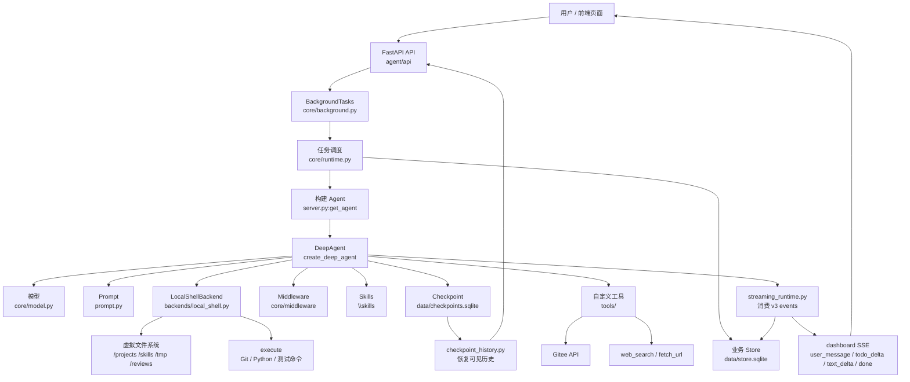

### 1.4 代码目录速览

```text
agent/
├─ app.py                    FastAPI 应用入口
├─ server.py                 当前 DeepAgent 工厂，最核心
├─ prompt.py                 系统提示词和任务提示词
├─ env_utils.py              环境变量加载
├─ api/                      FastAPI 路由与 Dashboard 适配
├─ core/                     runtime、streaming、settings、middleware、checkpoint
├─ backends/                 本地 Windows backend 和路径安全
├─ tools/                    Gitee、web_search、fetch_url、reviewer 等自定义工具
├─ store/                    业务 SQLite Store
├─ skills/                   DeepAgents skills
└─ memory/                   长期记忆文件
```

---

## 2. 第一步：搭建服务入口和配置加载

### 2.1 前置知识点

Agent 项目不是只有 Agent 本身，还需要一个服务入口把它变成可调用系统。

在本项目中：

| 层 | 文件 | 作用 |
|---|---|---|
| Web 服务入口 | `agent/app.py` | 创建 FastAPI app |
| 环境加载 | `agent/env_utils.py` | 加载 DeepSeek、Gitee、搜索等密钥 |
| 路径配置 | `agent/core/settings.py` | 配置 data、logs、workspace |
| 日志配置 | `agent/core/logging_config.py` | 配置控制台日志、全量后端日志、Agent 专用日志和按日期轮转 |
| 日志 API | `agent/api/routes.py` | 提供 `/api/logs/backend` 和 `/api/logs/agent` 读取日志 |

这一章的重点不是 FastAPI 语法，而是让学员理解一个真实 Agent 项目启动之前必须先准备好的基础设施：

| 基础设施 | 解决的问题 |
|---|---|
| `.env` 加载 | 模型密钥、Gitee token、搜索 key 从哪里来 |
| 路径集中配置 | SQLite、日志、工作区路径不能散落在各个文件里 |
| 日志系统 | Agent 运行时间长、工具调用多，必须能在控制台和文件中追踪 |
| 健康检查 | 服务启动后要有一个最小可验证入口 |
| 日志读取 API | 前端和课堂浏览器可以直接查看后端日志 |

### 2.2 开发顺序

一个初级 Agent 工程师应先写这些基础设施：

1. 写 `env_utils.py`，统一加载 `.env`。
2. 写 `settings.py`，固定项目数据目录和 Agent 工作区。
3. 写 `logging_config.py`，保证后续所有运行可追踪。
4. 写 `app.py`，启动 FastAPI 并挂载 API。
5. 写日志读取接口，方便页面和课堂直接查看日志。

课堂建议按这个顺序讲：

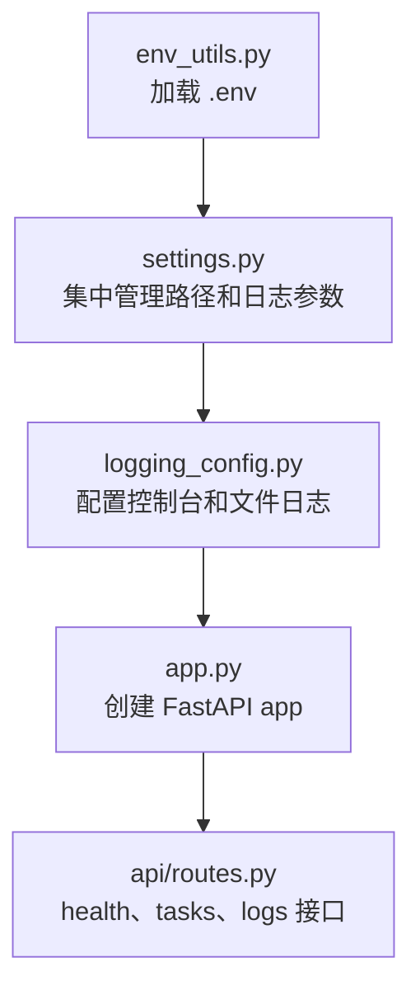

### 2.3 当前项目关键配置

| 配置 | 默认值 | 作用 |
|---|---|---|
| `PROJECT_ROOT` | 项目所在目录（由代码位置自动推导） | 当前教学项目源码目录 |
| `DATA_DIR` | `data/` | SQLite 数据目录 |
| `STORE_DB_PATH` | `data/store.sqlite` | 业务 Store |
| `CHECKPOINT_DB_PATH` | `data/checkpoints.sqlite` | LangGraph checkpoint |
| `LOG_DIR` | `logs/` | 日志目录 |
| `LX_AICODING_LOG_LEVEL` | `INFO` | 日志级别 |
| `LX_AICODING_LOG_RETENTION_DAYS` | `14` | 日志保留天数 |
| `LX_AICODING_LOG_WHEN` | `midnight` | 日志轮转周期 |
| `LX_AICODING_LOG_INTERVAL` | `1` | 日志轮转间隔，配合 `LX_AICODING_LOG_WHEN` 使用 |
| `WORKSPACE_ROOT` | `<AI_WORKSPACE_ROOT>` | Agent 真正操作用户仓库的工作区 |
| `PROJECTS_DIR` | `<AI_WORKSPACE_ROOT>\projects` | Gitee 仓库目录 |
| `SKILLS_DIR` | `<AI_WORKSPACE_ROOT>\skills` | DeepAgents skills 目录 |

其中日志相关配置都在 `agent/core/settings.py` 中集中定义：

| 函数或常量 | 作用 |
|---|---|
| `LOG_DIR` | 当前项目日志目录，默认是 `<项目目录>\logs` |
| `LOG_LEVEL` | 日志级别，非法配置会在 `logging_config.py` 中回退到 `INFO` |
| `LOG_ROTATION_WHEN` | 轮转时间点，默认 `midnight` |
| `LOG_ROTATION_INTERVAL` | 轮转间隔，默认 `1` |
| `LOG_RETENTION_DAYS` | 历史日志保留数量，默认 `14` |
| `backend_log_path()` | 返回 `backend.log` 或历史 `backend.log.YYYY-MM-DD` |
| `agent_log_path()` | 返回 `agent-runs.log` 或历史 `agent-runs.log.YYYY-MM-DD` |

### 2.4 日志系统改造后的设计

当前项目已经不是简单“每天生成一个日志文件”的手写方案，而是采用 Python 标准库 `TimedRotatingFileHandler` 做日志轮转。

日志文件分为两类：

| 日志文件 | 内容范围 | 用途 |
|---|---|---|
| `logs/backend.log` | 全量后端日志 | 排查 FastAPI、任务创建、API 请求、Store、工具异常等所有后端问题 |
| `logs/agent-runs.log` | 只记录 `agent.run.*` logger | 专门观察 Agent 执行链路、工具调用、中间件、流式事件 |

每天轮转后，标准库会生成历史文件：

| 当前文件 | 历史文件格式 |
|---|---|
| `backend.log` | `backend.log.YYYY-MM-DD` |
| `agent-runs.log` | `agent-runs.log.YYYY-MM-DD` |

举例：

```text
logs/
├── backend.log
├── backend.log.2026-07-10
├── agent-runs.log
└── agent-runs.log.2026-07-10
```

课堂讲解重点：

> 当前正在写入的日志文件名是固定的，历史日志才带日期后缀。这是 `TimedRotatingFileHandler` 的标准行为，也更容易控制保留天数。

### 2.5 `logging_config.py` 的核心逻辑

`agent/core/logging_config.py` 做了五件事：

| 步骤 | 代码点 | 说明 |
|---|---|---|
| 1 | `_configure_console_encoding()` | 尽量把控制台输出切换成 UTF-8，降低 Windows 中文乱码概率 |
| 2 | `_close_and_remove_handlers()` | 清理旧 handler，避免 reload 或测试时重复写日志 |
| 3 | `_make_timed_file_handler()` | 创建按时间轮转的文件日志 handler |
| 4 | `PrefixLoggerFilter("agent.run")` | 让 `agent-runs.log` 只接收 Agent 运行链路日志 |
| 5 | `configure_logging()` | 统一挂载 console、backend、agent 三类 handler |

伪代码可以这样讲：

```python
def configure_logging():
    # 1. 修正控制台编码，减少中文乱码
    configure_console_encoding()

    # 2. 准备 logs 目录
    LOG_DIR.mkdir(parents=True, exist_ok=True)

    # 3. 清理旧 handler，避免重复写日志
    close_and_remove_handlers(root_logger)

    # 4. 控制台输出所有日志
    root_logger.addHandler(console_handler)

    # 5. backend.log 写入全量后端日志
    root_logger.addHandler(backend_file_handler)

    # 6. agent-runs.log 只写入 agent.run.* 日志
    agent_file_handler.addFilter(PrefixLoggerFilter("agent.run"))
    root_logger.addHandler(agent_file_handler)
```

这里特别适合讲一个工程化思想：

> 不要在业务代码里到处手动写不同日志文件。应该通过 logger name 和 handler filter，把日志分流规则集中放在日志配置层。

### 2.6 为什么需要 `agent.run.*` 专用日志

Agent 运行时会产生很多不同类型的日志：

| 日志来源 | 示例 logger | 是否进入 `backend.log` | 是否进入 `agent-runs.log` |
|---|---|---|---|
| API 请求 | `agent.api` | 是 | 否 |
| 后台任务 | `agent.run.background` | 是 | 是 |
| runtime 调度 | `agent.run.runtime` | 是 | 是 |
| streaming 事件 | `agent.run.streaming` | 是 | 是 |
| shell 执行 | `agent.run.shell` | 是 | 是 |
| Gitee 工具 | `agent.run.gitee` | 是 | 是 |
| 中间件 | `agent.run.middleware.tool_error` | 是 | 是 |
| memory 加载 | `agent.memory` | 是 | 否 |

这样设计的好处：

| 好处 | 说明 |
|---|---|
| 全量问题看 `backend.log` | 服务启动、API 请求、配置加载、Store 失败都能看到 |
| Agent 问题看 `agent-runs.log` | 不被普通 API 日志干扰，排查任务执行更快 |
| 前端日志页面更清晰 | 可以分别展示后端日志和 Agent 执行日志 |
| 课堂复盘更方便 | 学员可以只看 Agent 运行链路 |

### 2.7 日志 API 如何读取文件

日志读取接口位于 `agent/api/routes.py`：

| API | 读取内容 |
|---|---|
| `/api/logs/backend` | 读取后端全量日志 |
| `/api/logs/agent` | 读取 Agent 执行日志 |

支持参数：

| 参数 | 示例 | 说明 |
|---|---|---|
| `limit` | `?limit=200` | 读取最近多少行 |
| `date` | `?date=2026-07-10` | 读取某一天的历史日志 |

示例：

```text
http://127.0.0.1:2024/api/logs/backend?limit=200
http://127.0.0.1:2024/api/logs/agent?limit=200
http://127.0.0.1:2024/api/logs/backend?date=2026-07-10
http://127.0.0.1:2024/api/logs/agent?date=2026-07-10
```

课堂讲解点：

> 日志 API 只暴露当前标准命名规则：当前文件是 `backend.log` / `agent-runs.log`，历史文件是 `.YYYY-MM-DD` 后缀。

### 2.8 日志系统在启动链路中的位置

`agent/app.py` 中会先调用：

```python
configure_logging()
```

然后再创建 FastAPI app。

启动顺序可以这样理解：

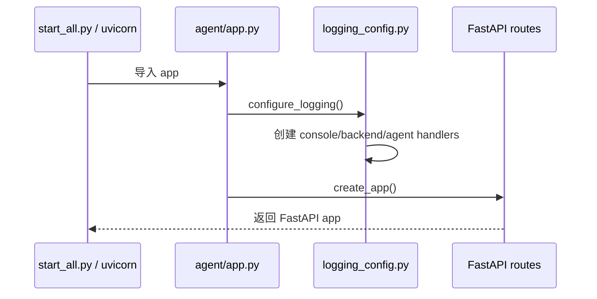

为什么日志配置要尽量靠前？

| 原因 | 说明 |
|---|---|
| 捕获启动期错误 | 配置、路由、数据库初始化失败也要能写入日志 |
| 避免重复 handler | reload 或测试时要先清理旧 handler |
| 保证格式统一 | 后续所有模块只需要 `logging.getLogger(...)` |

### 2.9 日志系统与控制台输出的关系

当前日志系统同时写两个地方：

| 输出位置 | 作用 |
|---|---|
| 控制台 | PyCharm、PowerShell、uvicorn 运行窗口实时查看 |
| 文件 | `logs/backend.log` 和 `logs/agent-runs.log` 持久化留痕 |

日志格式包含：

```text
时间 级别 [logger名称] [pid=进程号 thread=线程名] 消息
```

这样设计是为了排查三类问题：

| 问题 | 为什么需要 pid/thread |
|---|---|
| FastAPI 后台任务 | 同一个请求可能进入后台线程 |
| SSE 或轮询 | 前端可能频繁读取任务状态和日志 |
| Agent 工具调用 | shell、Gitee、streaming 事件可能交错出现 |

### 2.10 课堂演示建议

打开以下文件讲解：

```text
agent/app.py
agent/env_utils.py
agent/core/settings.py
agent/core/logging_config.py
agent/api/routes.py
```

建议按这个顺序演示：

1. 打开 `agent/core/settings.py`，说明 `LOG_DIR`、`backend_log_path()`、`agent_log_path()`。
2. 打开 `agent/core/logging_config.py`，说明三个 handler：console、backend file、agent file。
3. 重点讲 `PrefixLoggerFilter("agent.run")`，解释为什么 `agent-runs.log` 只记录 Agent 执行链路。
4. 打开 `agent/app.py`，说明为什么启动时先 `configure_logging()`。
5. 打开 `agent/api/routes.py`，说明 `/api/logs/backend` 和 `/api/logs/agent` 如何读取日志。
6. 启动服务后访问健康检查。
7. 再访问日志接口，观察返回结果。

健康检查：

```text
http://127.0.0.1:2024/health
```

日志接口：

```text
http://127.0.0.1:2024/api/logs/backend
http://127.0.0.1:2024/api/logs/agent
```

如果要演示历史日志读取，可以使用：

```text
http://127.0.0.1:2024/api/logs/backend?date=2026-07-10
http://127.0.0.1:2024/api/logs/agent?date=2026-07-10
```

### 2.11 为什么项目源码和 Agent 工作区要分开

课堂重点：

> `<项目目录>` 是教学项目本身；`<AI_WORKSPACE_ROOT>` 是 Agent 操作用户代码的工作区。两者分开，能降低 Agent 误改课程项目的风险。

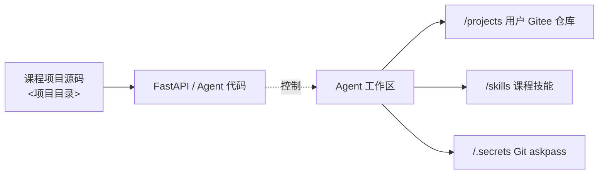

### 2.12 本章课堂总结

本章最后可以给学员总结三句话：

1. Agent 项目要先有服务入口、配置系统和日志系统，再谈智能体能力。
2. 当前日志系统采用“控制台 + 全量后端日志 + Agent 专用日志”的三路输出。
3. 日志文件使用 `TimedRotatingFileHandler` 自动按日期轮转，当前文件固定叫 `backend.log` / `agent-runs.log`，历史文件才带日期后缀。

---

## 3. 第二步：设计本地工作区和文件后端

### 3.1 前置知识点

DeepAgents 提供虚拟文件系统能力。官方文档中，Agent 可以通过 `ls`、`read_file`、`write_file`、`edit_file`、`glob`、`grep` 访问文件；如果 backend 支持 shell，还会出现 `execute`。

对于初级工程师，先记住：

| 概念 | 作用 |
|---|---|
| Backend | 文件和命令真正执行的位置 |
| Virtual filesystem | Agent 看到的是 `/projects/a.py` 这种虚拟路径 |
| Permission | 限制 Agent 可以读写哪些虚拟路径 |
| Sandbox | 给 `execute` 提供受控执行环境 |

### 3.2 为什么本项目要自定义 LocalShellBackend

DeepAgents 官方的 `LocalShellBackend` 直接操作宿主机，官方文档也提示它只适合受控开发环境。MY-AICODING 面向课堂和本地 Windows，因此自定义了 [agent/backends/local_shell.py](../agent/backends/local_shell.py)：

| 需求 | 项目实现 |
|---|---|
| Windows 路径兼容 | 把虚拟路径映射到 `<AI_WORKSPACE_ROOT>` |
| DeepAgents 文件协议 | 实现 `ls/read/write/edit/glob/grep` |
| 命令执行 | 实现 `execute` 和旧兼容 `run` |
| Gitee 认证 | 自动生成 askpass 文件，不把 token 写入命令 |
| 安全目录 | `/skills`、`/policies`、`/runtimes`、`/logs` 拒绝写入 |
| 旧代码兼容 | 保留 `read_file/write_file/list_files/run` |

### 3.3 LocalShellBackend 的核心优势和亮点

`LocalShellBackend` 是本项目的工程底座。它不是一个简单的 `subprocess.run()` 包装器，而是把 DeepAgents 文件后端、Windows 本地执行、Gitee 认证、安全边界和旧代码兼容封装到一个统一对象里。

| 亮点 | 解决的问题 | 对应代码位置 |
|---|---|---|
| DeepAgents 原生 backend 协议 | 让 `ls/read_file/write_file/edit_file/glob/grep/execute` 这些原生工具可用 | `LocalShellBackend(BaseSandbox)` |
| 虚拟路径映射 | 模型只看到 `/projects/demo`，不需要知道 Windows 真实盘符 | `_resolve_virtual_path()`、`_to_virtual_path()` |
| Windows 本地兼容 | 兼容 `<AI_WORKSPACE_ROOT>`、PowerShell、Git、Python venv、路径分隔符 | `__init__()`、`_normalize_compat_path()` |
| 工作区初始化 | 自动创建 `projects/skills/policies/reviews/runtimes/tmp/logs/.secrets` | `_ensure_layout()` |
| 默认策略文件 | 自动生成 workspace/git/security 策略说明 | `_ensure_policy_files()` |
| Gitee askpass | Git 操作自动认证，不把 token 拼进 clone URL 或命令 | `_ensure_gitee_askpass_files()`、`_execution_env()` |
| 命令安全防护 | 拦截危险命令、工作区外绝对路径、路径穿越 | `_deny_reason()`、`_prepare_run_command()` |
| 虚拟路径命令替换 | 命令里写 `/projects/repo` 时自动替换成本地真实路径 | `_virtual_command_path_replacement()` |
| token 脱敏 | 日志和工具返回中隐藏 Gitee token | `_mask_token()` |
| 旧接口兼容 | 保留旧版 runtime/pull-only 分支使用的 `run/list_files/read_file/write_file` | 兼容方法区域 |

课堂可以这样讲：

> 如果把 Agent 比作一个开发人员，`LocalShellBackend` 就是它的“电脑、文件系统、终端、凭据管理和安全边界”。没有这个 backend，模型只能说话，不能可靠地完成代码任务。

### 3.4 LocalShellBackend 的分层结构

`LocalShellBackend` 可以拆成四层理解：

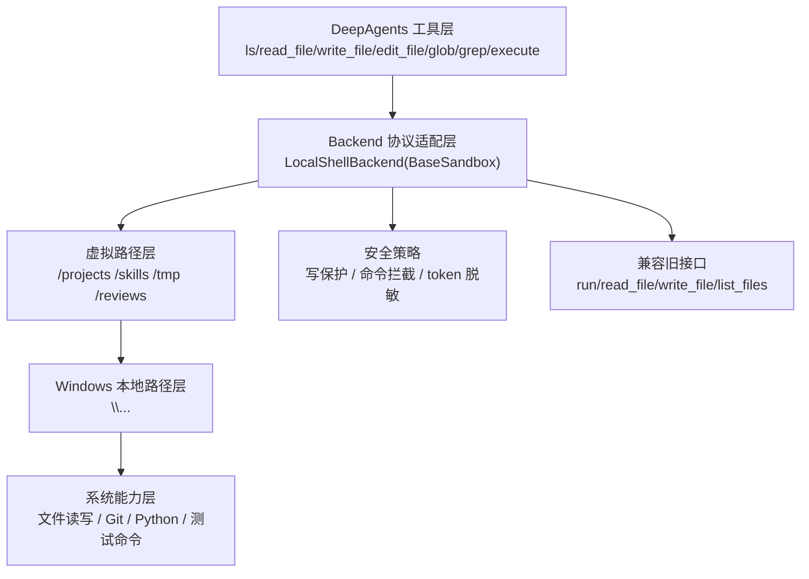

这张图要让学员理解：DeepAgents 调用的是统一 backend 协议，而不是直接操作 Windows 文件。

### 3.5 虚拟目录设计

| 虚拟路径 | 本地路径 | 写入策略 | 说明 |
|---|---|---|---|
| `/projects` | `<AI_WORKSPACE_ROOT>\projects` | 可写 | 用户 Gitee 仓库源码 |
| `/skills` | `<AI_WORKSPACE_ROOT>\skills` | 只读 | DeepAgents skills |
| `/policies` | `<AI_WORKSPACE_ROOT>\policies` | 只读 | 工作区策略 |
| `/reviews` | `<AI_WORKSPACE_ROOT>\reviews` | 可写 | 审查资料和输出 |
| `/runtimes` | `<AI_WORKSPACE_ROOT>\runtimes` | 只读 | 共享运行环境 |
| `/tmp` | `<AI_WORKSPACE_ROOT>\tmp` | 可写 | 临时文件 |
| `/logs` | `<AI_WORKSPACE_ROOT>\logs` | 只读 | 工作区日志 |
| `/.secrets` | `<AI_WORKSPACE_ROOT>\.secrets` | 禁止读写展示 | Git askpass 和敏感凭据 |

这套目录不是随意设计的。它把 Agent 能处理的内容分成几类：

| 类型 | 目录 | 工程意义 |
|---|---|---|
| 业务源码 | `/projects` | Agent 真正开发、测试、提交的地方 |
| 能力资料 | `/skills` | 给 Agent 看的专业流程，默认只读 |
| 规则资料 | `/policies` | 工作区、Git、安全规则，默认只读 |
| 输出资料 | `/reviews`、`/tmp` | 允许 Agent 写审查结果和临时文件 |
| 运行环境 | `/runtimes` | Python/Node 等共享环境，不允许模型随意改 |
| 敏感信息 | `/.secrets` | 只给 backend 使用，不给模型读取 |

### 3.6 文件后端调用关系

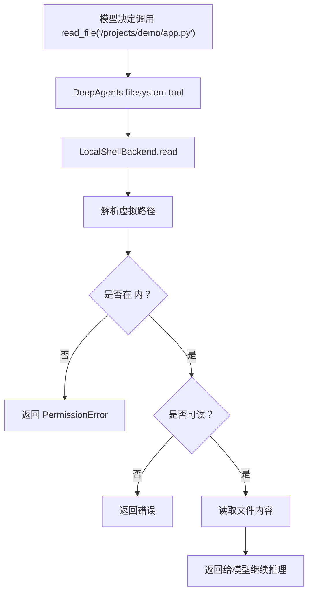

### 3.7 DeepAgents permissions 是什么

DeepAgents permissions 是传给 `create_deep_agent(..., permissions=[...])` 的声明式文件权限规则。它主要控制 DeepAgents 原生文件工具能对哪些虚拟路径执行读写操作。

官方概念可以简化为：

| 字段 | 含义 |
|---|---|
| `operations` | 控制 `read`、`write` 或两者 |
| `paths` | 虚拟路径 glob，例如 `/projects/**` |
| `mode` | `allow` 或 `deny` |
| 匹配顺序 | 按规则顺序匹配，先匹配先生效 |

课堂重点：

> permissions 管的是 DeepAgents 文件工具的可见能力；backend 管的是最终本地路径和命令执行安全。两者不能互相替代。

### 3.8 当前项目的主 Agent permissions

当前主 Agent 权限在 [agent/server.py](../agent/server.py) 的 `_agent_filesystem_permissions()` 中定义。

| 规则顺序 | operations | paths | mode | 工程含义 |
|---:|---|---|---|---|
| 1 | `read` | `/projects/**`、`/skills/**`、`/policies/**`、`/reviews/**`、`/runtimes/**`、`/logs/**`、`/tmp/**` | allow | 主 Agent 可以读取这些工作区资料 |
| 2 | `write` | `/projects/**`、`/reviews/**`、`/tmp/**` | allow | 主 Agent 可以改业务源码、写审查资料和临时文件 |
| 3 | `write` | `/skills/**`、`/policies/**`、`/runtimes/**`、`/logs/**` | deny | 防止模型修改技能、策略、运行环境和日志 |
| 4 | `read/write` | `/**` | deny | 默认拒绝未显式授权路径 |

用 Mermaid 表示：

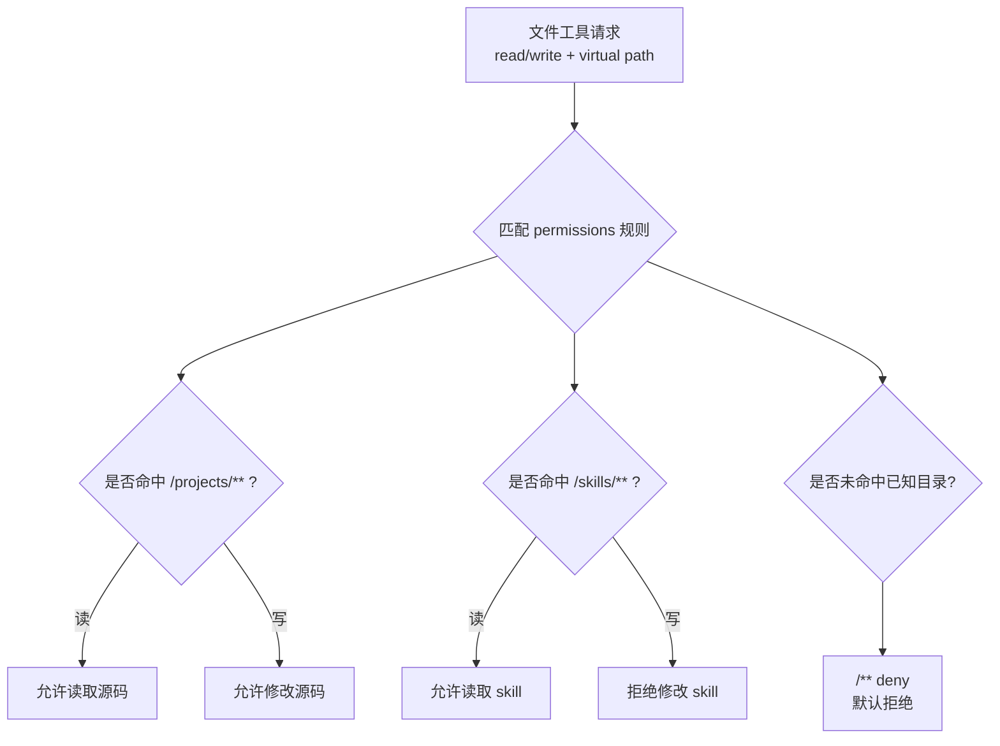

### 3.9 子 Agent permissions 为什么更窄

当前项目还为 general-purpose subagent 设置了单独权限。子 Agent 可以读 `/projects`，但不能写 `/projects`。

| 角色 | `/projects` 读 | `/projects` 写 | 设计目的 |
|---|---:|---:|---|
| 主 Agent | 允许 | 允许 | 负责最终开发实现 |
| 子 Agent | 允许 | 禁止 | 只做分析和建议，避免并行子任务误改源码 |

课堂解释：

> 子 Agent 适合读代码、总结结构、提出建议；真正修改文件的权力应该留给主 Agent。这样主流程更可控，责任边界更清晰。

### 3.10 本项目如何基于 DeepAgents permissions 工程化落地

可以把落地过程拆成 7 步：

| 步骤 | 工程动作 | 当前项目文件 |
|---:|---|---|
| 1 | 先定义工作区根目录，明确 Agent 只能操作 `<AI_WORKSPACE_ROOT>` | `core/settings.py` |
| 2 | 设计虚拟目录，把源码、技能、策略、日志、临时文件分开 | `backends/local_shell.py` |
| 3 | 在 backend 中实现虚拟路径到真实路径的安全解析 | `_resolve_virtual_path()` |
| 4 | 在 backend 中给敏感目录和只读目录加硬防护 | `_write_deny_reason()` |
| 5 | 在 `server.py` 中声明主 Agent 文件权限 | `_agent_filesystem_permissions()` |
| 6 | 在 `server.py` 中声明子 Agent 更窄的文件权限 | `_general_purpose_subagent()` |
| 7 | 用 middleware 在工具调用前清洗路径，减少错误调用 | `core/middleware/tool_sanitize.py` |

这个落地过程体现了三层边界：

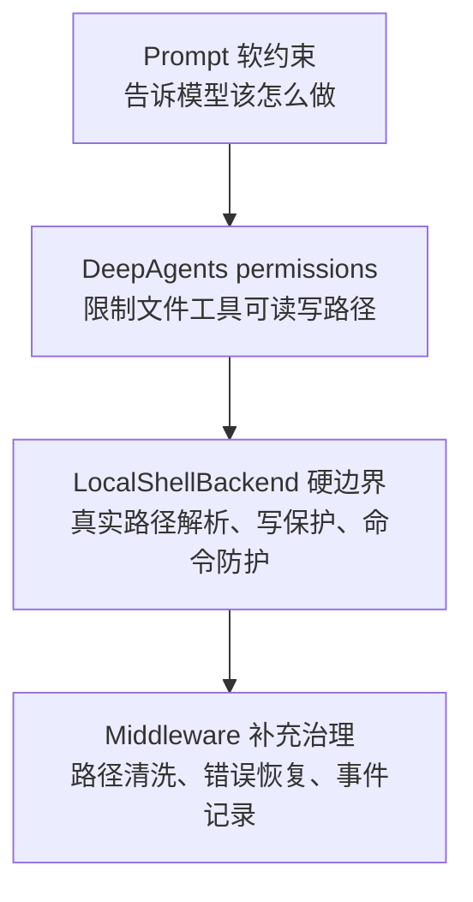

### 3.11 permissions 与 backend 的边界

| 能力 | DeepAgents permissions | LocalShellBackend |
|---|---|---|
| 控制 `read_file/write_file/edit_file` 能否读写某路径 | 主要负责 | 最终兜底 |
| 控制虚拟路径映射到哪个 Windows 目录 | 不负责 | 负责 |
| 控制 `execute` 命令能否访问系统路径 | 不足以负责 | 必须负责 |
| 防止写 `.secrets` | 可以通过 deny 辅助 | 必须硬防护 |
| Gitee token 注入和脱敏 | 不负责 | 负责 |
| 旧工具兼容 | 不负责 | 负责 |

课堂强调：

> permissions 是 DeepAgents 层的权限声明；backend 是本地执行层的安全边界。工程落地时两层都要写，不能只写其中一层。

### 3.12 execute 的课堂重点

`execute` 是风险最大的能力，因为它允许模型运行 shell 命令。

本项目通过多层防护降低风险：

| 防护点 | 实现位置 |
|---|---|
| 工作目录固定 | `LocalShellBackend.execute()` 默认在 projects 附近执行 |
| 虚拟路径替换 | `_virtual_command_path_replacement()` |
| 危险命令拦截 | `_deny_reason()` |
| 旧命令白名单 | `permissions.py:normalize_safe_command()` |
| Git token 注入 | `_execution_env()` + `.secrets/gitee_askpass.*` |
| token 脱敏 | `_mask_token()` |

### 3.13 课堂提醒

不要把“文件权限”理解成唯一安全边界。DeepAgents permissions 只控制文件工具；`execute` 能做更多事，所以还必须在 backend 自己做命令和路径防护。

---

## 4. 第三步：接入模型

### 4.1 前置知识点

Agent 的核心循环需要一个聊天模型。LangChain Agent 和 DeepAgents 都可以接收模型标识或已经初始化的模型对象。

MY-AICODING 使用 OpenAI-compatible 调用方式接入 DeepSeek：

```text
agent/core/model.py
```

### 4.2 当前模型配置

| 字段 | 当前设置 |
|---|---|
| 模型类 | `langchain_openai.ChatOpenAI` |
| 默认模型 | `deepseek-v4-pro` |
| API Key | `DEEPSEEK_API_KEY` |
| Base URL | `DEEPSEEK_BASE_URL` |
| max_tokens | `25600` |
| streaming | `True` |
| thinking | disabled |

### 4.3 代码讲解点

```python
def make_main_model() -> ChatOpenAI:
    return ChatOpenAI(
        model=get_env("MAIN_MODEL", "deepseek-v4-pro"),
        temperature=1.1,
        openai_api_key=require_env("DEEPSEEK_API_KEY"),
        openai_api_base=require_env("DEEPSEEK_BASE_URL"),
        max_tokens=DEEPSEEK_V4_MAX_TOKENS,
        streaming=True,
        extra_body={"thinking": {"type": "disabled"}},
    )
```

讲给初级工程师的重点：

1. 模型不是 Agent 的全部，只是 Agent Loop 的决策器。
2. `streaming=True` 不等于前端自动流式展示，还需要后续解析事件。
3. `require_env()` 让关键配置缺失时尽早失败。

---

<!-- LX-COURSE-DETAIL-4 START -->

### 4.4 课堂详细讲义补充：模型接入不是简单传一个 API Key

很多初级程序员第一次接模型时，会把重点放在“怎么把 API Key 填进去”。但在 AI Coding Agent 项目里，模型接入至少要回答四个问题：

| 问题 | 为什么重要 |
|---|---|
| 使用哪个模型 | 影响推理能力、工具调用稳定性、上下文长度和费用 |
| 模型如何初始化 | 影响后续是否能替换供应商、是否能统一配置 |
| 模型错误如何暴露 | 余额不足、鉴权失败、限流失败都要让前端和日志看得懂 |
| 模型调用如何被限制 | 防止复杂任务进入无限循环，触发大量费用或长时间卡住 |

当前项目接入的是 `deepseek-v4-pro`，配置来自 `.env`。课程中可以强调：`.env` 不是“业务配置文件”，而是“本地运行时凭证和环境参数”，不能提交到公开仓库。

### 4.5 推荐开发顺序

| 顺序 | 要做的事 | 对应文件 |
|---|---|---|
| 1 | 定义模型配置字段，例如模型名、base_url、api_key | `.env`、`agent/core/config.py` |
| 2 | 编写模型初始化函数 | `agent/core/model.py` |
| 3 | 在 Agent 工厂中引用模型 | `agent/core/agent_factory.py` |
| 4 | 给模型调用加运行保护 | `agent/core/middleware/model_call_limit.py`、`agent/core/streaming_runtime.py` |
| 5 | 在日志中记录模型名，不记录密钥 | `agent/core/logging_config.py` |

课堂讲解时建议先从 `.env` 讲起，再讲 `model.py`，最后讲 Agent 工厂。这样学生能理解“配置 -> 模型对象 -> Agent 实例”的链路。

### 4.6 模型初始化伪代码

```python
def get_chat_model():
    config = load_settings()
    return ChatModel(
        model=config.model_name,
        api_key=config.api_key,
        base_url=config.base_url,
        temperature=config.temperature,
    )
```

这段伪代码要讲清楚两点：

1. `get_chat_model()` 不应该到处散落。模型初始化应该集中在一个文件里，方便后续替换模型。
2. 不能在代码里写死真实密钥。密钥只能来自 `.env` 或运行环境变量。

### 4.7 是否应该改用 `init_chat_model`

如果项目使用的是 `langchain==1.3`，可以考虑逐步迁移到 `init_chat_model`。它的优点是初始化接口更统一，未来切换不同模型供应商时更容易。

| 方案 | 优点 | 注意点 |
|---|---|---|
| 继续使用当前封装 | 改动小，稳定，适合教学第一版 | 不同模型供应商可能需要分别适配 |
| 使用 `init_chat_model` | 接口统一，贴近 LangChain 新版本推荐写法 | 需要确认 deepseek-v4-pro 的 provider、base_url、streaming 参数都兼容 |

课堂上可以这样表达：第一版先保证跑通，第二版再做模型初始化抽象升级。不要在教学项目早期同时改模型层、Agent 工厂、流式输出和工具层，否则学生很难定位问题。

### 4.8 模型错误的课堂案例

常见错误可以分成三类：

| 错误 | 表现 | 课堂解释 |
|---|---|---|
| API Key 错误 | 401 或鉴权失败 | `.env` 没加载、变量名写错、密钥无效 |
| 余额不足 | 402 `Insufficient Balance` | 模型服务可访问，但账户不可继续调用 |
| 上下文或调用超限 | 任务长时间运行，触发保护上限 | Agent 循环没有收敛，需要优化记忆、skills 和任务拆解 |

模型错误不应该只出现在后端堆栈中。当前项目通过运行事件和最终总结把错误显示到前端，同时日志记录详细上下文，方便课堂排查。

### 4.9 本章 Mermaid 图

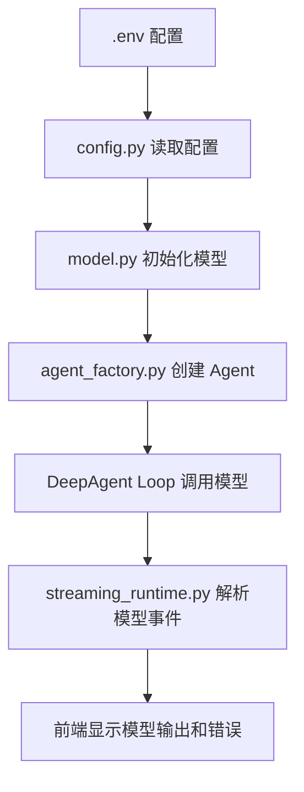

### 4.10 本章小结

模型层的职责不是“能调通一次大模型”这么简单，而是要做到：配置集中、凭证安全、错误可见、可替换、可观测。AI Coding Agent 的稳定性，很大一部分取决于模型层是否被工程化封装。

### 4.11 讲师版展开：模型层在整个 Agent 中的位置

课堂上不要把模型层讲成“调用大模型 API”。在当前项目中，模型层是 Agent Loop 的决策入口。模型每次被调用时，会读取系统提示词、用户消息、checkpoint 历史、仓库记忆、工具返回结果，再决定下一步是继续思考、调用工具、输出方案，还是结束任务。

可以用下面的顺序讲：

| 顺序 | 讲解内容 | 学员应该理解 |
|---:|---|---|
| 1 | 模型不是单独回答问题，而是在 Agent Loop 里反复被调用 | Agent 不是一次请求一次回答 |
| 2 | 模型输出可能是自然语言，也可能是工具调用 | Coding Agent 的动作来自工具调用 |
| 3 | `streaming=True` 只打开模型流式能力 | 前端流式展示还需要事件解析层 |
| 4 | 模型错误必须变成用户可见状态 | 不能只在后端日志里报错 |
| 5 | 模型调用次数要限制 | 防止复杂任务进入无限循环 |

### 4.12 当前模型层的工程边界

`agent/core/model.py` 只做模型对象初始化，不应该承担任务分类、Prompt 拼接、工具注册和前端事件处理。

| 不应该放在模型层 | 应该放在哪里 |
|---|---|
| 判断用户是不是 coding 任务 | `agent/core/task_intent.py` |
| 拼接“是否确认实施方案”的规则 | `agent/core/runtime.py`、`agent/prompt.py` |
| 注册 Gitee 工具和 reviewer 工具 | `agent/server.py` |
| 解析 DeepAgents v3 事件 | `agent/core/streaming_runtime.py` |
| 处理前端 SSE | `agent/api/dashboard_routes.py` |

这个边界很重要。否则模型初始化文件会越来越臃肿，最后变成“什么都放一点”的杂物文件。

### 4.13 `init_chat_model` 改造后的讲解方式

如果项目已经改成 LangChain 新版本推荐的 `init_chat_model`，讲课时可以这样解释：

```python
model = init_chat_model(
    model="deepseek-v4-pro",
    model_provider="openai",
    api_key=api_key,
    base_url=base_url,
    streaming=True,
)
```

注意这里的 `model_provider="openai"` 不是说使用 OpenAI 官方模型，而是说明 DeepSeek 暴露的是 OpenAI-compatible 接口。很多国产模型、企业网关、私有模型服务都会采用这种接口形式。

| 参数 | 课堂解释 |
|---|---|
| `model` | 具体模型名称，例如 `deepseek-v4-pro` |
| `model_provider` | LangChain 用来选择适配器的 provider |
| `base_url` | 模型服务地址，来自 `.env` |
| `api_key` | 鉴权密钥，不能写死在代码中 |
| `streaming` | 允许模型端按 chunk 返回内容 |

### 4.14 为什么要禁用 thinking 输出

当前项目面向教学和前端展示，需要输出清晰、稳定、中文的方案和总结。如果模型服务支持额外的 thinking 字段，建议禁用或隐藏。原因是：

| 原因 | 说明 |
|---|---|
| 降低前端噪音 | 用户不需要看到模型内部碎片化推理 |
| 减少格式污染 | thinking 内容可能不是 Markdown 正文 |
| 降低 token 消耗 | 不把冗长过程暴露给前端 |
| 方便课堂讲解 | 页面只展示任务计划、关键过程和最终结论 |

课堂上可以强调：我们不是不要“思考”，而是不把内部思考原样展示给用户。对用户有价值的是方案、依据、步骤、风险和结论。

### 4.15 模型层课堂演示脚本

建议课堂演示按下面步骤：

1. 打开 `.env`，只展示变量名，不展示真实密钥。
2. 打开 `agent/core/model.py`，说明模型名、base_url、streaming、max_tokens。
3. 打开 `agent/server.py`，说明模型对象如何进入 `create_deep_agent`。
4. 提交一个简单 QA 任务，观察模型只回答问题。
5. 提交一个 planning 任务，观察模型流式输出技术方案。
6. 故意改错 API Key 或使用无余额 key，说明错误如何出现在前端和日志里。

### 4.16 本章学生容易误解的点

| 误解 | 正确理解 |
|---|---|
| 换模型只改一个模型名就行 | 还要确认 provider、base_url、tool calling、streaming、上下文长度兼容 |
| streaming=True 后前端自然会流式 | 还需要后端消费事件流、前端处理 SSE |
| API Key 可以放代码里方便教学 | 不能。教学项目更要演示规范做法 |
| 模型越强就不需要 Prompt 和工具治理 | 模型只是决策器，工程边界仍然靠 Prompt、backend、permissions、中间件 |

<!-- LX-COURSE-DETAIL-4 END -->

## 5. 第四步：编写 Prompt 和任务规则

这一章讲 Agent 的“行为规则层”。学生需要理解：Prompt 不是简单的一段提示词，而是把项目规则、任务类型、长期上下文、工具使用边界组合成一个可维护的运行协议。

### 5.1 本步骤的开发目标

| 目标 | 说明 |
|---|---|
| 明确 Agent 角色 | 当前项目是面向 Gitee 仓库的 AI Coding Agent，不是通用聊天机器人 |
| 固定安全边界 | 只处理 Gitee 仓库，只在工作区内读写文件，不能碰 `.secrets` 等敏感目录 |
| 区分任务类型 | 编码任务、方案任务、问答任务、仓库分析任务的执行方式不同 |
| 支持人类确认 | 技术方案类任务先输出方案并询问“是否确认实施该方案？” |
| 支持中文教学 | 除代码、路径、命令、API 名称外，Agent 对用户输出必须是中文 |

### 5.2 相关核心文件

| 文件 | 作用 |
|---|---|
| `agent/prompt.py` | 定义主 Agent 的系统提示词和任务规则 |
| `agent/core/task_intent.py` | 判断用户指令属于编码、方案、问答、仓库分析等哪类任务 |
| `agent/core/runtime.py` | 根据任务类型组织运行流程，决定是否进入方案生成或代码实施 |
| `agent/core/middleware/context_injection.py` | 运行前把仓库级记忆注入 Agent 上下文 |
| `agent/server.py` | FastAPI 服务入口，接收前端请求并触发 Agent 运行 |
| `<AI_WORKSPACE_ROOT>\skills` | DeepAgents 原生 skills 目录，存放可被 Agent 读取的技能说明 |

### 5.3 Prompt 的分层设计

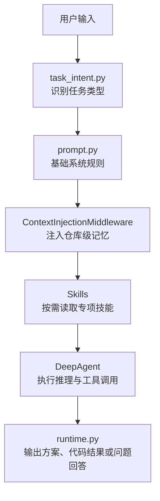

课堂讲解时可以强调：`prompt.py` 负责“稳定规则”，中间件负责“运行时上下文”，skills 负责“专项流程”，用户输入负责“本轮目标”。这四类信息不要混在一个超长提示词里。

### 5.4 基础系统规则应该包含什么

| 规则类别 | 讲解重点 |
|---|---|
| 平台规则 | 第一版只考虑 Gitee 仓库，不考虑 GitHub、GitLab 等其他平台 |
| 工作区规则 | Agent 看到的是 `<AI_WORKSPACE_ROOT>`，仓库应位于 `/projects/<repo_name>` |
| 中文输出规则 | 面向中文教学场景，过程解释、最终回答、错误说明都必须使用中文 |
| 安全规则 | 不能读取或输出 `.env`、`.secrets`、token、私钥等敏感信息 |
| 方案优先规则 | 用户提出较复杂代码需求时，先给技术方案，确认后再实施 |
| 工具规则 | 能通过文件后端完成的文件操作，优先走 DeepAgents backend 暴露的工具 |
| 测试规则 | 代码修改后要运行相关测试，失败时继续分析并尝试修复 |
| Gitee 规则 | 分支、提交、推送、Pull Request 都以 Gitee 为目标平台 |

### 5.5 为什么必须先做任务分类

如果所有用户输入都按照“写代码”处理，会出现三个问题：

| 问题 | 表现 |
|---|---|
| 简单问答被过度执行 | 用户只是问目录结构，Agent 却开始创建分支、写代码、提交 PR |
| 技术方案被直接实施 | 用户想先讨论方案，Agent 直接改文件，教学时不可控 |
| 工具调用次数暴涨 | Agent 反复分析仓库、运行测试、读同一批文件，容易触发运行保护上限 |

因此项目里通过 `task_intent.py` 先做任务分类。课堂上可以把它理解成 Agent 的“入口分流器”。

### 5.6 当前推荐的任务类型

| 类型 | 典型用户输入 | 推荐行为 |
|---|---|---|
| `qa` | “当前项目有哪些目录？” | 读取必要上下文后直接回答，不改代码，不创建 PR |
| `planning` | “给我一个改造 SQLite 的方案” | 读取仓库，输出完整方案，最后询问是否确认实施 |
| `coding` | “确认实施”“帮我写用户模块” | 创建或复用分支，修改代码，运行测试，提交并创建 PR |
| `analysis` | “帮我分析这个仓库结构” | 读取文件结构，整理结论，不做代码修改 |
| `review` | “帮我 review 这个 PR” | 读取 diff 和上下文，输出审查意见 |

### 5.7 技术方案任务的提示词要求

方案任务和编码任务最大的区别是：它必须输出可读、完整、可确认的方案，而不是直接改代码。

| 部分 | 内容 |
|---|---|
| 需求理解 | 用自己的话复述用户想做什么 |
| 当前结构 | 列出已经读取到的关键文件和模块关系 |
| 改造目标 | 明确要新增、修改、保持不变的内容 |
| 数据结构 | 如果涉及数据存储，说明表结构、字段、约束或文件格式 |
| 接口设计 | 如果涉及后端，说明路由、请求、响应、鉴权方式 |
| 页面影响 | 如果涉及前端，只说明对接点，不展开前端源码 |
| 测试策略 | 说明应该新增哪些测试、回归哪些测试 |
| 风险点 | 说明兼容性、数据迁移、权限、并发等风险 |
| 确认语 | 结尾询问：`是否确认实施该方案？` |

方案类任务不要把方案保存到 SQLite，也不要保存成 Markdown 文件。当前项目已经改成通过 `AI/assistant message` 流式输出到前端，用户确认后再进入编码实现。

### 5.8 编码任务的提示词要求

编码任务应当更强调执行闭环：

1. 定位仓库和分支。
2. 读取仓库级记忆，避免重复分析。
3. 根据用户确认的方案制定任务清单。
4. 只修改必要文件。
5. 运行最小相关测试。
6. 如果测试失败，分析原因并继续修复。
7. 全部通过后提交、推送、创建或复用 Gitee Pull Request。
8. 最后总结修改清单、测试结果、分支和 PR 地址。

课堂上可以说明：这个过程就是一个典型的 Coding Agent Loop。它不是一次模型调用解决问题，而是“计划、工具调用、观察、修复、验证、总结”的循环。

### 5.9 Prompt、记忆、Skills、中间件的分工

| 组件 | 存放什么 | 不应该存放什么 |
|---|---|---|
| `prompt.py` | 稳定规则、角色定位、安全边界 | 某个仓库的临时结构细节 |
| 仓库级记忆 | 仓库结构、测试命令、启动命令、关键模块、最近结论 | 一次性聊天内容、敏感信息 |
| Skills | 某类任务的标准流程，例如仓库分析、编码实施、代码审查 | 当前任务的具体用户需求 |
| Middleware | 运行时拦截、上下文注入、错误恢复、记忆更新 | 大段业务方案正文 |
| Checkpoint | 对话状态和 LangGraph 运行状态 | 可长期复用的仓库知识 |

### 5.10 课堂建议讲法

讲这一章时，不建议先展示很长的 Prompt。可以按下面顺序讲：

1. 先展示一个用户输入：“把用户数据改成 SQLite”。
2. 让学生判断：这是方案任务还是编码任务？
3. 打开 `task_intent.py`，说明任务分类。
4. 打开 `prompt.py`，说明基础规则如何约束 Agent。
5. 打开 `context_injection.py`，说明仓库记忆如何进入上下文。
6. 打开前端页面，演示方案流式输出和“是否确认实施该方案？”。

<!-- LX-COURSE-DETAIL-5 START -->

### 5.11 课堂详细讲义补充：Prompt 是 Agent 的运行协议

在普通聊天机器人里，Prompt 通常是一段角色描述。但在 AI Coding Agent 中，Prompt 更像一份“运行协议”。它规定模型在面对不同任务时应该怎么行动、什么时候能改代码、什么时候必须先输出方案、什么时候要停止并询问用户。

可以用下面这句话给学生建立直觉：

> Prompt 不是让模型“更会说话”，而是让模型“按项目规则工作”。

### 5.12 Prompt 的四层结构

| 层级 | 内容 | 当前项目来源 |
|---|---|---|
| 全局角色层 | 你是 MY-AICODING，服务于 Gitee 仓库代码任务 | `agent/prompt.py` |
| 安全边界层 | 只处理 Gitee、禁止泄露密钥、禁止越权路径 | `agent/prompt.py`、permissions、中间件 |
| 任务类型层 | qa、planning、coding、analysis、review 的不同规则 | `agent/core/task_intent.py` |
| 运行上下文层 | 当前仓库、仓库记忆、分支、PR、工作区路径 | `runtime.py`、`ContextInjectionMiddleware` |

课堂上要提醒学生：不要把所有规则都写进一个巨大字符串里。随着项目复杂度增加，Prompt 必须模块化，否则后期维护会非常困难。

### 5.13 方案任务和编码任务的关键差异

| 对比项 | 方案任务 | 编码任务 |
|---|---|---|
| 是否改代码 | 不改 | 改 |
| 是否提交 PR | 不提交 | 成功后提交 |
| 是否必须测试 | 只提出测试策略 | 必须尽量运行测试 |
| 输出重点 | 技术设计、风险、步骤 | 修改清单、测试结果、分支和 PR |
| 结束语 | `是否确认实施该方案？` | 总结本轮完成情况 |

这也是当前项目“人类确认”的核心。学生要理解：在真实项目中，AI 不应该看到一个复杂需求就直接动手改代码。先生成方案可以降低误改风险，也方便讲师在课堂中暂停解释。

### 5.14 Prompt 中必须强调中文输出

当前项目面向中文课堂，所以 Prompt 中要求：

- 普通解释必须中文。
- 任务计划必须中文。
- 错误说明必须中文。
- 最终总结必须中文。
- 代码、路径、命令、变量名、API 名称可以保留英文。

这个规则不能只放在前端，也不能只靠用户每次提醒。它必须进入系统提示词和相关 skills。否则模型在长任务中很容易因为读到英文源码、英文测试输出、英文工具结果而切回英文。

### 5.15 Prompt 与工具权限的配合

Prompt 可以告诉模型“不要访问工作区外路径”，但真正阻止危险行为的是 backend 和 permissions。

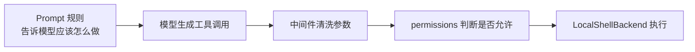

课堂重点：Prompt 是软约束，permissions 和 backend 是硬约束。工程化 Agent 必须两者都有。

### 5.16 任务计划为什么由 `write_todos` 驱动

当前项目不再用固定任务计划模板，而是让 Agent 根据真实任务调用 DeepAgents 的 `write_todos`。这样有三个好处：

| 好处 | 说明 |
|---|---|
| 更贴合用户需求 | 简单问答不会强行出现“改代码、测试、提交 PR” |
| 能追踪状态 | 前端可以展示每一步是否完成 |
| 更接近 Codex 风格 | 先列计划，再逐步执行，再总结结果 |

要提醒学生：任务计划不是装饰 UI，而是 Agent Loop 的可视化。它能帮助用户判断 Agent 是否走偏。

### 5.17 常见 Prompt 设计错误

| 错误写法 | 后果 | 推荐做法 |
|---|---|---|
| 规则太笼统 | 模型不知道什么时候改代码 | 明确区分 planning 和 coding |
| 全部写成自然语言 | 后期难维护 | 用分区、列表、固定格式 |
| 只写“不要泄露密钥” | 工具仍可能读到敏感文件 | 配合 permissions 和参数清洗 |
| 不要求中文 | 长任务中容易混入英文解释 | Prompt、skills、最终总结都要求中文 |
| 不要求测试 | Agent 可能只写代码不验证 | 编码任务必须运行相关测试 |

### 5.18 本章课堂练习

可以给学生三个输入，让他们判断任务类型：

| 用户输入 | 预期类型 | 原因 |
|---|---|---|
| “当前项目有哪些 API？” | `qa` 或 `analysis` | 只需要读取和回答 |
| “把用户存储改成 SQLite，先给方案” | `planning` | 用户明确要方案 |
| “确认实施上面的方案” | `coding` | 用户已经确认，可以改代码 |

这个练习能帮助学生理解：Agent 的行为不是由模型自由发挥，而是由任务分类和 Prompt 共同约束。

### 5.19 技术方案输出为什么不应该包含大段源码

当前项目已经明确：方案任务只输出设计、影响范围、步骤和风险，不直接输出大段可复制源码。原因是方案阶段的目标不是“马上写代码”，而是让用户确认方向。

| 方案阶段应该输出 | 方案阶段不应该输出 |
|---|---|
| 要改哪些文件 | 完整函数实现 |
| 新增哪些接口 | 大段类定义代码 |
| 数据结构如何变化 | 可直接粘贴的迁移脚本 |
| 测试怎么验证 | 完整测试文件 |
| 风险和取舍 | 过细的逐行实现 |

课堂上可以这样说：

> 技术方案要让人确认“改什么、为什么、怎么验证”，不是替代 coding 阶段。真正写代码要等用户确认后交给 coding 流程。

### 5.20 Prompt 与用户确认的配合

“是否确认实施该方案？”不是普通结束语，而是一个产品协议。它让系统从 planning 阶段进入 coding 阶段。

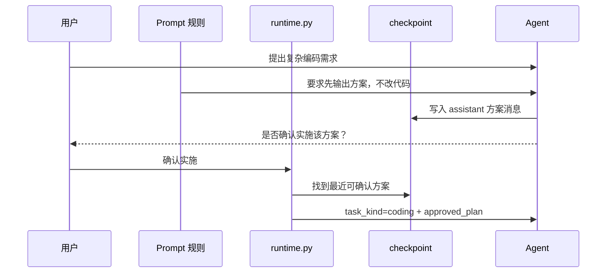

这里要强调：确认实施不是只靠模型理解，而是 runtime 层参与判断。Prompt 提供行为规则，runtime 提供流程保证。

### 5.21 任务类型和权限的关系

任务分类不是为了 UI 标签，而是影响权限和执行路径。

| task_kind | Prompt 规则 | 工具权限倾向 | runtime 行为 |
|---|---|---|---|
| `qa` | 简洁回答 | 只读 | 不改代码，不 PR |
| `analysis` | 分析结构 | 只读 | 可以读较多文件 |
| `planning` | 输出方案 | 只读 | 方案流式输出，等待确认 |
| `coding` | 实施修改 | 可写 `/projects` | 测试、提交、PR |
| `review` | 审查 PR | 只读 + findings 写入 | 输出审查报告 |

这张表适合放到课堂上反复引用。学生只要理解 task_kind，就能理解后面 runtime、middleware、permissions 为什么这么设计。

### 5.22 Prompt 中的中文输出规则如何落地

仅在 Prompt 写“请用中文”还不够，项目里需要多处配合：

| 位置 | 作用 |
|---|---|
| `agent/prompt.py` | 定义全局中文输出规则 |
| `agent/skills/*/SKILL.md` | 每类专项任务也要求中文输出 |
| `streaming_runtime.py` | 过滤或折叠无价值英文过程提示 |
| `message_sanitize.py` | 清理不适合发给模型的历史消息 |
| 前端 Markdown 展示 | 保留代码、路径、API 名称的英文格式 |

课堂提醒：中文输出不是“翻译所有英文”。代码文件名、路径、命令、API 名称本来就应该保留英文，否则工程语义会丢失。

### 5.23 本章课堂演示脚本

可以准备四个输入：

| 输入 | 预期效果 |
|---|---|
| `当前项目的记忆文件内容是什么？` | `qa`，直接回答，不出现“是否确认实施” |
| `帮我分析一下项目目录结构` | `analysis`，读取必要文件后输出结构分析 |
| `帮我给用户模块增加权限管理，先出方案` | `planning`，输出方案，最后询问确认 |
| `确认实施` | `coding`，读取上一轮方案，开始修改代码 |

这个演示能把 Prompt、task_intent、runtime、checkpoint 串起来。

### 5.24 Prompt 调试清单

当 Agent 行为不符合预期时，可以按下面顺序排查：

1. 任务是否被 `task_intent.py` 分错类。
2. 当前 task_kind 对应的 Prompt 是否正确。
3. runtime 是否把 coding 强制转成 planning。
4. checkpoint 中是否能找到上一轮技术方案。
5. skill 是否同步到了 `<AI_WORKSPACE_ROOT>\skills`。
6. 中间件是否注入了旧上下文或错误上下文。

### 5.25 本章小结

Prompt 是行为协议，task_kind 是流程开关，runtime 是执行守门员。三者配合后，Agent 才不会把简单问答当成代码任务，也不会在没有用户确认时贸然修改仓库。

<!-- LX-COURSE-DETAIL-5 END -->

## 6. 第五步：引入长期记忆和 Skills

这一章讲 Agent 如何避免“每一轮都从零开始”。当前项目已经从早期固定 `workspace.md` 记忆，升级为更适合 AI Coding 的“仓库级记忆”。

### 6.1 为什么需要长期记忆

Coding Agent 最浪费工具调用的地方，通常不是写代码本身，而是反复确认这些信息：

| 反复确认的信息 | 如果没有记忆会怎样 |
|---|---|
| 仓库目录结构 | 每轮都重新 `list_files`、读取 README、扫描模板目录 |
| 启动命令 | 每轮都猜 `uvicorn`、`pytest`、`npm`、`yarn` 怎么运行 |
| 测试命令 | 复杂项目里可能反复试错，消耗大量模型调用 |
| 关键模块 | 不知道路由、数据库、鉴权、模板分别在哪些文件里 |
| 已完成的分支和 PR | 重复创建分支或重复创建 Pull Request |
| 最近一次失败原因 | 测试失败后下一轮又走同样错误路径 |

仓库级记忆的目标是：让 Agent 下一轮进入同一个仓库时，先拿到“这个仓库怎么工作”的摘要。

### 6.2 当前项目的记忆分层

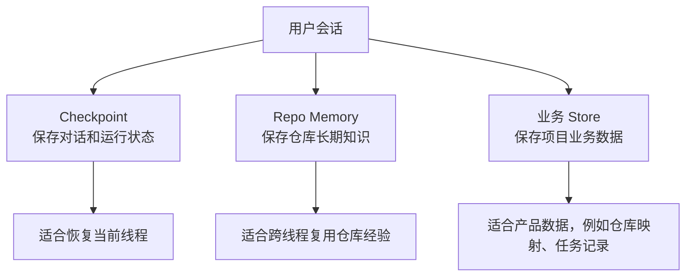

| 类型 | 当前用途 | 生命周期 |
|---|---|---|
| Checkpoint | 保存 LangGraph 对话状态、工具消息、运行过程 | 跟会话线程绑定 |
| Repo Memory | 保存某个 Gitee 仓库的长期开发知识 | 跟仓库绑定，可跨会话复用 |
| 业务 Store | 保存 UI、任务、仓库映射等应用数据 | 跟系统业务绑定 |

注意：仓库级记忆不是把所有聊天记录复制进去，而是提炼稳定结论。

### 6.3 仓库级记忆的存储方式

当前项目使用 DeepAgents 官方推荐的 `StoreBackend` 思路，让记忆以虚拟文件方式暴露给 Agent。

| 项 | 当前设计 |
|---|---|
| Agent 可见路径 | `/memories/{owner}/{repo}.md` |
| Store namespace | `("my-aicoding", "repo-memory", owner, repo)` |
| Store key | `repo.md` |
| 物理数据库 | `data/langgraph_store.sqlite` |
| 初始化时机 | 项目创建或首次解析仓库时初始化 |
| 更新时机 | coding / planning / analysis / review 任务结束后总结并写回 |

这里不再额外维护一张“记忆索引表”。原因是当前项目已经有“Gitee 仓库地址 -> 本地项目目录”的映射逻辑，仓库名本身就能作为唯一 namespace 的一部分。

### 6.4 仓库记忆文件命名为什么不能是 `/memories/repo.md`

早期方案使用固定路径 `/memories/repo.md`，这会导致多个仓库共用一个记忆文件，出现串仓库问题。

当前推荐命名：

```text
/memories/owner-example/ai_coding.md
/memories/owner-example/abc-test.md
/memories/pyautotest/pytest_ui_api_fw.md
```

这样每个仓库都有独立记忆，学生可以直观看出记忆属于哪个 Gitee 仓库。

### 6.5 仓库记忆应该写什么

| 适合写入 | 示例 |
|---|---|
| 项目技术栈 | FastAPI、SQLite、pytest、Jinja2 模板 |
| 关键入口 | `main.py` 是后端入口，`templates/` 存放页面模板 |
| 启动方式 | `python -m uvicorn main:app --reload` |
| 测试方式 | `python -m pytest` 或项目实际测试命令 |
| 数据存储 | 使用 `db.py` 封装 SQLite，数据库文件位置 |
| 重要约束 | 只允许 Gitee，用户输出必须中文 |
| 最近结论 | 已经存在用户模块、部门模块、权限模块 |
| PR 信息 | 最近分支和 Pull Request 地址 |

不适合写入：

| 不适合写入 | 原因 |
|---|---|
| `.env` 内容 | 敏感信息，不能持久化到记忆 |
| token、私钥、密码 | 安全风险 |
| 大段源码 | 会污染上下文，占用 token |
| 一次性推理过程 | 下轮通常不需要复用 |
| 错误的中间输出 | 会误导后续任务 |

### 6.6 仓库记忆的初始化流程

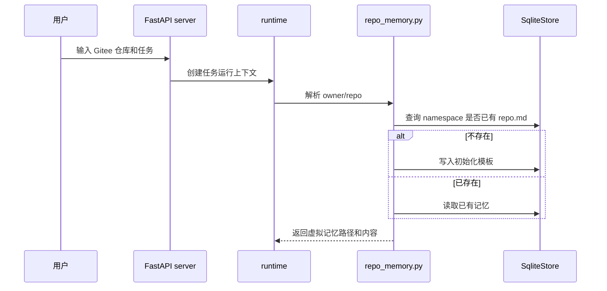

初始化内容应该是“空模板 + 结构化标题”，而不是伪造项目事实。

### 6.7 仓库记忆如何注入 Agent

当前项目通过 `ContextInjectionMiddleware` 在 Agent 执行前读取仓库级记忆，并把内容加入系统上下文。

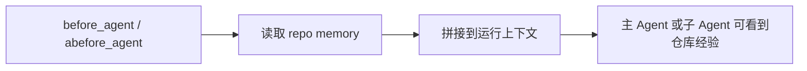

课堂中要说明：这和把内容写死在 `prompt.py` 不一样。`prompt.py` 是全局规则，仓库记忆是每个仓库不同的上下文。

### 6.8 仓库记忆什么时候更新

当前项目采用“双保险”机制：

| 更新位置 | 作用 |
|---|---|
| `runtime.py` | 在任务成功结束后，根据最终回答和上下文主动更新记忆，这是主要路径 |
| `MemoryUpdateMiddleware` | 在 Agent 完成后兜底更新，避免未来运行路径调整后忘记写回 |

`repo_memory_update.py` 负责把本轮上下文整理成简洁的仓库知识，再写回 `StoreBackend` 对应的记忆文件。

### 6.9 为什么更新记忆不应该在每个工具调用后执行

如果每次读文件、写文件、运行命令后都更新记忆，会产生三个问题：

1. 写入太频繁，SQLite 压力变大。
2. 中间状态不稳定，容易把错误推理写进长期记忆。
3. 记忆内容会越来越碎，下一轮反而更难使用。

所以当前项目选择“任务结束后总结写回”。这更适合教学，也更容易解释。

### 6.10 Skills 的作用

Skills 是 DeepAgents 原生机制，用来告诉 Agent 某类任务应该怎么做。它不是代码工具，而是“任务操作手册”。

当前项目的 skills 目录分两层：

| 目录 | 作用 |
|---|---|
| `agent/skills` | 项目源码中的技能模板，方便版本管理 |
| `<AI_WORKSPACE_ROOT>\skills` | Agent 运行时真正读取的 skills 目录 |

每次修改源码里的 skill 后，都要同步到 `<AI_WORKSPACE_ROOT>\skills`，否则运行中的 Agent 读取不到最新版本。

### 6.11 当前可用 Skills

| Skill | 作用 | 讲课重点 |
|---|---|---|
| `repo-bootstrap-analysis` | 仓库首次分析、目录识别、Gitee 仓库准备 | 避免每轮重复猜项目结构 |
| `ai-coding-implementation` | 编码实施流程 | 引导 Agent 少走弯路，减少工具调用次数 |
| `code-review` | Gitee PR 和本地 diff 审查流程 | Reviewer 子 Agent 运行时使用，已同步到 `<AI_WORKSPACE_ROOT>\skills` |

`repo-bootstrap-analysis/SKILL.md` 已经按中文和 Gitee 场景整理，适合课堂直接展示。

### 6.12 Skills、Prompt、Memory 的关系

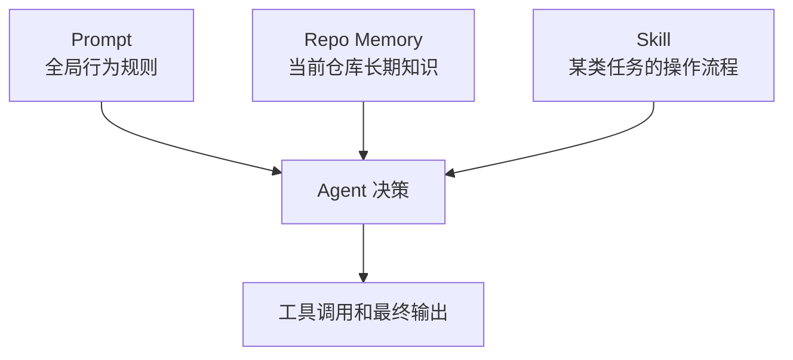

一句话总结：

- Prompt 告诉 Agent “必须遵守什么”。
- Memory 告诉 Agent “这个仓库以前发生过什么”。
- Skill 告诉 Agent “这类任务应该按什么流程做”。

### 6.13 课堂演示建议

建议课堂按下面方式演示：

1. 打开 `<AI_WORKSPACE_ROOT>\skills`，说明这是 Agent 真正读取的技能目录。
2. 打开 `agent/skills`，说明这是源码模板目录。
3. 打开 `repo_memory.py`，说明仓库记忆如何生成 namespace。
4. 打开 `context_injection.py`，说明记忆如何注入。
5. 打开 `repo_memory_update.py`，说明任务结束后如何提炼记忆。
6. 演示同一个仓库第二轮任务时，Agent 不再从零分析。

<!-- LX-COURSE-DETAIL-6 START -->

### 6.14 课堂详细讲义补充：长期记忆解决的是重复劳动

学生很容易把长期记忆理解成“把聊天记录保存起来”。这是不准确的。AI Coding 项目的长期记忆应该保存的是稳定、可复用的仓库知识，而不是完整聊天历史。

可以用下面的对比讲清楚：

| 内容 | 是否适合长期记忆 | 原因 |
|---|---|---|
| 项目启动命令 | 适合 | 每轮开发都可能用到 |
| 测试命令 | 适合 | 能减少反复猜测 |
| 上一轮用户随口说的话 | 不适合 | 可能只对当时上下文有效 |
| `.env` 里的 key | 禁止 | 敏感信息 |
| 某次失败测试的稳定原因 | 适合 | 后续排错可复用 |

### 6.15 为什么仓库级记忆比全局 `workspace.md` 更适合本项目

早期固定 `workspace.md` 更像“全局说明书”，它能告诉 Agent `<AI_WORKSPACE_ROOT>` 下有哪些目录，例如 `projects`、`skills`、`logs`、`runtimes`。但它不能解决“每个仓库不同”的问题。

| 记忆类型 | 适合保存 | 不适合保存 |
|---|---|---|
| 全局工作区记忆 | 工作区目录语义、通用安全规则 | 某个仓库的接口、测试命令、PR |
| 仓库级记忆 | 当前仓库结构、技术栈、启动测试方式 | 所有仓库通用规则 |

所以当前项目采用“全局规则 + 仓库级记忆”的组合。

### 6.16 StoreBackend 的教学解释

DeepAgents 的 `StoreBackend` 可以让 Agent 像读文件一样读写长期记忆，但底层实际存储在 LangGraph Store 中。对学生可以这样解释：

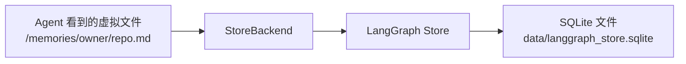

Agent 不需要知道 SQLite 表结构，也不需要自己写 SQL。它只需要知道有一个 `/memories/...md` 文件可以作为长期上下文。

### 6.17 仓库记忆初始化的课堂步骤

建议课堂按真实运行流程讲：

1. 用户选择或输入 Gitee 仓库地址。
2. `repo_mapping.py` 找到这个仓库对应的本地目录。
3. `runtime.py` 调用 `ensure_repo_memory_initialized()`。
4. 如果 Store 中没有该仓库记忆，就写入初始化模板。
5. `ContextInjectionMiddleware` 在 Agent 开始前读取并注入该记忆。
6. 任务结束后，`repo_memory_update.py` 重新整理记忆。

这条链路能让学生理解：记忆不是“模型自己记住了”，而是项目显式设计了持久化机制。

### 6.18 `repo_memory_update.py` 的职责

`repo_memory_update.py` 不应该简单把最终回答 append 到文件末尾。它应该做四件事：

| 职责 | 说明 |
|---|---|
| 提炼 | 从最终回答中提取稳定结论 |
| 去重 | 已存在的结论不要重复追加 |
| 分区 | 把启动命令、测试命令、关键文件、最近结论放到不同区域 |
| 脱敏 | 不写入 token、私钥、`.env` 内容 |

课堂上可以提醒学生：长期记忆质量决定 Agent 第二轮表现。如果记忆里堆满无用文本，Agent 反而更容易误判。

### 6.19 Skills 的教学定位

Skills 不是 Python 函数，也不是工具。它们更像“给 Agent 看的操作手册”。例如：

- 首次分析仓库时，先看 README，再看目录，再找测试命令。
- 编码实施时，先确认方案，再小步修改，再跑测试。
- 代码审查时，先看 diff，再看风险，再给出结论。

这类流程如果全部写进主 Prompt，会让 Prompt 越来越大。放进 skill 后，Agent 可以按需读取。

### 6.20 Skills 同步为什么重要

当前项目有两个 skills 目录：

| 目录 | 说明 |
|---|---|
| `agent/skills` | 源码版本，方便提交和维护 |
| `<AI_WORKSPACE_ROOT>\skills` | Agent 运行时读取的真实目录 |

课堂要重点提醒：修改 `agent/skills` 后，如果没有同步到 `<AI_WORKSPACE_ROOT>\skills`，运行效果不会变化。这是很多学生调试时最容易忽略的问题。

### 6.21 本章课堂提问

可以让学生回答：

1. 为什么不把所有聊天记录都写进长期记忆？
2. 为什么仓库记忆要按 owner/repo 隔离？
3. 为什么 skills 适合写流程，不适合写具体业务需求？
4. 为什么记忆更新应该在任务结束后做，而不是每次工具调用后做？

这些问题能帮助学生从“会用框架”升级到“理解 Agent 工程设计”。

### 6.22 仓库级记忆的推荐 Markdown 结构

仓库记忆建议保持结构化，不要随意追加流水账。课堂可以给学生展示下面的模板：

```markdown
# 仓库记忆：owner/repo

## 基本信息
- 平台：Gitee
- 本地目录：/projects/repo
- 技术栈：

## 启动与测试
- 启动命令：
- 测试命令：
- 依赖安装：

## 关键模块
- 后端入口：
- 数据库层：
- 鉴权模块：
- 前端或模板：

## 已完成功能
- 日期 + 任务类型 + 简要结果

## 分支与 PR
- 最近分支：
- 最近 Pull Request：

## 注意事项
- 不要写入敏感信息
- 不要保存一次性推理过程
```

这个模板的价值是让 Agent 下次读取时可以快速定位信息，而不是在一大段自然语言里搜索。

### 6.23 仓库记忆更新的输入来源

`repo_memory_update.py` 不应该只看最终回答，也不应该盲目读取所有运行事件。比较稳妥的输入来源是：

| 输入来源 | 适合提取什么 |
|---|---|
| 用户原始需求 | 本轮任务目标 |
| task_kind | 本轮是方案、编码、审查还是问答 |
| 最终 assistant 总结 | 稳定结论、测试结果、PR 地址 |
| Store 中的 PR 状态 | 分支名、PR 链接 |
| reviewer findings | 审查结论和修复闭环 |

不建议把 tool 原始输出全部塞进记忆。工具输出常常很长，里面可能包含失败尝试、临时路径和无价值日志。

### 6.24 记忆更新的成功标准

一次好的记忆更新，应该满足：

| 标准 | 说明 |
|---|---|
| 简洁 | 下一轮 Agent 能快速读完 |
| 稳定 | 保存仓库事实，不保存临时猜测 |
| 可验证 | 文件名、命令、PR 地址尽量准确 |
| 不泄密 | 不写 `.env`、token、私钥、密码 |
| 可覆盖 | 旧结论过时后可以被新结论替换 |

课堂可以强调：长期记忆不是越多越好，而是越准越好。

### 6.25 Skills 与 repo memory 的组合案例

以“给 abc-test 增加部门模块”为例：

| 阶段 | Skill 提供什么 | Repo Memory 提供什么 |
|---|---|---|
| 方案生成 | 编码前先分析结构、输出方案、询问确认 | 当前项目是 FastAPI + SQLite，路由在 `main.py` |
| 编码实施 | 小步修改、跑测试、提交 PR | 测试命令是 `python -m pytest` |
| 代码审查 | 先读 diff，再记录 findings | 最近 PR 地址和分支名 |

这说明 skill 和 memory 不是重复关系。skill 是“做事方法”，memory 是“项目事实”。

### 6.26 课堂排错表

| 现象 | 可能原因 | 排查位置 |
|---|---|---|
| Agent 仍然每次重新分析目录 | 仓库记忆没有注入或内容太空 | `context_injection.py`、`repo_memory.py` |
| 记忆文件名字不对 | owner/repo 解析错误 | `repo_memory.py`、`repo_mapping.py` |
| 修改 skill 后没效果 | 没同步到运行时目录 | `<AI_WORKSPACE_ROOT>\skills` |
| 记忆内容一直不更新 | 成功结束后没有触发更新 | `runtime.py`、`repo_memory_update.py` |
| 记忆里出现敏感内容 | 更新清洗规则不够 | `repo_memory_update.py` |

### 6.27 本章课堂演示脚本

建议演示两轮同仓库任务：

1. 第一轮让 Agent 分析项目结构，并观察它读取了哪些文件。
2. 查看 `/memories/owner/repo.md` 或对应 StoreBackend 虚拟文件内容。
3. 第二轮让 Agent 给同一仓库出方案。
4. 对比第二轮是否更快定位关键文件和测试命令。
5. 手动修改 skill，再同步到 `<AI_WORKSPACE_ROOT>\skills`，说明同步前后效果差异。

### 6.28 本章小结

长期记忆和 Skills 是 Agent 从“每轮重新猜”走向“持续积累项目经验”的关键。记忆保存仓库事实，Skills 保存任务方法论，checkpoint 保存对话历史，三者边界清楚后，Agent 才能在多轮 coding、review、fix 中稳定工作。

<!-- LX-COURSE-DETAIL-6 END -->

## 7. 第六步：创建 DeepAgent 工厂

### 7.1 前置知识点

普通 LangChain Agent 的核心组件是：

```text
Agent = Model + Tools + System Prompt + Middleware
```

DeepAgents 在这个基础上增加了：

```text
Filesystem Backend + Permissions + Skills + Memory + Subagents + Todo Planning
```

这一节要先区分三个概念：

| 概念 | 说明 | 当前项目中的承载位置 |
|---|---|---|
| Agent 实例 | `create_deep_agent(...)` 返回的可运行图对象 | `agent/server.py:get_agent` 每次按配置构建 |
| 运行状态 | 对话、图执行状态、checkpoint | `agent/core/graph.py:get_checkpointer()` |
| 工作区资源 | 本地文件系统、命令执行、Gitee 凭据注入 | `agent/backends/local_shell.py`，按 `thread_id` 缓存 |

课堂上要强调：**非单例 Agent 并不等于状态丢失**。状态应该由 checkpointer、业务 Store、文件后端承担，而不是隐式藏在一个长期存活的 Python 对象里。

### 7.2 当前核心文件

```text
agent/server.py
```

这是当前项目最关键的 Agent 构建文件。

### 7.3 get_agent 的构建步骤

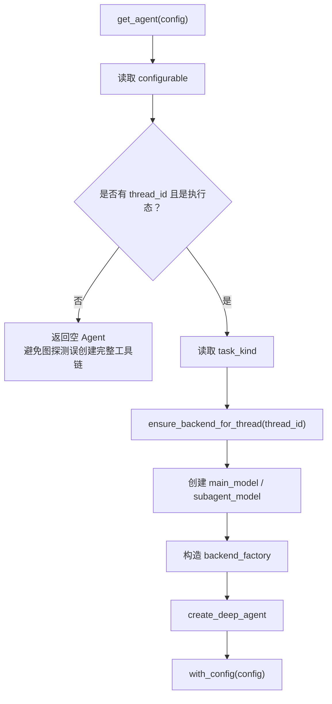

对应代码要点：

| 代码位置 | 作用 |
|---|---|
| `graph_loaded_for_execution(config)` | 判断当前是不是“真实执行态” |
| `ensure_backend_for_thread(thread_id)` | 为当前会话创建或复用 `LocalShellBackend` |
| `_task_kind_from_config(configurable)` | 从配置读取任务类型 |
| `_agent_filesystem_permissions()` | 生成主 Agent 文件权限 |
| `_general_purpose_subagent(subagent_model)` | 生成通用分析子 Agent |
| `create_deep_agent(...)` | 组装模型、工具、提示词、后端、权限、中间件、skills 和 checkpoint |

### 7.4 create_deep_agent 的组成

| 参数 | 当前项目传入 | 作用 |
|---|---|---|
| `model` | `make_main_model()` | 主 Agent 模型 |
| `tools` | `web_search`、`fetch_url`、Gitee PR、reviewer tools | 自定义外部能力 |
| `system_prompt` | `get_system_prompt(task_kind)` | 任务规则 |
| `subagents` | general-purpose subagent | 委派分析任务 |
| `backend` | `backend_factory` | DeepAgents 文件和命令后端 |
| `permissions` | `_agent_filesystem_permissions()` | 文件读写权限 |
| `middleware` | sanitize、model call limit、tool error | 安全、限制、恢复 |
| `skills` | `["/skills/"]` | 技能目录 |
| `checkpointer` | `get_checkpointer()` | LangGraph 状态恢复 |

### 7.5 为什么 Agent 实例采用非单例

当前项目不是把 `create_deep_agent(...)` 的结果做成全局单例，而是在 `get_agent(config)` 中按运行配置创建 Agent 实例。

核心原因如下：

| 原因 | 说明 |
|---|---|
| 任务类型不同 | `coding`、`planning`、`analysis`、`qa` 会拿到不同的 `system_prompt` |
| 会话上下文不同 | 每个 `thread_id` 对应不同工作区、checkpoint 和业务记录 |
| 权限可能变化 | 不同任务或未来不同用户可以使用不同 permissions |
| 长期记忆要新鲜 | `ContextInjectionMiddleware` 会读取当前仓库级记忆，重建 Agent 可以拿到最新上下文 |
| 避免跨会话污染 | 单例对象容易把工具状态、middleware 状态、config 状态混在一起 |
| 方便调试和热更新 | 修改 Prompt、Skills、权限后，新运行可以直接使用新配置 |

这套设计的关键不是“所有东西都重新创建”，而是把生命周期拆开：

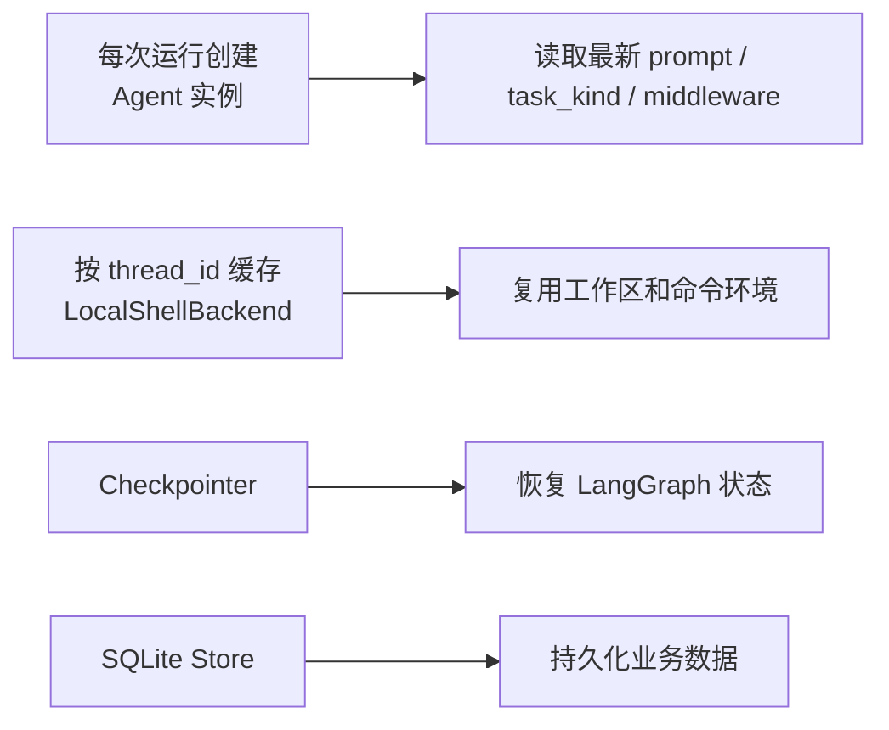

因此，Agent 实例是轻生命周期；backend、checkpoint、store 才是承载长期状态的部分。

### 7.6 企业项目中 Agent 实例的常见管理方案

`create_deep_agent(...)` 执行后会得到一个 Agent 实例。企业项目里通常有几种管理方式：

| 方案 | 做法 | 优势 | 风险或代价 | 适合场景 |
|---|---|---|---|---|
| 全局单例 Agent | 服务启动时创建一个 Agent，全局复用 | 实现简单，创建开销低 | 配置容易陈旧，权限和用户上下文容易串线 | Demo、内部单用户工具 |
| 按线程缓存 Agent | `thread_id -> Agent` 缓存 | 会话隔离更好，复用成本较低 | 缓存淘汰复杂，Prompt/Tools 更新后可能不生效 | 会话长、配置变化少的产品 |
| 按请求创建 Agent | 每次运行重新 `create_deep_agent` | 配置最新，隔离清晰，调试简单 | 每次有一定构建开销 | 多租户、多任务类型、权限变化频繁 |
| 工厂 + 资源池 | Agent 按请求创建，模型、backend、store、checkpoint 由容器管理 | 工程边界清晰，利于扩展和观测 | 需要更完整的生命周期管理 | 企业级 Agent 平台 |
| 远程图服务托管 | 由 LangGraph Server 或平台托管 graph 生命周期 | 服务化能力强，便于水平扩容 | 运维和平台依赖更重 | 大规模生产系统 |

当前项目采用的是接近“按请求创建 Agent + 线程级 backend 缓存 + 持久化 checkpoint/store”的混合方案。

| 当前项目设计 | 具体体现 | 好处 |
|---|---|---|
| Agent 不做全局单例 | `get_agent(config)` 中调用 `create_deep_agent(...)` | 每次运行拿到最新任务规则、长期记忆和权限配置 |
| backend 按线程复用 | `_BACKENDS: dict[str, LocalShellBackend]` | 同一会话复用本地工作区、askpass、环境变量和路径映射 |
| checkpoint 独立持久 | `checkpointer=get_checkpointer()` | Agent 对象销毁后，对话和图状态仍可恢复 |
| 业务数据进入 SQLite | `agent/store/sqlite_store.py` | run、message、review finding、settings 可以长期查询 |
| 非执行态返回空 Agent | 没有 `thread_id` 或 `__is_for_execution__` 时返回轻量 Agent | 避免图探测阶段误创建完整工具链 |

课堂总结：

> 当前项目不依赖“长寿命 Agent 对象”保存状态，而是让 Agent 成为一次运行的装配结果，让后端、checkpoint 和数据库承担可恢复状态。这比单例更适合企业项目中的多线程、多任务、多权限场景。

### 7.7 为什么要有 graph_loaded_for_execution

`graph_loaded_for_execution(config)` 用来避免非执行态时误创建完整 Agent。

课堂解释：

> 在复杂 Agent 系统里，框架有时会为了探测图结构加载 Agent。如果这时就创建 backend、读写文件或初始化重资源，会产生副作用。因此项目要求 `__is_for_execution__=True` 才返回完整 Agent。

### 7.8 子 Agent 的作用是什么

当前项目在 `agent/server.py` 中定义了一个通用子 Agent：

```text
_general_purpose_subagent(model)
```

它的定位不是“另一个可以随意写代码的 Agent”，而是主 Agent 的分析助手。

| 维度 | 主 Agent | 通用子 Agent |
|---|---|---|
| 职责 | 最终理解用户需求、修改代码、调用 PR 工具、输出结论 | 阅读、分析、总结、提出建议 |
| 写源码权限 | 可以写 `/projects/**` | 不允许写 `/projects/**` |
| 适合任务 | 实施方案、修复代码、创建 PR | 代码结构分析、大范围检索、风险梳理、方案对比 |
| 责任边界 | 对最终行为负责 | 给主 Agent 提供辅助结论 |

为什么要引入子 Agent：

1. **降低主 Agent 上下文压力**：大仓库分析可以委派给子 Agent，主 Agent 聚焦决策和执行。
2. **隔离权限风险**：子 Agent 默认不能改源码，适合作为只读分析角色。
3. **形成专业分工**：未来可以继续增加 reviewer、test-planner、security-auditor 等专用子 Agent。
4. **让复杂任务更可控**：主 Agent 负责调度，子 Agent 负责局部问题，边界更清晰。

### 7.9 主 Agent 与子 Agent 权限差异

| 角色 | 能读 | 能写 | 不允许 |
|---|---|---|---|
| 主 Agent | `/projects`、`/skills`、`/policies`、`/reviews`、`/runtimes`、`/logs`、`/tmp` | `/projects`、`/reviews`、`/tmp` | 写 `/skills`、`/policies`、`/runtimes`、`/logs` |
| 子 Agent | 多数目录只读 | `/reviews`、`/tmp` | 写 `/projects` |

这体现了一个工程原则：

> 子 Agent 可以分析，但不应该拥有最终修改源码的权限。

### 7.10 子 Agent 与权限的调用关系

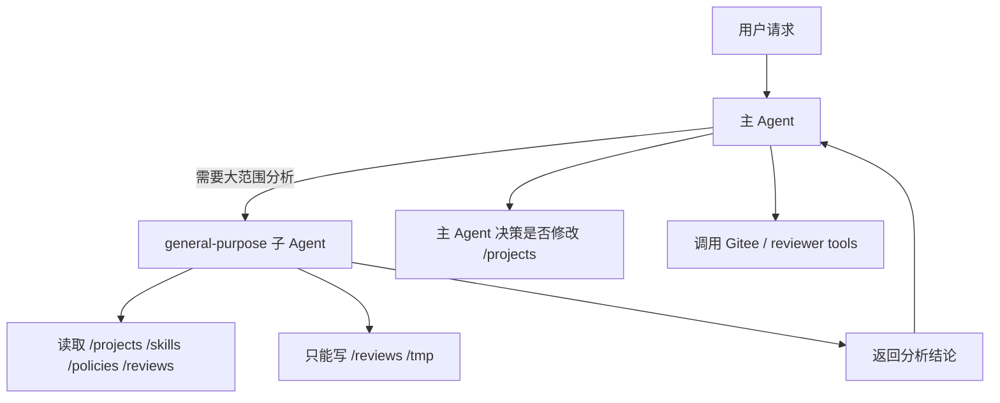

这个结构让课堂里的权限设计更容易讲清楚：

- 主 Agent 是执行者。
- 子 Agent 是分析者。
- 文件后端是最终边界。
- permissions 是 DeepAgents 层的声明式约束。
- middleware 是工具调用前后的工程防线。

### 7.11 reviewer 子 Agent 已经如何落地

当前项目已经实现 `code_reviewer` 子 Agent，不再是“未来规划”。

| 能力 | 当前实现 |
|---|---|
| 子 Agent 构建 | `agent/server.py:_code_reviewer_subagent()` |
| 专用 skill | `agent/skills/code-review/SKILL.md`，并同步到 `<AI_WORKSPACE_ROOT>\skills\code-review\SKILL.md` |
| 审查规则 | `agent/reviewer_rules/default_review_rules.md`、`/policies/review_rules.md`、仓库内 `.lx/review-rules.md` |
| diff 解析 | `agent/reviewer_diff.py` |
| Gitee PR 上下文 | `get_gitee_pull_request_context` |
| findings 写入 | `add_review_finding` 写入 `review_findings` 表 |
| findings 查询 | `list_review_findings` |
| 修复闭环 | 主 Agent 读取 `/reviews/*.md` 和 findings，先生成方案，确认后 coding |

Reviewer 子 Agent 应该做：

| 应该做 | 不应该做 |
|---|---|
| 读取审查规则 | 修改 `/projects` 业务代码 |
| 读取 Gitee PR 上下文 | 提交 commit |
| 读取本地 diff | push |
| 记录结构化 findings | 创建 Pull Request |
| 输出中文审查报告 | 未经确认发布 Gitee 评论 |

### 7.12 reviewer 子 Agent 的当前代码结构

当前子 Agent 在 `agent/server.py` 中注册：

```python
subagents=[
    _general_purpose_subagent(subagent_model),
    _code_reviewer_subagent(subagent_model),
]
```

`code_reviewer` 子 Agent 单独挂载以下工具：

| 工具 | 作用 |
|---|---|
| `get_gitee_pull_request_context` | 读取 Gitee PR 详情、提交、文件和评论 |
| `load_default_review_rules` | 读取项目内置默认审查规则，作为 skill 读取外部规则失败时的兜底 |
| `get_review_diff_summary` | 读取本地 diff 摘要 |
| `validate_review_finding_location` | 校验 finding 文件和行号 |
| `add_review_finding` | 写入结构化 finding |
| `list_review_findings` | 汇总 findings |

### 7.13 reviewer 子 Agent 的课堂 Mermaid 图

```mermaid
sequenceDiagram
    participant User as 用户
    participant Main as 主 Agent
    participant Reviewer as reviewer 子 Agent
    participant Store as SQLite Store
    participant Gitee as Gitee PR

    User->>Main: 确认实施代码修改
    Main->>Main: 修改 /projects 代码
    Main->>Reviewer: 委派审查本次修改
    Reviewer->>Reviewer: 只读分析 diff 和相关文件
    Reviewer-->>Main: 返回 findings
    Main->>Store: add_review_finding
    Main->>Main: 决定是否修复
    Main->>Gitee: 创建 PR 或发布评论
```

### 7.14 课堂重点

这一章要让学员建立四个判断：

1. `create_deep_agent(...)` 是装配点，不应该塞业务流程。
2. Agent 实例可以短生命周期，状态应该放在 checkpoint、store、backend 中。
3. 企业项目不要默认使用全局单例 Agent，多用户、多任务、多权限场景下风险很高。
4. 子 Agent 的价值不是“更多 Agent 更智能”，而是把职责、权限和上下文边界拆清楚。

---

<!-- LX-COURSE-DETAIL-7 START -->

### 7.15 课堂详细讲义补充：Agent 工厂是组装 Harness 的地方

`create_deep_agent` 不是单纯创建一个聊天模型对象。它会把模型、工具、文件后端、permissions、skills、subagents、middleware 组装成一个可以运行的 Agent Harness。

可以把 Agent 工厂理解成“装配车间”：

| 组件 | 类比 | 在 Agent 中的作用 |
|---|---|---|
| 模型 | 发动机 | 负责推理、决策、生成工具调用 |
| backend | 文件系统和终端 | 负责读写文件、执行命令 |
| tools | 专用设备 | 负责 Gitee、网页读取、审查发现等专项动作 |
| permissions | 安全围栏 | 控制哪些工具和路径可以使用 |
| skills | 操作手册 | 告诉 Agent 某类任务的标准流程 |
| middleware | 拦截器 | 注入上下文、清洗参数、处理错误、限制循环 |

### 7.16 为什么当前项目每轮创建 Agent 实例

当前项目使用 FastAPI 自己承载 Agent，而不是 LangGraph Server。因此每一轮请求进入时，会根据当前仓库、任务类型、线程 ID、repo memory 等运行参数创建一个新的 Agent 实例。

这样做的优点：

| 优点 | 说明 |
|---|---|
| 上下文干净 | 每轮 Agent 都按最新配置创建，避免残留状态 |
| 适合教学 | 学生能清楚看到一次请求如何组装 Agent |
| 配置明确 | 当前仓库、任务类型、skills、memory 都在本轮构建时确定 |

代价是：如果 Agent 工厂很重，每轮创建会有一定成本。但当前教学项目优先强调可理解性和稳定性。

### 7.17 与 open-swe 的差异

open-swe 使用 LangGraph Server 运行 Agent，生命周期由 LangGraph Server 管理，不一定表现为“每次前端请求都显式创建一个新 Agent 对象”。而当前项目为了脱离 `langgraph dev`，采用 FastAPI + uvicorn，所以 Agent 创建过程更显式。

| 对比项 | open-swe | MY-AICODING |
|---|---|---|
| 服务承载 | LangGraph Server | FastAPI |
| Agent 生命周期 | 由 LangGraph Server 管理 | 由项目代码显式创建 |
| 课堂可见性 | 框架封装更多 | 更容易讲清楚创建流程 |
| 复杂度 | 功能更完整 | 做了教学减法 |

课堂上可以强调：这不是谁更好，而是运行环境不同。open-swe 更接近生产级框架集成，MY-AICODING 更适合教学拆解。

### 7.18 Agent 工厂的推荐讲解顺序

| 顺序 | 打开文件 | 讲什么 |
|---|---|---|
| 1 | `agent/core/agent_factory.py` | get_agent 如何组装 DeepAgent |
| 2 | `agent/core/model.py` | 模型对象从哪里来 |
| 3 | `agent/backends/local_shell.py` | backend 如何暴露文件和命令能力 |
| 4 | `agent/core/middleware/__init__.py` | 中间件如何组合 |
| 5 | `agent/skills` 和 `<AI_WORKSPACE_ROOT>\skills` | skills 如何进入 Agent |
| 6 | 子 Agent 构建函数 | 为什么 reviewer 或 general purpose 可以隔离权限 |

### 7.19 主 Agent 和子 Agent 的关系

```mermaid
flowchart TD
    A["主 Agent"] --> B["直接调用工具"]
    A --> C["委派给子 Agent"]
    C --> D["子 Agent 使用更窄 permissions"]
    C --> E["子 Agent 完成专项分析"]
    E --> A
    A --> F["主 Agent 汇总并输出"]
```

主 Agent 负责整体任务推进，子 Agent 适合处理边界明确的专项任务，例如仓库分析、代码审查、局部方案评估。子 Agent 权限应该更窄，避免委派任务时扩大风险。

### 7.20 为什么去掉 `build_tools` 更贴近 open-swe

早期项目曾经使用 `build_tools(backend=..., store=..., thread_id=...)` 包装工具。后来为了尽量贴近 open-swe，改成让 backend、tools、middleware 各自承担清晰职责。

| 设计 | 问题 |
|---|---|
| `build_tools` 统一包装全部工具 | 容易把 backend、store、runtime context 混在一起 |
| 工具直接声明 + runtime context | 更接近 open-swe，职责更清楚 |

课堂重点：工具不应该承担过多运行时组装职责。Agent 工厂负责装配，工具负责执行一个明确动作。

### 7.21 本章常见问题

| 问题 | 回答 |
|---|---|
| 每轮创建 Agent 会不会浪费？ | 会有成本，但教学项目更重视清晰性；复杂生产场景可以复用图或缓存部分组件 |
| 子 Agent 是必须的吗？ | 不是。只有当任务边界清晰、权限需要隔离时才值得加 |
| skills 和子 Agent 有什么区别？ | skill 是流程说明，子 Agent 是可独立执行任务的 Agent |
| middleware 和工具有什么区别？ | middleware 拦截运行过程，工具执行具体动作 |

### 7.22 Agent 工厂为什么不能承载业务流程

`agent/server.py` 或 `agent/core/agent_factory.py` 的职责是装配 Agent，不应该在这里写“如果是 coding 就先生成方案”“如果确认就读上一轮方案”这类业务流程。

| 应该放在 Agent 工厂 | 不应该放在 Agent 工厂 |
|---|---|
| 模型对象 | 任务分类 |
| 工具列表 | 是否确认实施 |
| permissions | 分支名生成 |
| backend | PR 创建时机 |
| middleware | 测试失败后的业务总结 |
| skills | Dashboard 消息拼接 |

课堂上可以把它概括为：工厂只负责“组装车”，不负责“开车路线”。

### 7.23 Agent 工厂和 runtime 的分工

```mermaid
flowchart LR
    A["runtime.py<br/>决定做什么"] --> B["agent_factory/server.py<br/>组装能做事的 Agent"]
    B --> C["DeepAgent<br/>执行任务"]
    C --> D["streaming_runtime.py<br/>观察执行过程"]
    D --> E["runtime.py<br/>收尾状态"]
```

| 文件 | 核心问题 |
|---|---|
| `runtime.py` | 当前任务是什么？是否允许写代码？是否已有确认方案？ |
| `server.py` / `agent_factory.py` | 这个任务需要什么模型、工具、权限、skills、子 Agent？ |
| `streaming_runtime.py` | Agent 执行过程如何转成事件？ |

这样分层后，后续新增 reviewer、qa、planning 等任务类型时，不需要把所有逻辑塞进 Agent 工厂。

### 7.24 子 Agent 的设计原则

不是每个功能都要做成子 Agent。建议满足下面条件时再加：

| 条件 | 说明 |
|---|---|
| 任务边界清晰 | 例如代码审查、仓库分析、安全检查 |
| 权限应该更窄 | 子 Agent 只读，主 Agent 决定是否写 |
| 输出可被主 Agent 消费 | findings、分析报告、风险清单 |
| 不需要直接面向前端独立运行 | 由主 Agent 委派和汇总 |

如果只是一个确定性动作，例如创建 PR、读取网页、校验 diff 行号，更适合做成工具，而不是子 Agent。

### 7.25 reviewer 子 Agent 的讲课重点

reviewer 子 Agent 是当前项目最适合讲“职责隔离”的例子。

| 讲解点 | 说明 |
|---|---|
| 为什么只读 | 审查者不能直接改业务代码，否则角色混乱 |
| 为什么有 findings | 自然语言报告给人看，结构化 findings 给后续修复闭环用 |
| 为什么要校验行号 | 避免模型编造不存在的文件和行 |
| 为什么支持 Gitee PR | 第一版只考虑 Gitee，降低平台复杂度 |
| 为什么仍然通过主 Agent 输出 | 前端交互保持统一，不为子 Agent 单独做一套 UI |

### 7.26 Agent 工厂课堂演示脚本

建议课堂按这个顺序打开代码：

1. `agent/core/runtime.py`：看到什么时候调用 `_build_agent_for_runtime`。
2. `agent/server.py` 或 `agent/core/agent_factory.py`：看到 `get_agent(config)`。
3. `agent/core/model.py`：模型如何注入。
4. `agent/tools/__init__.py`：工具如何暴露。
5. `agent/backends/local_shell.py`：文件和命令能力如何进入 Agent。
6. `agent/core/middleware/__init__.py`：中间件顺序。
7. `<AI_WORKSPACE_ROOT>\skills`：Agent 真正读取的 skills。

### 7.27 Agent 工厂常见排错表

| 现象 | 可能原因 |
|---|---|
| Agent 找不到 skill | `skills=["/skills/"]` 配置错误或没有同步到 `<AI_WORKSPACE_ROOT>\skills` |
| 子 Agent 可以写源码 | 子 Agent permissions 配置过宽 |
| 每轮拿不到最新 Prompt | Agent 被错误缓存为全局单例 |
| 工具拿不到 thread_id | `with_config(config)` 没有正确传递 configurable |
| checkpoint 不生效 | 创建 Agent 时没有传入 `checkpointer=get_checkpointer()` |

### 7.28 本章小结

Agent 工厂是 Harness 的装配中心。它的价值不是“调用 `create_deep_agent`”，而是把模型、工具、backend、permissions、middleware、skills、subagents、checkpoint 按正确边界组合起来。课堂要让学生理解：Agent 的稳定性来自这些组件的边界清楚，而不是把所有逻辑写进一个超长 Prompt。

<!-- LX-COURSE-DETAIL-7 END -->

## 8. 第七步：设计中间件

这一章讲 Agent 运行过程中的“拦截层”。中间件不是业务逻辑，也不是普通工具，它负责在模型调用、工具调用、Agent 开始和结束等关键时机插入工程规则。

### 8.1 为什么需要中间件

没有中间件时，很多能力只能写在 `runtime.py` 或 prompt 里，容易越来越乱：

| 问题 | 如果没有中间件会怎样 |
|---|---|
| 仓库记忆注入 | 每个运行入口都要手工读取记忆 |
| 工具参数清洗 | Agent 容易把绝对路径、错误 cwd、`projects/projects` 传给工具 |
| 工具异常恢复 | 一个权限错误或 Git 错误可能直接中断整个任务 |
| 模型调用保护 | 复杂任务可能无限循环，直到耗尽额度 |
| 任务结束总结 | 每个任务分支都要手工写记忆更新逻辑 |

中间件的价值是把这些横切逻辑统一管理。

### 8.2 当前中间件执行顺序

当前项目推荐顺序如下：

```mermaid
flowchart TD
    A["用户任务进入 runtime.py"] --> B["ContextInjectionMiddleware<br/>注入仓库级记忆"]
    B --> C["SanitizeToolInputsMiddleware<br/>清洗工具参数"]
    C --> D["ModelCallLimitMiddleware<br/>限制模型调用次数"]
    D --> E["ToolErrorMiddleware<br/>工具异常转成可恢复观察"]
    E --> F["DeepAgent Loop"]
    F --> G["MemoryUpdateMiddleware<br/>任务结束后兜底更新记忆"]
    G --> H["runtime.py<br/>输出最终总结并主动写回记忆"]
```

说明：`AgentRunLimitTracker` 不属于 LangChain middleware，它位于流式事件解析层，用来限制整轮工具调用和模型调用次数，防止前端一直等待。

### 8.3 ContextInjectionMiddleware

| 项 | 说明 |
|---|---|
| 文件 | `agent/core/middleware/context_injection.py` |
| 钩子 | `before_agent` / `abefore_agent` |
| 作用 | 在 Agent 运行前读取仓库级记忆，并注入到系统上下文 |
| 解决问题 | Agent 不需要每轮都从零分析仓库 |

伪代码：

```python
class ContextInjectionMiddleware:
    async def abefore_agent(self, state, runtime):
        repo_memory = read_repo_memory(runtime.context)
        state.messages = inject_context_message(state.messages, repo_memory)
        return state
```

讲课重点：它负责“给 Agent 进入循环前发一份仓库背景资料”。

### 8.4 SanitizeToolInputsMiddleware

| 项 | 说明 |
|---|---|
| 文件 | `agent/core/middleware/tool_input_sanitizer.py` |
| 作用 | 清洗工具参数，修正路径、cwd、repo_dir 等输入 |
| 典型问题 | `/projects/projects` 双层目录、传入 `E:\` 绝对路径、路径越界 |

这个中间件是 Windows + Gitee 教学环境里很关键的一层。因为模型容易把自然语言里的路径直接传给工具，而真实工具只允许在 `<AI_WORKSPACE_ROOT>` 的安全边界内运行。

### 8.5 ToolErrorMiddleware

| 项 | 说明 |
|---|---|
| 文件 | `agent/core/middleware/tool_error.py` |
| 作用 | 捕获工具异常，把异常转成模型可以继续理解的观察结果 |
| 典型场景 | Git 命令失败、路径权限失败、测试失败、Gitee API 返回错误 |

没有这层时，工具异常可能直接让任务失败。加入后，Agent 可以看到错误原因，再决定下一步是修复代码、换命令，还是向用户说明阻塞原因。

### 8.6 ModelCallLimitMiddleware

| 项 | 说明 |
|---|---|
| 文件 | `agent/core/middleware/model_call_limit.py` |
| 作用 | 限制单轮模型调用次数 |
| 默认阈值 | 当前项目曾从 30 调整到 120，用于复杂编码任务 |
| 讲课重点 | 阈值不是越大越好，真正要优化的是任务拆解、记忆复用和工具效率 |

课堂上可以解释：保护上限是工程保险丝，不是性能优化手段。如果频繁触发上限，优先检查 Agent 是否重复读文件、重复运行测试、重复输出过程消息。

### 8.7 AgentRunLimitTracker

| 项 | 说明 |
|---|---|
| 位置 | 流式事件解析层 |
| 作用 | 统计一轮运行中的模型调用、工具调用和耗时 |
| 输出 | 达到保护上限时向前端输出清晰错误 |

这个组件和 `ModelCallLimitMiddleware` 配合使用：中间件偏 Agent 内部，Tracker 偏服务运行层和前端可见状态。

### 8.8 MemoryUpdateMiddleware

| 项 | 说明 |
|---|---|
| 文件 | `agent/core/middleware/memory_update.py` |
| 钩子 | `after_agent` / `aafter_agent` |
| 作用 | Agent 完成后兜底提取本轮结论，写回仓库级记忆 |
| 注意 | 当前主要写回路径在 `runtime.py`，该中间件是兜底机制 |

为什么不只靠中间件？

因为不同任务类型结束位置不同。方案任务、编码任务、问答任务的最终回答组织方式不同，`runtime.py` 更容易拿到“最终对用户说了什么”。因此当前项目采用：

1. `runtime.py` 在任务成功结束后主动调用 `repo_memory_update.py`。
2. `MemoryUpdateMiddleware` 在 Agent 完成后兜底更新。
3. 写入前由 `repo_memory_update.py` 清洗和压缩内容，避免污染长期记忆。

### 8.9 中间件和工具的边界

| 能力 | 放中间件 | 放工具 |
|---|---|---|
| 注入仓库记忆 | 是 | 否 |
| 清洗工具参数 | 是 | 否 |
| 执行 `git status` | 否 | 是 |
| 读取文件 | 否 | 由 backend 暴露 |
| 捕获工具异常 | 是 | 工具内部也可做局部处理 |
| 创建 Gitee PR | 否 | 是 |
| 更新长期记忆 | 兜底可以放中间件 | 具体写入逻辑放 `repo_memory_update.py` |

### 8.10 中间件和前端流式输出的关系

中间件本身不直接负责页面 UI，但它会影响前端看到什么：

| 中间件行为 | 前端表现 |
|---|---|
| 注入记忆 | Agent 更快给出有效方案 |
| 清洗工具参数 | 减少路径错误和失败提示 |
| 捕获工具异常 | 页面能看到可理解的错误说明，而不是后端堆栈 |
| 限制调用次数 | 任务不会无限转圈 |
| 更新记忆 | 下一轮对话更稳定 |

前端真正的流式输出，主要来自 `runtime.py` 对 DeepAgents event stream 的解析。课堂上讲前后端对接时，再单独讲事件类型、chunk 输出、任务计划列表和最终消息展示。

### 8.11 课堂建议讲法

这一章建议按故障驱动讲解：

1. 展示一个路径错误：模型传入 `E:\`，触发权限问题。
2. 引出 `SanitizeToolInputsMiddleware` 和工作区边界。
3. 展示一个测试失败：工具报错但 Agent 可以继续修复。
4. 引出 `ToolErrorMiddleware`。
5. 展示同一个仓库第二轮任务更快。
6. 引出 `ContextInjectionMiddleware` 和仓库级记忆。
7. 最后讲保护上限和 `MemoryUpdateMiddleware`，说明工程化 Agent 不能只靠 prompt。

### 8.12 中间件钩子的课堂解释

LangChain / DeepAgents 的中间件可以理解为 Agent Loop 周围的拦截点。不同钩子适合处理不同问题。

| 钩子 | 适合做什么 | 当前项目示例 |
|---|---|---|
| `before_agent` / `abefore_agent` | Agent 开始前准备上下文 | 注入仓库记忆 |
| `before_model` / `abefore_model` | 模型调用前裁剪或清洗消息 | 消息清洗、模型调用限制 |
| `wrap_tool_call` / `awrap_tool_call` | 工具调用前后拦截 | 工具参数清洗、异常恢复 |
| `after_agent` / `aafter_agent` | Agent 完成后做收尾 | 仓库记忆兜底更新 |

课堂上要强调：不要把所有逻辑都塞进一个中间件。中间件应该只处理一种横切关注点。

### 8.13 中间件顺序为什么重要

中间件不是简单列表，顺序会影响结果。

| 推荐顺序 | 原因 |
|---|---|
| 先注入上下文 | 模型第一次调用前就能看到仓库记忆 |
| 再清洗消息和工具参数 | 避免坏上下文或坏参数进入模型和工具 |
| 再限制模型调用 | 统计要覆盖真实模型调用 |
| 再捕获工具异常 | 工具实际执行时才能拿到异常 |
| 最后更新记忆 | 只有任务完成后结论才稳定 |

如果顺序错了，可能出现：记忆没注入、工具参数没清洗、错误直接抛出、任务完成后记忆仍不更新等问题。

### 8.14 中间件和 Prompt 的协作关系

Prompt 负责告诉模型“应该怎么做”，中间件负责在运行过程中“保证关键规则被执行”。

```mermaid
flowchart LR
    A["Prompt<br/>软规则"] --> B["模型生成动作"]
    B --> C["Middleware<br/>运行时治理"]
    C --> D["Tools / Backend<br/>真实执行"]
    D --> E["事件和结果"]
```

例如 Prompt 可以要求“不要访问工作区外路径”，但如果模型仍然传入 `E:\`，就必须由 `SanitizeToolInputsMiddleware` 和 `LocalShellBackend` 拦住。

### 8.15 中间件排错表

| 现象 | 重点排查 |
|---|---|
| 仓库记忆没有生效 | `ContextInjectionMiddleware` 是否注册、是否拿到 repo_url、记忆 namespace 是否正确 |
| 日志大量“丢弃孤立 ToolMessage” | checkpoint 历史中存在不完整工具消息，需要消息清洗或减少历史污染 |
| 工具异常后 Agent 直接失败 | `ToolErrorMiddleware` 是否捕获该工具异常 |
| 频繁触发 120 次保护 | 模型重复读文件或重复调用工具，优先检查 skill、repo memory 和任务计划 |
| 简单问答出现确认方案 | task_kind 判断或方案修订判断过宽，不是中间件直接问题 |

### 8.16 本章小结

中间件是 Agent 工程化的“运行护栏”。Prompt 负责表达规则，backend 负责最终安全边界，中间件负责把上下文注入、参数清洗、错误恢复、调用限制、记忆更新这些横切能力统一组织起来。

## 9. 第八步：设计自定义工具

### 9.1 前置知识点

DeepAgents 已经提供文件和命令工具，本项目只保留业务相关自定义工具：

```text
agent/tools/
```

也就是说：

| 能力类型 | 来源 |
|---|---|
| 文件读写、目录查看、命令执行 | DeepAgents 原生工具 + `LocalShellBackend` |
| 联网搜索、网页读取、Gitee PR、审查发现 | 本项目自定义工具 |

### 9.2 当前工具目录结构

| 文件 | 类型 | 作用 |
|---|---|---|
| `__init__.py` | 工具导出入口 | 控制哪些工具暴露给 Agent |
| `gitee_tools.py` | Agent tool | 创建 PR、发布 PR 评论 |
| `gitee_api.py` | 支撑模块 | Gitee URL 解析、token 读取、API 请求、token 脱敏 |
| `web_search.py` | Agent tool | 智谱联网搜索 |
| `fetch_url_tools.py` | Agent tool | 读取网页并转为 Markdown/文本 |
| `safe_http.py` | 支撑模块 | SSRF 防护、DNS pin、安全重定向 |
| `reviewer_tools.py` | Agent tool | 读取审查规则、生成 diff 摘要、校验 finding、写入和读取代码审查发现 |
| `runtime_context.py` | 支撑模块 | 从 LangGraph config 读取 `thread_id`、`task_kind` |

### 9.3 当前暴露给 Agent 的工具

| 文件 | 工具 | 作用 |
|---|---|---|
| `gitee_tools.py` | `open_gitee_pull_request` | 创建或复用 Gitee PR |
| `gitee_tools.py` | `publish_gitee_pr_comment` | 发布 Gitee PR 评论 |
| `gitee_tools.py` | `get_gitee_pull_request_context` | 读取 Gitee PR 审查上下文 |
| `web_search.py` | `web_search` | 智谱联网搜索 |
| `fetch_url_tools.py` | `fetch_url` | 读取公开网页并转文本 |
| `reviewer_tools.py` | `load_default_review_rules` | 读取项目内置默认审查规则 |
| `reviewer_tools.py` | `get_review_diff_summary` | 获取 diff 摘要和变更行 |
| `reviewer_tools.py` | `validate_review_finding_location` | 校验 finding 是否落在真实 diff 上 |
| `reviewer_tools.py` | `add_review_finding` | 记录审查问题 |
| `reviewer_tools.py` | `list_review_findings` | 列出审查问题 |

这些工具在 `agent/tools/__init__.py` 中统一导出，并在 `agent/server.py` 的 `create_deep_agent(tools=[...])` 中注册。

```mermaid
flowchart LR
    A["agent/tools/__init__.py"] --> B["agent/server.py"]
    B --> C["create_deep_agent(tools=[...])"]
    C --> D["模型可调用工具"]
```

### 9.4 `runtime_context.py`：工具如何知道当前线程和任务类型

自定义工具不能靠全局变量猜当前上下文，而是通过 LangGraph 的 `get_config()` 读取当前运行配置。

| 函数 | 返回 | 用途 |
|---|---|---|
| `get_runtime_configurable()` | `configurable` 字典 | 读取当前工具调用上下文 |
| `get_runtime_thread_id()` | 当前 `thread_id` 或 `None` | 写 run event、写 SQLite Store |
| `get_runtime_task_kind()` | 当前 `task_kind` | 判断任务类型 |
| `runtime_is_read_only_task()` | `True/False` | 工具内部二次权限判断 |

调用关系：

```mermaid
flowchart TD
    A["agent.server.get_agent"] --> B["with_config(config)"]
    B --> C["工具调用时 LangGraph get_config()"]
    C --> D["runtime_context.py"]
    D --> E["thread_id / task_kind"]
    E --> F["record_event / Store / read-only guard"]
```

课堂重点：

> 工具层要能拿到当前运行上下文，否则就无法把工具结果写回正确线程，也无法知道当前任务是否只读。

### 9.5 `gitee_tools.py`：Gitee PR 工具设计

`open_gitee_pull_request` 会先检查当前任务是否只读：

```text
analysis / planning / qa / inspect -> 禁止创建 PR
coding -> 允许创建 PR
```

`open_gitee_pull_request(...)` 参数：

| 参数 | 说明 |
|---|---|
| `owner` | Gitee 仓库 owner |
| `repo` | Gitee 仓库名 |
| `head` | 源分支 |
| `base` | 目标分支，默认 `master` |
| `title` | PR 标题 |
| `body` | PR 描述 |

执行流程：

```mermaid
sequenceDiagram
    participant M as Model
    participant T as open_gitee_pull_request
    participant C as runtime_context
    participant S as SQLite Store
    participant G as Gitee API

    M->>T: 调用创建 PR
    T->>C: runtime_is_read_only_task()
    alt 只读任务
        T-->>M: ok=false，拒绝创建 PR
    else coding 任务
        T->>S: record_event(gitee:pr, in_progress)
        T->>G: create_pull_request
        G-->>T: pr_url
        T->>S: update_thread_status(pr_created)
        T->>S: record_event(gitee:pr, completed)
        T-->>M: ok=true, pr_url
    end
```

`publish_gitee_pr_comment(...)` 参数：

| 参数 | 说明 |
|---|---|
| `owner` | Gitee 仓库 owner |
| `repo` | Gitee 仓库名 |
| `number` | PR 编号 |
| `body` | 评论正文 |

课堂重点：

> 权限不能只靠 prompt，工具内部也要检查 `runtime_is_read_only_task()`。

### 9.6 `gitee_api.py`：Gitee API 支撑层

这个文件不是直接暴露给 Agent 的工具，但它是 Gitee 工具的底层实现。

| 函数 | 作用 |
|---|---|
| `parse_gitee_repo_url(repo_url)` | 解析 Gitee 仓库地址，得到 owner、repo、clone_url |
| `authenticated_clone_url(repo)` | 返回普通 clone URL，认证交给 `GIT_ASKPASS` |
| `get_gitee_token()` | 从 `GITEE_TOKEN` 或 `SCM_GITEE_TOKEN` 读取 token |
| `mask_token(text)` | 日志和错误信息中脱敏 token |
| `_existing_pr_from_error(text)` | 识别“相同 head/base 的 PR 已存在”错误 |
| `create_pull_request(...)` | 调 Gitee API 创建 PR，或复用已有 PR |
| `get_pull_request(...)` | 读取 Gitee PR 详情 |
| `list_pull_request_commits(...)` | 读取 PR commits |
| `list_pull_request_files(...)` | 读取 PR files |
| `list_pull_request_comments(...)` | 读取 PR comments |
| `post_pr_comment(...)` | 调 Gitee API 发布 PR 评论 |

设计亮点：

| 设计 | 价值 |
|---|---|
| clone URL 不带 token | 避免 token 写入命令、日志、`.git/config` |
| 兼容 `GITEE_TOKEN` / `SCM_GITEE_TOKEN` | 适配课程项目和 open-swe 风格配置 |
| `mask_token` 统一脱敏 | 防止异常、日志、前端事件泄露密钥 |
| 重复 PR 复用 | 同一分支重复演示时不把成功任务误判为失败 |

### 9.7 `fetch_url_tools.py`：网页读取工具

工具签名：

```python
fetch_url(url: str, timeout: int = 30) -> dict[str, Any]
```

适用场景：

| 场景 | 示例 |
|---|---|
| 用户给了官方文档链接 | 读取文档内容辅助分析 |
| 用户给了错误页面 | 抽取错误说明 |
| 需要查接口说明 | 把 HTML 转成模型更容易读的文本 |

返回结构：

| 字段 | 说明 |
|---|---|
| `ok` | 是否成功 |
| `url` | 最终 URL |
| `status_code` | HTTP 状态码 |
| `content_type` | 响应内容类型 |
| `markdown_content` | 截断后的 Markdown/文本，最多约 20000 字符 |
| `content_length` | 原始转换后文本长度 |
| `error` | 失败原因 |

HTML 转文本策略：

1. 优先尝试 `markdownify`。
2. 如果依赖不可用，使用标准库 `HTMLParser` 提取正文文本。
3. 跳过 `script`、`style`、`noscript`。
4. 对段落、标题、列表、表格行插入换行。

### 9.8 `safe_http.py`：网页读取的安全边界

`fetch_url` 不是简单 `requests.get()`，而是通过 `safe_http.py` 做安全请求。

| 风险 | 防护 |
|---|---|
| SSRF 访问内网 | DNS 解析后阻止 private、loopback、link-local、reserved 地址 |
| DNS rebinding | DNS pin，连接时使用已校验 IP |
| 无限重定向 | 最多 5 次 |
| HTML 噪声太多 | HTML 转 Markdown/文本 |

核心函数：

| 函数 | 作用 |
|---|---|
| `_resolve_and_validate(url)` | 校验 URL 协议、hostname 和解析后的 IP |
| `_pin_dns(hostname, addr_infos)` | 当前线程内固定 DNS 解析结果 |
| `_pinned_create_connection(...)` | 让 urllib3 连接使用已校验 IP |
| `blocked_response(url, reason)` | 生成统一阻断结果 |
| `request_with_safe_redirects(...)` | 每次请求和重定向前都重新做安全校验 |

安全请求流程：

```mermaid
flowchart TD
    A["fetch_url(url)"] --> B["request_with_safe_redirects"]
    B --> C["解析 URL 和 DNS"]
    C --> D{"IP 是否内网/本机/保留地址？"}
    D -->|是| E["blocked_response"]
    D -->|否| F["DNS pin"]
    F --> G["requests.request(allow_redirects=False)"]
    G --> H{"是否重定向？"}
    H -->|否| I["返回 response"]
    H -->|是| J{"是否超过 5 次？"}
    J -->|是| E
    J -->|否| B
```

课堂重点：

> 只要 Agent 能访问 URL，就必须考虑 SSRF。尤其是企业内网环境，`fetch_url` 这类工具不能裸用 `requests.get()`。

### 9.9 `web_search.py`：联网搜索工具

`web_search` 用智谱搜索，适合：

- 最新第三方文档。
- 用户提到的外部资料。
- 错误信息背景。

工具签名：

```python
web_search(query: str) -> str
```

核心实现点：

| 设计 | 说明 |
|---|---|
| `@lru_cache(maxsize=1)` | 智谱客户端懒加载并复用 |
| `require_env("ZHIPU_API_KEY")` | 调用时才强制要求密钥 |
| SDK 兼容 | 优先尝试 `zai.ZhipuAiClient`，再尝试 `zhipuai.ZhipuAI` |
| 搜索数量 | `count=3` |
| 搜索引擎 | `search_pro` |
| 事件记录 | 写入 `web_search:{query}` 的 in_progress/completed/error |
| token 脱敏 | 异常通过 `mask_token` 处理 |

但项目 prompt 明确要求：

> 搜索结果只能辅助判断，最终结论必须结合本地仓库真实代码。

### 9.10 `reviewer_tools.py`：审查发现工具

当前项目有两个 reviewer 工具：

| 工具 | 作用 |
|---|---|
| `add_review_finding` | 把一条审查发现写入 SQLite |
| `list_review_findings` | 读取当前线程的审查发现 |

`add_review_finding(...)` 参数：

| 参数 | 说明 |
|---|---|
| `file` | 问题所在文件 |
| `line` | 问题所在行号，可为空 |
| `severity` | 严重级别 |
| `title` | 简短标题 |
| `description` | 详细说明 |

实现细节：

1. 通过 `get_runtime_thread_id()` 获取当前线程。
2. 如果没有 `thread_id`，返回错误，不写库。
3. 生成 `finding-{uuid}` 格式的 finding id。
4. 调用 `get_store().add_finding(...)` 写入 SQLite。
5. 返回 `{"id": finding_id, "status": "open"}`。

`list_review_findings()` 会读取当前 `thread_id` 下的 findings。如果没有 `thread_id`，返回错误列表。

课堂价值：

> reviewer 工具让“代码审查结果”从普通文本变成结构化数据。未来 reviewer 子 Agent、PR 评论发布、前端审查面板都可以复用这张数据表。

### 9.11 自定义工具与中间件的配合关系

```mermaid
flowchart TD
    A["模型决定调用工具"] --> B["SanitizeToolInputsMiddleware"]
    B --> C{"参数是否安全？"}
    C -->|否| D["ToolMessage: ToolInputRejected"]
    C -->|是| E["自定义工具"]
    E --> F{"工具是否异常？"}
    F -->|是| G["ToolErrorMiddleware<br/>转 ToolMessage(status=error)"]
    F -->|否| H["返回工具结果"]
    E --> I["record_event / SQLite Store / Gitee API / safe_http"]
```

这也是本项目工具设计的基本模板：

| 层次 | 职责 |
|---|---|
| Prompt | 告诉模型什么时候应该调用工具 |
| Middleware | 清洗参数、兜底异常 |
| Tool | 做业务动作和业务校验 |
| Support module | 封装外部 API、安全请求、上下文读取 |
| Store/Event | 让工具动作可持久化、可观察 |

### 9.12 课堂重点

初级工程师写 Agent 工具时，要养成下面几个习惯：

| 检查项 | 本项目示例 |
|---|---|
| 工具是否真的需要暴露给模型 | `gitee_api.py` 不暴露，只作为支撑层 |
| 工具是否能读取当前上下文 | `runtime_context.py` |
| 工具是否会产生外部副作用 | `open_gitee_pull_request` 内部检查只读任务 |
| 工具是否记录运行事件 | `web_search`、`fetch_url`、`open_gitee_pull_request` |
| 工具是否保护密钥 | `mask_token`、`GIT_ASKPASS`、clone URL 不带 token |
| 工具是否有网络安全边界 | `safe_http.py` |
| 工具结果是否结构化 | `add_review_finding` 写 SQLite |

### 9.13 为什么文件操作不再自定义一堆工具

早期项目可能会为 `read_file`、`write_file`、`list_files`、`execute` 分别写很多工具。但当前项目尽量参考 open-swe 和 DeepAgents 的方式：文件和命令能力交给 backend，业务专项能力才写成自定义工具。

| 能力 | 推荐来源 | 原因 |
|---|---|---|
| 读文件 | DeepAgents 文件工具 + `LocalShellBackend` | 框架已有统一协议，便于 permissions 管理 |
| 写文件 | DeepAgents 文件工具 + `LocalShellBackend` | 可以通过 backend 做 Windows 路径和安全边界 |
| 执行命令 | `LocalShellBackend.execute` | 需要统一处理 cwd、编码、GIT_ASKPASS、脱敏 |
| 创建 PR | 自定义 Gitee 工具 | 属于业务平台能力 |
| 发布 PR 评论 | 自定义 Gitee 工具 | 属于业务平台能力 |
| 记录 reviewer finding | 自定义 reviewer 工具 | 属于业务结构化数据 |
| 网页读取和搜索 | 自定义网络工具 | 需要安全 HTTP 和密钥管理 |

课堂重点：不是所有函数都应该暴露成工具。工具越多，模型选择空间越大，越容易误用。

### 9.14 工具副作用分级

给学生讲工具时，可以按副作用分级：

| 等级 | 示例 | 风险 | 当前项目策略 |
|---|---|---|---|
| 只读 | `fetch_url`、读取 PR 上下文、读取 diff 摘要 | 低 | 允许 analysis/planning/review 使用 |
| 本地写入 | 写 `/projects`、写 `/reviews`、写 findings | 中 | 只允许合适任务和路径 |
| 外部写入 | 创建 PR、发布 PR 评论、git push | 高 | 必须是 coding 或用户明确要求 |
| 敏感读取 | `.env`、token、私钥 | 极高 | 禁止暴露给模型 |

这个分级能帮助学生判断：一个新功能到底应该放工具、backend、中间件，还是根本不应该给 Agent。

### 9.15 工具结果格式建议

工具返回值应该尽量结构化，而不是随便返回一大段字符串。

推荐返回：

```python
{
    "ok": True,
    "summary": "已创建 Pull Request",
    "data": {
        "url": "https://gitee.com/owner/repo/pulls/1",
        "branch": "feat/example"
    }
}
```

这样做的好处：

| 好处 | 说明 |
|---|---|
| 模型容易理解 | `ok`、`summary`、`data` 比大段文本稳定 |
| 前端容易展示 | 可以提取 PR URL、分支名、错误原因 |
| 日志容易排查 | 结构化字段便于定位 |
| 后续工具可复用 | reviewer 或修复流程可以读取结构化 findings |

### 9.16 新增工具的开发步骤

当课程后续要新增一个工具，推荐按这个流程：

1. 明确工具是否真的需要暴露给模型。
2. 判断工具是只读、写本地、还是写外部平台。
3. 定义清晰的输入参数和返回结构。
4. 在工具内部读取 `thread_id`、`task_kind`，做权限判断。
5. 调用底层支撑模块，不要把复杂 API 细节写进工具函数。
6. 对异常做脱敏和结构化返回。
7. 必要时写入 `run_events` 或业务 Store。
8. 在 `agent/tools/__init__.py` 和 Agent 工厂里注册。
9. 用一个最小脚本验证工具在无 Agent 情况下也能跑通。

### 9.17 本章课堂练习

可以让学生设计一个“读取项目依赖清单”的工具，并判断它该不该成为自定义工具。

推荐答案：如果只是读取 `requirements.txt`、`pyproject.toml`，优先让 Agent 使用文件工具；如果要联网查询依赖最新版本、漏洞信息或许可证信息，才考虑做成自定义工具，并加网络安全和缓存。

### 9.18 本章小结

工具层要少而精。DeepAgents backend 负责通用文件和命令能力，自定义工具负责业务平台和结构化能力。这样项目更接近 open-swe 的设计，也能减少工具冗余和模型误用。

---

## 10. 第九步：实现任务分类和运行调度

### 10.1 前置知识点

Agent 不是所有请求都应该写代码。工程化 Agent 必须先识别任务意图。

这一章要解决三个问题：

1. 用户输入之后，后端从哪个接口进入？
2. 哪些代码负责判断这是 `coding`、`planning`、`analysis` 还是 `sync`？
3. 判断完成后，哪些代码负责创建任务记录、构建 Agent、流式执行和写回结果？

### 10.2 本章应该看哪些 Python 文件

| 文件 | 重点函数/类 | 作用 |
|---|---|---|
| `agent/api/dashboard_routes.py` | `dashboard_create_thread`、`dashboard_send_message`、`dashboard_approve_thread_plan` | 前端 API 入口，接收用户请求并提交后台任务 |
| `agent/core/background.py` | `run_task_safely` | FastAPI 后台任务入口，决定走轻量分支还是完整 Agent |
| `agent/core/task_intent.py` | `classify_task_kind`、`is_pull_only_task`、`is_workspace_listing_task`、`is_read_only_task` | 任务分类规则 |
| `agent/core/runtime.py` | `run_agent_task`、`run_plan_response_task`、`run_pull_only_task`、`run_workspace_listing_task` | 任务调度核心 |
| `agent/core/runtime.py` | `_build_agent_for_runtime`、`_build_agent_user_content`、`_build_plan_user_content` | 构造 Agent config 和用户输入内容 |
| `agent/core/runtime.py` | `_is_approval_prompt`、`_latest_confirmable_plan_from_checkpoint` | 识别“确认实施”并从 checkpoint 读取上一轮方案 |
| `agent/server.py` | `get_agent` | 根据 `thread_id`、`task_kind` 创建 DeepAgent |
| `agent/core/streaming_runtime.py` | `run_agent_with_event_stream` | 消费 DeepAgents 事件流，写入运行事件 |
| `agent/store/sqlite_store.py` | `upsert_thread`、`record_run`、`add_run_event`、`finish_open_run_events` | 保存任务、运行事件、PR、findings、仓库映射等业务数据 |

课堂建议讲解顺序：

```text
dashboard_routes.py
  -> background.py
  -> task_intent.py
  -> runtime.py
  -> server.py
  -> streaming_runtime.py
  -> sqlite_store.py
```

### 10.3 从前端请求到后台任务

前端创建任务时进入：

```text
agent/api/dashboard_routes.py:dashboard_create_thread
```

前端继续在同一个会话里发消息时进入：

```text
agent/api/dashboard_routes.py:dashboard_send_message
```

用户点击“确认方案”按钮时进入：

```text
agent/api/dashboard_routes.py:dashboard_approve_thread_plan
```

这三个入口都会做同一件事：先写入业务线程记录，再把真正的运行交给 FastAPI `BackgroundTasks`。

```mermaid
sequenceDiagram
    participant UI as 前端
    participant API as dashboard_routes.py
    participant Store as SQLite Store
    participant BG as background.py
    participant RT as runtime.py

    UI->>API: POST /threads 或 POST /threads/{id}/messages
    API->>Store: initialize_task_record
    API->>BG: background_tasks.add_task(run_task_safely)
    API-->>UI: 立即返回 thread payload
    BG->>RT: 后台执行具体任务
```

为什么要先返回 `thread_id`？

> Agent 任务可能运行很久。前端需要立即跳转到详情页，并通过 SSE 持续读取 `run_events` 和消息状态。

### 10.4 `background.py`：后台任务安全入口

核心函数：

```text
agent/core/background.py:run_task_safely
```

它做的是第一层轻量分流：

| 判断 | 命中后调用 |
|---|---|
| `is_workspace_listing_task(prompt)` | `run_workspace_listing_task(...)` |
| `is_pull_only_task(prompt)` | `run_pull_only_task(...)` |
| 其他请求 | `run_agent_task(...)` |

`run_task_safely` 会吞掉异常，因为真正的失败状态已经由 `runtime.py` 写入 Store。这样前端能从任务详情看到失败原因，而不是只在 Uvicorn 后台日志里看到异常。

### 10.5 `task_intent.py`：任务分类规则

核心类型：

```python
TaskKind = Literal["coding", "analysis", "planning", "qa", "sync", "inspect", "review"]
```

核心函数：

| 函数 | 作用 |
|---|---|
| `_normalize_prompt(prompt)` | 把用户输入转成小写、压缩空白，方便关键词判断 |
| `is_pull_only_task(prompt)` | 判断是否只是同步远程仓库 |
| `is_workspace_listing_task(prompt)` | 判断是否只是询问本地工作区项目 |
| `classify_task_kind(prompt)` | 选择主任务类型 |
| `is_read_only_task(task_kind)` | 判断任务是否只读 |

为什么这里不用模型做分类？

> 任务类型会影响是否允许写文件、执行命令、创建 PR。权限边界必须在本地代码里可预测地收敛，不能完全依赖模型自由判断。

### 10.6 任务类型

| task_kind | 场景 | 是否写代码 |
|---|---|---|
| `coding` | 修改、新增、修复、实现、重构 | 先方案，确认后写 |
| `planning` | 方案、计划、设计、怎么做 | 不写 |
| `analysis` | 分析、解析、目录结构、梳理 | 不写 |
| `qa` | 为什么、在哪里、是否、请问 | 不写 |
| `sync` | pull、拉取、同步远程 | 不写业务代码 |
| `inspect` | 工作区有哪些项目 | 不写 |

### 10.7 `classify_task_kind` 的判断顺序

`classify_task_kind(prompt)` 的规则可以按下面理解：

```mermaid
flowchart TD
    A["用户 prompt"] --> B["normalize"]
    B --> C{"is_pull_only_task?"}
    C -->|是| D["sync"]
    C -->|否| E{"is_workspace_listing_task?"}
    E -->|是| F["inspect"]
    E -->|否| G{"有 planning 关键词且没有 coding 关键词?"}
    G -->|是| H["planning"]
    G -->|否| I{"有 analysis 关键词且没有 coding 关键词?"}
    I -->|是| J["analysis"]
    I -->|否| K{"有 qa 关键词且没有 coding 关键词?"}
    K -->|是| L["qa"]
    K -->|否| M{"有 coding 关键词?"}
    M -->|是| N["coding"]
    M -->|否| O["qa"]
```

关键词大致分组：

| 类型 | 关键词示例 |
|---|---|
| planning | `方案`、`计划`、`设计`、`步骤`、`怎么做`、`先帮我设计`、`由我确认` |
| analysis | `分析`、`解析`、`目录结构`、`梳理`、`解释`、`查看`、`说明` |
| qa | `为什么`、`是什么`、`在哪里`、`是否`、`能不能` |
| coding | `修改`、`修复`、`新增`、`实现`、`开发`、`改造`、`迁移`、`接入`、`重构`、`提交`、`创建pr`、`push` |
| sync | `git pull`、`拉取`、`同步远程`、`更新远程` |
| inspect | `有哪些项目`、`工作目录`、`本地工作`、`workspace` |

### 10.8 `runtime.py`：调度核心文件

核心入口：

```text
agent/core/runtime.py:run_agent_task
```

但 `runtime.py` 不是只有一个函数，它包含四类职责：

| 职责 | 相关函数 |
|---|---|
| 创建任务记录 | `initialize_task_record` |
| 轻量任务直跑 | `run_workspace_listing_task`、`run_pull_only_task` |
| 方案生成和确认 | `run_plan_response_task`、`_is_approval_prompt`、`_latest_confirmable_plan_from_checkpoint` |
| 完整 Agent 执行 | `run_agent_task`、`_build_agent_for_runtime`、`_build_agent_user_content` |

### 10.9 runtime 主流程

核心入口：

```text
agent/core/runtime.py:run_agent_task
```

```mermaid
flowchart TD
    A["run_agent_task(repo_url, prompt, thread_id)"] --> B{"workspace listing?"}
    B -->|是| C["run_workspace_listing_task"]
    B -->|否| D{"pull-only?"}
    D -->|是| E["run_pull_only_task"]
    D -->|否| F["classify_task_kind"]
    F --> G{"已有 thread 且是确认实施语？"}
    G -->|是| H["读取 latest_confirmable_plan_message"]
    H --> I{"找到等待确认的方案？"}
    I -->|是| J["approved_plan_text<br/>task_kind=coding"]
    I -->|否| K["按当前 prompt 重新分类"]
    G -->|否| L["保持分类结果"]
    K --> M{"coding 且没有 approved_plan_text？"}
    L --> M
    J --> N["构建 Agent 并 stream_events"]
    M -->|是| O["run_plan_response_task"]
    M -->|否| N
```

### 10.10 `initialize_task_record`：先创建业务线程

位置：

```text
agent/core/runtime.py:initialize_task_record
```

它负责在真正执行 Agent 之前先写入 dashboard 可见的数据：

| 写入内容 | 说明 |
|---|---|
| `threads` | `thread_id`、标题、仓库地址、owner、repo、状态 |
| `run_events` | 写入 `created` 事件 |
| checkpoint messages | 记录 LangGraph/DeepAgents 的用户消息和 AI 消息，作为前端历史恢复的事实来源 |

为什么这一步放在前面？

> 前端需要马上拿到 `thread_id` 展示详情页。Agent 后台慢慢跑，页面通过 SSE 接收当前 run 的增量事件；刷新页面时再从 LangGraph checkpoint 恢复稳定历史。

### 10.11 `run_workspace_listing_task`：本地项目列表分支

位置：

```text
agent/core/runtime.py:run_workspace_listing_task
```

这个分支不调用模型，适合用户问：

```text
当前 workspace 有哪些项目？
```

执行步骤：

1. 调用 `initialize_task_record`。
2. 清理旧 `run_events`。
3. 创建 `LocalShellBackend`。
4. 调用 `backend.list_files("projects")`。
5. 写入 agent 消息，metadata 为 `{"task_kind": "inspect"}`。
6. 更新 run 和 thread 状态为 completed。

### 10.12 `run_pull_only_task`：只同步远程代码分支

位置：

```text
agent/core/runtime.py:run_pull_only_task
```

这个分支也不调用模型，适合用户明确说：

```text
先把远程代码 pull 一下
```

执行步骤：

| 步骤 | 说明 |
|---|---|
| 解析 Gitee URL | `parse_gitee_repo_url(repo_url)` |
| 定位本地目录 | `discover_repo_mapping(...)` |
| 已存在仓库 | `git remote set-url`、`git checkout master`、`git fetch --all`、`git pull origin master --ff-only` |
| 不存在仓库 | `git clone` 到 `projects` |
| 保存映射 | `save_clone_mapping(...)` |
| 写回状态 | run/thread completed 或 failed |

特殊处理：

```text
_run_git_with_fetch_head_retry
```

它用于处理 Windows 下偶发的 `.git/FETCH_HEAD` 权限异常：如果检测到该错误，会尝试删除 `FETCH_HEAD` 后重试一次。

### 10.13 为什么 coding 要先转 planning

这是一条产品和工程共同决定的规则。

| 原因 | 说明 |
|---|---|
| 降低误改代码风险 | 用户确认方案后才实施 |
| 便于课堂讲解 | 方案、确认、执行三个阶段清晰 |
| 便于约束 Agent | planning 阶段不允许修改和 PR |
| 提高用户信任 | 先看到影响范围和验证方式 |

对应代码在：

```text
agent/core/runtime.py:run_agent_task
```

关键逻辑：

```text
if task_kind == "coding" and approved_plan_text is None:
    return run_plan_response_task(...)
```

这意味着：用户第一次提出编码需求时，系统不会立刻改代码，而是转去生成技术方案。

### 10.14 `run_plan_response_task`：生成技术方案

位置：

```text
agent/core/runtime.py:run_plan_response_task
```

它的职责是为 coding 需求生成一个只读技术方案。

执行流程：

```mermaid
sequenceDiagram
    participant RT as runtime.py
    participant Store as SQLite Store
    participant SV as server.py
    participant Agent as DeepAgent
    participant SR as streaming_runtime.py

    RT->>Store: 清理 run_events，写 thread/run
    RT->>SV: _build_agent_for_runtime(task_kind="planning")
    SV-->>RT: DeepAgent
    RT->>SR: run_agent_with_event_stream(content=_build_plan_user_content)
    SR-->>RT: messages
    RT->>RT: _extract_best_plan_text
    RT->>Checkpoint: DeepAgents 写入 assistant 方案正文
    RT->>Store: 只更新 thread/run 状态和 run_events
    RT->>Store: run completed
```

`_build_plan_user_content(...)` 会明确告诉 Agent：

- 只生成技术方案。
- 不要修改文件。
- 不要提交。
- 不要 push。
- 不要创建 Pull Request。
- 最后必须问：是否确认实施该方案？

### 10.15 技术方案保存方式

当前主流程不再依赖 `thread_plans` 表，也不再把方案正文保存到业务 Store 的 `thread_messages` 中。方案正文的事实来源是 LangGraph checkpoint：DeepAgents 在运行过程中会把 `HumanMessage`、`AIMessage` 和图状态写入 `checkpoints.sqlite`。

课堂上可以这样理解：技术方案是一条普通的 assistant 消息，但它的内容符合“技术方案”形态，并且末尾会询问用户是否确认实施。确认实施时，runtime 不读取 Store 里的方案元数据，而是通过 `visible_checkpoint_messages(thread_id)` 扫描 checkpoint 历史，找到最近一条“像技术方案”的 assistant 消息。

具体读取代码在：

```text
agent/core/runtime.py:_latest_confirmable_plan_from_checkpoint
```

这样改造的原因是：前端历史、方案确认、运行时上下文都以 checkpoint 为准，避免 Store 和 checkpoint 两套历史互相覆盖。

### 10.16 `_is_approval_prompt`：识别用户确认

位置：

```text
agent/core/runtime.py:_is_approval_prompt
```

它识别这些确认意图：

```text
确认、确认实施、同意、同意方案、按方案实施、开始实施、可以实施、按照方案来、就按这个方案、实施
```

同时排除这些否定意图：

```text
不确认、先不要、不要实施、修改方案、重新设计、调整方案
```

当用户确认后，`run_agent_task` 会：

1. 判断当前用户输入是否属于确认实施语。
2. 从 LangGraph checkpoint 中读取最近一条“可确认”的 assistant 技术方案。
3. 读取方案正文作为 `approved_plan_text`。
4. 结合当前确认指令和上一轮方案，构造真正的 coding 输入。
5. 设置 `task_kind="coding"`。

这里不再依赖 Store 中的 `thread_messages.metadata.awaiting_confirmation`。原因是当前项目已经确定：前端历史、方案确认、Agent 上下文恢复统一以 checkpoint 为准，Store 只保存业务状态和运行事件。

### 10.17 `_build_agent_for_runtime`：把 runtime 配置交给 DeepAgent 工厂

位置：

```text
agent/core/runtime.py:_build_agent_for_runtime
```

它构造的 config：

```python
configurable = {
    "thread_id": thread_id,
    "task_kind": task_kind,
    "__is_for_execution__": True,
    "repo_url": repo_url,
}
```

然后调用：

```text
agent/server.py:get_agent
```

这一步非常关键，因为 `server.py` 会根据 `task_kind` 选择 Prompt，根据 `thread_id` 复用 backend，并把 `__is_for_execution__` 作为是否创建完整 Agent 的判断条件。

### 10.18 `_build_agent_user_content`：给 Agent 的用户消息

位置：

```text
agent/core/runtime.py:_build_agent_user_content
```

它不是简单把用户 prompt 原样丢给模型，而是拼上了：

| 内容 | 作用 |
|---|---|
| Gitee 仓库地址 | 告诉 Agent 操作哪个仓库 |
| 任务类型 | 告诉 Agent 当前是 `coding` 还是只读任务 |
| 用户任务 | 原始需求 |
| 任务指令 | coding 允许修改和 PR；非 coding 禁止修改、提交、push、PR |
| 已确认方案 | 用户确认后，作为实施依据注入 |

这和 `prompt.py` 的系统提示词是互补关系：

| 层级 | 文件 | 作用 |
|---|---|---|
| System Prompt | `agent/prompt.py` | 长期规则、角色、任务边界 |
| User Content | `agent/core/runtime.py` | 本次任务的仓库、类型、用户需求、确认方案 |

### 10.19 完整 coding 执行分支

当用户已经确认方案后，`run_agent_task` 会进入真正 coding 流程：

1. 清理旧 `run_events`。
2. 写入 `plan:approved` 事件。
3. 解析 Gitee 仓库。
4. upsert thread，record run。
5. 调用 `_build_agent_for_runtime(...)` 构建 Agent。
6. 调用 `run_agent_with_event_stream(...)` 执行。
7. 成功后 `finish_open_run_events`，更新 run/thread completed。
8. assistant 最终正文由 DeepAgents/LangGraph 写入 checkpoint，前端刷新后从 checkpoint 恢复。
9. 失败时写入 `model`、`failed` 事件，并把 run/thread 标记为 failed。

### 10.20 和 `streaming_runtime.py` 的边界

`runtime.py` 负责决定“跑什么任务”，`streaming_runtime.py` 负责“怎么消费 Agent 运行过程”。

| 文件 | 职责 |
|---|---|
| `runtime.py` | 分类、分支、创建 run、构造 Agent、处理最终状态 |
| `streaming_runtime.py` | 调 `agent.stream_events(version="v3")`，解析文本、工具、todo、子 Agent、运行上限 |

调用点：

```text
agent/core/runtime.py
  -> run_agent_with_event_stream(agent, thread_id, content)
```

### 10.21 任务调度全链路图

```mermaid
flowchart TD
    A["前端提交任务"] --> B["dashboard_routes.py<br/>initialize_task_record"]
    B --> C["background.py<br/>run_task_safely"]
    C --> D{"workspace listing?"}
    D -->|是| E["runtime.py<br/>run_workspace_listing_task"]
    D -->|否| F{"pull only?"}
    F -->|是| G["runtime.py<br/>run_pull_only_task"]
    F -->|否| H["task_intent.py<br/>classify_task_kind"]
    H --> I{"已有 thread 且确认实施？"}
    I -->|是| J["_latest_confirmable_plan_from_checkpoint"]
    J --> K{"找到方案？"}
    K -->|是| L["approved_plan_text<br/>task_kind=coding"]
    K -->|否| M["按当前 prompt 重新分类"]
    I -->|否| N["保持分类结果"]
    M --> O{"coding 且未确认方案？"}
    N --> O
    O -->|是| P["runtime.py<br/>run_plan_response_task"]
    P --> Q["DeepAgents v3<br/>text_delta 流式输出方案"]
    Q --> Q2["LangGraph checkpoint<br/>保存 assistant 方案正文"]
    O -->|否| R["server.py<br/>get_agent"]
    L --> R
    R --> S["streaming_runtime.py<br/>run_agent_with_event_stream"]
    S --> T["store.sqlite<br/>runs/run_events/PR/findings"]
```

### 10.22 课堂重点

这一章要让学员记住：

| 问题 | 去哪里找代码 |
|---|---|
| 前端请求怎么进入后端 | `agent/api/dashboard_routes.py` |
| 后台任务怎么启动 | `agent/core/background.py` |
| 任务类型怎么判断 | `agent/core/task_intent.py` |
| coding 为什么先生成方案 | `agent/core/runtime.py:run_agent_task` |
| 方案保存在哪里 | LangGraph checkpoint 中的 assistant 消息 |
| 用户确认怎么识别 | `agent/core/runtime.py:_is_approval_prompt` |
| 确认后怎么找到原方案 | `agent/core/runtime.py:_latest_confirmable_plan_from_checkpoint` |
| Agent 怎么创建 | `agent/core/runtime.py:_build_agent_for_runtime` -> `agent/server.py:get_agent` |
| Agent 运行过程怎么写到前端 | `agent/core/streaming_runtime.py` 消费 v3 事件，`dashboard_routes.py` 转成 SSE |

---

<!-- LX-COURSE-DETAIL-10 START -->

### 10.23 课堂详细讲义补充：运行调度决定 Agent 是否可控

任务分类和运行调度是当前项目最重要的控制层。没有这一层，所有用户输入都会进入同一个 Agent Loop，结果就是简单问题也可能触发大量工具调用，复杂需求也可能跳过方案直接改代码。

### 10.24 从用户输入到任务分支

```mermaid
flowchart TD
    A["前端提交用户输入"] --> B["FastAPI 接口接收请求"]
    B --> C["background.py 创建后台任务"]
    C --> D["task_intent.py 判断任务类型"]
    D --> E{"任务类型"}
    E -->|qa| F["只读回答"]
    E -->|planning| G["生成技术方案"]
    E -->|coding| H["确认实施并改代码"]
    E -->|analysis| I["仓库分析"]
    E -->|pull_only| J["只同步远程代码"]
```

这张图建议在课堂中反复使用。学生要理解：Agent 能不能稳定，首先取决于入口分流是否清楚。

### 10.25 为什么 coding 任务要先经过 planning

真实开发中，“用户提出需求”和“可以直接改代码”之间通常还差一步确认。当前项目用 planning 阶段解决这个问题。

| 阶段 | 目标 | 是否修改代码 |
|---|---|---|
| planning | 理解需求、读取仓库、输出方案 | 否 |
| coding | 用户确认后按方案实施 | 是 |

这样设计有两个教学价值：

1. 学生能看到 Agent 如何先分析再行动。
2. 讲师可以在方案输出后暂停，解释设计是否合理。

### 10.26 `runtime.py` 为什么会比较大

`runtime.py` 是调度核心，它连接了很多模块：

| 模块 | runtime 调用它的原因 |
|---|---|
| `repo_mapping.py` | 找到 Gitee 仓库对应的本地目录 |
| `repo_memory.py` | 初始化仓库级记忆 |
| `agent_factory.py` | 创建 DeepAgent |
| `streaming_runtime.py` | 把 Agent 事件转成前端事件 |
| `store.py` | 更新任务状态和对话记录 |
| `repo_memory_update.py` | 任务结束后写回仓库记忆 |

课堂上可以解释：`runtime.py` 不是普通业务 service，它更像 Agent 运行编排器。

### 10.27 方案修改类输入如何处理

用户经常会先要一个方案，然后补一句：“把方案改一下，一个用户只能有一个角色”。这种输入不应该直接进入 coding，而应该继续停留在 planning。

判断原则：

| 用户输入 | 应该进入 |
|---|---|
| “确认实施” | coding |
| “按这个方案写代码” | coding |
| “修改一下方案” | planning |
| “再补充一个约束” | planning |
| “这个方案不要保存，直接展示” | planning |

这也是之前项目修复过的问题：方案修改必须重新流式输出完整方案，而不是只输出“是否确认实施该方案？”。

### 10.28 后台任务为什么必要

FastAPI 接收到请求后不能一直阻塞 HTTP 请求等待 Agent 跑完。因为 Agent 任务可能要读文件、调用模型、跑测试、提交 PR，耗时从几十秒到几分钟不等。

因此当前项目采用后台任务模式：

1. 接口快速创建任务记录。
2. 后台协程运行 Agent。
3. 前端通过事件接口持续读取进度。
4. 任务完成后更新状态。

这种模式和普通 CRUD 项目不同，是 Agent 应用常见架构。

### 10.29 本章课堂排错表

| 现象 | 可能原因 |
|---|---|
| 简单问题也创建分支 | 任务分类把 qa 误判成 coding |
| 用户要求改方案却直接写代码 | approval 判断过宽 |
| 前端一直显示 running | 后台任务结束后状态没有写回 |
| 没有最终回答 | streaming_runtime 没捕获最后 assistant message |
| 仓库记忆没更新 | runtime 成功分支没有调用 repo_memory_update |

### 10.30 本章小结

任务调度层的目标不是让 Agent “更聪明”，而是让 Agent “更可控”。它把用户输入拆成明确分支，让每类任务走不同流程，从而降低误操作和无限循环风险。

### 10.31 讲师版展开：为什么 runtime 是最容易出 bug 的层

`runtime.py` 处在 API、Agent 工厂、Store、checkpoint、流式输出之间，所以它承担的是“流程编排”职责。它不直接实现模型推理，也不直接实现 UI，但它决定每一轮任务走哪条路。

| runtime 需要决定的问题 | 决策错误后的表现 |
|---|---|
| 当前输入是问答、方案、编码还是审查 | 简单问题被当成 coding，或者 coding 被当成 qa |
| 是否需要先生成技术方案 | 用户还没确认就改代码 |
| 用户是否确认上一轮方案 | 输入“确认实施”后仍只读回答 |
| 是否是修改上一轮方案 | 用户要求补充方案，却直接进入 coding |
| 当前 run 如何和上一轮隔离 | 两轮任务计划和正文混在一起 |
| 成功和失败状态怎么收尾 | 前端一直 running 或最终结果丢失 |

课堂上要提醒：Agent 项目真正复杂的不是模型调用，而是这些流程边界。

### 10.32 确认实施的三种情况

用户输入“确认”“开始实施”“可以，按方案来”时，runtime 不能简单地把这句话直接交给模型。它要区分三种情况：

| 情况 | 应该怎么处理 |
|---|---|
| 前面确实有可确认技术方案 | 从 checkpoint 读取方案，切换到 `coding` |
| 前面没有技术方案 | 不要盲目 coding，应提示没有可实施方案或重新生成方案 |
| 用户是在确认一个非代码问题 | 保持问答，不要误触发 coding |

这也是为什么当前实现要从 checkpoint 中查找“最近可确认方案”，而不是只看当前用户输入。

### 10.33 方案修订和 coding 确认的区别

下面两类用户输入很像，但流程完全不同：

| 用户输入 | 正确理解 | runtime 行为 |
|---|---|---|
| `确认实施` | 同意上一轮方案 | 读取上一轮方案，进入 coding |
| `修改一下方案，增加权限控制` | 还在讨论方案 | 继续 planning，输出修订后的方案 |
| `先不要实施，再补充测试策略` | 明确否定实施 | planning，不改代码 |
| `按上面的方案实施，但不要创建 PR` | 确认实施并带附加约束 | coding，但 user content 中带上新约束 |

课堂上可以让学生理解：自然语言确认不是简单关键词匹配，需要结合历史上下文。

### 10.34 coding 任务为什么必须带 approved_plan

当前项目的原则是：复杂 coding 必须基于已确认方案执行。这样做有两个好处：

1. Agent 写代码时有明确边界，不会把用户一句话扩展成过大的改造。
2. 课堂中可以暂停讲解方案，再让学生观察实施过程。

`approved_plan_text` 在 coding 阶段应该作为输入的一部分注入，让 Agent 知道：

| 信息 | 用途 |
|---|---|
| 用户原始需求 | 明确业务目标 |
| 已确认方案 | 明确实施范围 |
| 用户确认时追加的约束 | 例如“不创建 PR”“只改后端” |
| 当前仓库和分支 | 定位真实代码 |

### 10.35 runtime 收尾的标准动作

无论任务成功还是失败，runtime 都应该做清晰收尾：

| 收尾动作 | 成功 | 失败 |
|---|---:|---:|
| 更新 run 状态 | 是 | 是 |
| 更新 thread 状态 | 是 | 是 |
| 关闭未完成 run_events | 是 | 是 |
| 写入错误事件 | 否 | 是 |
| 写入 PR / 分支信息 | 如果有 | 如果已产生也要保留 |
| 更新仓库记忆 | 成功后为主 | 谨慎，避免写入错误结论 |
| 通知前端 done/error | 是 | 是 |

这张表可以帮助学生理解为什么后台日志里看起来 Agent 已结束，但前端如果没有收到状态更新就会一直等待。

### 10.36 本章课堂练习

让学生判断下面输入应该走哪条分支：

| 输入 | 预期分支 |
|---|---|
| `当前项目的记忆文件内容是什么？` | `qa` |
| `请先把远程代码 pull 一下` | `sync` |
| `把用户表改成 SQLite，先给方案` | `planning` |
| `确认实施` | 如果 checkpoint 有方案，则 `coding` |
| `方案里再加一个审计日志模块` | `planning` 修订 |
| `帮我 review 这个 PR，不要修改代码` | `review` |

这个练习是整门课的关键之一，因为它把自然语言输入和 Agent 运行流程连接起来。

<!-- LX-COURSE-DETAIL-10 END -->

## 11. 第十步：构建流式运行层

### 11.1 本章目标

本章讲 `agent/core/streaming_runtime.py`。它是当前项目里连接 DeepAgents 和前端页面的关键层。

普通 `invoke()` 只能在 Agent 完整结束后返回最终结果；但一个 Coding Agent 运行时间可能很长，中间会经历读取仓库、生成任务计划、调用工具、修改文件、运行测试、创建 PR 等步骤。如果页面一直没有反馈，用户会误以为系统卡死。因此课程版项目必须把 Agent 内部运行过程转换成前端可以理解的实时事件。

当前项目的目标不是把 DeepAgents 的所有原始事件都暴露给前端，而是把框架事件翻译成稳定的产品事件：

| 前端需要看到什么 | 后端对应能力 |
|---|---|
| 用户刚刚输入了什么 | `user_message` 事件 |
| 当前任务计划 | `todo_delta` 事件，对应 DeepAgents `write_todos` |
| AI 正在输出什么 | `message_start` + `text_delta` |
| 本轮是否结束 | `thread_done` + `done` |
| 是否失败 | `error` |
| 是否达到保护上限 | `AgentRunLimitTracker` 抛出明确异常 |

### 11.2 核心文件与入口函数

```text
agent/core/streaming_runtime.py
```

主入口：

```python
run_agent_with_event_stream(
    agent=agent,
    thread_id=thread_id,
    run_id=run_id,
    content=content,
    task_kind=task_kind,
    event_sink=event_sink,
)
```

这个函数只做一件事：运行 DeepAgent，并消费它的 v3 raw event stream。

它不负责判断任务类型，也不负责创建 Agent，更不负责前端渲染。它的职责边界非常清晰：

| 模块 | 职责 |
|---|---|
| `runtime.py` | 决定跑什么任务、创建 run、最终落库 |
| `server.py` | 根据 config 创建 DeepAgent、backend、tools、skills、middleware |
| `streaming_runtime.py` | 消费 DeepAgents v3 raw event，转成项目自己的实时事件 |
| `dashboard_routes.py` | 把实时事件包装成 POST SSE 响应给 Vue |
| Vue 前端 | 按事件顺序追加用户消息、任务计划、AI 正文和最终状态 |

### 11.3 为什么采用 DeepAgents V3 raw event streaming

DeepAgents 的高层输出适合拿最终答案，但不够适合做精细前端展示。我们需要更细粒度地知道：

- assistant 文本什么时候开始生成；
- 每一段文本 chunk 是什么；
- `write_todos` 的参数什么时候出现；
- 子 Agent 是否启动；
- 工具调用是否过多；
- 最终 output 中有哪些 messages。

所以当前项目消费的是 DeepAgents 兼容的 v3 raw event 形态，而不是只等最终结果。

课堂上可以这样解释：

> 框架事件是底层运行日志，产品事件是用户界面协议。`streaming_runtime.py` 的价值，就是把底层事件翻译成稳定的用户界面协议。

### 11.4 当前流式运行时序图

```mermaid
sequenceDiagram
    participant RT as runtime.py
    participant Agent as DeepAgent
    participant SR as streaming_runtime.py
    participant API as dashboard_routes.py
    participant UI as Vue Dashboard
    participant Store as 业务 Store
    participant CP as LangGraph checkpoint

    RT->>Agent: get_agent(...)
    RT->>SR: run_agent_with_event_stream(..., event_sink)
    SR->>Agent: stream_events / stream raw events
    Agent-->>SR: messages text-delta
    SR-->>API: event_sink(text_delta)
    API-->>UI: SSE text_delta
    Agent-->>SR: write_todos tool chunk
    SR-->>API: event_sink(todo_delta)
    API-->>UI: SSE todo_delta
    Agent-->>SR: subagent/tool events
    SR->>Store: record_event 用于排查和业务记录
    Agent-->>SR: final output messages
    Agent->>CP: LangGraph checkpoint 写入历史
    SR-->>RT: 返回最终 messages
    RT->>Store: 更新 run/thread 状态
    RT-->>API: 完成本轮执行
    API-->>UI: thread_done + done
```

注意：当前页面运行中的实时内容来自 POST SSE，不是前端轮询 Store。Store 仍然写 `run_events`，但它主要用于运行状态、日志排查和业务状态，不再作为聊天正文的恢复来源。

### 11.5 assistant 正文如何流式展示

`streaming_runtime.py` 会识别 raw messages 事件中的文本块：

| 函数 | 作用 |
|---|---|
| `_text_block_marker_from_event()` | 识别 assistant 文本块开始或结束 |
| `_text_delta_from_event()` | 从 raw event 中取出正文 token/chunk |
| `_should_flush_stream_text()` | 判断是否应该把累计文本刷新给前端 |
| `_record_assistant_stream_message()` | 写运行事件，并通过 `event_sink` 推送 `message_start/text_delta` |

当前项目采用“累计文本 replace”策略，而不是纯 append：

| 模式 | 做法 | 优点 | 风险 |
|---|---|---|---|
| append | 后端每次只发新增 token，前端追加 | payload 小 | 重复事件或丢包会导致文本重复或缺字 |
| replace | 后端发送当前累计文本，前端替换同一条 live assistant 消息 | 容错好、容易恢复 | payload 略大 |

课程版选择 replace，因为它更稳定，也更适合调试“内容覆盖”“重复展示”这类问题。

伪代码如下：

```python
current_text = ""
for event in deepagents_events:
    delta = read_text_delta(event)
    if delta:
        current_text += delta
        if should_flush(current_text):
            event_sink("text_delta", {"content": current_text, "mode": "replace"})
```

### 11.6 `write_todos` 如何转换成任务计划

DeepAgents 内置 `write_todos` 工具，用来表达当前任务拆解。这个项目把它作为独立 UI 组件展示，不和 assistant 正文混在一起。

相关函数：

| 函数 | 作用 |
|---|---|
| `_tool_chunk_from_message_event()` | 从 raw messages 中捕获工具参数 chunk |
| `_tool_call_from_event()` | 从 raw tool_calls 事件中捕获工具调用 |
| `_todos_from_args_text()` | 在 JSON 参数还没完整闭合时，尽量提取已生成的 todo |
| `_extract_todos()` | 从完整工具参数中提取 todo 列表 |
| `_record_todos()` | 生成 `todo_delta` 事件并写入 `run_events` |

为什么要单独处理 `write_todos`？

| 如果当普通文本展示 | 如果当任务计划展示 |
|---|---|
| 用户只能看到一段 JSON 或一句描述 | 用户能看到任务列表、进度和完成状态 |
| 无法判断当前做到第几步 | 可以稳定展示 pending / in_progress / completed |
| 多轮运行容易混在一起 | 通过 `run_id` 区分每一轮 |

### 11.7 工具事件与工具噪声

真实 Coding Agent 会调用大量工具：读文件、写文件、执行命令、查询 Gitee、读取 PR diff。全部展示会导致页面像终端日志，学生反而看不清 Agent 的决策。

当前策略：

| 内容 | 页面默认策略 |
|---|---|
| 用户输入 | 展示 |
| 任务计划 | 展示 |
| 非空 assistant 正文 | 展示，并流式输出 |
| `write_todos` | 展示为任务计划 |
| 普通工具调用 | 默认不作为主正文展示，必要时可在日志或折叠区查看 |
| 命令完整输出 | 不直接铺满页面，优先展示摘要 |

这就是“可观察”与“不过度打扰”的平衡。

### 11.8 运行保护

`AgentRunLimitTracker` 会在流式层观察 raw event，防止复杂任务无限运行。

| 限制 | 默认值 | 环境变量 |
|---|---:|---|
| 工具调用次数 | 120 | `AGENT_MAX_TOOL_CALLS` |
| 总运行秒数 | 900 | `AGENT_MAX_SECONDS` |

达到上限后：

1. 抛出 `AgentRunLimitExceeded`。
2. `runtime.py` 捕获异常并更新 thread/run 为 failed。
3. 前端收到 `error` 和 `thread_done`，停止 loading。
4. 日志记录具体原因，便于调整任务拆分或阈值。

### 11.9 流式层和 checkpoint 的边界

这是当前项目最重要的设计点之一：

| 层 | 负责什么 | 前端怎么用 |
|---|---|---|
| POST SSE 实时流 | 当前这一轮正在发生的事情 | 直接追加到页面最后面 |
| checkpoint | 稳定历史消息和 Agent 状态 | 打开历史会话时读取 |
| Store | thread/run/PR/findings/repo memory 等业务数据 | 列表、状态、删除、排查，不作为聊天正文 |

不要在任务结束后用 Store 快照覆盖前端 messages。否则就会出现之前反复遇到的问题：运行中显示正常，一结束用户输入或审查报告就消失。

### 11.10 本章课堂排错表

| 现象 | 优先检查 |
|---|---|
| 技术方案最后才一次性出现 | 是否捕获了 assistant `text-delta` |
| 任务计划不出现 | 是否捕获 `write_todos` tool chunk |
| 任务计划状态一直 running | 是否在收尾时完成 todo 状态同步 |
| 第二轮消息插到第一轮前面 | 前端是否按 run 顺序追加，是否被 `thread_done` 快照覆盖 |
| 运行保护触发 | 检查工具调用次数和复杂任务拆分 |

### 11.11 本章小结

`streaming_runtime.py` 不是简单的日志转发器，而是 Agent 产品的实时事件翻译层。它让用户看见：Agent 正在计划、正在输出、正在调用工具、是否完成、为什么失败。讲课时要强调：框架给的是 raw event，产品需要自己设计稳定事件协议。

## 12. 第十一步：设计业务 Store 和 Checkpoint

### 12.1 前置知识点

Agent 项目通常有两类状态：

| 状态类型 | 谁使用 | 保存内容 |
|---|---|---|
| Agent runtime state | LangGraph / DeepAgents | messages、工具调用状态、图恢复信息 |
| Business state | 应用后端和前端 | 任务列表、运行状态、事件、PR URL |

不要把两者混在一起。

如果学员只记住一句话，就是：

> Checkpoint 服务 Agent 恢复，Store 服务产品展示和业务查询。

### 12.2 本章应该看哪些 Python 文件

| 文件 | 重点函数/类 | 作用 |
|---|---|---|
| `agent/core/graph.py` | `get_store`、`get_checkpointer`、`build_agent` | 统一创建业务 Store 和 LangGraph checkpointer |
| `agent/core/persistence.py` | `make_checkpointer` | 创建 `SqliteSaver` 并执行 `setup()` |
| `agent/store/sqlite_store.py` | `LocalSqliteStore` | 业务 SQLite Store 的核心实现 |
| `agent/core/events.py` | `record_event` | 工具、中间件、runtime 写运行事件的统一入口 |
| `agent/core/runtime.py` | `initialize_task_record`、`run_agent_task` 等 | 写入 threads、runs、run_events、PR 状态，并从 checkpoint 读取确认方案 |
| `agent/core/streaming_runtime.py` | `run_agent_with_event_stream` | 把 DeepAgents raw event 转成业务事件 |
| `agent/api/dashboard_routes.py` | `get_task`、`list_tasks` 的消费侧 | 从 checkpoint 读取历史正文，从 Store 读取业务状态，转换成前端 payload |
| `agent/tools/reviewer_tools.py` | `add_review_finding`、`list_review_findings` | 读写 `review_findings` |
| `agent/core/repo_mapping.py` | `discover_repo_mapping`、`save_clone_mapping` | 读写 `repo_workspace_mappings` |

课堂建议讲解顺序：

```text
graph.py
  -> persistence.py
  -> sqlite_store.py
  -> events.py
  -> runtime.py / streaming_runtime.py
  -> dashboard_routes.py
```

### 12.3 本项目两个 SQLite

| 文件 | 管理者 | 作用 |
|---|---|---|
| `data/checkpoints.sqlite` | LangGraph checkpointer | Agent thread state 和可见对话历史 |
| `data/store.sqlite` | `LocalSqliteStore` | 业务数据、运行事件、PR、review findings、仓库映射 |

这两个数据库不能混用：

| 对比项 | `checkpoints.sqlite` | `store.sqlite` |
|---|---|---|
| 谁写 | LangGraph `SqliteSaver` | 项目代码 `LocalSqliteStore` |
| 谁读 | DeepAgents / LangGraph、`checkpoint_history.py` | FastAPI、Dashboard、tools、runtime |
| 数据形态 | 图状态、messages、checkpoint 元数据 | threads、runs、run_events、review findings、PR、repo mappings |
| 是否面向前端 | 前端历史正文的事实来源，但通过后端 API 转换后输出 | 只提供业务状态和当前运行事件，不再作为聊天正文来源 |
| 是否建议手写 SQL 修改 | 不建议 | 可以按业务表结构查询和排查 |

### 12.4 `graph.py`：Store 和 Checkpoint 的统一入口

位置：

```text
agent/core/graph.py
```

核心函数：

| 函数 | 返回 | 作用 |
|---|---|---|
| `get_store()` | `LocalSqliteStore(STORE_DB_PATH)` | 获取业务 Store 单例 |
| `get_checkpointer()` | `make_checkpointer(CHECKPOINT_DB_PATH)` | 获取 LangGraph SQLite checkpointer |
| `build_agent(thread_id, task_kind)` | DeepAgent | 兼容入口，内部调用 `agent.server.get_agent` |

为什么这里要提供统一入口？

1. 避免各个模块自己创建数据库路径。
2. 确保业务 Store 和 checkpoint 是两套清晰的生命周期。
3. 让 `server.py` 创建 DeepAgent 时可以稳定拿到同一个 checkpointer。

### 12.5 `persistence.py`：Checkpoint 怎么创建

位置：

```text
agent/core/persistence.py
```

核心函数：

```python
def make_checkpointer(db_path: Path) -> SqliteSaver:
    db_path.parent.mkdir(parents=True, exist_ok=True)
    conn = sqlite3.connect(str(db_path), check_same_thread=False)
    saver = SqliteSaver(conn)
    saver.setup()
    return saver
```

关键点：

| 代码 | 说明 |
|---|---|
| `sqlite3.connect(...)` | 创建 SQLite 连接 |
| `check_same_thread=False` | 允许 checkpointer 被不同线程调用 |
| `SqliteSaver(conn)` | 使用 LangGraph 官方 SQLite checkpointer |
| `saver.setup()` | 初始化 LangGraph checkpoint 所需表结构 |

课堂提醒：

> `checkpoints.sqlite` 的表结构由 LangGraph 管理，课程里不要把它当业务表讲。我们只需要知道它负责 Agent thread state 恢复。

### 12.6 `store.sqlite` 表结构

| 表 | 作用 |
|---|---|
| `threads` | 会话和任务摘要 |
| `runs` | 每次运行记录 |
| `run_events` | 实时运行步骤 |
| `thread_messages` | 历史兼容表，当前前端正文不再依赖它 |
| `thread_plans` | 历史遗留方案表，当前主流程不依赖它 |
| `review_findings` | 审查发现 |
| `settings` | 少量键值配置 |
| `repo_workspace_mappings` | Gitee repo 与本地目录映射 |

### 12.7 每张业务表在哪里写、在哪里读

| 表 | 主要写入位置 | 主要读取位置 | 课堂说明 |
|---|---|---|---|
| `threads` | `runtime.py:initialize_task_record`、`update_thread_status` | `runtime.py:get_task`、`dashboard_routes.py` | 任务列表和当前状态 |
| `runs` | `runtime.py:record_run` | `get_latest_run`、Dashboard payload | 每一次后台执行的开始、完成、失败 |
| `run_events` | `events.py:record_event`、`streaming_runtime.py`、middleware/tools | `dashboard_routes.py` | 前端实时步骤，如读取文件、执行命令、生成 todo |
| `thread_messages` | 历史兼容方法 | 历史兼容方法 | 当前主流程不再用它恢复前端正文，也不再用它确认方案 |
| `thread_plans` | 历史兼容方法 `add_thread_plan` | 历史兼容方法 `get_latest_thread_plan` | 当前主流程不依赖；方案正文来自 checkpoint |
| `review_findings` | `reviewer_tools.py:add_review_finding` | `reviewer_tools.py:list_review_findings`、`get_task` | 结构化代码审查发现；review 修复方案会读取它作为依据 |
| `settings` | 配置类逻辑 | 配置读取逻辑 | 少量 key-value 设置 |
| `repo_workspace_mappings` | `repo_mapping.py:save_clone_mapping` | `repo_mapping.py:discover_repo_mapping` | 远程 Gitee 仓库和本地目录映射 |

### 12.8 `LocalSqliteStore` 的核心方法

位置：

```text
agent/store/sqlite_store.py
```

| 方法 | 作用 |
|---|---|
| `upsert_thread(...)` | 创建或更新任务摘要 |
| `get_thread(thread_id)` | 读取单个任务 |
| `list_threads(limit)` | 读取任务列表 |
| `update_thread_status(...)` | 更新任务状态、PR URL、分支名 |
| `record_run(...)` | 创建或更新 run 记录 |
| `add_run_event(...)` | 写入或更新运行事件 |
| `list_run_events(thread_id)` | 读取前端运行步骤 |
| `clear_run_events(thread_id)` | 新一轮运行前清理临时事件 |
| `finish_open_run_events(...)` | 任务结束时关闭残留 in_progress 事件 |
| `add_thread_message(...)` | 历史兼容写入方法，当前主流程尽量不依赖 |
| `list_thread_messages(thread_id)` | 历史兼容读取方法，不作为前端历史正文来源 |
| `delete_thread(thread_id)` | 删除业务 Store 中的 thread 及附属记录 |
| `add_finding(...)` / `list_findings(...)` | 写入和读取 reviewer findings |

这里的一个重要设计是：很多写入都是“可重复写”的。

| 方法 | 幂等设计 |
|---|---|
| `upsert_thread` | `ON CONFLICT(thread_id) DO UPDATE` |
| `record_run` | `ON CONFLICT(run_id) DO UPDATE` |
| `add_run_event` | `ON CONFLICT(id) DO UPDATE` |
| `add_thread_message` | 历史兼容表仍保留幂等写法，但当前主流程不再依赖它恢复正文 |

这样做的原因是 Agent 运行过程中同一个步骤会先写 `in_progress`，完成后再用同一个 key 更新成 `completed` 或 `error`。

### 12.9 `events.py`：为什么运行事件单独封装

位置：

```text
agent/core/events.py
```

核心函数：

```text
record_event(thread_id, key, title, kind, status, detail)
```

它会把事件 ID 拼成：

```text
{thread_id}:{key}
```

然后调用：

```text
LocalSqliteStore.add_run_event(...)
```

为什么不直接在工具里导入 `graph.get_store()`？

> 因为 tools、middleware、runtime、graph 之间容易形成循环导入。`events.py` 用独立的 `_event_store` 延迟创建 Store，专门服务事件写入，降低模块耦合。

事件写入失败时，`record_event` 会捕获异常并记录日志，不中断真实 Agent 任务。原因是：

| 事件失败 | 真实任务 |
|---|---|
| 前端少一个展示步骤 | 不应该导致代码修改、搜索、PR 创建失败 |
| 属于可观察性问题 | 属于业务执行问题 |

### 12.10 数据流

```mermaid
flowchart TD
    A["DeepAgent 执行"] --> B["LangGraph checkpointer<br/>checkpoints.sqlite"]
    A --> C["streaming_runtime 写 run_events"]
    R["runtime 写 thread/runs/PR 状态"] --> D["store.sqlite"]
    C --> D
    D --> E["dashboard_routes.py"]
    E --> F["SSE 增量事件"]
    F --> G["前端展示"]
```

更细一点的写入链路：

```mermaid
sequenceDiagram
    participant API as dashboard_routes.py
    participant RT as runtime.py
    participant Agent as DeepAgent
    participant SR as streaming_runtime.py
    participant EV as events.py
    participant Store as store.sqlite
    participant CP as checkpoints.sqlite

    API->>RT: 后台执行 run_agent_task
    RT->>Store: upsert_thread / record_run
    RT->>Agent: get_agent(checkpointer=SqliteSaver)
    Agent->>CP: 保存 LangGraph thread state
    Agent-->>SR: stream_events
    SR->>Store: add_run_event
    EV->>Store: 工具和中间件写 run_events
    RT->>Store: update_thread_status / record_run finished
```

### 12.11 SQLite 并发处理：为什么不能简单带过

`LocalSqliteStore` 使用：

- `check_same_thread=False`
- `threading.RLock`
- `PRAGMA journal_mode=WAL`
- `PRAGMA busy_timeout=30000`

课堂解释：

> FastAPI 后台任务在写事件，前端 SSE 在读事件，所以本地 SQLite 必须考虑多线程读写稳定性。

但这里不能只背配置项，要理解它们分别解决什么问题。

### 12.12 并发场景从哪里来

本项目虽然是课程版本地 SQLite，但运行时至少有这些并发读写来源：

| 来源 | 典型操作 | 读/写 |
|---|---|---|
| FastAPI 请求线程 | 创建 thread、读取 thread detail | 读写 |
| FastAPI BackgroundTasks | 执行 `run_agent_task`，写 runs/messages/events | 写 |
| SSE stream | 定时读取 thread payload 和 run_events | 读 |
| `streaming_runtime.py` | 消费 Agent raw event，持续写 run_events | 写 |
| tools/middleware | `record_event` 写工具步骤、错误步骤 | 写 |
| reviewer tools | 写 `review_findings` | 写 |

如果不做并发处理，常见问题是：

| 问题 | 表现 |
|---|---|
| 同一个 SQLite connection 被跨线程使用 | 抛出 `SQLite objects created in a thread can only be used in that same thread` |
| 多个线程同时使用同一个 connection 写入 | 事务状态混乱，偶发 `database is locked` |
| 后台写事件时前端正好读取 | 读请求被写锁阻塞或失败 |
| 工具高频写 event | 页面步骤丢失、任务状态卡住 |

### 12.13 `check_same_thread=False` 解决什么，不解决什么

代码位置：

```python
self._conn = sqlite3.connect(str(db_path), check_same_thread=False, timeout=30)
```

它解决的是：

| 能力 | 说明 |
|---|---|
| 跨线程使用同一个连接 | FastAPI 请求线程、后台任务线程、事件写入线程可以访问同一个 connection |

但它不解决：

| 不解决的问题 | 说明 |
|---|---|
| 同一连接上的并发写安全 | 多线程同时 execute/commit 仍然需要应用层加锁 |
| SQLite 文件级写锁 | SQLite 同一时间本来就只能有一个 writer |
| 长事务导致的锁等待 | 需要缩短事务、设置 busy timeout |

所以 `check_same_thread=False` 必须和 `RLock` 一起看。

### 12.14 `threading.RLock` 为什么必要

代码位置：

```python
self._lock = threading.RLock()
```

并且每个数据库方法基本都使用：

```python
with self._lock:
    ...
    self._conn.commit()
```

它解决的是：

| 问题 | 解释 |
|---|---|
| 同一个连接同时执行 SQL | 串行化 `execute`、`fetchall`、`commit` |
| 写入和读取交错导致状态异常 | 保证一次 Store 方法内部的 SQL 是完整临界区 |
| 方法内部调用其他 Store 方法 | `RLock` 可重入，允许 `upsert_thread` 内部调用 `get_thread` |

为什么用 `RLock`，不是普通 `Lock`？

`upsert_thread(...)` 内部会在持锁状态下调用：

```text
existing = self.get_thread(thread_id)
```

而 `get_thread(...)` 自己也会 `with self._lock`。如果使用普通 `Lock`，同一线程二次获取锁会死锁；`RLock` 允许同一线程重入。

### 12.15 `WAL` 模式解决什么

代码位置：

```python
self._conn.execute("PRAGMA journal_mode=WAL")
```

WAL 是 Write-Ahead Logging。简化理解：

| 默认 rollback journal | WAL |
|---|---|
| 写事务更容易阻塞读 | 读写并发能力更好 |
| 写入时需要改主数据库文件 | 先写 WAL 日志，再合并 |
| 适合简单脚本 | 更适合本项目这种“后台写、前端读”的服务 |

在本项目中，WAL 的价值是：

1. Agent 后台持续写 `run_events`。
2. 前端 SSE 每 1.5 秒读取 thread payload。
3. WAL 让读请求更不容易被写请求卡住。

注意：WAL 不是让 SQLite 支持多个 writer 同时写。SQLite 仍然是单 writer，只是读写并发体验更好。

### 12.16 `busy_timeout=30000` 解决什么

代码位置：

```python
self._conn.execute("PRAGMA busy_timeout=30000")
```

含义：

| 配置 | 说明 |
|---|---|
| `30000` | 最长等待 30000 毫秒，也就是 30 秒 |

当 SQLite 遇到短时间锁冲突时，不会立刻失败，而是等待一段时间再重试。

典型场景：

```text
后台线程正在 commit run_events
前端 SSE 同时读取 run_events
SQLite 短暂锁冲突
busy_timeout 让读取或写入等待，而不是马上 database is locked
```

它解决的是“短时间锁等待”，不是“长期事务卡死”。所以 Store 方法里必须避免长事务，不要在 `with self._lock` 里面执行网络请求、模型调用或 Git 命令。

### 12.17 为什么关闭 foreign_keys

代码位置：

```python
self._conn.execute("PRAGMA foreign_keys=OFF")
```

这不是说外键不重要，而是本项目对运行事件做了工程取舍：

| 取舍 | 原因 |
|---|---|
| 不启用外键强校验 | 事件记录有时可能早于 thread 主记录写入 |
| 删除 thread 时手动清理附属记录 | `delete_thread` 主动删除 findings、plans、messages、events、runs、threads |
| 保障展示不中断 | run_events 只服务前端展示，不应该因为外键顺序影响主任务 |

课堂提醒：

> 企业生产系统可以启用外键，但要保证写入顺序、事务边界和错误处理更严格。课程项目优先保证 Agent 运行过程可观察且不中断。

### 12.18 为什么 Store 使用单连接 + 锁，而不是每次新建连接

当前项目选择：

```text
LocalSqliteStore 单实例
  -> 一个 sqlite3 connection
  -> check_same_thread=False
  -> RLock 串行化访问
```

优势：

| 优势 | 说明 |
|---|---|
| 简单 | 课程项目容易讲清楚 |
| 可控 | 所有操作都经过同一个锁 |
| 足够 | 本地单机、低并发、教学演示场景足够稳定 |

代价：

| 代价 | 说明 |
|---|---|
| 写入吞吐有限 | 同一个 Store 实例内部写入被串行化 |
| 不适合高并发多用户平台 | 生产级平台更适合 PostgreSQL 或连接池 |
| 多个 Store 实例之间仍可能文件级锁竞争 | `events.py` 有独立 `_event_store`，所以仍依赖 WAL 和 busy_timeout 缓解 |

为什么 `events.py` 又创建了独立 `_event_store`？

> 主要是为了避免循环导入，不是为了提升并发。由于两个 Store 实例会连接同一个 `store.sqlite` 文件，所以 SQLite 文件级锁仍然存在，`busy_timeout` 和 WAL 仍然重要。

### 12.19 当前 SQLite 并发设计的边界

这套设计适合：

| 适合 | 说明 |
|---|---|
| 本地课程演示 | 单机、少量任务、少量前端连接 |
| 个人或小团队内部工具 | 并发不高，易部署 |
| Agent 运行过程展示 | 高频事件写入但规模可控 |

不适合：

| 不适合 | 原因 |
|---|---|
| 大规模多租户 SaaS | SQLite 单 writer 成为瓶颈 |
| 多进程多实例部署 | 多进程写同一 SQLite 文件更容易锁冲突 |
| 需要复杂查询和权限隔离 | 应迁移 PostgreSQL/MySQL |

如果未来企业化升级，推荐路线：

1. `store.sqlite` 迁移到 PostgreSQL。
2. `LocalSqliteStore` 抽象成 Store Protocol。
3. `record_event` 改成队列或批量写入。
4. run_events 做分页、归档或 TTL。
5. checkpoint 根据部署方式选择 LangGraph 官方持久化方案。

### 12.20 课堂重点

这一章要让学员能回答：

| 问题 | 答案 |
|---|---|
| Agent 状态保存在哪里 | `data/checkpoints.sqlite`，由 LangGraph `SqliteSaver` 管理 |
| 页面任务列表保存在哪里 | `data/store.sqlite`，由 `LocalSqliteStore` 管理 |
| 为什么不能混用 | checkpoint 面向图恢复，store 面向业务展示 |
| 运行步骤怎么写入 | `agent/core/events.py:record_event` -> `run_events` |
| 方案确认状态在哪里 | 当前主流程从 checkpoint 中识别最近可确认技术方案 |
| 为什么用 `check_same_thread=False` | 允许同一个 connection 跨线程使用 |
| 为什么还要 `RLock` | 串行化同一 connection 的 SQL 和 commit |
| 为什么用 WAL | 改善后台写、前端读的并发体验 |
| 为什么用 busy_timeout | 遇到短时间锁冲突时等待，而不是立即失败 |
| 生产环境是否还建议 SQLite | 高并发平台不建议，应迁移到 PostgreSQL |

---

<!-- LX-COURSE-DETAIL-12 START -->

### 12.21 课堂详细讲义补充：Store 和 Checkpoint 不能混为一谈

很多学生会问：既然 LangGraph 已经有 checkpoint，为什么还要业务 Store？原因是二者保存的数据类型不同。

| 对比项 | Checkpoint | 业务 Store |
|---|---|---|
| 保存内容 | LangGraph 运行状态、用户消息、assistant 消息 | 任务记录、会话列表、运行事件、仓库映射、PR、findings |
| 面向对象 | 框架运行 | 产品业务 |
| 谁主要使用 | LangGraph / DeepAgents / 后端历史转换逻辑 | FastAPI / 前端状态接口 / runtime / tools |
| 是否适合直接给前端查 | 不适合前端直连，但后端会把它转换成可见历史 | 适合展示业务状态和运行事件，不适合作为聊天正文事实来源 |

一句话：Checkpoint 是“让 Agent 和对话历史能恢复”，业务 Store 是“让应用能展示任务状态、运行过程和业务结果”。两者都服务产品，但数据边界不同。

### 12.22 当前项目为什么有多个 SQLite

当前项目中至少会涉及几类 SQLite：

| SQLite | 作用 |
|---|---|
| `store.sqlite` | 业务数据，例如会话、任务、事件、仓库映射 |
| `checkpoints.sqlite` | LangGraph checkpoint |
| `langgraph_store.sqlite` | DeepAgents StoreBackend 记忆数据 |

它们不应该随意合并。教学时可以解释：分开是为了边界清楚，排错也更容易。

### 12.23 业务事件为什么要单独存

前端需要展示 Agent 的运行过程，不能只等最终结果。因此后端会把关键过程写成事件：

| 事件 | 用途 |
|---|---|
| 任务创建 | 前端显示新会话 |
| 模型开始 | 显示正在生成 |
| assistant chunk | 流式追加正文 |
| tool call | 显示调用了什么工具 |
| tool result | 展示命令输出或文件读取结果 |
| todos | 更新任务计划 |
| failed / completed | 更新任务状态 |

这些事件属于产品业务数据，所以放在业务 Store，而不是 checkpoint。

### 12.24 SQLite 并发要重点讲

Agent 应用比普通 Web 项目更容易遇到 SQLite 并发问题，因为一个任务可能同时发生：

1. 后台任务写事件。
2. 前端轮询读事件。
3. Agent 写 checkpoint。
4. 记忆更新写 Store。
5. 日志 API 读取日志文件。

如果没有锁、WAL 和 busy_timeout，课堂演示时很容易出现 `database is locked`。

### 12.25 当前并发设计的讲解顺序

| 顺序 | 讲解点 |
|---|---|
| 1 | `check_same_thread=False` 允许连接跨线程使用 |
| 2 | `RLock` 保证同一个 Store 实例内的读写串行 |
| 3 | WAL 模式提升读写并发能力 |
| 4 | `busy_timeout` 让短暂锁等待，而不是立即失败 |
| 5 | 业务 Store 和 checkpoint 分开，降低互相影响 |

### 12.26 仓库记忆与业务 Store 的关系

仓库记忆使用 LangGraph Store，并通过 `StoreBackend` 暴露为虚拟文件。它不属于业务 Store。

```mermaid
flowchart TD
    A["业务 Store"] --> A1["任务、会话、事件、仓库映射"]
    B["Checkpoint"] --> B1["LangGraph 运行状态"]
    C["LangGraph Store"] --> C1["Repo Memory"]
    C1 --> C2["/memories/owner/repo.md"]
```

课堂上要强调：不要因为它们底层都是 SQLite，就把职责混在一起。

### 12.27 常见错误

| 错误 | 后果 |
|---|---|
| 把前端事件写进 checkpoint | 前端查询困难，数据结构不稳定 |
| 把长期记忆写进业务事件表 | 记忆无法被 DeepAgents backend 原生读取 |
| 所有数据共用一个无锁连接 | 容易并发报错 |
| 每次操作都新建连接 | Windows 下更容易出现锁和文件句柄问题 |

### 12.28 本章小结

Store 和 Checkpoint 的分离，是 Agent 产品工程化的基础。学生要记住：会话恢复、业务展示、长期记忆是三类不同问题，应该用不同的数据边界解决。

### 12.29 数据归属原则：谁产生，谁负责恢复

当前项目最终采用下面的归属规则：

| 数据 | 产生者 | 恢复来源 | 是否给前端正文用 |
|---|---|---|---|
| 用户消息 | LangGraph / DeepAgents 会话 | checkpoint | 是 |
| assistant 正文 | LangGraph / DeepAgents 会话 | checkpoint | 是 |
| 当前运行中的 token | DeepAgents v3 event | SSE 当前流 | 是，仅当前 run |
| 任务计划 | `write_todos` | 当前 run_events，经 SSE 推送 | 是，作为任务计划 UI |
| PR 链接 | Gitee 工具 / runtime | Store.threads | 是，作为状态和总结链接 |
| reviewer findings | reviewer 工具 | Store.review_findings | 不直接当聊天正文，供报告和修复方案使用 |
| 仓库长期记忆 | repo memory 更新逻辑 | LangGraph StoreBackend | 不直接给前端历史用 |

一句话：聊天正文只认 checkpoint；运行中过程看 SSE；业务数据留在 Store。

### 12.30 Store 在会话删除时的作用

虽然 Store 不再参与正常前端历史恢复，但它仍然很重要。特别是会话删除时，需要清理业务侧残留：

| 删除对象 | 为什么要删 |
|---|---|
| `threads` | 任务列表不再显示 |
| `runs` | 不保留该会话运行记录 |
| `run_events` | 防止旧事件在未来被误读 |
| `review_findings` | 防止旧审查发现污染新任务 |
| 相关 PR 状态缓存 | 防止界面显示旧 PR |

注意：仓库级记忆通常不随某个会话删除，因为它跟仓库绑定，不跟单次对话绑定。只有用户明确要求清理某个仓库记忆时，才应该删除 repo memory。

### 12.31 为什么不从 Store 恢复正常聊天历史

课堂上可以用最近项目中真实出现过的问题解释：

| 问题 | 如果 Store 参与聊天历史会怎样 |
|---|---|
| 多轮确认 | “确认”这种短句容易被旧消息吞掉 |
| 方案后实施 | 上一轮 plan 和本轮 coding 容易混排 |
| 运行完成 | SSE 生成的完整内容可能被 Store 快照覆盖 |
| reviewer 报告 | 运行中报告很完整，结束后只剩简短摘要 |

所以当前项目明确：Store 可以写业务数据，但不再作为前端聊天正文的恢复来源。

<!-- LX-COURSE-DETAIL-12 END -->

## 13. 第十二步：接入 FastAPI 和 Dashboard 展示

### 13.1 本章目标

本章讲 FastAPI 如何承接 Vue 前端请求，并把 Agent 运行过程通过 POST SSE 推给页面。

当前项目已经不再使用 `langgraph dev`，也不再使用旧的“POST 创建任务 + 后台任务 + GET 轮询事件”模式。最新版采用更直接的链路：

```text
Vue 提交用户输入 -> FastAPI 返回 StreamingResponse -> 后端同步运行 Agent -> SSE 持续推送事件
```

这样可以避免多数据源竞争，尤其是之前反复出现的几个问题：

- 第二轮用户输入没有追加到最后面；
- 任务结束后实时输出被历史快照覆盖；
- review 报告运行中显示，结束后消失；
- Store 中的旧消息污染 checkpoint 历史；
- plan 和 coding 两轮任务计划混在一起。

### 13.2 当前 API 文件分工

| 文件 | 当前职责 |
|---|---|
| `agent/api/routes.py` | 只保留基础健康检查 `/health` |
| `agent/api/dashboard_routes.py` | Dashboard 所有会话、历史、POST SSE、删除会话接口 |
| `agent/core/runtime.py` | 任务调度、任务分类、方案确认、Store 状态、checkpoint 删除 |
| `agent/core/streaming_runtime.py` | 消费 DeepAgents v3 raw event 并产生业务事件 |

之前文档里提到的任务管理接口、日志接口、后台任务模式和独立流式轮询接口都属于旧链路，当前代码已经删除或不再使用。

### 13.3 当前 Dashboard API 清单

| 方法 | 路径 | 作用 |
|---|---|---|
| `GET` | `/dashboard/api/me` | 返回前端需要的用户信息占位 |
| `GET` | `/dashboard/api/options` | 返回当前模型选项，例如 `deepseek-v4-pro` |
| `GET` | `/dashboard/api/threads` | 返回左侧会话列表，只包含业务摘要和 meta |
| `GET` | `/dashboard/api/threads/{thread_id}` | 打开历史会话，从 checkpoint 读取正文 |
| `POST` | `/dashboard/api/threads/stream-message` | 新会话发送用户输入，并返回 SSE |
| `POST` | `/dashboard/api/threads/{thread_id}/stream-message` | 旧会话继续发送用户输入，并返回 SSE |
| `DELETE` | `/dashboard/api/threads/{thread_id}` | 删除会话，同时清理 Store 和 checkpoint |

### 13.4 POST SSE 主链路

```mermaid
sequenceDiagram
    participant UI as Vue 前端
    participant API as dashboard_routes.py
    participant RT as runtime.py
    participant SR as streaming_runtime.py
    participant Agent as DeepAgent
    participant Store as 业务 Store
    participant CP as checkpoint

    UI->>API: POST /threads/{id}/stream-message(content, repo)
    API->>RT: initialize_task_record(...)
    API-->>UI: SSE thread_snapshot(meta only)
    API-->>UI: SSE user_message
    API->>RT: run_agent_task(..., event_sink)
    RT->>Agent: get_agent(config)
    RT->>SR: run_agent_with_event_stream(...)
    SR->>Agent: 消费 v3 raw events
    SR-->>API: event_sink(message_start/text_delta/todo_delta)
    API-->>UI: SSE 增量事件
    Agent->>CP: 写入 HumanMessage / AIMessage / 图状态
    RT->>Store: 更新 thread/run/PR/findings 等业务数据
    API-->>UI: SSE thread_done(meta only)
    API-->>UI: SSE done
```

这里有两个关键点：

1. `thread_snapshot` 和 `thread_done` 只传 meta，不传完整 `messages`。
2. 当前轮页面内容由 SSE 增量事件追加，不再等任务结束后重新拉取完整快照覆盖页面。

### 13.5 当前 SSE 事件协议

| 事件 | 发送时机 | 前端处理 |
|---|---|---|
| `thread_snapshot` | SSE 开始时 | 更新当前 thread 的状态、仓库、分支、PR 等 meta，不覆盖 messages |
| `user_message` | 后端确认收到用户输入后 | 把本轮用户输入追加到页面最后面 |
| `message_start` | assistant 新文本块开始 | 创建一条 live assistant 消息 |
| `text_delta` | assistant 文本累计更新 | 替换同一条 live assistant 正文，保持换行和 Markdown |
| `todo_delta` | 捕获 `write_todos` 时 | 展示或更新本轮任务计划 |
| `thread_done` | 本轮任务结束 | 更新状态、PR、错误等 meta，不覆盖 messages |
| `error` | 后端异常 | 展示错误提示，停止 loading |
| `done` | SSE 结束 | 关闭前端 streaming 状态 |

### 13.6 为什么不能从 Store 恢复聊天正文

当前项目明确：Store 不参与前端聊天正文展示。

| 数据 | 存放位置 | 前端用途 |
|---|---|---|
| 用户消息、AI 消息 | LangGraph checkpoint | 打开历史会话时恢复正文 |
| thread 状态 | Store | 左侧列表、当前任务状态 |
| runs | Store | 运行状态和错误摘要 |
| run_events | Store | 运行排查、必要的过程记录，不作为历史正文 |
| review findings | Store | 结构化审查结果，供 reviewer 和后续修复方案读取 |
| repo memory | LangGraph StoreBackend | Agent 长期记忆，不直接作为聊天正文 |

如果 Store 也参与正文恢复，就会形成两个历史来源：checkpoint 一份，Store 一份。两份数据的顺序、粒度和更新时机都不同，前端就容易出现覆盖、重复、错位。

### 13.7 历史会话打开流程

打开左侧会话时，前端调用：

```text
GET /dashboard/api/threads/{thread_id}
```

后端处理逻辑：

```mermaid
flowchart TD
    A["前端点击左侧会话"] --> B["dashboard_thread_detail(thread_id)"]
    B --> C["runtime.get_task(thread_id) 读取业务 meta"]
    C --> D["_thread_payload(thread)"]
    D --> E["_message_payload(thread)"]
    E --> F["visible_checkpoint_messages(thread_id)"]
    F --> G["只返回 checkpoint 中的 user/assistant 正文"]
    G --> H["前端渲染稳定历史"]
```

`_message_payload()` 不再读取 Store 中的旧 messages，也不再用 `threads.user_prompt` 兜底生成聊天正文。

### 13.8 会话删除流程

左侧会话列表新增了删除按钮，点击后调用：

```text
DELETE /dashboard/api/threads/{thread_id}
```

后端删除流程：

```mermaid
sequenceDiagram
    participant UI as Vue Sidebar
    participant API as dashboard_routes.py
    participant RT as runtime.py
    participant Store as 业务 Store
    participant CP as checkpoint

    UI->>API: DELETE /threads/{thread_id}
    API->>RT: delete_task(thread_id)
    RT->>Store: delete_thread(thread_id)
    RT->>CP: delete_thread(thread_id)
    RT-->>API: True / False
    API-->>UI: 204 No Content
    UI->>UI: 从左侧列表移除，必要时切换下一条会话
```

这是 Store 和 checkpoint 同时参与的少数场景之一。正常展示不从 Store 读正文，但删除时必须两边都清理，避免历史残留。

### 13.9 前端展示顺序规则

当前 Vue 前端采用顺序追加，而不是“重新计算整页消息”：

```text
用户输入
  -> 本轮任务计划
  -> 本轮 assistant 正文
  -> 本轮最终状态
```

多轮会话按时间继续追加：

```mermaid
flowchart TD
    A["第一轮 user"] --> B["第一轮 todo"]
    B --> C["第一轮 assistant"]
    C --> D["第二轮 user"]
    D --> E["第二轮 todo"]
    E --> F["第二轮 assistant"]
```

这条规则比“按文本内容找位置”更可靠。用户可能多次输入“确认”“开始实施”，不能用文本相同与否判断消息是否重复。

### 13.10 Dashboard payload 的设计重点

`dashboard_routes.py` 中 `_thread_payload()` 负责把后端业务对象转换成前端结构。

| 字段 | 来源 | 说明 |
|---|---|---|
| `id` | Store thread | 会话 id，也等于 LangGraph `thread_id` |
| `repo` / `repoFullName` | Store thread | 左侧列表和输入框显示 |
| `status` | latest run status | 映射成前端可理解的 running / finished / error |
| `messages` | checkpoint | 只在列表详情接口中返回，实时流的 meta 事件不返回 |
| `pr` | Store thread | PR 链接和分支信息 |
| `updatedAt` | Store thread | 左侧排序和刷新 |

### 13.11 本章课堂排错表

| 现象 | 优先检查 |
|---|---|
| 用户输入一闪而过 | 前端是否在 `thread_snapshot/thread_done` 后覆盖 messages |
| 第二轮输入插到第一轮中间 | 是否按当前 run 顺序追加，是否用旧快照重排 |
| 删除按钮点击后打开了会话 | 删除按钮是否使用 `@click.stop` |
| 删除后刷新又出现 | 后端是否同时删除 Store 和 checkpoint |
| 历史会话没有正文 | checkpoint 是否有对应 `thread_id` 的 messages |
| 运行中正常、结束后丢内容 | `thread_done` 是否错误携带并覆盖 messages |

### 13.12 本章小结

FastAPI 不是简单的 HTTP 包装层。它在当前项目里承担三个关键职责：接收前端用户输入、把 Agent 实时事件稳定推给 Vue、把历史恢复和业务状态分层隔离。课堂上要强调：前端页面稳定与否，核心不是 CSS，而是后端事件协议是否清晰。

## 14. 第十三步：加入 Gitee 仓库映射和认证

### 14.1 前置知识点

Coding Agent 要操作代码仓库，需要解决两个映射：

1. 远程仓库 URL 是哪个。
2. 本地目录在哪里。

还要解决两个认证场景：

| 场景 | 例子 | 认证方式 |
|---|---|---|
| Git 命令认证 | `git clone`、`git fetch`、`git pull`、`git push` | `LocalShellBackend` 注入 `GIT_ASKPASS` |
| Gitee REST API 认证 | 创建 PR、发布 PR 评论 | `gitee_api.py` 读取 token，调用 Gitee API |

这两类认证不要混在一起讲。Git 命令走命令行凭据注入，PR API 走 HTTP access_token。

### 14.2 本章应该看哪些 Python 文件

| 文件 | 重点函数/类 | 作用 |
|---|---|---|
| `agent/core/repo_mapping.py` | `discover_repo_mapping`、`save_clone_mapping`、`remote_matches_repo` | 远程仓库到本地目录的发现和保存 |
| `agent/store/sqlite_store.py` | `repo_workspace_mappings` 表、`upsert_repo_mapping`、`get_repo_mapping`、`mark_repo_mapping_verified` | 保存仓库映射数据 |
| `agent/core/runtime.py` | `run_pull_only_task`、`run_agent_task` | 在同步或执行任务时解析仓库、发现本地目录 |
| `agent/tools/gitee_api.py` | `parse_gitee_repo_url`、`get_gitee_token`、`create_pull_request`、`post_pr_comment`、`mask_token` | Gitee URL 解析和 REST API 认证 |
| `agent/backends/local_shell.py` | `_ensure_gitee_askpass_files`、`_prepare_git_command`、`_execution_env`、`_mask_token` | Git 命令认证和 token 脱敏 |
| `agent/env_utils.py` | `load_environment`、`get_env`、`require_env` | 加载 `.env`，兼容 `GITEE_TOKEN` / `SCM_GITEE_TOKEN` |
| `agent/core/settings.py` | `WORKSPACE_ROOT`、`PROJECTS_DIR`、`STORE_DB_PATH` | 工作区和 SQLite 文件位置 |

课堂建议讲解顺序：

```text
settings.py
  -> gitee_api.py
  -> repo_mapping.py
  -> sqlite_store.py
  -> local_shell.py
  -> runtime.py
```

### 14.3 仓库映射数据存在哪里

仓库映射数据保存在：

```text
data/store.sqlite
```

具体表：

```text
repo_workspace_mappings
```

建表位置：

```text
agent/store/sqlite_store.py:_init_schema
```

表字段：

| 字段 | 说明 |
|---|---|
| `id` | 映射 ID，由标准 repo URL + project_dir 生成 sha1 |
| `repo_url` | 标准化后的 Gitee clone URL，例如 `https://gitee.com/owner/repo.git` |
| `repo_owner` | Gitee owner |
| `repo_name` | Gitee repo name |
| `project_dir` | 工作区内相对目录，例如 `projects/ai_coding` |
| `local_path` | Windows 绝对路径，例如 `<AI_WORKSPACE_ROOT>\projects\ai_coding` |
| `is_active` | 是否当前启用 |
| `source` | 映射来源，如 `auto_discovered`、`projects_scan`、`clone_created` |
| `notes` | 备注 |
| `created_at` | 创建时间 |
| `updated_at` | 更新时间 |
| `last_verified_at` | 最近一次通过本地 remote 验证的时间 |

关键约束：

```sql
CREATE UNIQUE INDEX IF NOT EXISTS idx_repo_workspace_active
  ON repo_workspace_mappings(repo_url)
  WHERE is_active = 1;
```

含义：

> 同一个标准 Gitee 仓库，同一时间只允许有一个 active 映射，避免 Agent 在多个本地目录之间摇摆。

### 14.4 `repo_mapping.py` 的职责

| 函数 | 作用 |
|---|---|
| `normalize_gitee_repo_url` | 标准化 Gitee URL |
| `repo_mapping_id` | 生成稳定映射 ID |
| `_candidate_remote_urls` | 生成 HTTPS 和 SSH remote 候选地址 |
| `_clean_remote_url` | 清理 remote URL 中的 token、`.git` 等差异 |
| `_read_origin_remote` | 读取本地 `.git/config` 里的 origin URL |
| `remote_matches_repo` | 判断本地 `.git/config` remote 是否匹配 |
| `discover_repo_mapping` | 自动发现 repo 到本地目录 |
| `save_clone_mapping` | clone 成功后保存映射 |

核心数据结构：

```python
@dataclass(frozen=True)
class RepoMappingResult:
    repo: GiteeRepo
    project_dir: str
    local_path: str
    source: str
    mapping: dict | None = None
    remote_matched: bool = False
```

它告诉 runtime：

| 字段 | 说明 |
|---|---|
| `repo` | 解析后的 Gitee 仓库信息 |
| `project_dir` | 给 backend/Git 命令使用的工作区相对路径 |
| `local_path` | 真实 Windows 路径 |
| `source` | 这个映射从哪里来 |
| `mapping` | SQLite 中已有或刚保存的映射记录 |
| `remote_matched` | 是否已经通过本地 Git remote 验证 |

### 14.5 Gitee URL 标准化

位置：

```text
agent/tools/gitee_api.py:parse_gitee_repo_url
agent/core/repo_mapping.py:normalize_gitee_repo_url
```

它会把不同写法统一成：

```text
https://gitee.com/{owner}/{repo}.git
```

例如：

| 输入 | 标准结果 |
|---|---|
| `https://gitee.com/owner-example/ai_coding` | `https://gitee.com/owner-example/ai_coding.git` |
| `https://www.gitee.com/owner-example/ai_coding.git` | `https://gitee.com/owner-example/ai_coding.git` |
| 带账号或 token 信息的 HTTPS URL | 解析时只取 hostname 和 path 中的 owner/repo，映射表只保存普通 clone URL |

为什么必须标准化？

> 如果不标准化，同一个仓库可能因为 `.git`、`www`、token、大小写差异写出多条映射，后续 Agent 不知道该用哪个本地目录。

### 14.6 自动发现流程

```mermaid
flowchart TD
    A["Gitee repo_url"] --> B["标准化 URL"]
    B --> C{"store 是否已有 active mapping?"}
    C -->|有| D{"目录存在且 remote 匹配?"}
    D -->|是| E["使用 stored mapping"]
    D -->|否| F["继续发现"]
    C -->|无| F
    F --> G{"projects/<repo> 是否匹配?"}
    G -->|是| H["保存 auto_discovered"]
    G -->|否| I["扫描 projects/* 的 .git/config"]
    I --> J{"是否找到匹配 remote?"}
    J -->|是| K["保存 projects_scan mapping"]
    J -->|否| L["返回默认 clone 路径 projects/<repo>"]
```

对应代码：

```text
agent/core/repo_mapping.py:discover_repo_mapping
```

详细顺序：

| 顺序 | 逻辑 | 命中后的 source |
|---|---|---|
| 1 | 读取 `store.get_repo_mapping(repo.clone_url)` | `stored` |
| 2 | 验证 stored 映射的目录存在、含 `.git`、origin remote 匹配 | `stored`，并更新 `last_verified_at` |
| 3 | 检查默认目录 `projects/<repo>` 是否存在并匹配 remote | `default_name` / 保存为 `auto_discovered` |
| 4 | 扫描 `projects/*` 下一级 Git 仓库，读取 `.git/config` 比较 origin | `projects_scan` / 保存为 `auto_discovered` |
| 5 | 都找不到 | 返回 `projects/<repo>`，source 为 `default_clone_path`，等待后续 clone |

### 14.7 映射如何写入 SQLite

写入函数：

```text
agent/store/sqlite_store.py:upsert_repo_mapping
```

读取函数：

```text
agent/store/sqlite_store.py:get_repo_mapping
```

验证时间更新：

```text
agent/store/sqlite_store.py:mark_repo_mapping_verified
```

写入逻辑：

1. 如果新映射是 active，先把同一个 `repo_url` 的其他 active 映射置为 inactive。
2. `INSERT ... ON CONFLICT(id) DO UPDATE` 保存当前映射。
3. 如果 `verified=True`，写入 `last_verified_at`。
4. 保存后重新查询该映射并返回。

这个设计保证：

| 目标 | 实现 |
|---|---|
| 同仓库只有一个启用目录 | active 唯一索引 + 写入前停用旧映射 |
| 重复发现不产生脏数据 | 稳定 `repo_mapping_id` + upsert |
| 能知道映射是否可靠 | `last_verified_at` |
| 能追踪映射来源 | `source` 和 `notes` |

### 14.8 runtime 里什么时候使用仓库映射

主要在只同步远程代码的分支：

```text
agent/core/runtime.py:run_pull_only_task
```

关键步骤：

```text
repo = parse_gitee_repo_url(repo_url)
workspace = Workspace(WORKSPACE_ROOT)
backend = LocalShellBackend(workspace)
mapping = discover_repo_mapping(repo_url=repo.clone_url, workspace=workspace, store=store)
relative_dir = Path(mapping.project_dir)
target = workspace.resolve(relative_dir)
```

如果本地仓库已存在：

```text
git remote set-url origin <clone_url>
git checkout master
git fetch --all
git pull origin master --ff-only
```

如果本地仓库不存在：

```text
git clone <clone_url> <target.name>
```

成功后调用：

```text
save_clone_mapping(...)
```

把最终目录保存进 `repo_workspace_mappings`。

完整 coding Agent 执行时，Prompt 会把 Gitee 仓库地址告诉 Agent；Agent 后续通过 backend 的文件和命令能力准备/操作仓库。仓库映射让后端轻量同步分支和后续管理页面能稳定知道“这个远程仓库对应哪个本地目录”。

### 14.9 Gitee 认证总览

当前项目不建议把 token 写进命令或 URL。

认证来源：

| 环境变量 | 作用 |
|---|---|
| `GITEE_TOKEN` | 当前项目优先使用的 Gitee token |
| `SCM_GITEE_TOKEN` | 兼容 open-swe 风格的源码管理 token |
| `GITEE_API_BASE_URL` | Gitee API 地址，默认 `https://gitee.com/api/v5` |

加载位置：

```text
agent/env_utils.py:load_environment
```

加载顺序：

1. 先读取参考项目 `<参考项目目录>\open-swe\.env`，不覆盖已有环境变量。
2. 再读取当前项目 `.env`，非空值覆盖默认值。
3. 如果没有 `GITEE_TOKEN`，但有 `SCM_GITEE_TOKEN`，则同步：

```python
os.environ["GITEE_TOKEN"] = scm_gitee_token
```

### 14.10 Git 命令认证：LocalShellBackend + GIT_ASKPASS

实现文件：

```text
agent/backends/local_shell.py
```

相关函数：

| 函数 | 作用 |
|---|---|
| `_ensure_gitee_askpass_files` | 创建 `.secrets/gitee_askpass.ps1` 和 `.cmd` |
| `_prepare_git_command` | 给所有 git 命令加 `credential.helper=` 和 `core.askPass` |
| `_execution_env` | 执行命令前注入 `GIT_ASKPASS`、用户名和 token |
| `_mask_token` | 日志和工具输出里隐藏 token |

认证文件位置：

```text
<AI_WORKSPACE_ROOT>\.secrets\gitee_askpass.ps1
<AI_WORKSPACE_ROOT>\.secrets\gitee_askpass.cmd
```

`gitee_askpass.ps1` 的逻辑：

```text
如果 Git 问 username，输出 GITEE_ASKPASS_USERNAME
否则输出 GITEE_ASKPASS_TOKEN
```

执行 Git 命令前，`_execution_env()` 会注入：

```text
GIT_TERMINAL_PROMPT=0
GCM_INTERACTIVE=Never
GIT_ASKPASS=<AI_WORKSPACE_ROOT>\.secrets\gitee_askpass.cmd
GITEE_ASKPASS_USERNAME=oauth2
GITEE_ASKPASS_TOKEN=<token>
```

为什么要这么做？

| 设计 | 原因 |
|---|---|
| 不把 token 拼进 clone URL | 避免 token 出现在命令行、日志、`.git/config` |
| `GIT_TERMINAL_PROMPT=0` | 禁止 Git 卡住等待交互输入 |
| `GCM_INTERACTIVE=Never` | 禁止 Windows Git Credential Manager 弹窗 |
| `core.askPass` | 让 Git 非交互式读取用户名和 token |
| `.secrets` 目录 | askpass 脚本放在工作区私密目录，并被 backend/middleware 保护 |

`_prepare_git_command(...)` 还会把：

```text
git pull
```

改写为类似：

```text
git -c credential.helper= -c core.askPass="<AI_WORKSPACE_ROOT>\.secrets\gitee_askpass.cmd" pull
```

这能避免 Git 使用系统凭据管理器里的旧凭据。

### 14.11 Gitee REST API 认证：gitee_api.py

实现文件：

```text
agent/tools/gitee_api.py
```

相关函数：

| 函数 | 作用 |
|---|---|
| `get_gitee_token()` | 读取 `GITEE_TOKEN` 或 `SCM_GITEE_TOKEN` |
| `create_pull_request(...)` | 使用 `access_token` 调 Gitee 创建 PR API |
| `post_pr_comment(...)` | 使用 `access_token` 调 Gitee PR 评论 API |
| `mask_token(text)` | 隐藏错误信息和日志里的 token |
| `_existing_pr_from_error(text)` | 把重复 PR 错误转成“复用已有 PR” |

创建 PR 时的 payload：

```python
payload = {
    "access_token": token,
    "title": title,
    "head": head,
    "base": base,
    "body": body,
}
```

发布评论时：

```python
client.post(url, data={"access_token": token, "body": body})
```

调用入口在：

```text
agent/tools/gitee_tools.py:open_gitee_pull_request
agent/tools/gitee_tools.py:publish_gitee_pr_comment
```

### 14.12 Git 认证和 API 认证的区别

| 对比项 | Git 命令认证 | Gitee REST API 认证 |
|---|---|---|
| 主要文件 | `local_shell.py` | `gitee_api.py` |
| 使用场景 | clone/fetch/pull/push | 创建 PR、发 PR 评论 |
| token 使用方式 | 环境变量 + askpass 输出 | HTTP form 参数 `access_token` |
| 是否写入 URL | 不写入 | 不涉及 clone URL |
| 脱敏函数 | `local_shell.py:_mask_token` | `gitee_api.py:mask_token` |
| 防交互 | `GIT_TERMINAL_PROMPT=0`、`GCM_INTERACTIVE=Never` | HTTP 请求无交互 |

### 14.13 Token 为什么不能写进 URL

不要使用这种方式：

```text
https://<token>@gitee.com/owner/repo.git
```

原因：

| 风险 | 说明 |
|---|---|
| 命令日志泄露 | Agent 会记录命令、stdout、stderr |
| `.git/config` 泄露 | remote origin 可能把带 token 的 URL 持久化 |
| 前端事件泄露 | 工具失败时可能把命令或错误展示到页面 |
| 难以轮换 | token 分散写入多个仓库 config 后很难清理 |

当前项目的正确做法是：

1. clone URL 保持普通地址。
2. token 只存在环境变量和进程环境中。
3. Git 需要认证时由 askpass 临时输出。
4. 日志、事件、异常统一脱敏。

### 14.14 认证链路图

```mermaid
flowchart TD
    A[".env / open-swe .env"] --> B["env_utils.py<br/>load_environment"]
    B --> C{"GITEE_TOKEN 是否存在？"}
    C -->|否但有 SCM_GITEE_TOKEN| D["同步到 GITEE_TOKEN"]
    C -->|是| E["可用 token"]
    D --> E
    E --> F["local_shell.py<br/>_execution_env"]
    F --> G["Git 命令<br/>GIT_ASKPASS"]
    E --> H["gitee_api.py<br/>get_gitee_token"]
    H --> I["Gitee REST API<br/>access_token"]
    G --> J["clone / fetch / pull / push"]
    I --> K["create PR / comment"]
```

### 14.15 仓库映射和认证的完整协作流程

```mermaid
sequenceDiagram
    participant User as 用户
    participant RT as runtime.py
    participant Map as repo_mapping.py
    participant Store as store.sqlite
    participant Backend as LocalShellBackend
    participant Git as Git/Gitee
    participant API as gitee_api.py

    User->>RT: 输入 Gitee repo_url
    RT->>Map: parse + discover_repo_mapping
    Map->>Store: get_repo_mapping(repo_url)
    Map->>Map: 验证 local_path/.git/config
    Map-->>RT: project_dir/local_path/source
    RT->>Backend: run git clone/fetch/pull
    Backend->>Backend: 注入 GIT_ASKPASS 环境变量
    Backend->>Git: 非交互认证执行 Git 命令
    RT->>Store: save_clone_mapping
    RT->>API: 创建 PR 或发布评论
    API->>API: get_gitee_token
    API->>Git: REST API access_token
```

### 14.16 常见问题排查

| 现象 | 优先检查 |
|---|---|
| `Missing required environment variable: GITEE_TOKEN or SCM_GITEE_TOKEN` | `.env` 或参考项目 `<参考项目目录>\open-swe\.env` 是否配置 token |
| Git 命令卡住 | `GIT_TERMINAL_PROMPT=0` 是否生效，askpass 文件是否存在 |
| clone 成功但后续找错目录 | 查询 `repo_workspace_mappings` 是否有多个历史 inactive 映射 |
| PR 创建失败 401/403 | token 权限是否包含仓库和 PR 权限 |
| 日志里出现 token | 检查是否绕过了 `_mask_token` / `mask_token` |
| remote 不匹配 | 打开本地 `.git/config`，确认 `origin.url` 是否指向目标 Gitee 仓库 |

### 14.17 课堂重点

这一章要让学员能回答：

| 问题 | 答案 |
|---|---|
| 仓库映射数据存在哪里 | `data/store.sqlite` 的 `repo_workspace_mappings` 表 |
| 谁负责发现本地目录 | `agent/core/repo_mapping.py:discover_repo_mapping` |
| 谁负责保存映射 | `agent/store/sqlite_store.py:upsert_repo_mapping` 和 `save_clone_mapping` |
| 如何判断本地目录是不是目标仓库 | 读取 `.git/config` 的 `remote "origin"`，用 `remote_matches_repo` 比较 |
| Git 命令怎么认证 | `LocalShellBackend` 创建 askpass 脚本并注入 `GIT_ASKPASS` |
| PR API 怎么认证 | `gitee_api.py` 把 token 作为 `access_token` 调 Gitee API |
| token 从哪里来 | `GITEE_TOKEN` 或 `SCM_GITEE_TOKEN`，由 `env_utils.py` 加载 |
| 为什么 token 不写进 URL | 防止命令日志、`.git/config`、前端事件泄露 |

---

<!-- LX-COURSE-DETAIL-14 START -->

### 14.18 课堂详细讲义补充：为什么 Gitee 映射是本项目的关键能力

当前项目只考虑 Gitee 平台。用户给的是远程仓库地址，例如：

```text
https://gitee.com/owner-example/ai_coding.git
```

但 Agent 真正操作的是本地工作区目录，例如：

```text
<AI_WORKSPACE_ROOT>\projects\ai_coding
```

所以必须有一层映射关系：远程 Gitee 仓库地址对应本地哪个项目目录。

### 14.19 仓库映射解决的问题

| 问题 | 没有映射会怎样 |
|---|---|
| 找不到本地代码 | Agent 会反复扫描 `projects` 目录 |
| 创建重复项目 | 可能出现 `projects/projects` 或多个同名克隆 |
| 记忆无法定位 | 不知道 repo memory 应该使用哪个 owner/repo |
| Git 命令路径错误 | push、pull、status 可能在错误目录执行 |
| PR 信息混乱 | 分支和 PR 可能写到错误仓库 |

仓库映射是让 Agent “知道自己在哪个项目工作”的基础。

### 14.20 推荐映射流程

```mermaid
flowchart TD
    A["用户输入 Gitee URL"] --> B["标准化 URL"]
    B --> C["查询业务 Store 中是否已有映射"]
    C --> D{"是否存在"}
    D -->|是| E["使用已有本地目录"]
    D -->|否| F["扫描 <AI_WORKSPACE_ROOT>/projects"]
    F --> G{"能否按仓库名匹配"}
    G -->|能| H["写入映射"]
    G -->|不能| I["克隆仓库到 projects/repo_name"]
    I --> H
    H --> J["初始化仓库级记忆"]
```

课堂上要提醒学生：不要直接根据 URL 每次 clone。先查映射，再自动发现，最后才克隆。

### 14.21 Gitee 认证的两条链路

当前项目里 Gitee 有两类操作：

| 操作类型 | 例子 | 认证方式 |
|---|---|---|
| Git 命令 | `git pull`、`git push` | `GIT_ASKPASS` 或本地 Git 凭据注入 |
| REST API | 创建 Pull Request、查询 PR | Gitee 私人令牌 |

这两条链路容易被学生混淆。Git 命令认证失败，不代表 REST API token 一定失败；REST API 成功，也不代表 `git push` 一定有写权限。

### 14.22 为什么不能把 token 写进 remote URL

有些简单做法会把 token 拼进 URL：

```text
https://oauth2:<token>@gitee.com/owner/repo.git
```

教学项目不推荐这样做，原因是：

| 风险 | 说明 |
|---|---|
| 容易泄露 | `git remote -v`、日志、错误输出都可能带出 token |
| 难以脱敏 | 模型和前端事件都可能看到完整 URL |
| 不便维护 | token 变更后需要修改仓库配置 |

当前项目更推荐参考 open-swe 的做法，通过认证辅助机制完成 Git 命令认证，并对日志和输出做脱敏。

### 14.23 Gitee URL 标准化

同一个仓库可能有多种写法：

```text
https://gitee.com/owner-example/ai_coding
https://gitee.com/owner-example/ai_coding.git
git@gitee.com:owner-example/ai_coding.git
```

映射前必须标准化，否则同一个仓库会被当成多个仓库。

标准化后至少要得到：

| 字段 | 示例 |
|---|---|
| owner | `owner-example` |
| repo | `ai_coding` |
| clone_url | `https://gitee.com/owner-example/ai_coding.git` |

这也是 repo memory namespace 的基础。

### 14.24 推送和 PR 的课堂排错

| 现象 | 可能原因 | 处理思路 |
|---|---|---|
| `Incorrect username or password` | Git 命令认证失败 | 检查 askpass、token 权限、remote URL |
| REST API 创建 PR 失败 | token 无权限或 PR 已存在 | 查看 Gitee API 返回 message |
| PR 已存在 | 同源分支和目标分支已有 PR | 复用已有 PR，不要直接失败 |
| push 成功但 PR 失败 | Git 权限和 API 权限不是同一问题 | 分开排查 |
| pull 失败且 `.git/config` 无法写 | 本地目录权限问题 | 检查工作区权限和文件占用 |

### 14.25 仓库映射和记忆的协作

仓库映射确定“本地目录在哪里”，仓库记忆确定“这个仓库怎么开发”。

```mermaid
flowchart LR
    A["Gitee URL"] --> B["repo_mapping.py"]
    B --> C["本地项目目录"]
    A --> D["owner/repo"]
    D --> E["repo_memory.py"]
    E --> F["/memories/owner/repo.md"]
    C --> G["LocalShellBackend 执行文件和命令操作"]
    F --> H["ContextInjectionMiddleware 注入上下文"]
```

课堂上可以用这张图串起 Gitee、工作区、记忆、backend 四个模块。

### 14.26 本章小结

Gitee 接入不是只会调用 API。一个可运行的 AI Coding Agent 必须同时处理：仓库地址标准化、本地目录映射、Git 命令认证、REST API 认证、PR 复用、日志脱敏、仓库记忆 namespace。只要其中一个环节不清楚，Agent 就容易在真实仓库中失败。

### 14.27 token 命名和课堂提醒

当前项目兼容多个变量名，但讲课时建议统一强调：

| 变量 | 推荐用途 |
|---|---|
| `GITEE_TOKEN` | 当前项目优先使用的 Gitee 私人令牌 |
| `SCM_GITEE_TOKEN` | 兼容 open-swe 的源码管理 token |
| `GITEE_WEBHOOK_SECRET` | webhook 签名密钥，不建议当作 Git push 或 PR API token 使用 |

课堂中要特别提醒：webhook secret 和私人令牌不是同一种东西。前者用于校验 webhook 请求是否可信，后者用于调用 Gitee API 或 Git 写权限认证。

### 14.28 Git push 失败的排查步骤

当页面或日志出现：

```text
Incorrect username or password (access token)
Authentication failed
```

建议按顺序排查：

1. `.env` 是否加载到了 `GITEE_TOKEN` 或 `SCM_GITEE_TOKEN`。
2. token 是否属于当前 Gitee 账号。
3. token 是否对目标仓库有写权限。
4. 本地 `.git/config` 的 `origin.url` 是否仍指向目标仓库。
5. `LocalShellBackend` 是否给 git 命令注入了 `GIT_ASKPASS`。
6. 日志里是否出现脱敏后的 token 标记，而不是完整 token。
7. 如果 API 能创建 PR 但 push 失败，优先怀疑 Git 写权限或 askpass 链路。

这能帮助学生区分“API 认证成功”和“Git push 成功”不是一回事。

### 14.29 为什么第一版只保留 Gitee

当前项目是讲课版，不追求一次支持所有代码平台。只保留 Gitee 有几个好处：

| 好处 | 说明 |
|---|---|
| 业务边界清晰 | 学员只需要理解一种仓库 URL、一种 PR API |
| 认证链路可控 | 不需要同时讲 GitHub App、OAuth、GitLab token |
| Prompt 更稳定 | Agent 不会在 GitHub/Gitee/GitLab 之间摇摆 |
| 更贴合课程环境 | 教学仓库和 token 都来自 Gitee |

课堂上可以说明：平台抽象不是第一版目标。等 Gitee 链路稳定后，再抽象 SCM provider 才有意义。

<!-- LX-COURSE-DETAIL-14 END -->

## 15. 第十四步：把所有模块串成真实运行流程

### 15.1 本章目标

本章把前面所有模块串起来，解释一次用户输入如何从前端进入后端，经过任务分类、方案确认、Agent 创建、工具调用、流式输出、checkpoint 持久化、Store 状态更新，最终形成一个可继续对话、可刷新恢复、可删除清理的完整 Coding Agent 流程。

当前项目不是“用户输入 -> LLM 回答”这么简单，而是一个完整的工程闭环：

```text
用户输入 -> POST SSE -> runtime 调度 -> DeepAgent 执行 -> 工具/测试/Gitee -> checkpoint 历史 -> Store 业务状态 -> Vue 展示
```

### 15.2 总体运行架构

```mermaid
flowchart TD
    A["Vue ChatComposer"] --> B["POST /dashboard/api/threads/.../stream-message"]
    B --> C["dashboard_routes.py
创建 StreamingResponse"]
    C --> D["initialize_task_record
写 Store thread 初始状态"]
    C --> E["SSE user_message
确认本轮用户输入"]
    D --> F["runtime.py run_agent_task"]
    F --> G["task_intent.py
识别 planning/coding/review/qa"]
    G --> H{"是否需要先生成方案？"}
    H -->|是| I["run_plan_response_task"]
    H -->|否| J["通用 Agent 执行分支"]
    I --> K["server.py get_agent(task_kind=planning)"]
    J --> L["server.py get_agent(task_kind=task_kind)"]
    K --> M["streaming_runtime.py
消费 v3 raw events"]
    L --> M
    M --> N["SSE text_delta / todo_delta"]
    N --> O["Vue 顺序追加展示"]
    M --> P["LangGraph checkpoint
保存 user/assistant 历史"]
    F --> Q["Store
更新 run/thread/PR/findings"]
```

### 15.3 用户输入进入系统

前端发送用户输入时，不再先创建后台任务，也不再单独轮询事件。当前流程是：

1. 用户在 Vue 输入框提交内容。
2. 前端本地可以先乐观显示一条 pending 用户消息。
3. 前端调用 POST SSE 接口。
4. 后端先返回 `thread_snapshot` 和 `user_message`。
5. 前端用后端确认的 `user_message` 稳定本轮用户输入位置。
6. 后续所有 `todo_delta` 和 `text_delta` 都追加在这条用户输入后面。

对应文件：

| 阶段 | 文件 |
|---|---|
| 发送请求 | `ui/src/api/sse.js` |
| 前端状态管理 | `ui/src/stores/agent.js` |
| 输入组件 | `ui/src/components/ChatComposer.vue` |
| 后端 SSE 入口 | `agent/api/dashboard_routes.py` |

### 15.4 任务分类和分支

`runtime.py` 收到请求后，会调用 `classify_task_kind(prompt)` 做第一层意图识别。

| 用户请求 | task_kind | 运行方式 |
|---|---|---|
| “帮我实现用户注册” | `coding` | 先转 planning，等待确认 |
| “确认实施” | `coding` | 从 checkpoint 找上一轮方案后实施 |
| “分析项目结构” | `analysis` | 只读分析，不修改代码 |
| “帮我 review 这个 PR” | `review` | 调用 reviewer 子 Agent，只审查不修改 |
| “pull 一下仓库” | pull-only | 直接执行 Git 同步，不调用模型 |
| “当前工作区有哪些项目” | workspace-listing | 直接列目录，不调用模型 |
| “方案里加一个字段” | `planning` 修订 | 读取上一版方案，重新输出完整方案 |

这一步体现了企业 Agent 项目常见的“多层意图识别”：先用轻量规则或小模型做粗分类，再在 runtime 层做确定性策略兜底，最后才交给大模型执行。

### 15.5 技术方案生成流程

首轮 coding 请求不会直接改代码，而是转为 planning。

```mermaid
sequenceDiagram
    participant UI as Vue 前端
    participant API as dashboard_routes.py
    participant RT as runtime.py
    participant Agent as planning DeepAgent
    participant SR as streaming_runtime.py
    participant CP as checkpoint
    participant Store as 业务 Store

    UI->>API: POST SSE：新增某功能
    API->>RT: run_agent_task(prompt)
    RT->>RT: classify_task_kind = coding
    RT->>RT: 未找到已确认方案，切换 planning
    RT->>Agent: get_agent(task_kind=planning)
    Agent-->>SR: assistant 技术方案 chunk
    SR-->>API: text_delta
    API-->>UI: 流式展示技术方案
    Agent->>CP: 写入方案 AIMessage
    RT->>Store: run completed，thread completed
    API-->>UI: thread_done + done
```

方案输出规则：

- 使用中文 Markdown；
- 不输出大段完整代码；
- 给出模块、文件、接口、测试和风险；
- 最后询问“是否确认实施该方案？”；
- 不写 Markdown 文件，不写 thread_plans 表；
- 用户确认后从 checkpoint 读取该方案。

### 15.6 方案修订流程

如果当前会话中已有等待确认的方案，用户输入“把方案改一下”“再加一个字段”“重新生成方案”，系统不会进入 coding，而是走方案修订。

```mermaid
flowchart TD
    A["用户提出方案修改要求"] --> B["runtime 检查 checkpoint 中最近可确认方案"]
    B --> C["提取 previous_plan"]
    C --> D["合并 revision_prompt"]
    D --> E["run_plan_response_task"]
    E --> F["重新输出完整新版方案"]
    F --> G["再次等待用户确认"]
```

重点：修订方案必须输出完整新版方案，不是只输出差异说明。这样用户下一轮确认时，coding 阶段有完整上下文可执行。

### 15.7 确认实施流程

用户输入“确认”“确认实施”“开始吧”时，系统不能把这几个字当成开发需求。它必须回到 checkpoint 中找到上一轮可确认方案。

```mermaid
sequenceDiagram
    participant UI as Vue 前端
    participant API as dashboard_routes.py
    participant RT as runtime.py
    participant CP as checkpoint
    participant Agent as coding DeepAgent
    participant Gitee as Gitee
    participant Store as 业务 Store

    UI->>API: POST SSE：确认实施
    API->>RT: run_agent_task(prompt="确认实施")
    RT->>CP: visible_checkpoint_messages(thread_id)
    RT->>RT: 找最近可确认技术方案
    RT->>RT: 还原 source_prompt + approved_plan
    RT->>Agent: get_agent(task_kind=coding)
    Agent-->>UI: write_todos -> todo_delta
    Agent->>Agent: 读取文件、修改文件、运行测试
    Agent->>Gitee: commit / push / PR
    Agent-->>UI: assistant 最终总结 text_delta
    Agent->>CP: 写入最终 AIMessage
    RT->>Store: 更新 PR、run completed、repo memory
```

这一步是“人在回路”的核心。没有确认方案，coding 请求不会直接写代码；确认后才允许修改文件、提交、push 和创建 PR。

### 15.8 代码审查流程

review 任务是另一个重要分支。它不修改代码，而是读取 PR 上下文和 diff，调用 reviewer 子 Agent 输出中文审查报告。

```mermaid
flowchart TD
    A["用户：审查 PR，不要修改代码"] --> B["task_intent = review"]
    B --> C["get_agent(task_kind=review)"]
    C --> D["读取 Gitee PR 上下文"]
    D --> E["加载 code-review skill 和规则"]
    E --> F["分析 diff 和变更文件"]
    F --> G["写入结构化 findings"]
    G --> H["流式输出中文审查报告"]
```

审查报告运行中和结束后都应保留在页面中。结构化 findings 可以后续被主 Agent 读取，用来生成修复方案或继续修改代码。

### 15.9 只读分析流程

只读分析任务不会修改文件，也不会创建 PR。

```mermaid
flowchart LR
    A["用户：当前项目有哪些 API？"] --> B["task_kind=analysis 或 qa"]
    B --> C["Prompt 明确只读"]
    C --> D["权限中间件兜底"]
    D --> E["读取仓库文件"]
    E --> F["流式输出中文回答"]
```

只读任务依然可以使用工具读取文件、列目录、查询仓库记忆，但不能写文件、提交或 push。

### 15.10 pull-only 和 workspace-listing 快速路径

并不是所有任务都需要调用模型。

| 快速路径 | 触发示例 | 好处 |
|---|---|---|
| workspace-listing | “当前工作区有哪些项目？” | 直接列 `E:i_workspace\projects`，更快、更稳定 |
| pull-only | “帮我 pull 一下仓库” | 直接执行 Git 同步，不消耗模型调用 |

这些快速路径仍会写 thread/run/run_events，使前端体验和普通任务保持一致。

### 15.11 checkpoint、Store、repo memory 的最终分工

| 层 | 存什么 | 谁读 | 用途 |
|---|---|---|---|
| checkpoint | user/assistant messages、Agent 图状态 | Dashboard 历史、runtime 方案确认 | 稳定会话历史和上下文 |
| 业务 Store | threads、runs、run_events、PR、findings | Dashboard 列表、runtime、review 工具 | 业务状态和结构化数据 |
| repo memory | 仓库长期知识 | StoreBackend / Agent 上下文 | 减少重复分析仓库结构和测试方式 |

课堂上要特别强调：Store 不参与聊天正文恢复。聊天历史从 checkpoint 读取；Store 用来做业务状态。

### 15.12 删除会话流程

```mermaid
sequenceDiagram
    participant UI as 左侧会话列表
    participant API as dashboard_routes.py
    participant RT as runtime.py
    participant Store as 业务 Store
    participant CP as checkpoint

    UI->>API: DELETE /dashboard/api/threads/{thread_id}
    API->>RT: delete_task(thread_id)
    RT->>Store: 删除 thread/run/run_events/findings 等业务数据
    RT->>CP: 删除 LangGraph thread state 和 messages
    API-->>UI: 204
    UI->>UI: 移除列表项，必要时切换下一条会话
```

这是 Store 和 checkpoint 必须同时操作的场景。否则会出现“列表删了但历史还在”或“历史没了但列表还在”的不一致。

### 15.13 每个阶段的关键文件

| 阶段 | 关键文件 |
|---|---|
| 前端发送 SSE | `ui/src/api/sse.js` |
| 前端状态管理 | `ui/src/stores/agent.js` |
| 会话列表与删除 | `ui/src/components/SessionSidebar.vue` |
| 接收 Dashboard 请求 | `agent/api/dashboard_routes.py` |
| 健康检查 | `agent/api/routes.py` |
| 任务分类 | `agent/core/task_intent.py` |
| 运行调度 | `agent/core/runtime.py` |
| Agent 装配 | `agent/server.py` |
| 流式事件解析 | `agent/core/streaming_runtime.py` |
| checkpoint 历史读取 | `agent/core/checkpoint_history.py` |
| 本地文件和命令 | `agent/backends/local_shell.py` |
| 业务 Store | `agent/store/sqlite_store.py` |
| Gitee 操作 | `agent/tools/gitee_tools.py`、`agent/tools/gitee_api.py` |
| reviewer 能力 | `agent/tools/reviewer_tools.py`、`agent/skills/code-review/SKILL.md` |
| 仓库记忆 | `agent/core/repo_memory.py`、`agent/core/repo_memory_update.py` |

### 15.14 课堂演示建议

建议按五轮演示：

1. **只读问答**：问“当前项目有哪些 API？”，证明不会乱改代码。
2. **方案生成**：要求新增一个功能，观察技术方案是否流式输出。
3. **方案修订**：要求“方案里再加一个字段”，观察是否重新输出完整方案。
4. **确认实施**：输入“确认实施”，观察任务计划、文件修改、测试、PR。
5. **代码审查**：要求 review 当前 PR，观察 reviewer 子 Agent 输出中文报告和 findings。

### 15.15 成功运行的验收标准

| 验收项 | 标准 |
|---|---|
| 用户消息 | 每一轮用户输入都追加在页面最后面，不覆盖上一轮 |
| 任务计划 | 每轮只展示本轮 `write_todos`，状态可追踪 |
| AI 正文 | 非空 assistant message 能流式展示，Markdown 换行正常 |
| Store 分层 | Store 不参与聊天正文恢复 |
| checkpoint 历史 | 刷新或打开会话后能看到稳定历史 |
| 代码修改 | 只发生在确认后的 coding 阶段 |
| 测试 | 修改后运行测试，失败则继续分析修复 |
| PR | 创建或复用 Gitee PR，并保留链接 |
| 删除会话 | 同时删除业务 Store 和 checkpoint |

### 15.16 本章小结

第 15 章是全项目总装图。学员需要理解：模型、Prompt、backend、tools、middleware、Store、checkpoint、SSE、Vue 前端不是孤立模块，而是共同支撑“方案 -> 确认 -> 编码 -> 测试 -> PR -> 总结 -> 历史恢复”的完整闭环。

## 16. 第十五步：构建 Gitee Code Reviewer 子 Agent

这一章讲当前项目新增的代码审查闭环。Reviewer 子 Agent 不是用来写代码的，而是专门读取 Gitee PR、本地 diff、审查规则和仓库上下文，输出结构化 findings 和中文审查报告。主 Agent 再根据报告和 findings 生成修复方案，用户确认后进入 coding 流程。

### 16.1 本章学习目标

| 学习目标 | 学完后应能说明 |
|---|---|
| Reviewer 子 Agent 的定位 | 它只做审查，不直接修改 `/projects` 代码 |
| 审查规则来源 | 默认规则、工作区规则、仓库规则如何组合 |
| diff 审查数据 | 如何解析变更文件和变更行号 |
| Gitee PR 上下文 | 如何读取 PR 详情、commits、files、comments |
| 结构化 findings | 为什么审查发现要写入 SQLite，而不是只写自然语言 |
| 修复闭环 | 如何从 review 报告进入方案，再进入代码实施 |

### 16.2 为什么要单独做 Reviewer 子 Agent

如果让主 Agent 一边写代码、一边审查代码、一边修复问题，职责会混在一起：

| 问题 | 结果 |
|---|---|
| 写代码和审代码同一个角色 | 模型容易忽略自己刚刚写出的缺陷 |
| 审查过程无结构化数据 | 后续无法筛选、统计、生成修复方案 |
| 审查规则只写在 prompt 里 | 难以复用和维护 |
| finding 行号靠模型猜 | 容易出现不存在的文件或行号 |

Reviewer 子 Agent 的价值是把“质量反馈”从编码流程中独立出来，让它以只读权限审查 diff，并把问题结构化保存。

### 16.3 参考的开源项目

本项目没有直接复制外部源码，而是参考了几个开源 reviewer 项目的设计思想，整理在：

```text
docs/reviewer_references/open_source_reviewer_comparison.md
```

重点借鉴：

| 项目 | 借鉴点 |
|---|---|
| Alibaba open-code-review | 确定性工程 + Agent 混合，diff 解析和行号校验由代码完成 |
| serge | 仓库级规则文件、只读 reviewer、finding 必须落在真实 diff 上 |
| Robin | severity 分级和中文审查报告结构 |
| Vercel OpenReview | sandbox/skills 思路，但第一版不做自动修复 |
| Dailybot AI Diff Reviewer | review 方法论可沉淀为 skill |

### 16.4 当前新增和修改的核心文件

| 文件 | 作用 |
|---|---|
| `agent/server.py` | 新增 `_code_reviewer_subagent()`，并注册到 `subagents` |
| `agent/core/task_intent.py` | 新增 `review` 任务类型和 review 修复闭环分类 |
| `agent/prompt.py` | 新增 review 专用提示词和 review 修复闭环规则 |
| `agent/reviewer_diff.py` | 解析 unified diff，提取变更文件和变更行号 |
| `agent/reviewer_rules/default_review_rules.md` | 项目内置默认审查规则 |
| `agent/tools/reviewer_tools.py` | 加载规则、读取 diff 摘要、校验 finding、读写 findings |
| `agent/tools/gitee_api.py` | 读取 Gitee PR 详情、commits、files、comments |
| `agent/tools/gitee_tools.py` | 暴露 `get_gitee_pull_request_context` 工具 |
| `agent/skills/code-review/SKILL.md` | 中文 code-review skill |
| `scripts/verify_review_task_kind.py` | 验证 review 和 review-fix 分类 |
| `scripts/verify_reviewer_rules.py` | 验证审查规则和 skill |
| `scripts/verify_reviewer_diff.py` | 验证 diff 解析和行号校验 |

运行时还同步了：

```text
<AI_WORKSPACE_ROOT>\skills\code-review\SKILL.md
<AI_WORKSPACE_ROOT>\policies\review_rules.md
```

### 16.5 Reviewer 子 Agent 的权限设计

Reviewer 子 Agent 的权限比主 Agent 更窄：

| 目录 | 权限 | 原因 |
|---|---|---|
| `/projects/**` | 只读 | 可以审查源码，但不能修改源码 |
| `/skills/**` | 只读 | 可以读取审查 skill |
| `/policies/**` | 只读 | 可以读取团队审查规则 |
| `/reviews/**` | 读写 | 可以保存审查报告 |
| `/memories/**` | 只读 | 可以参考仓库记忆 |
| `/tmp/**` | 读写 | 可保存临时审查资料 |

禁止：

- 修改 `/projects/**`。
- 提交 commit。
- push。
- 创建 Pull Request。
- 未经确认发布 Gitee 评论。

### 16.6 审查规则来源

当前规则分三层：

| 优先级 | 位置 | 说明 |
|---|---|---|
| 1 | 仓库内 `.lx/review-rules.md` | 某个仓库自己的审查规则 |
| 2 | `/policies/review_rules.md` | 工作区或团队统一规则 |
| 3 | `agent/reviewer_rules/default_review_rules.md` | 项目默认规则，保证没有外部规则也能审查 |

规则加载现在主要由 `code-review` skill 编排：先用 DeepAgents 原生 `read_file` 读取 `/policies/review_rules.md` 和仓库 `.lx/review-rules.md`；如果工作区通用规则不存在或为空，再调用 `load_default_review_rules` 读取项目内置默认规则。课堂上可以强调：规则文件是 Markdown，不是复杂 DSL，便于初级程序员阅读和维护；工具只做兜底，不私自创建 backend。

### 16.7 diff 解析为什么要用确定性代码

Reviewer 不能只把 diff 丢给模型，让模型自己猜文件和行号。LLM 容易出现：

- 编造不存在的文件；
- 行号漂移；
- 把删除行当成新文件行；
- 对超长 diff 漏审。

所以 `agent/reviewer_diff.py` 负责：

1. 执行 `git diff --unified=80`。
2. 解析 `diff --git` 文件头。
3. 解析 `@@ -old,+new @@` hunk。
4. 记录新文件中的新增/修改行。
5. 校验 finding 是否落在真实 diff 文件和变更行上。

### 16.8 Reviewer 工具链

| 工具 | 作用 |
|---|---|
| `load_default_review_rules` | 读取项目内置默认审查规则 |
| `get_review_diff_summary` | 获取 diff 摘要、变更文件和变更行 |
| `validate_review_finding_location` | 校验 finding 位置是否属于真实 diff |
| `add_review_finding` | 写入结构化审查发现 |
| `list_review_findings` | 汇总当前线程 findings |
| `get_gitee_pull_request_context` | 读取 Gitee PR 详情、commits、files、comments |

这些工具的关系：

```mermaid
flowchart TD
    A["read_file 读取 /policies 和 .lx 规则"] --> D["Reviewer 子 Agent"]
    A2["load_default_review_rules 兜底"] --> D
    B["get_gitee_pull_request_context"] --> D
    C["get_review_diff_summary"] --> D
    D --> E["validate_review_finding_location"]
    E --> F["add_review_finding"]
    F --> G["list_review_findings"]
    G --> H["中文审查报告"]
```

### 16.9 前端如何触发 Reviewer

前端文本框可以输入：

```text
请审查这个 PR：https://gitee.com/owner-example/ai_coding/pulls/8
```

或者：

```text
帮我做一次代码审查，只 review，不要修改代码
```

`task_intent.py` 会识别为 `review`，然后主 Agent 根据 `prompt.py` 规则优先委派 `code_reviewer` 子 Agent。

### 16.10 中文审查报告格式

最终报告建议固定为：

```markdown
## 审查结论

- 结论：通过 / 有条件通过 / 不建议合并
- 阻塞问题：N 个
- 高风险问题：N 个
- 一般建议：N 个

## 主要发现

| 严重级别 | 文件 | 行号 | 问题 | 建议 |
|---|---|---|---|---|

## 测试建议

## 是否发布到 Gitee PR 评论？
```

如果用户要求保存报告，可以写到：

```text
/reviews/<repo>/pr-<number>-review.md
```

### 16.11 Review 修复闭环

Reviewer 子 Agent 只负责发现问题。修复由主 Agent 负责。

```mermaid
flowchart TD
    A["review 任务"] --> B["Reviewer 子 Agent 审查 diff / PR"]
    B --> C["写入 review_findings"]
    B --> D["输出或保存 Markdown 审查报告"]
    C --> E["用户要求生成修复方案"]
    D --> E
    E --> F["主 Agent 读取 /reviews/*.md"]
    F --> G["调用 list_review_findings"]
    G --> H["生成修复技术方案"]
    H --> I["用户确认实施"]
    I --> J["coding 流程修改代码"]
    J --> K["运行测试、提交、push、创建或复用 PR"]
```

前端输入示例：

```text
请读取 /reviews/ai_coding/pr-8-review.md，并结合当前任务的 review findings，生成修复这些问题的技术方案。先不要修改代码。
```

确认实施：

```text
确认实施这个 review 修复方案
```

### 16.12 任务类型如何支持闭环

`task_intent.py` 做了三类识别：

| 用户输入 | 任务类型 | 行为 |
|---|---|---|
| “请审查这个 PR...” | `review` | 只读审查 |
| “读取审查报告和 findings，生成修复方案，先不要修改代码” | `planning` | 只输出方案 |
| “确认实施这个 review 修复方案” | `coding` | 修改代码、测试、提交、PR |

这能避免“用户只是要方案，Agent 却直接改代码”的问题。

### 16.13 课堂演示顺序

1. 打开 `agent/skills/code-review/SKILL.md`，讲审查流程。
2. 打开 `agent/reviewer_rules/default_review_rules.md`，讲默认规则。
3. 打开 `agent/reviewer_diff.py`，讲 diff 行号如何解析。
4. 打开 `agent/tools/reviewer_tools.py`，讲 findings 如何结构化保存。
5. 打开 `agent/server.py`，讲 `_code_reviewer_subagent()` 的权限。
6. 在前端输入“请审查这个 PR...”，观察任务类型和流式输出。
7. 再输入“根据审查报告生成修复方案”，观察 review -> planning。
8. 最后输入“确认实施”，观察 planning -> coding。

### 16.14 审查报告和结构化 findings 的区别

reviewer 子 Agent 会产出两类结果：

| 结果 | 面向谁 | 保存在哪里 | 用途 |
|---|---|---|---|
| 中文审查报告 | 用户、讲师、代码作者 | checkpoint + 当前 `text_delta` | 页面直接阅读 |
| 结构化 findings | 主 Agent、后续工具、可能的前端面板 | Store.review_findings | 生成修复方案、统计风险、发布 PR 评论 |

这两类结果不能互相替代。只有中文报告，后续修复时模型需要重新解析文本；只有 findings，用户阅读体验又不够好。

### 16.15 reviewer 与前端展示的一致性

reviewer 子 Agent 不单独设计一套前端协议，而是复用主流程：

| 内容 | 展示方式 |
|---|---|
| 审查任务计划 | `todo_delta` |
| 审查过程中的中文分析 | `text_delta` |
| 最终审查报告 | assistant 正文 |
| findings 统计 | 最终总结或后续查询工具 |
| 发布 PR 评论结果 | assistant 最终总结或工具结果摘要 |

这样做的好处是：用户不需要学习一个“reviewer 专用页面”，主 Agent、coding、planning、review 都遵守同一套对话展示协议。

### 16.16 reviewer 触发语示例

课堂可以给学生这些输入：

```text
请帮我审查这个 PR：https://gitee.com/owner-example/abc-test/pulls/3，只做代码 review，不要修改代码。
```

```text
帮我读取 PR diff，按照项目审查规则输出中文审查报告。
```

```text
根据刚刚的审查报告，给我一个修复方案，先不要改代码。
```

```text
确认实施审查报告中的修复方案。
```

这些输入能展示 review -> plan -> coding 的完整闭环。

### 16.17 reviewer 排错表

| 现象 | 可能原因 |
|---|---|
| 页面运行中有报告，结束后报告消失 | 最终快照覆盖了 SSE 正文，应该从 checkpoint 恢复历史 |
| findings 为空 | reviewer 没调用 `add_review_finding`，或没有 `thread_id` |
| finding 行号不对 | 没有调用 `validate_review_finding_location` |
| PR 上下文读取失败 | Gitee token、PR URL、仓库映射或 API 权限问题 |
| 审查任务被当成 planning | task_intent 的 review 关键词不够准确 |

### 16.18 reviewer 子 Agent 小结

reviewer 子 Agent 的价值不是“多一个模型回答”，而是把代码质量反馈做成可复用流程：读取 PR 上下文、加载规则、分析 diff、校验 finding、输出中文报告、保存结构化发现、驱动后续修复方案。

### 16.19 本章小结

Reviewer 子 Agent 让项目形成质量反馈闭环：

```text
写代码 -> 提交 PR -> 审查 -> findings -> 修复方案 -> 确认实施 -> 再验证
```

这也是 AI Coding 项目从“能写代码”走向“能协作开发”的关键一步。

## 17. 第十六步：验证和课堂演示

### 17.1 推荐先跑的验证脚本

| 脚本 | 验证点 |
|---|---|
| `scripts/verify_backend.py` | FastAPI 基础接口 |
| `scripts/verify_task_intent.py` | 任务分类 |
| `scripts/verify_tool_middleware.py` | 工具参数清洗和异常恢复 |
| `scripts/verify_streaming_runtime.py` | raw event、todo、正文流 |
| `scripts/verify_run_limits.py` | 运行上限 |
| `scripts/verify_repo_mapping.py` | repo 到本地目录映射 |
| `scripts/verify_fetch_url_tool.py` | fetch_url 和安全 HTTP |
| `scripts/verify_gitee_auth_flow.py` | Gitee askpass 认证 |

### 17.2 课堂演示路线

1. 打开目录结构，说明 `agent/` 是核心。
2. 打开 `agent/app.py`，讲服务启动。
3. 打开 `agent/server.py`，讲 `create_deep_agent`。
4. 打开 `agent/backends/local_shell.py`，讲文件后端和虚拟目录。
5. 打开 `agent/core/middleware/tool_sanitize.py`，讲参数清洗。
6. 打开 `agent/core/runtime.py`，讲任务分类和方案确认。
7. 打开 `agent/core/streaming_runtime.py`，讲流式事件。
8. 打开 `agent/store/sqlite_store.py`，讲业务状态。
9. 前端发起任务，观察日志和页面变化。

### 17.3 推荐演示 prompt

```text
请分析这个 Gitee 仓库的项目结构，说明启动方式、测试方式和核心模块。
```

```text
我想新增一个健康检查接口，请先给出技术方案，不要直接修改代码。
```

```text
确认实施
```

### 17.4 日志观察

打开：

```text
http://127.0.0.1:2024/api/logs/backend
http://127.0.0.1:2024/api/logs/agent
```

课堂重点：

> Agent 项目必须可观测。只看最终回答无法定位模型、工具、backend、Gitee、SQLite 哪一层出了问题。

当前日志使用 Python 标准库 `TimedRotatingFileHandler`：

| 日志 | 当前文件 | 历史轮转文件 |
|---|---|---|
| 后端全量日志 | `logs/backend.log` | `logs/backend.log.YYYY-MM-DD` |
| Agent 执行日志 | `logs/agent-runs.log` | `logs/agent-runs.log.YYYY-MM-DD` |

### 17.5 验证顺序为什么要从小到大

课堂验证不要一上来就跑完整 coding 任务。推荐从确定性脚本开始，再进入真实 Agent：

| 阶段 | 验证目标 | 为什么 |
|---|---|---|
| 基础接口 | FastAPI 能启动，健康检查正常 | 排除服务入口问题 |
| 配置加载 | `.env`、模型、Gitee token 能读取 | 排除凭证问题 |
| 任务分类 | qa/planning/coding/review 分类正确 | 排除流程入口问题 |
| backend | 文件读写、命令执行、路径安全 | 排除本地工作区问题 |
| 工具 | Gitee、fetch_url、reviewer tools | 排除外部能力问题 |
| 流式事件 | text_delta、todo_delta、done | 排除前后端对接问题 |
| 完整任务 | 方案、确认、编码、PR | 最后验证闭环 |

这样排查时更容易定位问题。否则完整任务失败时，学生不知道是模型、工具、Git、SQLite 还是前端事件出了问题。

### 17.6 课堂演示时推荐同时打开三个窗口

| 窗口 | 用途 |
|---|---|
| 前端页面 | 看用户输入、任务计划、AI 正文和 PR 链接 |
| PyCharm / 终端日志 | 看 Uvicorn、Agent、工具调用、异常堆栈 |
| Gitee PR 页面 | 看分支、commit、PR 评论和代码变更 |

讲课时可以让学生观察同一个任务在三个窗口中的对应关系：前端看到的是产品化摘要，日志看到的是工程细节，Gitee 看到的是真实外部结果。

### 17.7 一次完整课堂验收用例

推荐用一个小仓库演示：

1. 输入：`请分析这个仓库的接口结构`。
2. 输入：`新增一个 /health 接口，先给技术方案`。
3. 确认方案后输入：`确认实施`。
4. 观察任务计划是否出现。
5. 观察代码是否修改。
6. 观察测试是否运行。
7. 观察 PR 是否创建或复用。
8. 输入：`请审查这个 PR，只做 review，不要修改代码`。
9. 观察中文审查报告和 findings。

这个用例覆盖课程的主要模块。

### 17.8 本章小结

验证不是为了证明“模型聪明”，而是为了证明每个工程边界都可靠：服务能启动、配置能加载、任务能分类、工具能调用、事件能展示、历史能恢复、Gitee 能提交、review 能闭环。

---

## 18. 工程原则总结

### 18.1 初级工程师必须记住的五句话

1. Agent 不是模型本身，而是模型、工具、上下文、状态和运行时的组合。
2. Prompt 只能做软约束，真正的边界要放在 backend、permissions 和 middleware。
3. 文件后端是 Coding Agent 的核心，不理解 backend 就无法控制代码读写风险。
4. 工具错误要尽量变成可恢复反馈，而不是直接中断整轮任务。
5. 业务 Store 和 LangGraph checkpoint 要分开设计。

### 18.2 当前项目架构一页图

```mermaid
flowchart TD
    A["FastAPI<br/>app.py / api/"] --> B["Runtime<br/>runtime.py"]
    B --> C["Agent Factory<br/>server.py"]
    C --> D["DeepAgent"]
    D --> E["Model<br/>model.py"]
    D --> F["Prompt<br/>prompt.py"]
    D --> G["Backend<br/>local_shell.py"]
    D --> H["Middleware<br/>tool_sanitize / tool_error"]
    D --> I["Skills<br/>repo-bootstrap-analysis"]
    D --> J["Tools<br/>Gitee / web_search / fetch_url"]
    D --> K["Checkpoint<br/>checkpoints.sqlite"]
    B --> L["Business Store<br/>store.sqlite"]
    G --> M["Workspace<br/><AI_WORKSPACE_ROOT>"]
    J --> N["External APIs<br/>Gitee / Web"]
    D --> O["Streaming Events<br/>streaming_runtime.py"]
    O --> L
    L --> P["Dashboard SSE"]
```

### 18.3 咨询师视角的判断标准

评估一个 Agent Coding 项目，不要只看模型效果，要问这些问题：

| 问题 | 本项目答案 |
|---|---|
| Agent 能操作哪里？ | `<AI_WORKSPACE_ROOT>` 虚拟工作区 |
| 谁限制路径和命令？ | `LocalShellBackend` + middleware + permissions |
| 谁负责构建 Agent？ | `agent/server.py:get_agent` |
| 谁负责运行调度？ | `agent/core/runtime.py` |
| 谁负责流式展示？ | `agent/core/streaming_runtime.py` 和 `dashboard_routes.py` |
| 谁保存业务状态？ | `LocalSqliteStore` |
| 谁保存 Agent 状态？ | LangGraph checkpointer |
| 任务为什么不会直接改代码？ | coding 先转 planning，用户确认后才执行 |
| 工具失败会怎样？ | middleware 转成可恢复 ToolMessage |

### 18.4 从 Demo 到工程项目的分界线

一个简单 Demo 通常只需要：

```text
用户输入 -> 调模型 -> 返回文本
```

但当前项目是工程化 Agent，需要补齐：

| 能力 | 为什么必须有 |
|---|---|
| 工作区边界 | Coding Agent 会读写真实文件，必须限制范围 |
| 任务分类 | 不是所有输入都应该写代码 |
| 人类确认 | 降低误改代码风险 |
| 流式事件 | 长任务必须让用户看到过程 |
| checkpoint | 多轮对话和历史恢复必须稳定 |
| Store | 任务、PR、findings 等业务数据需要查询 |
| 日志 | 出错时必须能定位是哪一层 |
| Gitee 集成 | 真实研发流程需要分支、push、PR |

### 18.5 三个最重要的边界

| 边界 | 说明 |
|---|---|
| 模型和工具边界 | 模型负责决策，工具负责确定性动作 |
| checkpoint 和 Store 边界 | checkpoint 保存对话和 Agent 状态，Store 保存业务数据 |
| 主 Agent 和子 Agent 边界 | 主 Agent 负责最终执行，子 Agent 负责专项分析或审查 |

这些边界如果混在一起，项目很快会出现历史覆盖、权限混乱、工具重复、任务不可控等问题。

### 18.6 给初级工程师的开发建议

1. 先跑通最小链路，再加复杂功能。
2. 新增工具前先判断 DeepAgents backend 是否已经提供能力。
3. 新增中间件前先判断它是不是横切逻辑。
4. 新增子 Agent 前先判断是否真的需要独立角色和独立权限。
5. 修改前端展示前先定义事件协议。
6. 任何能产生外部副作用的动作都要记录日志和事件。
7. 每个长期状态都要说明它的 owner：checkpoint、Store、repo memory 还是文件系统。

### 18.7 课程最终能力目标

学完这个项目，学员应该能掌握：

| 能力 | 具体表现 |
|---|---|
| DeepAgents Harness 架构 | 能解释模型、tools、backend、skills、subagents、middleware 如何组合 |
| 本地 Coding Agent 后端 | 能设计受控工作区和文件命令执行边界 |
| LangGraph 状态管理 | 能区分 checkpoint、Store、长期记忆 |
| 前后端流式对接 | 能把框架事件转换成产品事件 |
| Gitee 平台集成 | 能实现仓库映射、Git 认证、PR 创建和评论 |
| Reviewer 子 Agent | 能实现只读审查、结构化 findings 和修复闭环 |
| Agent 稳定性治理 | 能处理工具异常、运行上限、日志、并发和历史恢复 |

### 18.8 本章小结

工程原则总结的核心是：不要迷信模型能力，要把 Agent 当作一个软件系统设计。模型、工具、后端、状态、权限、事件、日志、前端展示，每一层都要有明确边界。

---

## 19. 附录：当前 Agent 核心文件索引

### 19.1 如何使用这个索引

这个索引用于讲师备课和课堂快速定位源码。建议不要按文件名逐个平铺讲，而是按“运行链路”讲：

```text
服务入口 -> 配置加载 -> 模型接入 -> Agent 工厂 -> backend -> middleware -> tools -> runtime -> streaming -> Store/checkpoint -> Dashboard
```

每次讲一个模块时，都要回答三个问题：

1. 这个文件解决什么问题？
2. 它和上游、下游文件如何连接？
3. 如果它出 bug，页面或日志会出现什么现象？

### 19.2 核心文件一览

| 文件 | 课堂定位 |
|---|---|
| `agent/app.py` | 服务入口 |
| `agent/server.py` | Agent 工厂，最核心 |
| `agent/prompt.py` | 行为规约 |
| `agent/env_utils.py` | 配置加载 |
| `agent/core/runtime.py` | 任务调度 |
| `agent/core/streaming_runtime.py` | 事件流消费 |
| `agent/core/model.py` | 模型接入 |
| `agent/core/settings.py` | 路径配置 |
| `agent/core/task_intent.py` | 任务分类 |
| `agent/core/events.py` | 运行事件写入 |
| `agent/core/background.py` | 后台任务入口 |
| `agent/core/repo_mapping.py` | 仓库映射 |
| `agent/core/persistence.py` | checkpoint |
| `agent/core/middleware/tool_sanitize.py` | 参数清洗 |
| `agent/core/middleware/tool_error.py` | 工具异常恢复 |
| `agent/core/middleware/run_limits.py` | 运行限制 |
| `agent/backends/local_shell.py` | DeepAgents 本地 backend |
| `agent/backends/workspace.py` | 工作区路径解析 |
| `agent/backends/permissions.py` | 命令和 Git 安全校验 |
| `agent/tools/gitee_tools.py` | Gitee PR 工具 |
| `agent/tools/gitee_api.py` | Gitee API 封装 |
| `agent/tools/web_search.py` | 联网搜索 |
| `agent/tools/fetch_url_tools.py` | URL 内容读取 |
| `agent/tools/safe_http.py` | 安全 HTTP |
| `agent/tools/runtime_context.py` | 工具读取 runtime config |
| `agent/tools/reviewer_tools.py` | Reviewer findings 工具 |
| `agent/store/sqlite_store.py` | 业务 Store |
| `agent/api/dashboard_routes.py` | 前端 dashboard 适配 |
| `agent/api/routes.py` | 普通 REST API |

### 19.3 按运行链路分组

| 分组 | 文件 | 讲课重点 |
|---|---|---|
| 服务入口 | `agent/app.py`、`agent/api/routes.py`、`agent/api/dashboard_routes.py` | FastAPI 如何承载 Agent |
| 配置和路径 | `agent/env_utils.py`、`agent/core/settings.py` | `.env`、工作区、SQLite 路径 |
| 模型和 Prompt | `agent/core/model.py`、`agent/prompt.py` | 模型初始化和行为规则 |
| Agent 装配 | `agent/server.py`、`agent/core/agent_factory.py` | `create_deep_agent` 参数如何组合 |
| 本地执行 | `agent/backends/local_shell.py`、`workspace.py`、`permissions.py` | 文件读写、命令执行、Windows 兼容 |
| 中间件 | `agent/core/middleware/*` | 上下文注入、参数清洗、错误恢复、调用限制 |
| 工具 | `agent/tools/*` | Gitee、web、reviewer 等专项能力 |
| 调度和流式 | `agent/core/runtime.py`、`streaming_runtime.py` | 任务分类、方案确认、v3 事件消费 |
| 数据持久化 | `sqlite_store.py`、`persistence.py`、`checkpoint_history.py` | Store、checkpoint、历史恢复 |
| 记忆和 skills | `repo_memory.py`、`repo_memory_update.py`、`<AI_WORKSPACE_ROOT>\skills` | 仓库级记忆和任务方法论 |

### 19.4 推荐课堂打开顺序

如果课堂时间有限，建议只打开这些文件：

1. `agent/app.py`
2. `agent/core/model.py`
3. `agent/prompt.py`
4. `agent/server.py`
5. `agent/backends/local_shell.py`
6. `agent/core/runtime.py`
7. `agent/core/streaming_runtime.py`
8. `agent/api/dashboard_routes.py`
9. `agent/store/sqlite_store.py`
10. `agent/tools/gitee_tools.py`
11. `agent/tools/reviewer_tools.py`

这样可以覆盖 Agent 核心、前后端对接和 Gitee/reviewer 闭环。

---

## 20. 工程亮点与设计取舍

### 20.1 项目的一句话定位

可以这样讲：

> 这个项目不是简单套一个大模型聊天接口，而是围绕 DeepAgents 构建了一个本地 Windows Coding Agent。它把 Agent 工厂、文件后端、权限控制、长期记忆、任务规划、中间件、工具系统、业务 Store、checkpoint 和 Dashboard 流式展示串成了一套可落地的工程方案。

这句话的重点是：**不是模型 Demo，而是 Agent 工程系统**。

### 20.2 亮点总览

| 亮点 | 解决的问题 | 体现的工程能力 |
|---|---|---|
| 自定义 `LocalShellBackend` | Agent 如何安全读写本地代码和执行命令 | 文件后端、安全边界、Windows 适配 |
| DeepAgents permissions | 如何限制主 Agent 和子 Agent 的文件权限 | 声明式权限设计 |
| 非单例 Agent 工厂 | 多线程、多任务、多权限场景下如何隔离上下文 | 生命周期管理 |
| 子 Agent 设计 | 大任务如何拆分分析和执行职责 | 多 Agent 协作与权限隔离 |
| 长期记忆与 Skills | Agent 如何复用工作区规则、仓库经验和任务方法论 | 可持久上下文设计 |
| coding 先 planning | 如何降低误改代码风险 | 人在回路、任务规划 |
| 自定义中间件 | 如何把危险参数和工具异常变成可恢复反馈 | 稳定性和安全兜底 |
| 自定义工具体系 | 如何接入 Gitee、联网搜索、网页读取、审查发现 | 工具工程化 |
| Store 与 Checkpoint 分离 | 如何区分 Agent 状态和业务状态 | 状态架构设计 |
| 流式事件与 Dashboard | 如何让 Agent 运行过程可观察 | 可观测性和产品化 |
| Gitee 映射与认证 | 如何安全管理仓库目录和 token | 真实企业接入能力 |

### 20.3 亮点一：自定义 LocalShellBackend

一个常被问到的问题是：

> 你们为什么不直接用框架默认的本地 shell？

可以这样回答：

> Coding Agent 的核心风险在文件系统和命令执行，不在模型调用本身。我们自定义了 `LocalShellBackend`，把 Agent 能访问的范围收敛到 `<AI_WORKSPACE_ROOT>`，并把 `/projects`、`/skills`、`/reviews`、`/tmp` 等虚拟路径映射到真实目录。同时在 backend 层做路径解析、写保护、危险命令拦截、Gitee askpass 认证和 token 脱敏。这样即使模型产生了不安全路径或命令，也会被 backend 硬拦截。

可展开的工程点：

| 工程点 | 表达方式 |
|---|---|
| 虚拟目录 | “模型看到的是 `/projects`，真实路径由 backend 解析，避免模型直接操作任意磁盘路径。” |
| 写保护 | “`/skills`、`/policies`、`/logs` 等目录默认只读，源码修改集中在 `/projects`。” |
| Git 认证 | “Git token 不写入 URL，通过 `GIT_ASKPASS` 临时注入，避免泄露到日志和 `.git/config`。” |
| 命令防护 | “backend 对危险命令、路径穿越、工作区外绝对路径做硬拦截。” |

### 20.4 亮点二：DeepAgents permissions 和多层安全边界

可以这样讲：

> 我们没有只靠 Prompt 约束模型，而是做了多层边界。Prompt 告诉模型规则，DeepAgents permissions 限制文件工具的读写范围，middleware 清洗工具参数，`LocalShellBackend` 做最终路径和命令校验。主 Agent 和子 Agent 还使用不同 permissions，子 Agent 主要做分析，不允许写 `/projects`。

多层边界：

```mermaid
flowchart TD
    A["Prompt 软约束"] --> B["DeepAgents permissions"]
    B --> C["Middleware 参数清洗"]
    C --> D["LocalShellBackend 硬边界"]
    D --> E["真实文件系统 / 命令执行"]
```

这里要强调：

> Agent 安全不能靠一句“不要乱改文件”的 Prompt，必须把风险控制下沉到工具、中间件和后端。

### 20.5 亮点三：非单例 Agent 工厂

可以这样讲：

> 我们没有把 Agent 实例做成全局单例。`get_agent(config)` 会根据 `thread_id`、`task_kind` 和执行态创建 DeepAgent；backend 按 thread 缓存，checkpoint 和 Store 负责持久状态。这样每次运行都能拿到最新 Prompt、长期记忆、权限和任务类型，同时避免不同会话之间共享错误上下文。

工程价值：

| 设计 | 价值 |
|---|---|
| Agent 按运行配置创建 | 避免 Prompt、权限、任务类型陈旧 |
| backend 按 `thread_id` 复用 | 保留工作区和 Git 认证环境 |
| checkpoint 持久化 Agent state | Agent 对象销毁后仍可恢复上下文 |
| Store 持久化业务状态 | 页面刷新后仍能看到任务状态、PR、findings 等业务结果 |

如果追问“为什么不单例”，可以回答：

> 单例适合 Demo，但企业 Agent 会有多用户、多任务类型、多权限、多工作区。单例容易出现上下文污染和配置陈旧。我们把长期状态放到 checkpoint、Store 和 backend，而不是藏在一个长期存活的 Agent 对象里。

### 20.6 亮点四：子 Agent 的职责隔离

可以这样讲：

> 项目里设计了 general-purpose 子 Agent，用来承担大范围阅读、分析、总结和方案建议。它的权限比主 Agent 更窄，可以读项目和资料，但不能写 `/projects` 源码。主 Agent 保留最终决策和执行权。

这体现的是：

| 角色 | 职责 |
|---|---|
| 主 Agent | 理解用户目标、调度工具、修改代码、创建 PR、输出最终结果 |
| 子 Agent | 分析复杂上下文、总结风险、提供建议 |

可以补一句未来规划：

> 后续 reviewer 子 Agent 可以专门审查 diff，只输出结构化 findings，主 Agent 决定是否修复或发布 PR 评论。这样能把“写代码”和“审代码”的职责分开。

### 20.7 亮点五：长期记忆和 Skills

可以这样讲：

> 项目把上下文分成三层：全局工作区记忆记录 `<AI_WORKSPACE_ROOT>` 的目录语义和安全边界；仓库级记忆记录每个 Gitee 仓库的技术栈、启动命令、测试命令和最近结论；Skills 记录 repo 分析、编码实施、代码审查等专项流程。它们不是替代 Prompt，而是补充可复用上下文。

长期记忆的工程价值：

| 设计 | 价值 |
|---|---|
| 全局工作区记忆 | 说明 `/projects`、`/skills`、`/reviews` 等目录含义 |
| 仓库级记忆 | 避免每轮重新分析同一个 Gitee 仓库 |
| ContextInjectionMiddleware | 在 Agent 开始前注入相关记忆 |
| Skills 目录 | 提供任务方法论，例如编码实施和代码审查 |
| 与 Prompt 分层 | Prompt 管稳定规则，memory 管项目事实，skill 管流程 |

这里可以强调：

> 我们没有把所有知识都塞进一个超长 Prompt，而是把系统规则、长期记忆和 Skills 分层管理。

### 20.8 亮点六：任务规划和人在回路

可以这样讲：

> 项目不会在用户提出 coding 需求后立刻改代码，而是先把任务转成 planning，通过 DeepAgents v3 事件流把技术方案实时展示到网页中，同时由 LangGraph checkpoint 保存这条 assistant 方案消息。用户确认后，runtime 从 checkpoint 找到最近可确认的方案，再切换到 `coding` 执行。

流程：

```mermaid
sequenceDiagram
    participant U as 用户
    participant RT as runtime.py
    participant Agent as DeepAgent
    participant CP as checkpoint
    participant UI as 前端

    U->>RT: 提出 coding 需求
    RT->>Agent: task_kind=planning
    Agent-->>UI: text_delta 流式输出技术方案
    Agent->>CP: 保存 assistant 方案消息
    U->>RT: 确认实施
    RT->>CP: 读取最近可确认方案
    RT->>Agent: task_kind=coding + approved_plan
```

工程价值：

| 问题 | 方案 |
|---|---|
| Agent 误改代码 | 先方案，确认后实施 |
| 用户不知道影响范围 | 方案里说明模块、步骤、验证、风险 |
| Prompt 约束不够 | runtime 层强制 coding 先转 planning |
| 确认状态如何保存 | 运行时从 checkpoint 中识别最近可确认方案，不再依赖 Store 消息 metadata |

### 20.9 亮点七：中间件让工具调用可恢复

可以这样讲：

> 我们做了两个自定义中间件：`SanitizeToolInputsMiddleware` 和 `ToolErrorMiddleware`。前者在工具执行前清洗路径、Gitee URL、offset/limit，并拒绝 `.secrets`、`..`、工作区外绝对路径；后者把工具异常转换成 `ToolMessage(status="error")`，让模型能根据 hint 自我修正，而不是整轮任务失败。

这一部分真正关心的是稳定性：

| 中间件 | 工程价值 |
|---|---|
| `SanitizeToolInputsMiddleware` | 把不安全参数挡在工具调用前 |
| `ToolErrorMiddleware` | 把异常变成模型可理解的反馈 |
| `AgentRunLimitTracker` | 防止工具调用次数和运行时间失控 |

可以补充：

> 这类中间件是 Agent 产品化的关键。没有它，模型一旦传错路径或工具抛异常，用户看到的就是失败；有了它，模型还有机会调整参数继续完成任务。

### 20.10 亮点八：工具体系的工程化

可以这样讲：

> 自定义工具不是简单函数，而是有上下文、权限和可观察性的业务能力。比如 Gitee PR 工具会检查当前任务是否只读；`fetch_url` 不是裸 `requests.get()`，而是通过 `safe_http.py` 做 SSRF 防护、DNS pin 和重定向校验；reviewer 工具把审查发现写成结构化数据。

工具亮点：

| 工具 | 特色 |
|---|---|
| `open_gitee_pull_request` | 只允许 coding 任务创建 PR，并写回 PR 状态 |
| `publish_gitee_pr_comment` | 支持把审查结果发布到 PR |
| `web_search` | 懒加载智谱 SDK，失败时返回可理解错误 |
| `fetch_url` | 安全 HTTP，不直接裸连 URL |
| `add_review_finding` | 把审查发现结构化保存到 SQLite |
| `runtime_context.py` | 工具能读取当前 `thread_id` 和 `task_kind` |

表达重点：

> 工具层既要实现能力，也要知道当前运行上下文，并把动作写入 Store 或事件流，方便追踪和恢复。

### 20.11 亮点九：Store 和 Checkpoint 分离

可以这样讲：

> 我们把 LangGraph checkpoint 和业务 Store 分开。`checkpoints.sqlite` 由 LangGraph 管理，保存 Agent thread state 和可见对话历史；`store.sqlite` 由项目管理，保存 threads、runs、run_events、review_findings、PR 状态和 repo mappings。这样 Agent 恢复、前端展示和业务数据不会互相污染。

如果继续追问 SQLite 并发，可以这样回答：

> 本地课程版使用 SQLite，但考虑了 FastAPI 后台任务写、SSE 读、工具写事件的并发场景。`LocalSqliteStore` 使用 `check_same_thread=False` 允许跨线程访问，用 `RLock` 串行化同一连接的 SQL 和 commit，用 WAL 改善读写并发，用 `busy_timeout=30000` 缓解短时间锁冲突。这个方案适合本地和低并发场景；如果企业化多租户部署，会把 Store 迁移到 PostgreSQL。

### 20.12 亮点十：可观测的流式运行

可以这样讲：

> 项目不是等 Agent 跑完才返回结果，而是消费 DeepAgents 的 `stream_events(version="v3")`，把文本增量、工具调用、todo、子 Agent、运行上限等事件转成 `run_events`，再通过 Dashboard SSE 推给前端。这样用户能看到 Agent 正在读文件、执行命令、生成计划还是遇到错误。

工程价值：

| 价值 | 说明 |
|---|---|
| 可观察 | 用户知道 Agent 当前在做什么 |
| 可调试 | 出错时能定位模型、工具、backend、Gitee、SQLite 哪一层 |
| 可恢复 | 页面刷新后从 checkpoint 恢复可见对话历史，Store 只作为运行事件和业务状态来源 |
| 产品化 | 不是命令行黑盒，而是可交互的任务系统 |

### 20.13 亮点十一：Gitee 映射和认证

可以这样讲：

> 项目针对 Gitee 做了工程化接入。仓库 URL 会标准化，本地目录映射保存在 `repo_workspace_mappings`，自动发现时会验证 `.git/config` 的 origin remote。认证分两条链路：Git 命令通过 `GIT_ASKPASS` 注入 token，PR API 通过 `gitee_api.py` 使用 access_token。token 不写入 clone URL，避免泄露到日志或 `.git/config`。

这体现了企业落地能力：

| 能力 | 说明 |
|---|---|
| 仓库映射持久化 | 远程 repo 和本地目录关系可查询、可验证 |
| 自动发现 | 支持已有本地仓库，不必每次重新 clone |
| token 安全 | 不把 token 写入 URL、命令、日志 |
| PR 集成 | 支持创建或复用 Gitee PR |

### 20.14 三分钟讲法

可以按这个顺序说：

1. **项目定位**：这是一个基于 DeepAgents 的本地 Coding Agent，不是聊天 Demo。
2. **核心架构**：FastAPI 接收任务，runtime 分类和调度，server.py 创建 DeepAgent，LocalShellBackend 提供文件和命令能力，Store 和 checkpoint 分别保存业务状态和 Agent 状态。
3. **安全边界**：Prompt、permissions、middleware、backend 四层约束，尤其是自定义 LocalShellBackend 限定工作区和命令。
4. **任务规划**：coding 请求先生成方案，用户确认后才实施，体现人在回路。
5. **上下文体系**：系统 Prompt、workspace 长期记忆、Skills 分层管理，不把所有规则塞进一个 Prompt。
6. **稳定性**：中间件清洗参数、工具异常可恢复、运行限制防止失控。
7. **产品化**：DeepAgents streaming 转成 run_events，通过 Dashboard SSE 展示执行过程。
8. **企业接入**：Gitee 仓库映射、Git askpass 认证、PR API、SQLite Store 并发处理。

### 20.15 深入追问时的回答模板

| 常见追问 | 推荐回答方向 |
|---|---|
| 为什么要自定义 backend？ | Coding Agent 的风险在文件和命令，自定义 backend 才能做工作区、命令、认证和脱敏的硬边界。 |
| 为什么 Agent 不是单例？ | 多线程、多任务、多权限下单例容易污染上下文；状态放 checkpoint、Store、backend，Agent 按配置装配。 |
| Prompt 能不能保证安全？ | 不能。Prompt 是软约束，真正安全靠 permissions、middleware、backend。 |
| 子 Agent 有什么价值？ | 拆分分析和执行职责，降低主 Agent 上下文压力，并通过更窄权限控制风险。 |
| 长期记忆和 Prompt 会不会重复？ | 不重复。Prompt 是稳定行为规则，workspace memory 是本地工作区事实和约定。 |
| 为什么 coding 要先 planning？ | 降低误改风险，让用户确认影响范围和实施步骤，是人在回路的工程控制。 |
| 工具失败怎么办？ | 中间件把异常转成 ToolMessage，模型可以根据 hint 修正参数继续执行。 |
| SQLite 并发怎么处理？ | `check_same_thread=False + RLock + WAL + busy_timeout`，适合本地低并发；企业化可迁移 PostgreSQL。 |
| Gitee token 如何保护？ | Git 命令用 askpass，API 用 access_token，日志和事件统一脱敏，token 不写入 URL。 |

### 20.16 最终总结

可以用这段作为收尾：

> 这个项目最大的价值，是把 Agent 从“能调用模型回答问题”推进到“能在受控工作区里完成代码任务”。它不仅有 DeepAgents 的模型、工具和子 Agent 能力，还补齐了企业落地需要的文件后端、安全权限、长期记忆、任务规划、人类确认、中间件兜底、业务 Store、checkpoint、流式可观测、Gitee 认证和 PR 集成。这些工程边界如何配合，如何降低 Agent 写代码时的风险，并让整个运行过程可恢复、可追踪、可解释。

---

## 21. 讲师备课索引：章节与代码位置对照表

### 21.1 本章使用方式

这一章给讲课老师使用。建议讲课时把它当作“代码导航表”：

1. 先按课件章节讲清楚概念。
2. 再按表格打开对应 Python 文件。
3. 每次只讲一个主入口函数，再顺着调用链展开。
4. 遇到安全、状态、认证、并发、流式事件等内容时，优先讲“为什么这样设计”，再讲代码细节。

### 21.2 章节总览索引

| 课件章节 | 讲课目标 | 主要代码文件 | 重点函数/类 | 建议打开顺序 |
|---|---|---|---|---|
| 0. 课件使用方式 | 明确课程范围和官方资料 | `docs/MY_AICODING_AGENT_CORE_COURSE.md` | 无 | 先讲课程目标，再讲官方 DeepAgents/LangGraph 资料 |
| 1. 项目全局画像 | 建立项目整体架构 | `agent/app.py`、`agent/server.py`、`agent/core/runtime.py` | `get_agent`、`run_agent_task` | 从架构图进入，再打开 `server.py` |
| 2. 服务入口和配置加载 | 讲 FastAPI 启动、环境变量、路径配置 | `agent/app.py`、`agent/env_utils.py`、`agent/core/settings.py` | `create_app`、`load_environment`、`get_env` | 先配置，再服务入口 |
| 3. 本地工作区和文件后端 | 讲 Coding Agent 的文件与命令边界 | `agent/backends/local_shell.py`、`agent/backends/workspace.py`、`agent/backends/permissions.py` | `LocalShellBackend`、`execute`、`_resolve_virtual_path`、`_prepare_run_command` | 先 `LocalShellBackend.__init__`，再讲读写和执行 |
| 4. 接入模型 | 讲模型配置和实例创建 | `agent/core/model.py`、`.env` | `make_main_model` | 先环境变量，再模型工厂 |
| 5. Prompt 和任务规则 | 讲系统提示词、任务类型和 runtime user content | `agent/prompt.py`、`agent/core/task_intent.py`、`agent/core/runtime.py` | `get_system_prompt`、`classify_task_kind`、`_build_agent_user_content` | 先 Prompt，再任务分类，再 runtime 内容 |
| 6. 长期记忆和 Skills | 讲仓库级记忆、StoreBackend 和 skills 加载 | `agent/core/repo_memory.py`、`agent/core/repo_memory_update.py`、`agent/core/middleware/context_injection.py`、`<AI_WORKSPACE_ROOT>\skills` | `ensure_repo_memory_initialized`、`update_repo_memory_after_task`、`ContextInjectionMiddleware` | 先看仓库记忆 namespace，再看注入函数 |
| 7. DeepAgent 工厂 | 讲 Agent 实例生命周期、subagent、permissions、middleware | `agent/server.py` | `get_agent`、`ensure_backend_for_thread`、`_general_purpose_subagent`、`_agent_filesystem_permissions` | 直接从 `get_agent` 开始 |
| 8. 中间件 | 讲工具入参清洗、异常恢复、运行上限 | `agent/core/middleware/tool_sanitize.py`、`tool_error.py`、`run_limits.py` | `SanitizeToolInputsMiddleware`、`ToolErrorMiddleware`、`AgentRunLimitTracker` | 先 sanitize，再 error，再 limits |
| 9. 自定义工具 | 讲业务工具和支撑模块 | `agent/tools/` | `open_gitee_pull_request`、`fetch_url`、`web_search`、`load_default_review_rules`、`get_review_diff_summary`、`add_review_finding` | 先 `__init__.py` 看暴露工具 |
| 10. 任务分类和运行调度 | 讲从用户输入到 Agent 执行的主流程 | `agent/api/dashboard_routes.py`、`agent/core/background.py`、`agent/core/task_intent.py`、`agent/core/runtime.py` | `run_task_safely`、`classify_task_kind`、`run_agent_task`、`run_plan_response_task` | 从 API 到 background，再到 runtime |
| 11. 流式运行层 | 讲 DeepAgents event streaming 如何转成前端事件 | `agent/core/streaming_runtime.py` | `run_agent_with_event_stream`、`_consume_raw_event_stream`、`_record_todos` | 先主入口，再讲 raw event 消费 |
| 12. Store 和 Checkpoint | 讲业务状态和 Agent 状态分离 | `agent/core/graph.py`、`agent/core/persistence.py`、`agent/store/sqlite_store.py`、`agent/core/events.py` | `get_store`、`get_checkpointer`、`LocalSqliteStore`、`record_event` | 先 graph，再 store，再 events |
| 13. FastAPI 和 Dashboard | 讲 API 如何适配前端展示 | `agent/api/dashboard_routes.py`、`agent/api/routes.py` | `dashboard_create_thread`、`dashboard_thread_stream`、`_thread_payload` | 先创建任务，再 SSE |
| 14. Gitee 映射和认证 | 讲仓库目录映射、Git askpass、PR API token 和 PR 审查上下文读取 | `agent/core/repo_mapping.py`、`agent/backends/local_shell.py`、`agent/tools/gitee_api.py`、`agent/store/sqlite_store.py` | `discover_repo_mapping`、`_execution_env`、`create_pull_request`、`get_pull_request`、`list_pull_request_files`、`upsert_repo_mapping` | 先 mapping，再认证，再 PR 上下文 |
| 15. 真实运行流程 | 串联方案生成、确认实施、只读分析 | `agent/core/runtime.py`、`agent/server.py`、`agent/tools/gitee_tools.py` | `run_agent_task`、`get_agent`、`open_gitee_pull_request` | 按 Mermaid 顺序讲 |
| 16. Reviewer 子 Agent | 讲 Gitee PR 审查、规则、diff、findings 和修复闭环 | `agent/server.py`、`agent/tools/reviewer_tools.py`、`agent/reviewer_diff.py`、`agent/skills/code-review/SKILL.md` | `_code_reviewer_subagent`、`add_review_finding`、`validate_review_finding_location` | 先规则，再 diff，再 findings |
| 17. 验证和演示 | 讲验证脚本和课堂演示路线 | `scripts/` | `verify_*` 脚本 | 按脚本逐个演示 |
| 18. 工程原则总结 | 抽象项目设计原则 | 多文件综合 | 无固定入口 | 结合前面所有章节总结 |
| 19. 文件索引 | 快速查找核心文件 | `agent/` | 各文件入口 | 作为备课查表 |
| 20. 工程亮点与设计取舍 | 梳理项目亮点和设计取舍 | 多文件综合 | 无固定入口 | 按亮点讲代码证据 |

### 21.3 第 2 章：服务入口和配置加载

| 讲解点 | 文件 | 函数/类 | 讲课提示 |
|---|---|---|---|
| FastAPI 应用如何启动 | `agent/app.py` | `create_app` 或应用实例创建逻辑 | 讲清楚后端服务是 Agent 产品外壳，不是 Agent 本体 |
| 环境变量加载顺序 | `agent/env_utils.py` | `load_environment` | 重点讲 open-swe `.env` 和本项目 `.env` 的覆盖关系 |
| 环境变量读取 | `agent/env_utils.py` | `get_env`、`require_env` | `get_env` 可给默认值，`require_env` 缺失时直接报错 |
| 关键路径配置 | `agent/core/settings.py` | `DATA_DIR`、`STORE_DB_PATH`、`CHECKPOINT_DB_PATH`、`WORKSPACE_ROOT` | 强调项目源码目录和 Agent 工作区分离 |

### 21.4 第 3 章：本地工作区和文件后端

| 讲解点 | 文件 | 函数/类 | 讲课提示 |
|---|---|---|---|
| backend 总入口 | `agent/backends/local_shell.py` | `LocalShellBackend` | 先讲它继承 DeepAgents `BaseSandbox` |
| 初始化工作区 | `agent/backends/local_shell.py` | `LocalShellBackend.__init__`、`_ensure_layout` | 解释 `/projects` 等虚拟目录对应真实目录 |
| 原生文件工具 | `agent/backends/local_shell.py` | `ls`、`read`、`write`、`edit`、`glob`、`grep` | 对应 DeepAgents 文件工具协议 |
| 兼容旧工具接口 | `agent/backends/local_shell.py` | `read_file`、`write_file`、`list_files`、`run` | 解释为什么保留兼容方法 |
| 命令执行 | `agent/backends/local_shell.py` | `execute`、`run`、`_prepare_run_command` | 讲命令防护、cwd 解析、超时和 token 脱敏 |
| 虚拟路径解析 | `agent/backends/local_shell.py` | `_resolve_virtual_path`、`_to_virtual_path`、`_virtual_command_path_replacement` | 说明模型看到虚拟路径，不直接操作任意磁盘 |
| 写入保护 | `agent/backends/local_shell.py` | `_write_deny_reason`、`_is_under_root` | 强调 backend 是最终硬边界 |
| 安全命令归一化 | `agent/backends/permissions.py` | `normalize_safe_command` | 解释命令不是完全相信模型生成 |
| 工作区封装 | `agent/backends/workspace.py` | `Workspace` | 讲路径解析和 workspace root |

### 21.5 第 4 章：接入模型

| 讲解点 | 文件 | 函数/类 | 讲课提示 |
|---|---|---|---|
| 模型配置来源 | `.env`、`agent/env_utils.py` | `get_env`、`require_env` | 讲 API Key、base_url、模型名都来自环境变量 |
| 模型初始化 | `agent/core/model.py` | `make_main_model` | 讲 `init_chat_model` 或模型工厂如何创建聊天模型 |
| OpenAI-compatible | `agent/core/model.py` | provider/base_url 配置 | 说明 DeepSeek 可通过 OpenAI-compatible 接口接入 |
| streaming 参数 | `agent/core/model.py` | `streaming=True` | 强调这只是模型流式，前端流式还要靠 event streaming |
| 模型错误 | `streaming_runtime.py`、日志 | 错误事件写入 | 讲 401、402、限流、运行保护如何展示 |

### 21.6 第 5 章：Prompt 和任务规则

| 讲解点 | 文件 | 函数/类 | 讲课提示 |
|---|---|---|---|
| 基础系统提示词 | `agent/prompt.py` | `BASE_SYSTEM_PROMPT` | 讲角色、行为边界、语言要求 |
| coding 任务规则 | `agent/prompt.py` | `CODING_PROMPT` | 讲为什么开发任务可以改代码和创建 PR |
| 只读任务规则 | `agent/prompt.py` | `READ_ONLY_PROMPTS` | 讲 analysis/planning/qa/inspect 的边界 |
| 长期记忆注入 | `agent/core/middleware/context_injection.py` | `ContextInjectionMiddleware` | 重点讲仓库级记忆如何在运行前注入 |
| 任务分类 | `agent/core/task_intent.py` | `classify_task_kind` | 解释本地关键词分类比模型分类更可控 |
| 是否只读 | `agent/core/task_intent.py` | `is_read_only_task` | 工具层和 Prompt 层都会用到这个判断 |
| runtime user message | `agent/core/runtime.py` | `_build_agent_user_content`、`_build_plan_user_content` | 区分 system prompt 和本轮用户内容 |

### 21.7 第 6 章：长期记忆和 Skills

| 讲解点 | 文件 | 函数/类 | 讲课提示 |
|---|---|---|---|
| 仓库级记忆初始化 | `agent/core/repo_memory.py` | `ensure_repo_memory_initialized` | 讲 owner/repo namespace 和 `/memories/owner/repo.md` |
| 仓库级记忆更新 | `agent/core/repo_memory_update.py` | `update_repo_memory_after_task` | 讲任务结束后总结稳定结论 |
| 记忆注入 | `agent/core/middleware/context_injection.py` | `ContextInjectionMiddleware` | Agent 开始前注入仓库上下文 |
| Skills 源码模板 | `agent/skills/` | `SKILL.md` | 讲源码版本方便维护 |
| Skills 运行目录 | `<AI_WORKSPACE_ROOT>\skills` | `SKILL.md` | 讲 Agent 真正读取的是运行目录 |
| DeepAgents 加载 Skills | `agent/server.py` | `create_deep_agent(..., skills=["/skills/"])` | 结合 backend 的 `/skills` 路由讲 |

### 21.8 第 7 章：DeepAgent 工厂

| 讲解点 | 文件 | 函数/类 | 讲课提示 |
|---|---|---|---|
| 判断执行态 | `agent/server.py` | `graph_loaded_for_execution` | 非执行态返回轻量空 Agent，避免图探测副作用 |
| backend 生命周期 | `agent/server.py` | `ensure_backend_for_thread`、`_get_cached_backend` | backend 按 thread 缓存，Agent 按运行配置创建 |
| 子 Agent | `agent/server.py` | `_general_purpose_subagent`、`_code_reviewer_subagent` | 讲通用分析子 Agent 和代码审查子 Agent 的职责隔离 |
| 主 Agent 权限 | `agent/server.py` | `_agent_filesystem_permissions` | 主 Agent 可写 `/projects`、`/reviews`、`/tmp` |
| 任务类型读取 | `agent/server.py` | `_task_kind_from_config` | 非法值回退 `coding` |
| DeepAgent 创建 | `agent/server.py` | `get_agent` | 重点讲 model/tools/system_prompt/subagents/backend/permissions/middleware/skills/checkpointer |

### 21.9 第 8 章：中间件

| 讲解点 | 文件 | 函数/类 | 讲课提示 |
|---|---|---|---|
| 参数清洗入口 | `agent/core/middleware/tool_sanitize.py` | `SanitizeToolInputsMiddleware` | 讲 middleware 在工具执行前介入 |
| 路径参数清洗 | `tool_sanitize.py` | `sanitize_workspace_path` | 重点讲工作区外路径、`.secrets`、`..` |
| URL 和整数修正 | `tool_sanitize.py` | `_sanitize_gitee_url`、`_coerce_int` | 讲模型常见参数错误如何修复 |
| 拒绝后恢复 | `tool_sanitize.py` | `_reject_tool_message` | 拒绝不是崩溃，而是 ToolMessage |
| 工具异常处理 | `agent/core/middleware/tool_error.py` | `ToolErrorMiddleware` | 讲异常转可恢复 ToolMessage |
| 错误 hint | `tool_error.py` | `tool_error_result` | 针对不同异常给不同修正建议 |
| 前端事件回写 | `tool_error.py` | `_record_original_tool_error` | 避免原工具步骤一直 in_progress |
| 运行保护 | `agent/core/middleware/run_limits.py` | `AgentRunLimitTracker` | 讲工具次数和总耗时限制 |

### 21.10 第 9 章：自定义工具

| 讲解点 | 文件 | 函数/类 | 讲课提示 |
|---|---|---|---|
| 工具导出 | `agent/tools/__init__.py` | `__all__` | 只有这里导出的工具才进入 Agent |
| 工具上下文 | `agent/tools/runtime_context.py` | `get_runtime_thread_id`、`get_runtime_task_kind`、`runtime_is_read_only_task` | 讲工具如何知道当前 thread 和任务类型 |
| Gitee PR | `agent/tools/gitee_tools.py` | `open_gitee_pull_request` | 重点讲只读任务禁止创建 PR |
| PR 评论 | `agent/tools/gitee_tools.py` | `publish_gitee_pr_comment` | 讲 reviewer 结果未来如何发布 |
| Gitee API | `agent/tools/gitee_api.py` | `get_gitee_token`、`create_pull_request`、`post_pr_comment` | 区分 API token 和 Git askpass |
| 联网搜索 | `agent/tools/web_search.py` | `_get_zhipu_client`、`web_search` | 讲懒加载 SDK 和事件记录 |
| 网页读取 | `agent/tools/fetch_url_tools.py` | `fetch_url`、`_html_to_markdown` | 讲 HTML 转文本和长度截断 |
| 安全 HTTP | `agent/tools/safe_http.py` | `request_with_safe_redirects`、`_resolve_and_validate`、`_pin_dns` | 讲 SSRF 和 DNS pin |
| 审查发现 | `agent/tools/reviewer_tools.py` | `add_review_finding`、`list_review_findings` | 讲结构化 findings |

### 21.11 第 10 章：任务分类和运行调度

| 讲解点 | 文件 | 函数/类 | 讲课提示 |
|---|---|---|---|
| API 创建任务 | `agent/api/dashboard_routes.py` | `dashboard_create_thread` | 前端先拿 thread_id，后台慢慢跑 |
| API 继续对话 | `dashboard_routes.py` | `dashboard_send_message` | 同 thread 继续触发后台任务 |
| 确认方案接口 | `dashboard_routes.py` | `dashboard_approve_thread_plan` | 讲按钮式确认和自然语言确认都支持 |
| 后台入口 | `agent/core/background.py` | `run_task_safely` | 异常由 runtime 写 Store，这里只记录日志 |
| 分类规则 | `agent/core/task_intent.py` | `is_pull_only_task`、`is_workspace_listing_task`、`classify_task_kind` | 先轻量任务，再分类 |
| 创建业务记录 | `agent/core/runtime.py` | `initialize_task_record` | 先写 Store，前端才能展示 |
| 本地项目列表 | `runtime.py` | `run_workspace_listing_task` | 不调用模型 |
| 只同步远程 | `runtime.py` | `run_pull_only_task` | 不调用模型，不创建 PR |
| 方案生成 | `runtime.py` | `run_plan_response_task` | coding 未确认前先 planning |
| 确认识别 | `runtime.py` | `_is_approval_prompt`、`_latest_confirmable_plan_from_checkpoint` | 讲如何从 checkpoint 找到最近可确认方案 |
| 完整执行 | `runtime.py` | `run_agent_task` | 最核心调度入口 |

### 21.12 第 11 章：流式运行层

| 讲解点 | 文件 | 函数/类 | 讲课提示 |
|---|---|---|---|
| 主入口 | `agent/core/streaming_runtime.py` | `run_agent_with_event_stream` | 讲 `agent.stream_events(version="v3")` |
| raw event 消费 | `streaming_runtime.py` | `_consume_raw_event_stream` | 同时解析正文、todo、subagent、运行上限 |
| 正文增量 | `streaming_runtime.py` | `_text_delta_from_event`、`_record_stream_message` | 讲前端为什么能看到逐步生成 |
| todo 解析 | `streaming_runtime.py` | `_record_write_todos`、`_todos_from_args_text`、`_record_todos` | DeepAgents `write_todos` 到前端 todo |
| 子 Agent 展示 | `streaming_runtime.py` | `_subagent_from_event`、`_record_subagent` | 展示委派分析过程 |
| 运行保护 | `streaming_runtime.py` | `AgentRunLimitTracker.observe_event` | 限制工具次数和总时间 |

### 21.13 第 12 章：Store 和 Checkpoint

| 讲解点 | 文件 | 函数/类 | 讲课提示 |
|---|---|---|---|
| 统一入口 | `agent/core/graph.py` | `get_store`、`get_checkpointer` | 讲业务状态和 Agent 状态分离 |
| Checkpoint 创建 | `agent/core/persistence.py` | `make_checkpointer` | 由 LangGraph `SqliteSaver` 管理 |
| Store 初始化 | `agent/store/sqlite_store.py` | `LocalSqliteStore.__init__`、`_configure_connection`、`_init_schema` | 讲 SQLite 并发和表结构 |
| 线程和运行 | `sqlite_store.py` | `upsert_thread`、`record_run`、`update_thread_status` | Dashboard 任务列表依赖这些 |
| 运行事件 | `sqlite_store.py` | `add_run_event`、`finish_open_run_events` | 实时步骤和收尾 |
| 会话历史 | `checkpoint_history.py` | `visible_checkpoint_messages` | 技术方案、用户消息和最终回答从 checkpoint 恢复 |
| 事件入口 | `agent/core/events.py` | `record_event` | 工具和中间件都从这里写事件 |
| 仓库映射 | `sqlite_store.py` | `upsert_repo_mapping`、`get_repo_mapping` | 第 14 章会继续展开 |

### 21.14 第 13 章：FastAPI 和 Dashboard

| 讲解点 | 文件 | 函数/类 | 讲课提示 |
|---|---|---|---|
| Dashboard 线程列表 | `agent/api/dashboard_routes.py` | `dashboard_threads` | 读取 `list_tasks` |
| 线程详情 | `dashboard_routes.py` | `dashboard_thread_detail` | 读取 `get_task` |
| payload 转换 | `dashboard_routes.py` | `_thread_payload`、`_message_payload` | 后端把 checkpoint 历史和 Store 业务状态组合成前端结构 |
| todo 转换 | `dashboard_routes.py` | `_todos_from_events` | `run_events.kind=todo` 到前端 todo |
| 正文过滤 | `dashboard_routes.py` | `_user_visible_text`、`_user_visible_stream_text` | 过滤过程噪声 |
| SSE | `dashboard_routes.py` | `dashboard_thread_stream` | 推送 `user_message`、`todo_delta`、`text_delta`、`done` 等增量事件 |

### 21.15 第 14 章：Gitee 映射和认证

| 讲解点 | 文件 | 函数/类 | 讲课提示 |
|---|---|---|---|
| URL 解析 | `agent/tools/gitee_api.py` | `parse_gitee_repo_url` | 只支持 Gitee，统一 clone URL |
| 映射 ID | `agent/core/repo_mapping.py` | `repo_mapping_id` | 标准 repo URL + project_dir 生成稳定 id |
| remote 比较 | `repo_mapping.py` | `_read_origin_remote`、`remote_matches_repo` | 通过 `.git/config` 验证本地目录 |
| 自动发现 | `repo_mapping.py` | `discover_repo_mapping` | stored -> default path -> scan projects -> default clone path |
| 保存映射 | `repo_mapping.py` | `save_clone_mapping` | clone 或发现成功后持久化 |
| 映射表写入 | `agent/store/sqlite_store.py` | `upsert_repo_mapping`、`mark_repo_mapping_verified` | 同一 repo 只保留一个 active |
| Git askpass | `agent/backends/local_shell.py` | `_ensure_gitee_askpass_files`、`_prepare_git_command`、`_execution_env` | Git 命令认证，不把 token 写进 URL |
| Gitee API token | `agent/tools/gitee_api.py` | `get_gitee_token`、`create_pull_request`、`post_pr_comment` | REST API 的 access_token |

### 21.16 第 15-20 章：综合串讲、Reviewer 闭环和工程亮点

| 章节 | 代码证据 | 讲课提示 |
|---|---|---|
| 15. 真实运行流程 | `runtime.py:run_agent_task`、`server.py:get_agent`、`streaming_runtime.py:run_agent_with_event_stream` | 用三张流程图串起来，不再逐行讲 |
| 16. 验证和演示 | `scripts/verify_*` | 每个脚本对应一个工程能力 |
| 17. 工程原则 | `local_shell.py`、`tool_sanitize.py`、`sqlite_store.py` | 用代码证明原则不是口号 |
| 18. 文件索引 | `agent/` 全目录 | 适合课前备课 |
| 19. 工程亮点 | 前面所有核心文件 | 把技术点转成工程化表达 |

### 21.17 讲师课堂代码打开顺序

如果只有 60-90 分钟，建议按这个顺序打开代码：

1. `agent/server.py:get_agent`
2. `agent/backends/local_shell.py:LocalShellBackend`
3. `agent/prompt.py:get_system_prompt`
4. `agent/core/task_intent.py:classify_task_kind`
5. `agent/core/runtime.py:run_agent_task`
6. `agent/core/runtime.py:run_plan_response_task`
7. `agent/core/streaming_runtime.py:run_agent_with_event_stream`
8. `agent/core/middleware/tool_sanitize.py:SanitizeToolInputsMiddleware`
9. `agent/core/middleware/tool_error.py:ToolErrorMiddleware`
10. `agent/store/sqlite_store.py:LocalSqliteStore`
11. `agent/core/repo_mapping.py:discover_repo_mapping`
12. `agent/tools/gitee_tools.py:open_gitee_pull_request`

如果只有 20 分钟，只讲四个文件：

| 文件 | 为什么必须讲 |
|---|---|
| `agent/server.py` | Agent 是怎么装配出来的 |
| `agent/backends/local_shell.py` | Agent 为什么能安全操作代码 |
| `agent/core/runtime.py` | 为什么不会直接乱改代码 |
| `agent/store/sqlite_store.py` | 产品状态如何持久化和展示 |

### 21.18 源码中文注释检查结果

本次检查发现，核心文件大部分已经有中文 docstring，但为了方便讲师课堂讲解，建议重点关注这些注释：

| 文件 | 已补充或建议重点讲的注释位置 | 说明 |
|---|---|---|
| `agent/server.py` | `get_agent` 内非执行态、backend_factory、create_deep_agent 前 | 解释为什么 Agent 非单例、backend 按 thread 复用 |
| `agent/core/runtime.py` | `run_agent_task` 确认方案分支、coding 转 planning 分支 | 解释人在回路和防误执行 |
| `agent/backends/local_shell.py` | `_ensure_gitee_askpass_files`、`_prepare_git_command`、`_execution_env` | 解释 Git 认证和 token 防泄露 |
| `agent/core/repo_mapping.py` | `discover_repo_mapping` 每个发现阶段 | 解释映射来源和验证逻辑 |
| `agent/store/sqlite_store.py` | `_configure_connection`、`upsert_repo_mapping` | 解释 SQLite 并发和 active 映射 |
| `agent/core/streaming_runtime.py` | `run_agent_with_event_stream`、`_consume_raw_event_stream` | 解释为什么用 raw event |

课堂提醒：

> 源码注释不需要把每行代码翻译成中文，真正有价值的是解释工程取舍：为什么这里要分支、为什么要落库、为什么不能只靠 Prompt、为什么 token 不能出现在 URL、为什么状态要分 Store 和 checkpoint。

---

## 22. 新建教学项目：环境一致性与前端命令验证方案

本章用于课堂开始前的环境准备，也用于演示“如何从当前 MY-AICODING 项目复制出一个新的教学项目，并保证前端运行环境尽量一致”。

本章只验证前端项目命令，不验证 Python 虚拟环境。Python 环境的创建、依赖安装和后端启动，可以放到前面 Python 环境章节或后端部署章节中讲解。

### 22.1 本章目标

课堂中新建项目时，最容易出现的问题不是代码逻辑，而是环境不一致：

| 问题 | 表现 | 影响 |
|---|---|---|
| Node 版本不一致 | Vite、TanStack Start、Vitest 运行异常 | 前端无法启动或构建 |
| 包管理器不一致 | 同一个项目里混用 `npm`、`yarn`、`bun` | 锁文件冲突，依赖解析结果不同 |
| 锁文件不统一 | 同时存在 `yarn.lock`、`bun.lock` | 学员机器安装结果不可控 |
| 命令入口未生成 | `vite`、`vitest` 找不到 | `yarn build`、`yarn dev` 失败 |
| lint 依赖不完整 | `eslint` 找不到 | `yarn lint` 无法作为验收命令 |

所以本章不是简单告诉学员“复制代码后运行一下”，而是训练学员建立一个标准动作：

1. 先复制项目。
2. 再确认前端工具链。
3. 再安装前端依赖。
4. 再分别验证构建、类型检查、测试、开发服务。
5. 最后把失败原因分类为“源码问题”还是“环境问题”。

### 22.2 当前项目的前端技术栈

当前前端项目位于：

```text
<项目目录>\ui
```

核心文件如下：

| 文件 | 作用 |
|---|---|
| `package.json` | 定义前端依赖和脚本命令 |
| `yarn.lock` | Yarn 依赖锁文件 |
| `bun.lock` | Bun 依赖锁文件，当前机器未安装 Bun 时不建议作为课堂默认方案 |
| `vite.config.ts` | Vite、TanStack Start、PWA 等构建配置 |
| `tsconfig.json` | TypeScript 类型检查配置 |
| `src/` | 前端源码 |
| `public/` | 静态资源 |
| `assets/` | 项目资源 |

当前 `package.json` 中比较关键的脚本：

| 脚本 | 命令 | 用途 |
|---|---|---|
| `dev` | `vite dev --port 3000` | 启动前端开发服务 |
| `build` | `vite build` | 构建生产产物 |
| `preview` | `vite preview` | 预览构建产物 |
| `test` | `vitest run` | 运行前端测试 |
| `lint` | `eslint` | 运行静态检查 |
| `format` | `prettier --write "**/*.{ts,tsx,js,jsx}"` | 格式化前端代码 |
| `typecheck` | `tsc --noEmit` | TypeScript 类型检查 |

### 22.3 推荐的新项目目录结构

课堂中新建项目时，建议统一放到：

```text
<课堂演示目录>
```

如果只是验证前端环境，可以使用：

```text
<前端验证目录>
```

目录建议如下：

```text
<课堂演示目录>
├── agent                  # 后端 Agent 核心代码
├── data                   # SQLite 数据库、运行数据
├── docs                   # 课程文档
├── logs                   # 后端日志
├── scripts                # 启停脚本
├── ui                     # 前端项目
├── .env                   # 本地真实配置，不提交
├── pyproject.toml         # Python 项目依赖定义
└── README.md
```

课堂强调：

> `ui` 是一个完整的前端子项目，前端依赖安装和命令验证都应该在 `ui` 目录下执行，而不是在项目根目录执行。

### 22.4 从当前项目复制出新教学项目

复制时不要复制这些目录：

| 目录 | 为什么不复制 |
|---|---|
| `.venv` | Python 虚拟环境和本机路径强绑定 |
| `ui/node_modules` | 前端依赖体积大，且和 Node/npm/Yarn 环境相关 |
| `ui/.output` | 前端构建产物，应该重新生成 |
| `ui/dist` | 如果存在，也属于构建产物 |
| `ui/.tanstack` | TanStack 运行缓存 |
| `logs` | 运行日志不应带到新项目 |
| `data/*.sqlite` | 教学新项目可重新初始化 |

课堂推荐复制逻辑：

```powershell
# 1. 创建新项目目录
New-Item -ItemType Directory -Force -Path <课堂演示目录>

# 2. 复制项目源码
# 注意：课堂中可以使用资源管理器复制，也可以使用 PowerShell。
# 如果用 PowerShell，应该排除 .venv、node_modules、.output、logs 等目录。
```

如果只是验证前端，可以只复制 `ui`：

```text
<项目目录>\ui
        ↓
<前端验证目录>\ui
```

### 22.5 前端环境基线

本次验证时，当前机器环境为：

| 工具 | 版本或状态 |
|---|---|
| Node.js | `v20.19.6` |
| npm | `10.8.2`，但本机 npm 安装存在内部异常 |
| Yarn | 通过 `corepack yarn` 使用 Yarn v1.22.22 |
| Bun | 未安装 |
| Vite | 依赖解析到 `v7.3.3` |
| Vitest | `v4.1.0` |

课堂建议把 Node.js 版本统一到 Node 20 LTS 系列，避免不同学员使用 Node 18、Node 22 或更高版本造成不一致。

### 22.6 前端安装命令的真实验证结论

本次在新目录：

```text
<前端验证目录>\ui
```

中进行了验证。

#### 22.6.1 标准 Yarn 安装

命令：

```powershell
corepack yarn install
```

结果：失败。

关键错误：

```text
could not find a copy of vite to link in ...\node_modules\vitest\node_modules
```

结论：

| 判断 | 说明 |
|---|---|
| 不是源码构建错误 | 依赖还没有安装成功，构建尚未开始 |
| 是 Yarn v1 链接阶段问题 | `vite` 与 `vitest` 的依赖解析和命令链接出现异常 |
| 不建议把它作为课堂唯一安装方案 | 学员机器上容易复现同类问题 |

#### 22.6.2 使用 `--no-bin-links` 安装

命令：

```powershell
corepack yarn install --no-bin-links
```

结果：依赖本体可以安装。

但是会带来一个重要后果：不会生成 `.bin` 命令入口。

因此下面这些标准脚本会失败：

```powershell
corepack yarn build
corepack yarn dev
corepack yarn test
```

典型错误：

```text
'vite' is not recognized as an internal or external command
```

结论：

| 判断 | 说明 |
|---|---|
| 可以作为临时诊断手段 | 能验证依赖包本体是否下载完整 |
| 不适合作为课堂标准安装方式 | 因为学员不能直接使用 `yarn build`、`yarn dev` |
| 后续需要统一修复包管理方案 | 让标准脚本可以直接运行 |

#### 22.6.3 npm 安装验证

命令：

```powershell
npm install
```

结果：失败。

关键错误：

```text
Class extends value undefined is not a constructor or null
```

错误位置在：

```text
E:\nodejs\node_modules\npm\node_modules\minipass-collect\index.js
```

结论：

| 判断 | 说明 |
|---|---|
| 不是项目依赖问题 | 错误发生在本机 npm 自身依赖中 |
| 是本机 npm 安装损坏或环境异常 | 需要单独修复 Node/npm |
| 不建议本课堂当前阶段切换到 npm | 否则会引入新的环境变量 |

### 22.7 前端命令验证结果

虽然标准 `yarn build` 因 `.bin` 入口缺失失败，但依赖本体可用后，可以直接调用包内真实入口进行验证。

#### 22.7.1 构建验证

命令：

```powershell
node .\node_modules\vite\bin\vite.js build
```

结果：通过。

生成产物：

```text
<前端验证目录>\ui\.output
```

产物目录包含：

| 目录或文件 | 说明 |
|---|---|
| `.output/public` | 前端静态资源 |
| `.output/server` | Nitro 服务端构建产物 |
| `.output/nitro.json` | Nitro 构建元数据 |

构建中出现的常见警告：

| 警告 | 是否阻断 |
|---|---|
| 某些 chunk 超过 500 KB | 不阻断 |
| `"use client" was ignored` | 不阻断 |
| `shiki onig.wasm fallback` | 不阻断 |

课堂解释：

> 这些是 Vite/Rollup/TanStack/Nitro 打包阶段的兼容性或体积警告，不等于构建失败。判断构建是否通过，要看命令退出码和最后是否生成 `.output`。

#### 22.7.2 TypeScript 类型检查

命令：

```powershell
node .\node_modules\typescript\bin\tsc --noEmit
```

结果：通过。

说明：

| 判断 | 说明 |
|---|---|
| TypeScript 配置可用 | `tsconfig.json` 能被正常解析 |
| 前端源码类型层面无阻断错误 | 当前验证没有类型错误 |
| 适合放入课堂验收命令 | 类型检查比只启动页面更可靠 |

#### 22.7.3 前端测试

命令：

```powershell
node .\node_modules\vitest\vitest.mjs run
```

结果：通过。

测试结果：

```text
Test Files  1 passed (1)
Tests       4 passed (4)
```

但测试结束时出现提示：

```text
close timed out after 10000ms
Tests closed successfully but something prevents Vite server from exiting
```

结论：

| 判断 | 说明 |
|---|---|
| 测试本身通过 | 1 个测试文件、4 个测试全部通过 |
| 退出阶段存在清理提示 | 可能是 Vite/Vitest 环境里有未释放资源 |
| 当前不是阻断问题 | 命令退出码为 0 |
| 后续可优化 | 可以使用 `hanging-process` reporter 定位 |

#### 22.7.4 开发服务启动

命令：

```powershell
node .\node_modules\vite\bin\vite.js dev --port 3100
```

结果：通过。

输出：

```text
VITE v7.3.3 ready
Local: http://localhost:3100/
```

课堂说明：

> 课堂验证时建议使用 `3100` 或其他临时端口，避免和真实项目默认端口 `3000` 冲突。验证结束后要停止临时 Vite 进程。

#### 22.7.5 lint 静态检查

命令：

```powershell
node .\node_modules\eslint\bin\eslint.js .
```

结果：失败。

原因：

```text
Cannot find module '...\node_modules\eslint\bin\eslint.js'
```

实际检查发现，项目依赖中存在一些 eslint 插件，但没有直接安装 `eslint` 包。

结论：

| 判断 | 说明 |
|---|---|
| 不是代码风格错误 | eslint 程序本身不存在 |
| 是依赖声明不完整 | `package.json` 有 `lint` 脚本，但缺少直接 `eslint` 依赖 |
| 后续应修复 | 如果课堂要求 `lint` 作为验收命令，需要补充 `eslint` |

### 22.8 当前验证结论汇总

| 命令或动作 | 结果 | 结论 |
|---|---|---|
| 复制 `ui` 到新项目 | 通过 | 前端源码可以独立复制 |
| `corepack yarn install` | 失败 | Yarn v1 链接 `vite/vitest` 有问题 |
| `corepack yarn install --no-bin-links` | 部分通过 | 依赖本体可用，但标准脚本入口缺失 |
| `corepack yarn build` | 失败 | `.bin/vite.cmd` 未生成 |
| `node .\node_modules\vite\bin\vite.js build` | 通过 | 前端可以成功构建 |
| `node .\node_modules\typescript\bin\tsc --noEmit` | 通过 | 类型检查正常 |
| `node .\node_modules\vitest\vitest.mjs run` | 通过 | 测试通过，但退出阶段有清理提示 |
| `node .\node_modules\vite\bin\vite.js dev --port 3100` | 通过 | 开发服务可启动 |
| lint | 失败 | 缺少直接 `eslint` 依赖 |
| `npm install` | 失败 | 本机 npm 内部异常，不是项目源码问题 |

### 22.9 课堂推荐的最终前端环境方案

基于本次验证，课堂环境建议不要让学员自由选择包管理器。建议采用下面的统一方案。

#### 方案一：短期课堂可用方案

适合当前马上讲课，需要尽快保证项目能跑起来。

步骤：

1. 统一安装 Node.js 20 LTS。
2. 使用 `corepack yarn`。
3. 如果标准安装失败，临时使用：

```powershell
corepack yarn install --no-bin-links
```

4. 验证命令改为直接调用包内入口：

```powershell
node .\node_modules\vite\bin\vite.js dev --port 3000
node .\node_modules\vite\bin\vite.js build
node .\node_modules\typescript\bin\tsc --noEmit
node .\node_modules\vitest\vitest.mjs run
```

优点：

| 优点 | 说明 |
|---|---|
| 不改当前项目 | 课堂风险低 |
| 能证明源码可运行 | 构建、类型检查、测试都可以验证 |
| 适合临时教学 | 学员能继续往下学习 Agent 核心 |

缺点：

| 缺点 | 说明 |
|---|---|
| 命令不够标准 | 学员不能直接使用 `yarn dev` |
| 不适合长期维护 | 每次都写完整入口路径不友好 |
| 没解决 lint 依赖缺失 | `eslint` 仍需要后续补齐 |

#### 方案二：推荐长期标准方案

适合后续把本项目作为正式课程模板。

建议调整：

1. 在 `ui/package.json` 中明确 `packageManager`。
2. 只保留一种锁文件。
3. 优先选择课堂最稳定的包管理器。
4. 补齐 `eslint` 直接依赖。
5. 重新生成锁文件。
6. 重新验证标准脚本。

目标命令应该恢复为：

```powershell
corepack yarn install
corepack yarn dev
corepack yarn build
corepack yarn typecheck
corepack yarn test
corepack yarn lint
```

长期标准应该达到：

| 命令 | 目标 |
|---|---|
| `corepack yarn install` | 无异常完成依赖安装 |
| `corepack yarn dev` | 能直接启动 Vite |
| `corepack yarn build` | 能直接生成 `.output` |
| `corepack yarn typecheck` | 能直接完成类型检查 |
| `corepack yarn test` | 能直接运行 Vitest |
| `corepack yarn lint` | 能直接运行 ESLint |

### 22.10 新建项目时的详细操作步骤

下面给出完整课堂流程。讲师可以照着演示。

#### 第一步：创建新项目目录

```powershell
New-Item -ItemType Directory -Force -Path <课堂演示目录>
```

讲解点：

| 要点 | 说明 |
|---|---|
| 不要直接在原项目上演示 | 避免误改真实课程项目 |
| 新目录要固定 | 方便排查路径问题 |
| 路径尽量不要有中文和空格 | 减少 Node、Python、Git 工具链兼容问题 |

#### 第二步：复制项目文件

复制源码时保留：

```text
agent
data
docs
scripts
ui
pyproject.toml
README.md
.env
```

复制时排除：

```text
.venv
ui\node_modules
ui\.output
ui\dist
ui\.tanstack
logs
__pycache__
.pytest_cache
```

讲解点：

> 源码和配置可以复制，运行环境和构建产物应该重新生成。

#### 第三步：进入前端目录

```powershell
cd <课堂演示目录>\ui
```

确认当前目录：

```powershell
Get-Location
```

应该看到：

```text
<课堂演示目录>\ui
```

#### 第四步：确认 Node 环境

```powershell
node --version
corepack --version
```

推荐结果：

```text
node v20.x
corepack 可用
```

如果 `corepack` 不可用，可以先执行：

```powershell
corepack enable
```

#### 第五步：安装前端依赖

标准命令：

```powershell
corepack yarn install
```

如果出现本次验证中的链接错误，可以临时执行：

```powershell
corepack yarn install --no-bin-links
```

课堂讲解时要强调：

> `--no-bin-links` 只是临时绕过脚本入口生成问题，不是最终推荐方案。

#### 第六步：验证构建

标准方案下执行：

```powershell
corepack yarn build
```

如果使用了 `--no-bin-links`，执行：

```powershell
node .\node_modules\vite\bin\vite.js build
```

通过标准：

| 检查项 | 标准 |
|---|---|
| 命令退出码 | 0 |
| 构建产物 | 出现 `.output` |
| 关键目录 | `.output/public`、`.output/server` |
| 警告 | 可以有非阻断警告 |

#### 第七步：验证类型检查

标准方案下执行：

```powershell
corepack yarn typecheck
```

如果使用了 `--no-bin-links`，执行：

```powershell
node .\node_modules\typescript\bin\tsc --noEmit
```

通过标准：

| 检查项 | 标准 |
|---|---|
| 命令退出码 | 0 |
| 输出 | 没有 TypeScript 报错 |

#### 第八步：验证测试

标准方案下执行：

```powershell
corepack yarn test
```

如果使用了 `--no-bin-links`，执行：

```powershell
node .\node_modules\vitest\vitest.mjs run
```

通过标准：

```text
Test Files  1 passed
Tests       4 passed
```

如果出现：

```text
Tests closed successfully but something prevents Vite server from exiting
```

可以先记录为“测试进程清理提示”，不作为当前课堂阻断项。

#### 第九步：验证开发服务

标准方案下执行：

```powershell
corepack yarn dev
```

如果使用了 `--no-bin-links`，执行：

```powershell
node .\node_modules\vite\bin\vite.js dev --port 3000
```

为了避免和真实项目冲突，也可以使用：

```powershell
node .\node_modules\vite\bin\vite.js dev --port 3100
```

通过标准：

```text
VITE ready
Local: http://localhost:3000/
```

或者：

```text
Local: http://localhost:3100/
```

#### 第十步：验证 lint

标准方案下执行：

```powershell
corepack yarn lint
```

当前验证结论是：该命令会失败，因为缺少直接 `eslint` 依赖。

后续修复建议：

```powershell
corepack yarn add -D eslint
```

但课堂中是否执行这一步，要看是否已经决定调整前端依赖锁文件。不要在正式课程项目中临时添加依赖后忘记提交锁文件。

### 22.11 推荐写入 README 的前端命令

如果当前暂时不修复包管理器，只保证课堂能跑，README 可以写：

```powershell
cd <课堂演示目录>\ui
corepack yarn install --no-bin-links
node .\node_modules\vite\bin\vite.js dev --port 3000
```

验证命令：

```powershell
node .\node_modules\vite\bin\vite.js build
node .\node_modules\typescript\bin\tsc --noEmit
node .\node_modules\vitest\vitest.mjs run
```

如果后续修复为长期标准方案，README 应改为：

```powershell
cd <课堂演示目录>\ui
corepack yarn install
corepack yarn dev
```

验证命令：

```powershell
corepack yarn build
corepack yarn typecheck
corepack yarn test
corepack yarn lint
```

### 22.12 课堂故障排查表

| 现象 | 可能原因 | 处理方式 |
|---|---|---|
| `vite is not recognized` | `.bin` 命令入口未生成 | 使用 `node .\node_modules\vite\bin\vite.js ...` 临时验证，后续修复安装方案 |
| `could not find a copy of vite to link` | Yarn v1 依赖链接问题 | 尝试 `--no-bin-links` 诊断，长期应统一包管理器和锁文件 |
| `Class extends value undefined...` | 本机 npm 损坏 | 修复 Node/npm，不要先怀疑项目代码 |
| `eslint.js` 找不到 | 缺少直接 `eslint` 依赖 | 在长期方案中补齐 `eslint` |
| 构建有 chunk 体积警告 | 部分包体积较大 | 当前不阻断，后续可做代码拆分 |
| Vitest 测试通过但关闭超时 | Vite/Vitest 进程清理提示 | 当前不阻断，后续用 `hanging-process` reporter 定位 |
| 页面端口打不开 | 端口冲突或服务没启动 | 换 `3100` 端口验证 |

### 22.13 讲师课堂讲解重点

本章不只是环境安装说明，还可以作为“工程化排障训练”来讲。

建议重点讲这四点：

1. 前端项目是独立工程，必须进入 `ui` 目录执行前端命令。
2. 锁文件决定依赖解析结果，不能随意混用 `npm`、`yarn`、`bun`。
3. 构建失败要先判断阶段：安装阶段、命令入口阶段、源码编译阶段、测试阶段。
4. 真实工程中，能运行不等于环境方案合格；课堂模板必须追求可复制、可解释、可排查。

### 22.14 本章最终结论

本次验证证明：

| 结论 | 说明 |
|---|---|
| 前端源码可以在新项目中构建 | 直接调用 Vite 入口构建成功 |
| 前端类型检查通过 | TypeScript 无阻断错误 |
| 前端测试通过 | 1 个测试文件、4 个测试通过 |
| 前端开发服务可以启动 | Vite 在测试端口 `3100` 成功启动 |
| 当前包管理方案需要后续标准化 | Yarn v1 标准安装和 `.bin` 命令入口存在问题 |
| lint 依赖需要补齐 | `package.json` 有 lint 脚本，但缺少直接 `eslint` 依赖 |

课堂短期可以采用“直接调用包内入口”的方式保证演示顺利；课程模板长期应该统一包管理器、锁文件和脚本入口，让学员可以直接使用标准命令。

---

## 23. 最新补充：多轮对话、流式展示和历史恢复的最终架构

本章记录 2026-07-26 最近一轮集中改造后的设计。它非常适合放在课程后半段讲，因为这里不是单点功能，而是真实 Agent 产品在多轮运行中最容易出错的地方。

### 23.1 为什么要新增这一章

项目最近出现过几类典型问题：

| 问题 | 页面表现 | 根因 |
|---|---|---|
| 第二轮用户输入不显示 | 用户输入“确认”“开始实施”后，页面没有出现这条用户消息 | 前端 pending 消息按文本去重，旧的同文本消息误删了新的 pending |
| 两轮任务计划混在一起 | 第二轮 coding 的 todo 出现在上一轮 plan 内容前面 | 前端没有按运行轮次 `run_id` 对消息分组 |
| 任务完成后内容消失 | 运行中显示正常，结束后变成简短总结或丢失 PR 链接 | 完成后重新拉取 thread 快照覆盖了 SSE 已经追加的本地消息 |
| Store 和 checkpoint 互相污染 | 页面历史有重复、覆盖、乱序 | Store 和 checkpoint 同时参与聊天正文恢复 |
| 技术方案不能确认实施 | 用户输入“确认”后，Agent 仍按只读任务回复 | runtime 没有稳定从 checkpoint 找回上一轮方案 |

这些问题都不是模型能力问题，而是前后端状态边界问题。

课堂中可以用一句话概括：

> Agent 本身会运行，但产品层必须解决“当前轮实时输出”和“历史稳定恢复”的边界，否则页面会乱。

### 23.2 最终三层结构

当前项目采用三层结构：

```mermaid
flowchart TD
    A["DeepAgents v3 event streaming<br/>实时事件"] --> B["streaming_runtime.py<br/>解析 token/todo/subagent"]
    B --> C["业务 Store.run_events<br/>当前 run 的事件缓冲"]
    C --> D["dashboard_routes.py SSE<br/>转换为前端事件"]
    D --> E["前端 Query Cache<br/>追加当前页面消息"]

    F["LangGraph checkpoint<br/>HumanMessage / AIMessage / 图状态"] --> G["dashboard_routes.py _message_payload"]
    G --> H["刷新页面后的稳定历史"]

    I["业务 Store<br/>threads / runs / PR / findings / repo mapping"] --> J["任务列表、状态、PR、审查发现"]
```

三层职责如下：

| 层 | 存什么 | 谁写 | 谁读 | 是否直接作为聊天正文 |
|---|---|---|---|---|
| v3 实时流 | token、todo、subagent、tool 事件 | DeepAgents | `streaming_runtime.py` | 否 |
| checkpoint | 用户消息、AI 消息、Agent 图状态 | LangGraph / DeepAgents | `checkpoint_history.py`、runtime | 是 |
| 业务 Store | thread、run、run_events、PR、findings、仓库映射 | runtime、tools、middleware | API、SSE、工具 | 否 |

这个设计的关键结论：

1. Store 可以保留业务数据，但不能再参与正常聊天历史恢复。
2. 页面历史以 checkpoint 为准。
3. 当前正在运行的内容通过 SSE 增量追加。
4. 当前运行结束后，不再用一个完整快照覆盖前端已经渲染好的 messages。

### 23.3 为什么 Store 不能再作为前端聊天历史来源

早期设计里，Store 的 `thread_messages` 也会保存用户消息、assistant 消息、方案消息。这个方案看起来简单，但多轮任务后会出问题。

问题本质是：同一条对话有两个来源。

```mermaid
flowchart LR
    A["checkpoint messages"] --> C["前端聊天正文"]
    B["Store.thread_messages"] --> C
```

一旦两个来源内容不完全一致，就会出现：

| 冲突类型 | 具体表现 |
|---|---|
| 覆盖 | SSE 已经显示的完整报告，被 Store 里的简短最终总结覆盖 |
| 重复 | 同一条用户输入或任务计划出现两次 |
| 乱序 | 第二轮任务计划插到第一轮回答前面 |
| 旧数据污染 | 删除会话后 Store 残留内容又被展示 |
| 误确认 | “确认实施”找到了旧方案或旧用户输入 |

因此现在采用更清晰的规则：

| 数据 | 来源 |
|---|---|
| 历史用户消息 | checkpoint |
| 历史 AI 正文 | checkpoint |
| 当前运行中用户占位 | 前端 pending + SSE `user_message` |
| 当前运行中任务计划 | Store.run_events 里的 todo 事件，经 SSE 输出 |
| 当前运行中 AI 正文 | Store.run_events 里的 `stream:{run_id}:message`，经 SSE 输出 |
| PR 链接 | Store.threads.pr_url |
| reviewer findings | Store.review_findings |

### 23.4 当前消息链路：从用户输入到页面显示

用户在前端输入一条新指令后，页面上会经历两段：

1. 本地立刻插入 pending 用户消息。
2. 后端 SSE 发来正式 `user_message` 后，用正式消息确认这一轮输入。

流程如下：

```mermaid
sequenceDiagram
    participant UI as 前端输入框
    participant Pending as pendingPrompts.ts
    participant Query as React Query detail cache
    participant API as dashboard_routes.py
    participant RT as runtime.py
    participant SSE as /threads/{id}/stream

    UI->>Pending: addPendingPrompt(prompt, insertAt)
    Pending->>Query: 页面立即显示本地用户气泡
    UI->>API: POST /threads/{id}/messages
    API->>RT: 后台 run_task_safely
    API-->>UI: 返回不覆盖 messages 的 thread 元信息
    UI->>SSE: 建立实时流
    SSE-->>Query: user_message(run_id, content)
    Query->>Pending: 确认并清理对应 pending
```

这个链路里有两个教学重点：

| 点 | 解释 |
|---|---|
| pending 是前端乐观显示 | 它保证用户点击发送后马上看到自己的输入 |
| `user_message` 是后端正式确认 | 它携带 `run_id`，用于把这一轮用户输入和任务计划、AI 正文分到同一组 |

### 23.5 pending 用户消息为什么必须有唯一 id

用户经常会连续输入这些短指令：

```text
确认
确认实施
开始
可以
好的
```

如果前端用“文本内容”判断 pending 是否已经确认，就会出错。

错误逻辑：

```text
只要历史里存在一条用户消息 text == 当前 pending.prompt
就认为当前 pending 已确认
```

这种逻辑会让第二次“确认”被第一次“确认”吞掉。

所以当前 `pendingPrompts.ts` 给每条 pending 增加：

| 字段 | 作用 |
|---|---|
| `id` | 每次提交生成唯一 id |
| `createdAt` | 记录本地提交时间 |
| `insertAt` | 记录提交时应该插入的位置 |
| `prompt` | 用户输入文本 |
| `images` | 图片附件 |

当前确认逻辑变成：

```text
只检查 entry.insertAt 之后的新用户消息
并且文本和图片都匹配
才认为这个 pending 已确认
```

伪代码：

```ts
function isPendingPromptConfirmed(entry, messages) {
  const candidates = messages.slice(entry.insertAt)
  return candidates.some(message =>
    message.author === "user" &&
    messageText(message) === entry.prompt &&
    messageImageKey(message) === pendingImageKey(entry)
  )
}
```

这个修复非常适合课堂讲：

> UI 去重不能只看文本。多轮 Agent 对话中，相同文本可能代表完全不同的运行轮次。

### 23.6 `run_id` 为什么是多轮对话的核心

同一个 thread 里可能连续发生：

1. 第一轮：生成技术方案。
2. 第二轮：用户确认，开始 coding。
3. 第三轮：代码审查。
4. 第四轮：根据审查报告修复。

如果所有事件都只按 `thread_id` 分组，前端无法知道哪个 todo 属于哪一轮。

因此当前每次运行都会生成一个 `run_id`：

```text
thread_id = 一个会话
run_id    = 会话中的某一次运行
```

事件 id 采用：

```text
stream:{run_id}:message
todos:{run_id}:{call_id}
stream:{run_id}:subagent:{index}:{name}
```

前端消息 id 采用：

```text
{thread_id}-user-{run_id}
{thread_id}-live-plan-{run_id}
{thread_id}-live-assistant-{run_id}
```

这样一轮运行中，三类消息可以稳定归位：

```mermaid
flowchart TD
    A["user_message<br/>{thread_id}-user-{run_id}"] --> B["todo_delta<br/>{thread_id}-live-plan-{run_id}"]
    B --> C["text_delta<br/>{thread_id}-live-assistant-{run_id}"]
```

### 23.7 当前 SSE 事件类型

`dashboard_routes.py` 输出的是课程项目自己的 SSE 包装，不直接把 DeepAgents 原始事件给前端。

当前主要事件：

| SSE event | 作用 | 是否包含 `run_id` |
|---|---|---|
| `thread_snapshot` | 当前 thread 状态元信息，不包含 messages | 否 |
| `user_message` | 当前轮正式用户消息 | 是 |
| `message_start` | 当前轮 AI 消息开始 | 是 |
| `text_delta` | 当前轮 AI 正文增量或累计替换 | 是 |
| `todo_delta` | 当前轮任务计划 | 是 |
| `thread_done` | 当前 thread 元信息完成态 | 否 |
| `done` | SSE 结束 | 否 |
| `error` | SSE 错误 | 否 |

前端的 `useThreadStream.ts` 处理规则：

| 事件 | 前端处理 |
|---|---|
| `user_message` | 插到同 run 的任务计划前面；不能按文本去重 |
| `todo_delta` | 插到同 run 的用户消息后面；如果 AI 消息先到了，则插到 AI 前面 |
| `text_delta` | 插到同 run 的任务计划后面；没有计划则跟在用户消息后面 |
| `thread_snapshot` | 只更新状态、分支、PR 等元信息，不覆盖 messages |
| `thread_done` | 只更新状态，不拉取完整消息覆盖页面 |

### 23.8 任务计划为什么必须保留

`write_todos` 是 DeepAgents 自带的计划工具。它对教学项目很重要：

| 价值 | 说明 |
|---|---|
| 教学可见 | 学员能看到 Agent 如何拆解任务 |
| 进度可追踪 | 每个 todo 有 pending / in_progress / completed |
| 降低等待焦虑 | 长任务时用户知道 Agent 没卡死 |
| 方便复盘 | 出错时能看到 Agent 卡在哪一步 |

当前解析链路：

```mermaid
sequenceDiagram
    participant DA as DeepAgents raw event
    participant SR as streaming_runtime.py
    participant Store as run_events
    participant SSE as dashboard_routes.py
    participant UI as TodoList

    DA-->>SR: content-block-delta tool_call_chunk(write_todos)
    SR->>SR: _todos_from_args_text
    SR->>Store: record_event(kind=todo, id=todos:{run_id}:{call_id})
    SSE->>Store: 读取当前 run 的 todo event
    SSE-->>UI: todo_delta(run_id, todos)
    UI->>UI: 渲染任务计划卡片
```

注意：

> 任务计划来自 `write_todos`，不是模型普通正文里的 Markdown 列表。这样才能稳定追踪状态。

### 23.9 AI 正文为什么用 replace 模式

DeepAgents v3 raw message event 中，正文 token 会持续增长。后端将累计正文写入：

```text
stream:{run_id}:message
```

前端接收 `text_delta` 时使用：

```json
{
  "mode": "replace"
}
```

原因是后端发给前端的不是“一个 token”，而是“截至当前的累计正文”。如果前端继续 append，就会重复拼接。

课堂可以对比两种模式：

| 模式 | 后端发什么 | 前端怎么做 | 风险 |
|---|---|---|---|
| append | 每次只发新增 token | 前端追加 | 需要严格保证每个 token 不重复 |
| replace | 每次发累计正文 | 前端替换当前文本块 | 更稳，适合当前项目 |

当前项目采用 replace，是为了在 Python 后端和 React Query 缓存之间降低重复拼接风险。

### 23.10 技术方案的当前生命周期

技术方案不再保存为 Markdown 文件，也不再保存到业务 Store。

生命周期如下：

```mermaid
sequenceDiagram
    participant User as 用户
    participant RT as runtime.py
    participant Agent as planning Agent
    participant CP as checkpoint
    participant UI as 前端

    User->>RT: 提出 coding 需求
    RT->>RT: task_kind=coding 且无确认方案
    RT->>Agent: 转为 planning，只读生成方案
    Agent-->>UI: text_delta 流式展示技术方案
    Agent->>CP: 保存 assistant 方案消息
    UI-->>User: 显示“是否确认实施该方案？”
    User->>RT: 确认实施
    RT->>CP: 查找最近一条可确认方案
    RT->>Agent: 转为 coding 并传入 approved_plan
```

关键函数：

| 函数 | 作用 |
|---|---|
| `_is_confirmable_plan_text` | 判断一条 assistant 消息是否像技术方案 |
| `_latest_confirmable_plan_from_checkpoint` | 从 checkpoint 找最近可确认方案 |
| `_latest_non_approval_user_prompt` | 找回最初真实需求，避免把“确认”当需求 |
| `_build_agent_user_content` | 把确认后的方案注入 coding 任务 |

### 23.11 “确认实施”为什么不能只靠 prompt

如果用户输入：

```text
确认
```

这几个字本身不是开发需求。真正要执行的是上一轮技术方案。

所以 runtime 必须做确定性判断：

```text
如果当前 thread 有最近可确认方案
并且用户输入是确认类短句
则读取 checkpoint 中的方案正文
再进入 coding
```

如果只靠 prompt，模型可能会：

| 错误行为 | 后果 |
|---|---|
| 把“确认”当成普通问答 | 不执行代码 |
| 把“确认”当成新需求 | 输出无意义回答 |
| 找不到上一轮方案 | 重新规划或进入只读 |
| 读取 Store 旧方案 | 执行过期方案 |

当前项目把这个逻辑放在 `runtime.py`，而不是只写在系统提示词里，是为了让产品流程更稳定。

### 23.12 方案修订任务如何处理

用户在方案后可能不确认，而是输入：

```text
再增加一个权限管理模块
```

如果这句话明确是在改方案，runtime 会：

1. 从 checkpoint 找到上一版方案。
2. 读取上一版方案的原始需求。
3. 把用户新要求合并为修订输入。
4. 重新输出完整新版方案。

注意：

> 不是所有新输入都应该被当成方案修订。比如“当前项目的记忆文件内容是什么？”是普通问答，不能因为历史里有待确认方案就强行改写成“重新生成方案”。

因此当前 `_is_plan_revision_prompt` 使用较严格的关键词判断，只有用户明确说“修改方案、补充方案、基于上一版方案”等，才进入方案修订。

### 23.13 前端消息排序规则

前端最终要保证每一轮是这样的顺序：

```text
用户输入
任务计划
AI 正文
最终总结或 PR 链接
```

`useThreadStream.ts` 里通过 `run_id` 找同一轮消息：

| 函数 | 作用 |
|---|---|
| `runIdFromMessageId` | 从消息 id 中解析 `run_id` |
| `payloadRunId` | 优先读取事件 payload 的 `run_id` |
| `findRunMessageIndex` | 找到同 run 的 user/plan/assistant |
| `insertOrReplaceAt` | 在指定位置插入或替换消息 |
| `applyUserMessage` | 正式用户消息归位 |
| `applyTodoDelta` | 任务计划归位 |
| `applyTextDelta` | AI 正文归位 |

插入规则：

| 新消息 | 插入位置 |
|---|---|
| `user_message` | 同 run plan 前面；如果没有 plan，则同 run assistant 前面；都没有则末尾 |
| `todo_delta` | 同 run user 后面；如果 assistant 已存在，则 assistant 前面 |
| `text_delta` | 同 run plan 后面；如果没有 plan，则 user 后面 |

这个规则可以解决：

1. todo 先于 user_message 到达。
2. AI 正文先于 todo 到达。
3. 用户连续发同样文本。
4. 第二轮任务计划插到第一轮内容前面。

### 23.14 为什么不在任务结束后重新拉完整快照

早期做法是：任务结束后刷新 thread detail，拿后端完整 payload 覆盖前端缓存。

这个做法会导致：

| 问题 | 原因 |
|---|---|
| SSE 过程输出消失 | checkpoint 可能只恢复最后几条消息或格式不同 |
| 用户输入消失 | checkpoint 写入有时间差 |
| PR 链接消失 | 前端本地消息被旧 payload 覆盖 |
| 两轮内容混合 | 新快照和本地流式消息合并规则不一致 |

当前规则：

1. SSE 运行中只追加增量。
2. `thread_snapshot` 和 `thread_done` 只更新元信息，不带 `messages`。
3. `done` 只把状态设为 finished。
4. 侧边栏列表可以刷新，但 detail messages 不被覆盖。

对应前端代码：

```text
ui/src/lib/agents/queries.ts:invalidateThreadList(exact=true)
ui/src/lib/agents/useThreadStream.ts:thread_snapshot/thread_done 只 applyThreadMeta
```

### 23.15 checkpoint 历史恢复的边界

刷新页面后，前端会重新请求：

```text
GET /dashboard/api/threads/{thread_id}
```

后端 `_message_payload(thread)` 会：

1. 调用 `visible_checkpoint_messages(thread_id)`。
2. 读取 checkpoint 中的用户和 AI 消息。
3. 过滤明显英文过程描述。
4. 规整长中文段落。
5. 如果 checkpoint 为空，才用 `threads.user_prompt` 做最小兜底。

它不会读取：

```text
Store.thread_messages
Store.run_events 里的旧 stream/message
Store.run_events 里的旧 todo
```

课堂强调：

> run_events 是运行过程，不是聊天历史。历史正文应该来自 checkpoint。

### 23.16 reviewer 子 Agent 和新流式架构的关系

reviewer 子 Agent 仍走同一套实时通道。

```mermaid
sequenceDiagram
    participant User as 用户
    participant Main as 主 Agent
    participant Reviewer as code_reviewer 子 Agent
    participant Tools as reviewer tools
    participant Store as Store findings
    participant SSE as 前端 SSE

    User->>Main: 请审查 PR
    Main->>Reviewer: 委派 code_reviewer
    Reviewer->>Tools: read_file 规则文件 / load_default_review_rules 兜底 / get_review_diff_summary
    Reviewer->>Tools: add_review_finding
    Tools->>Store: 保存结构化 findings
    Reviewer-->>SSE: 中文审查报告 text_delta
```

注意两类数据：

| 数据 | 保存位置 | 页面如何展示 |
|---|---|---|
| 中文审查报告 | checkpoint + 当前 text_delta | 作为 AI 正文展示 |
| 结构化 findings | Store.review_findings | 用于后续查询、修复方案、PR 评论 |

这样可以形成闭环：

1. 用户要求审查 PR。
2. reviewer 输出中文报告。
3. findings 结构化保存。
4. 用户要求“根据审查报告修复”。
5. 主 Agent 读取报告或 findings，生成修复方案。
6. 用户确认后进入 coding。

### 23.17 当前后端文件分工

| 文件 | 当前职责 |
|---|---|
| `agent/core/runtime.py` | 判断任务类型、处理 planning/coding/review、确认实施、更新 run 状态 |
| `agent/core/streaming_runtime.py` | 消费 DeepAgents v3 raw event，解析正文、todo、subagent、运行保护 |
| `agent/api/dashboard_routes.py` | 把 checkpoint 历史和当前 run_events 转换成前端 API/SSE |
| `agent/store/sqlite_store.py` | 保存业务 Store：threads、runs、events、PR、findings、repo mappings |
| `agent/core/checkpoint_history.py` | 从 LangGraph checkpoint 提取前端可见历史 |
| `ui/src/lib/agents/useThreadStream.ts` | 消费 SSE，按 `run_id` 插入 user/plan/assistant |
| `ui/src/lib/agents/pendingPrompts.ts` | 本地 pending 用户输入占位 |
| `ui/src/components/agents/AgentThreadView.tsx` | 合并 thread.messages 和 pendingPrompts，渲染页面 |

### 23.18 课堂建议讲解顺序

这一章建议不要先讲 React 细节，而是先讲问题，再讲边界。

推荐顺序：

1. 展示问题截图：第二轮输入消失、任务计划混排。
2. 解释为什么 Store + checkpoint 双来源会导致不稳定。
3. 画三层结构图：v3 实时流、checkpoint 历史、Store 业务数据。
4. 讲 `run_id`：一个 thread 多个 run。
5. 讲 SSE 事件类型：`user_message`、`todo_delta`、`text_delta`。
6. 讲前端插入规则：同 run user -> plan -> assistant。
7. 讲 pending 为什么不能按文本去重。
8. 回到代码文件逐个定位。

### 23.19 课堂伪代码：当前正确流程

后端运行：

```python
def run_agent_task(thread_id, prompt):
    task_kind = classify_task_kind(prompt)

    if task_kind == "coding" and not has_confirmed_plan(thread_id):
        return run_plan_response_task(thread_id, prompt)

    if is_approval_prompt(prompt):
        plan = latest_confirmable_plan_from_checkpoint(thread_id)
        prompt = build_coding_prompt_from(plan)

    run_id = uuid4()
    store.record_run(run_id, thread_id, "running")
    agent = get_agent(thread_id, task_kind)
    run_agent_with_event_stream(agent, thread_id, run_id, prompt)
```

流式事件：

```python
for event in agent.stream_events(version="v3"):
    if is_text_delta(event):
        record_event(f"stream:{run_id}:message", accumulated_text)
    if is_write_todos(event):
        record_event(f"todos:{run_id}:{call_id}", todos)
    if is_subagent(event):
        record_event(f"stream:{run_id}:subagent:{index}:{name}", status)
```

前端消费：

```ts
if (event === "user_message") {
  insertBeforeSameRunPlanOrAssistant()
}

if (event === "todo_delta") {
  insertAfterSameRunUser()
}

if (event === "text_delta") {
  insertAfterSameRunPlanOrUser()
}
```

### 23.20 本章最终结论

当前项目在多轮对话和流式展示上的最终规则是：

| 规则 | 解释 |
|---|---|
| 聊天历史只从 checkpoint 恢复 | 避免 Store 和 checkpoint 双来源冲突 |
| Store 不再参与前端正文拼接 | Store 只保存业务状态、运行事件、PR、findings、映射 |
| SSE 只推当前 run 的增量 | 通过 `run_id` 过滤旧事件 |
| 任务计划必须保留 | 来自 DeepAgents `write_todos`，用于教学和进度追踪 |
| ToolMessage 默认不展示 | 降低页面噪音，排查时看日志和 run_events |
| AIMessage 文本必须展示 | 用户要看到 Agent 正在分析、规划、总结 |
| pending 用户输入必须有唯一 id | 避免“确认”等重复短句被旧消息吞掉 |
| 任务结束不覆盖 messages | 防止完整快照把 SSE 本地结果冲掉 |

这套设计是当前 MY-AICODING 区别于普通聊天 Demo 的关键工程点。它把 DeepAgents 的事件流、LangGraph 的 checkpoint、业务 Store 和前端渲染状态分清楚，才能支撑“方案 -> 确认 -> 编码 -> review -> 修复”的真实多轮 Coding Agent 流程。
