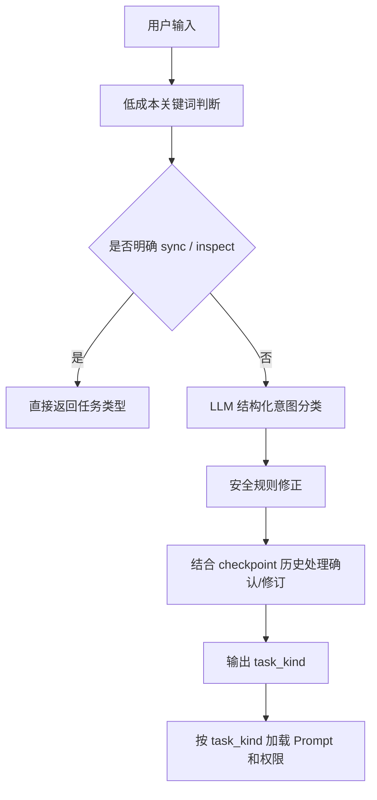

# MY-AICODING Agent 项目工程问答

本文围绕 MY-AICODING 项目整理常见 Agent 工程问题。每个问题按照统一结构回答：

```text
企业项目关切的问题 -> 常用解决方案 -> 当前项目如何解决 -> 总结
```

本文既结合当前项目，也适当扩展企业级 Agent 项目的通用设计思路。

---

## 1. Agent 项目如何保证数据安全和权限控制，Prompt 能不能保证安全？

### 企业项目关切的问题

企业最关心的是：Agent 能不能越权访问、修改或泄露数据。

普通聊天机器人主要回答问题，而 Coding Agent 会调用工具、读写文件、执行命令、访问仓库、提交代码、创建 Pull Request。这意味着 Agent 不只是“生成文本”，而是具备真实操作能力。

企业项目通常会关注以下风险：

| 风险 | 说明 |
|---|---|
| 文件越权 | Agent 读取或修改工作区外的文件，例如 `.env`、私钥、系统目录 |
| 命令越权 | Agent 执行危险命令，例如删除目录、改系统配置 |
| 数据泄露 | 把 token、API Key、私钥、数据库连接串输出到前端、日志或 PR 描述 |
| Prompt Injection | 仓库文件、网页内容或用户输入诱导 Agent 忽略规则 |
| 权限扩大 | 只读任务被误判成 coding 任务，导致 Agent 修改代码或提交 PR |
| 工具滥用 | 工具参数被模型拼错、绕过虚拟路径、重复调用或调用不该调用的工具 |

所以企业不会只问“Prompt 写得安全吗”，而是会问：

- 有没有文件系统边界？
- 有没有工具权限边界？
- 有没有任务类型权限边界？
- 有没有敏感信息脱敏？
- 有没有操作审计和日志？
- 有没有失败兜底和人工确认？

### 常用有哪些解决方案

企业级 Agent 项目通常不会只依赖 Prompt，而是采用多层防护。

| 层级 | 常见方案 |
|---|---|
| Prompt 规则 | 告诉模型不能泄露敏感信息、不能越权、不能执行危险操作 |
| 工具白名单 | 只给 Agent 暴露必要工具，不把所有内部函数都注册成工具 |
| 文件沙箱 | 所有文件读写都限制在 workspace 内 |
| 虚拟路径 | 对 Agent 暴露 `/projects`、`/tmp` 等虚拟路径，不直接暴露真实磁盘路径 |
| 权限模型 | 按任务类型区分只读、可写、可提交、可评论 |
| 中间件 | 在工具调用前清洗参数，在模型调用前清洗消息，在工具失败后统一处理 |
| 敏感信息脱敏 | 日志、前端、异常、PR 文本中隐藏 token 和私钥 |
| 人工确认 | 方案生成后，必须由用户确认再进入 coding |
| 审计日志 | 记录 Agent 调用了什么工具、执行了什么命令、修改了什么文件 |
| 运行上限 | 限制模型调用次数、工具调用次数和运行时间 |

Prompt 是必要的，但 Prompt 不是安全边界。

原因是：

1. 模型可能理解错 Prompt；
2. 用户可能输入对抗指令；
3. 仓库文件或网页内容可能包含 Prompt Injection；
4. 模型调用工具时可能拼错路径或命令；
5. Prompt 只能“劝模型不要做”，不能从系统层面阻止它做。

真正可靠的安全设计应该是：

```text
Prompt 负责表达规则
权限系统负责强制执行规则
工具层负责参数校验
后端负责最终兜底
日志负责审计追踪
```

### 当前项目是如何解决的

MY-AICODING 采用了多层防护。

#### 1. 文件系统使用 LocalShellBackend 做边界控制

当前项目不让 Agent 直接操作真实磁盘路径，而是通过 `LocalShellBackend` 暴露虚拟路径：

```text
/projects
/skills
/policies
/reviews
/runtimes
/tmp
/logs
/memories
```

Agent 看到的是虚拟路径，例如：

```text
/projects/abc-test/main.py
```

而不是直接看到：

```text
<AI_WORKSPACE_ROOT>\projects\abc-test\main.py
```

这样可以把模型能力限制在工作区中。

#### 2. 使用 DeepAgents permissions 限制读写能力

主 Agent 和子 Agent 的权限不同。

主 Agent 可以写 `/projects`，因为它要实现代码。

Reviewer 子 Agent 默认只做审查：

- 可以读 `/projects`；
- 可以读 `/policies`；
- 可以写 `/reviews`；
- 不允许修改 `/projects`；
- 不允许 commit；
- 不允许 push；
- 不允许创建 PR。

这体现了企业项目中的最小权限原则。

#### 3. 按任务类型控制是否允许写代码

项目会先识别用户任务类型：

| 任务类型 | 是否允许修改代码 |
|---|---|
| `qa` | 否 |
| `analysis` | 否 |
| `planning` | 否 |
| `review` | 否 |
| `inspect` | 否 |
| `sync` | 只允许同步 |
| `coding` | 是 |

例如用户说“先给我一个技术方案，不要修改代码”，就应该进入 `planning`，不能直接写文件。

用户确认后，例如“确认实施该方案”，才切换为 `coding`。

#### 4. 工具参数由中间件清洗

项目中有工具参数清洗中间件，用于处理：

- 路径格式错误；
- `projects/projects` 这类重复目录；
- Windows 路径兼容；
- 工具参数不符合虚拟路径约定；
- 不安全参数。

这比完全依赖模型自己写对参数更可靠。

#### 5. Gitee Token 不直接交给模型

Gitee 认证不是让模型拼 token URL，而是由后端和 `LocalShellBackend` 在执行 git 命令时自动处理。

模型只需要执行普通命令：

```bash
git clone https://gitee.com/owner/repo.git
```

禁止模型输出：

```text
https://oauth2:<token>@gitee.com/owner/repo.git
```

这样可以降低 token 泄露风险。

#### 6. Store、Checkpoint、Repo Memory 分层

当前项目把数据分成三类：

| 数据 | 存储 |
|---|---|
| 前端聊天历史 | LangGraph checkpoint |
| 任务摘要、run、review findings | 业务 Store |
| 仓库长期记忆 | LangGraph StoreBackend |

这避免了所有数据混在一个表里，也方便分别控制用途和删除策略。

#### 7. 日志和运行记录

项目会记录：

- Agent 运行状态；
- 工具调用；
- 任务状态；
- 错误原因；
- review findings；
- PR 地址；
- 分支信息。

日志用于排查问题，也用于教学时展示 Agent 执行过程。

### 总结

Prompt 不能单独保证安全。

MY-AICODING 的安全思路是：

```text
Prompt 约束模型行为
任务分类限制写权限
DeepAgents permissions 限制文件访问
LocalShellBackend 限制真实路径和命令环境
工具中间件清洗参数
Token 由后端注入，不暴露给模型
Store / checkpoint / memory 分层存储
日志记录操作过程
```

这才是企业级 Agent 项目比较合理的安全架构。

---

## 2. 为什么项目中的 Agent 不是单例？

### 企业项目关切的问题

企业项目会关心 Agent 实例的生命周期。

常见问题包括：

- 每个用户是否共享同一个 Agent？
- 多个任务并发时，会不会互相污染上下文？
- Agent 里的工具、权限、仓库、记忆是否和当前会话绑定？
- 如果用单例，任务 A 的仓库信息会不会影响任务 B？
- 如果每次创建 Agent，会不会性能太差？

Coding Agent 和普通服务对象不同，它内部通常绑定：

- 模型；
- 工具；
- backend；
- permissions；
- middleware；
- skills；
- checkpointer config；
- thread_id；
- repo_url；
- task_kind。

这些信息有很多是“当前任务相关”的，不适合作为全局单例。

### 常用有哪些解决方案

Agent 生命周期常见有三种模式。

| 模式 | 说明 | 优点 | 缺点 |
|---|---|---|---|
| 全局单例 Agent | 服务启动时创建一个 Agent，全局复用 | 创建成本低 | 容易上下文串扰，权限难隔离 |
| 每次请求创建 Agent | 每轮请求根据 config 创建 Agent | 隔离性好，配置灵活 | 创建成本略高 |
| Agent 工厂 + backend 缓存 | Agent 每次创建，但 backend / store / checkpointer 复用 | 兼顾隔离和性能 | 架构稍复杂 |

企业项目更常见的是第三种：

```text
Agent 对象按请求创建
底层资源按 thread / user / repo 复用
状态交给 checkpoint 和 store 保存
```

这样 Agent 本身是轻量的运行编排对象，不承担长期状态存储。

### 当前项目是如何解决的

MY-AICODING 使用的是：

```text
每轮构建 Agent 实例 + 按 thread 复用 LocalShellBackend + checkpoint 保存历史
```

核心思想是：

1. Agent 实例不是长期状态容器；
2. 每次运行根据 `thread_id`、`task_kind`、`repo_url` 重新装配；
3. 真正长期状态由 checkpoint、Store 和 repo memory 管理；
4. backend 可以按 thread 缓存，避免重复创建工作区上下文。

项目中的 `get_agent(config)` 会根据当前 config 构建 Agent：

```text
thread_id
task_kind
repo_url
backend
model
tools
subagents
permissions
middleware
skills
checkpointer
store
```

这样做的好处是：

| 点 | 说明 |
|---|---|
| 任务隔离 | 每轮运行都按当前任务类型装配 Prompt 和权限 |
| 仓库隔离 | repo memory namespace 与当前仓库绑定 |
| 会话隔离 | checkpoint 使用 thread_id 管理历史 |
| 权限灵活 | reviewer、planning、coding 可以有不同权限 |
| 方便教学 | 可以清楚讲解 Agent 工厂的装配过程 |

### 总结

MY-AICODING 的 Agent 不是单例，是为了避免上下文、权限和仓库状态混在一起。

它采用的是更适合企业项目的模式：

```text
Agent 实例按请求创建
backend 按 thread 复用
checkpoint 保存会话历史
Store 保存业务数据
StoreBackend 保存仓库记忆
```

这样既能保证隔离，也不会让所有状态都塞进一个全局 Agent 对象里。

---

## 3. 你的代码审查为什么要使用 SubAgent，这个子 Agent 有什么特色？

### 企业项目关切的问题

代码审查和代码实现是两类不同任务。

企业项目通常希望：

- 写代码的 Agent 不要自己审自己；
- 审查过程要更客观；
- 审查规则要稳定；
- 审查结果要结构化；
- 审查时不能偷偷改代码；
- 审查报告可以被后续修复流程读取。

如果主 Agent 同时负责写代码和审查代码，容易出现：

- 审查粒度不稳定；
- 审查变成自我解释；
- 忽略自己刚写的 bug；
- 审查中顺手修改代码；
- 审查结论没有结构化沉淀。

### 常用有哪些解决方案

企业中常见代码审查 Agent 方案有几种。

| 方案 | 说明 |
|---|---|
| 主 Agent 直接 review | 简单，但职责混杂 |
| 单独 reviewer 服务 | 独立进程或服务做代码审查 |
| SubAgent reviewer | 主 Agent 委派专门子 Agent 审查 |
| 多 reviewer 投票 | 多个模型或规则引擎分别审查，再合并结果 |
| 静态分析 + LLM | 先跑 lint/test/security scanner，再让 LLM 总结 |

SubAgent 的价值在于：

```text
主 Agent 负责流程
Reviewer 子 Agent 负责专业审查
工具和权限按角色隔离
结果可结构化保存
```

### 当前项目是如何解决的

MY-AICODING 设计了 `code_reviewer` 子 Agent。

它的职责是：

1. 读取 Gitee PR 上下文；
2. 读取本地 diff；
3. 读取审查规则；
4. 逐文件审查；
5. 校验 finding 行号；
6. 写入结构化 findings；
7. 输出中文审查报告；
8. 必要时保存 `/reviews/*.md` 报告。

它的特色主要有四点。

#### 1. 只读权限

Reviewer 子 Agent 默认不能修改 `/projects`。

它只负责审查，不负责修复。

这能避免：

- review 阶段误改代码；
- 审查职责和实现职责混在一起；
- 用户明明说“只 review”，Agent 却提交代码。

#### 2. 审查规则可扩展

当前项目支持多层规则：

| 规则来源 | 作用 |
|---|---|
| `/policies/review_rules.md` | 工作区统一审查规则 |
| `/projects/<repo>/.lx/review-rules.md` | 仓库级补充规则 |
| `load_default_review_rules` | 默认规则兜底 |

目前规则读取已经调整为：

```text
skill 自己用 read_file 读取工作区和仓库规则
如果读不到，再调用 load_default_review_rules 兜底
```

这样不会在工具里私自创建 backend，权限更统一。

#### 3. findings 结构化保存

Reviewer 不只是输出一段自然语言，它还会调用：

```text
add_review_finding
list_review_findings
```

结构化 finding 存在：

```text
data/store.sqlite
review_findings 表
```

每个 finding 包含：

```text
file
line
severity
title
description
status
thread_id
```

这样后续主 Agent 可以读取 findings，生成修复方案，形成闭环。

#### 4. 可以形成 review -> plan -> coding 闭环

流程是：

```text
用户要求审查 PR
    ↓
主 Agent 委派 code_reviewer
    ↓
子 Agent 生成中文审查报告和 findings
    ↓
用户要求根据审查报告生成修复方案
    ↓
主 Agent 读取 /reviews 和 list_review_findings
    ↓
生成修复方案
    ↓
用户确认
    ↓
主 Agent 进入 coding 修复代码
```

### 总结

代码审查使用 SubAgent 的核心原因是职责隔离。

MY-AICODING 的 reviewer 子 Agent 具备：

- 只读权限；
- 专门的 code-review skill；
- Gitee PR 上下文读取；
- diff 摘要和行号校验；
- 结构化 findings；
- 中文审查报告；
- review 修复闭环。

这比主 Agent 自己顺手 review 更适合企业级 Agent 工程。

---

## 4. Agent 项目中工具失败怎么办？或者出现循环调用怎么办？

### 企业项目关切的问题

Agent 项目最容易出现两类运行问题：

1. 工具失败；
2. 循环调用。

工具失败包括：

| 类型 | 示例 |
|---|---|
| 参数错误 | 路径写错、repo_dir 写错 |
| 权限错误 | 访问工作区外路径 |
| 命令失败 | pytest 失败、git push 失败 |
| 网络失败 | Gitee API 超时 |
| 认证失败 | token 不正确、权限不足 |
| 文件锁 | SQLite database is locked |
| 模型工具调用错误 | tool message 和 tool call 不匹配 |

循环调用包括：

- 反复读取同一个文件；
- 反复运行同一个失败命令；
- 测试失败后不分析错误，继续重复跑测试；
- commit/push 失败后重复尝试；
- 模型一直调用工具但不输出结论；
- 代码改动越来越大，迟迟不收尾。

企业项目关心的是：Agent 失败后能不能恢复，不能恢复时能不能停止，而不是无限跑。

### 常用有哪些解决方案

常见方案包括：

| 方案 | 说明 |
|---|---|
| 工具异常包装 | 工具失败后返回结构化错误，而不是直接崩溃 |
| Tool Error Middleware | 统一捕获工具错误，给模型可理解的反馈 |
| 参数清洗 | 工具执行前修正常见参数问题 |
| 重试策略 | 对网络、锁、临时失败做有限重试 |
| 运行上限 | 限制模型调用、工具调用、执行时间 |
| 任务计划 | 用 `write_todos` 约束任务推进 |
| 状态追踪 | 前端展示任务计划和运行状态 |
| 失败总结 | 失败时输出明确原因和下一步建议 |
| 人工确认 | 高风险操作前需要用户确认 |

循环调用通常要靠两类机制控制：

```text
Prompt 让模型知道什么时候收尾
后端强制限制调用次数和运行时间
```

### 当前项目是如何解决的

MY-AICODING 在多个层面处理工具失败和循环调用。

#### 1. ToolErrorMiddleware 统一处理工具错误

工具失败时，不是简单把 Python traceback 丢给用户，而是：

- 记录日志；
- 生成前端可见事件；
- 给模型反馈错误；
- 对部分可恢复错误提供提示。

比如：

- 路径越界；
- Gitee PR 创建失败；
- 命令失败；
- 文件不存在；
- SQLite 锁；
- Git 认证失败。

#### 2. SanitizeToolInputsMiddleware 清洗工具参数

模型经常会把路径写错。

例如：

```text
projects/projects/abc-test
<AI_WORKSPACE_ROOT>\projects\abc-test
```

项目会通过中间件把常见错误纠正到符合 backend 规则的路径。

#### 3. MessageSanitizeMiddleware 处理 tool message 兼容问题

LangGraph checkpoint 恢复历史时，可能出现孤立 ToolMessage。

项目通过消息清洗中间件避免模型请求报错，例如：

```text
Messages with role 'tool' must be a response to a preceding tool call
```

这类清洗只发生在发给模型前，不污染 checkpoint。

#### 4. ModelCallLimitMiddleware 限制模型调用

项目设置了模型调用保护上限。

当模型调用次数超过阈值时，会停止本轮运行，避免无限循环。

这对于复杂 coding 任务非常重要。

#### 5. 自定义运行上限

除了模型调用限制，项目还可以根据任务类型设置：

- 最大工具调用次数；
- 最大运行时间；
- review / coding 不同阈值；
- 失败后是否终止。

#### 6. write_todos 约束任务进度

每轮任务必须先调用 `write_todos` 生成任务清单。

前端会展示：

```text
0 out of 5 tasks completed
1. 读取仓库
2. 分析需求
3. 修改代码
4. 运行测试
5. 提交 PR
```

这样用户能看到 Agent 正在做什么，也能发现是否卡在某一步。

#### 7. 测试失败后允许循环修复

如果 pytest 失败，Agent 不应该直接退出。

更合理的流程是：

```text
运行测试
    ↓
读取失败信息
    ↓
定位相关文件
    ↓
修复代码
    ↓
再次运行相关测试
    ↓
通过后收尾
```

但这个循环必须有上限，不能无限修。

### 总结

Agent 工具失败和循环调用是企业项目里的常见问题。

MY-AICODING 的处理方式是：

```text
工具失败 -> ToolErrorMiddleware 统一处理
参数错误 -> SanitizeToolInputsMiddleware 清洗
消息异常 -> MessageSanitizeMiddleware 修正
循环调用 -> 模型调用上限 + 工具调用上限 + 时间上限
过程失控 -> write_todos 任务计划约束
测试失败 -> 允许有限循环修复
最终失败 -> 输出明确失败原因
```

核心原则是：允许 Agent 自主修复，但不能无限自主运行。

---

## 5. 为什么要设计 Agent 的长期记忆，当前项目的长期记忆有什么特点？

### 企业项目关切的问题

Coding Agent 最大的浪费之一是重复分析。

如果每次打开同一个仓库都重新做这些事：

- 仓库目录结构；
- 技术栈；
- 启动命令；
- 测试命令；
- 关键模块；
- 已知坑；
- 最近 PR；
- 项目约定；

模型会消耗大量 token 和工具调用。

企业项目关心：

- Agent 能不能记住每个仓库的稳定知识？
- 多仓库之间记忆会不会串？
- 记忆是否可维护？
- 记忆是否会保存敏感信息？
- 记忆是否会过期或污染？

### 常用有哪些解决方案

长期记忆常见有几种。

| 方案 | 说明 |
|---|---|
| 固定 Prompt | 把项目规则写死在系统提示词里 |
| 文档记忆 | 每个仓库维护一个 markdown 记忆文件 |
| 向量数据库 | 把代码、文档、历史经验 embedding 后检索 |
| KV Store | 按 namespace/key 存储仓库摘要 |
| 数据库表 | 自定义 repo_memory 表保存结构化字段 |
| 混合方案 | Markdown 记忆 + 结构化字段 + 检索 |

对 Coding Agent 来说，第一版最实用的通常是：

```text
仓库级 Markdown 记忆
```

因为它可读、可改、可展示、适合教学。

### 当前项目是如何解决的

MY-AICODING 使用仓库级长期记忆。

记忆路径规则是：

```text
/memories/{owner}/{repo}.md
```

例如：

```text
/memories/owner-example/abc-test.md
```

它不是普通磁盘文件，而是通过 DeepAgents `StoreBackend` 映射到底层 LangGraph Store。

底层数据库是：

```text
data/langgraph_store.sqlite
```

#### 1. 按仓库隔离

记忆不是全局一个 `repo.md`，而是按 owner/repo 隔离。

这样可以避免：

```text
abc-test 的记忆影响 ai_coding
ai_coding 的测试命令影响 efg-test
```

#### 2. 任务开始时注入

运行时根据用户传入的 Gitee 仓库地址解析：

```text
owner/repo
```

然后准备对应的 memory namespace，并把记忆内容注入 Agent 上下文。

#### 3. 首次处理仓库时初始化

如果仓库记忆不存在，会初始化一个模板。

模板中通常包括：

- 基本信息；
- 技术栈；
- 启动命令；
- 测试命令；
- 关键文件；
- 最近任务结论；
- 已知注意事项。

#### 4. 只在 coding 成功后更新

当前项目已经明确：

```text
planning 成功后不写仓库记忆
MemoryUpdateMiddleware 不再兜底写记忆
coding 成功后由 runtime 主路径更新记忆
```

这样可以避免“只生成方案但没改代码”的内容污染仓库记忆。

#### 5. 禁止写入敏感信息

仓库记忆不能保存：

- token；
- 私钥；
- `.env`；
- `.secrets`；
- 本机敏感路径；
- 临时错误猜测。

### 总结

长期记忆的价值是减少重复分析，提高多轮开发效率。

MY-AICODING 的长期记忆特点是：

```text
仓库级隔离
路径固定为 /memories/{owner}/{repo}.md
底层使用 StoreBackend
任务开始时注入
首次处理时初始化
coding 成功后更新
planning 不更新
禁止写敏感信息
```

这是一种适合教学和企业第一版落地的长期记忆方案。

---

## 6. Agent 项目有多层用户意图识别吗？

### 企业项目关切的问题

企业项目非常关心用户意图识别，因为意图决定权限。

同一句话如果识别错，后果可能很严重。

例如：

```text
“帮我看看这个 PR 有什么问题，不要修改代码”
```

应该是 `review`，只读。

如果误判成 `coding`，Agent 可能直接改代码、提交、push。

再比如：

```text
“根据这个审查报告给我一个修复方案，先不要改”
```

应该是 `planning`，不是 `review`，也不是 `coding`。

企业关心：

- 是否能识别只读任务？
- 是否能识别 coding 任务？
- 是否能识别 review 任务？
- 是否能处理“确认实施”这种短回复？
- 是否能处理多轮方案修订？
- 是否有安全兜底？

### 常用有哪些解决方案

意图识别常见有多层方案。

| 层级 | 方案 |
|---|---|
| 第一层 | 关键词规则，识别低歧义任务 |
| 第二层 | 小模型或主模型结构化分类 |
| 第三层 | 安全规则修正 |
| 第四层 | 结合历史上下文判断短回复 |
| 第五层 | 后端权限最终兜底 |

企业项目通常不会完全依赖 LLM 分类。

推荐结构：



### 当前项目是如何解决的

MY-AICODING 采用多层意图识别。

#### 1. 关键词快速识别

对于低歧义任务，先用规则判断：

| 任务 | 示例 |
|---|---|
| `sync` | “帮我 pull 一下代码” |
| `inspect` | “当前工作区有哪些项目” |

这些任务没必要调用模型。

#### 2. LLM 结构化分类

普通任务会调用模型，并要求返回结构化 JSON。

分类结果包括：

```text
task_kind
confidence
reason
```

任务类型包括：

```text
coding
planning
analysis
qa
sync
inspect
review
```

#### 3. 安全规则修正

即使模型分类为 `coding`，如果用户明确说：

```text
不要修改代码
只给方案
只 review
不要提交
不要 push
```

后端也会强制降级为只读任务。

#### 4. 处理 review 修复方案

当前项目专门处理：

```text
审查报告 + review findings + 修复方案 + 不修改代码
```

这类任务应该是 `planning`，而不是重新做 `review`。

#### 5. 处理“确认实施”

用户输入：

```text
确认
确认实施
开始实施
按方案执行
```

项目会结合 checkpoint 中上一轮技术方案，把任务切换为 `coding`。

这就是多轮上下文意图识别。

### 总结

MY-AICODING 不是单层关键词判断，而是：

```text
关键词快速判断
    ↓
LLM 结构化分类
    ↓
安全规则修正
    ↓
结合 checkpoint 处理确认实施
    ↓
按 task_kind 加载 Prompt、权限和运行流程
```

企业级 Agent 项目中，意图识别不是为了“分类好看”，而是为了控制权限和运行流程。

---

## 7. 怎么保证 SSE 的流式输出稳定性？

### 企业项目关切的问题

Agent 项目的用户体验很依赖流式输出。

如果没有流式输出，用户会觉得：

- Agent 卡住了；
- 不知道执行到哪一步；
- 不知道是否正在调用工具；
- 长任务体验很差；
- 失败时不知道失败在哪里。

企业项目更关心：

- 多轮对话会不会乱序？
- 用户输入会不会覆盖上一轮？
- assistant 内容会不会丢？
- 工具消息是否会污染页面？
- 刷新后历史能不能恢复？
- SSE 断开后怎么处理？
- Store 和 checkpoint 会不会重复参与展示？

### 常用有哪些解决方案

稳定 SSE 通常需要从数据源、事件协议和前端渲染三方面设计。

| 方面 | 常见方案 |
|---|---|
| 事件协议 | 定义清晰事件类型，例如 `user_message`、`text_delta`、`todo_delta`、`done` |
| 消息 id | 每条消息有稳定 id，避免覆盖 |
| 顺序追加 | 前端只 append，不随意重排 |
| 前后端单一历史源 | 历史从 checkpoint 读，业务 Store 不拼聊天正文 |
| 实时与历史分离 | 当前运行用 SSE，刷新后用 checkpoint |
| 心跳事件 | 长时间无输出时发送 keep-alive |
| 错误事件 | 后端异常时发送 `error`，而不是直接断开 |
| 前端容错 | SSE 失败时显示错误，不清空已有内容 |
| 去重策略 | 避免 seed/writes 或重连导致重复消息 |

### 当前项目是如何解决的

MY-AICODING 经过多轮调整后，形成了比较清晰的三层结构：

```text
V3 实时流
    ↓
checkpoint 历史
    ↓
Store 业务数据
```

#### 1. 当前轮运行走 POST SSE

前端提交用户输入后，后端直接返回 SSE 流。

典型事件包括：

| 事件 | 说明 |
|---|---|
| `thread_snapshot` | 当前 thread 基础信息 |
| `user_message` | 用户输入，前端立即追加 |
| `message_start` | assistant 消息开始 |
| `text_delta` | assistant token/chunk |
| `todo_delta` | write_todos 任务计划更新 |
| `thread_done` | 任务结束摘要 |
| `error` | 运行失败 |
| `done` | SSE 结束 |

#### 2. 任务计划单独展示

`write_todos` 产生的任务计划不和普通 assistant 正文混在一起。

前端可以稳定展示：

```text
任务计划
3 out of 5 tasks completed
```

这让用户知道 Agent 当前执行到哪一步。

#### 3. 非空 AIMessage 可以流式输出

项目支持把非空 assistant 文本通过 `text_delta` 流式推送。

这样用户不会等到任务结束才看到完整技术方案或审查报告。

#### 4. checkpoint 是历史正文唯一来源

刷新页面或点击左侧历史会话时，前端只从 checkpoint 恢复 user/assistant 正文。

Store 不再参与聊天正文拼接。

这样避免了之前出现的问题：

- 用户输入被覆盖；
- 新一轮输入插到上一轮中间；
- Store 和 checkpoint 双数据源乱序；
- 完成后实时流切换稳定快照导致内容消失。

#### 5. checkpoint_history.py 做历史清洗

checkpoint 中保存的是 LangGraph 原始消息，不能直接给前端。

所以项目用 `checkpoint_history.py`：

- 提取 HumanMessage；
- 还原用户可见输入；
- 提取有价值 AIMessage；
- 过滤 tool/system；
- 按内容去重；
- 生成稳定 message id。

#### 6. Store 只保存业务数据

Store 保存：

- thread 摘要；
- run 状态；
- review findings；
- PR 地址；
- 任务元信息。

它不参与聊天正文展示。

### 总结

SSE 稳定性的关键不是“能不能流式输出 token”，而是：

```text
实时事件协议清晰
用户输入立即追加
assistant token 顺序追加
任务计划单独展示
历史正文只从 checkpoint 恢复
Store 不拼聊天正文
消息 id 稳定
错误事件明确
```

MY-AICODING 当前的设计可以概括为：

```text
当前轮：POST SSE 实时流
刷新后：checkpoint 恢复历史
业务状态：Store 单独保存
```

这是一种适合企业 Agent Dashboard 的稳定架构。

---

## 总体总结

MY-AICODING 不是一个简单的“调用大模型写代码”的 Demo，而是一个包含工程化边界的 Agent 项目。

它涉及：

| 能力 | 当前项目体现 |
|---|---|
| 安全边界 | Prompt + permissions + LocalShellBackend + 工具清洗 |
| Agent 生命周期 | 非单例 Agent 工厂 + thread backend 复用 |
| 子 Agent 协作 | code_reviewer 只读审查 |
| 工具治理 | 工具失败处理、参数清洗、调用上限 |
| 长期记忆 | 仓库级 `/memories/{owner}/{repo}.md` |
| 意图识别 | 关键词 + LLM 结构化分类 + 安全修正 |
| 流式输出 | POST SSE + checkpoint 历史 + Store 业务数据 |
| Gitee 集成 | 只支持 Gitee，包含 PR、评论、Token 注入 |
| 教学价值 | 可以完整讲解企业级 AI Coding Agent 架构 |

可以用一句话概括：

> 这个项目的重点不是让模型“能写代码”，而是围绕 AI Coding 场景，把权限、安全、工具、记忆、意图识别、流式交互和代码审查闭环工程化。
