# MY-AICODING Agent 运行调度与流式输出详解

本文专门讲解 MY-AICODING 项目的 **Agent 运行调度** 和 **前后端流式输出链路**。它对应当前项目的最新实现：前端使用 Vue + JavaScript，后端使用 FastAPI，Agent 使用 DeepAgents，实时输出使用 DeepAgents 官方 `stream_events(version="v3")`，历史消息从 LangGraph checkpoint 恢复，业务摘要写入本地 SQLite Store。

> 课堂定位：这一章不讲前端页面样式，只讲“用户输入如何变成一次 Agent 运行，以及模型、任务计划、工具事件如何实时显示到网页上”。

---

## 1. 总体架构

### 1.1 当前项目的三层数据结构

MY-AICODING 当前采用三层结构：

| 层 | 作用 | 主要文件 | 是否参与前端正文展示 |
| --- | --- | --- | --- |
| 实时流 | 当前这一轮运行过程中的用户输入、任务计划、AI 文本 chunk、完成事件 | `agent/api/dashboard_routes.py`、`agent/core/streaming_runtime.py`、`ui/src/api/sse.js`、`ui/src/stores/agent.js` | 是，实时追加 |
| checkpoint 历史 | LangGraph 保存的 thread state 和消息历史，页面刷新后从这里恢复历史对话 | `agent/core/checkpoint_history.py`、`agent/core/graph.py` | 是，刷新或打开会话时读取 |
| 业务 Store | 任务列表、运行状态、PR 地址、review findings、run_events、settings | `agent/store/sqlite_store.py`、`agent/core/events.py` | 不参与聊天正文展示，只参与任务摘要、侧边栏、删除清理 |

核心原则：

- 当前轮的页面内容，来自 POST SSE 实时事件。
- 刷新页面或点击历史会话，正文来自 checkpoint。
- Store 不再拼接聊天正文，避免 Store 和 checkpoint 两套数据源造成重复、覆盖和乱序。
- 删除会话时，需要同时删除 Store 业务数据和 checkpoint 历史。

### 1.2 总体时序图

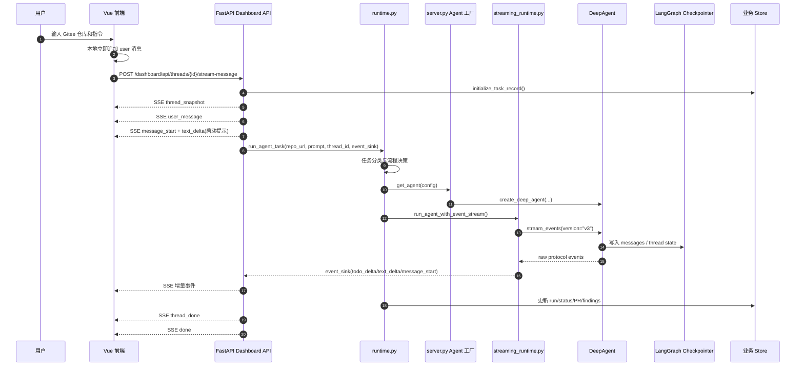

---

## 2. 用户输入如何进入后端

### 2.1 前端提交入口

前端主要入口在：

- `ui/src/components/ChatComposer.vue`
- `ui/src/stores/agent.js`
- `ui/src/api/sse.js`

用户点击发送后，Pinia store 的 `submit(content)` 会执行以下动作：

1. 去掉首尾空白，得到 `prompt`。
2. 如果当前正在 streaming，则拒绝重复发送。
3. 创建本地临时用户消息，立即 push 到 `messages`。
4. 创建 `AbortController`，支持停止当前 SSE。
5. 调用 `consumeMessageStream(threadId, prompt)`。

伪代码：

```js
async submit(content) {
  const prompt = content.trim()
  if (!prompt || this.streaming) return

  this.streaming = true
  this.controller = new AbortController()

  const localUserMessage = createTextMessage('user', prompt, 'local-user')
  this.messages.push(localUserMessage)

  await this.consumeMessageStream(this.currentThread?.id || null, prompt)
}
```

这里有一个关键设计：**用户输入先在前端本地追加，再提交到后端**。这样可以保证用户点击发送后，页面上马上看到自己输入的内容，不需要等待后端创建任务或模型启动。

### 2.2 新会话和已有会话的 POST SSE 接口

前端根据是否有当前 `threadId`，调用不同接口：

| 场景 | 请求接口 | 后端函数 |
| --- | --- | --- |
| 新会话 | `POST /dashboard/api/threads/stream-message` | `dashboard_stream_new_message()` |
| 已有会话继续输入 | `POST /dashboard/api/threads/{thread_id}/stream-message` | `dashboard_stream_existing_message()` |

这两个接口最终都会调用：

```python
_post_streaming_response(thread_id=thread_id, repo_url=repo_url, content=body.content)
```

这个函数是当前项目实时流的核心入口。它不再采用旧版“POST 创建任务 + GET 轮询事件”的两段式方案，而是在同一个 POST 响应里持续返回 SSE。

---

## 3. POST SSE 的设计

### 3.1 为什么不用旧版 GET 轮询

早期实现中，页面大致是：

1. POST 创建任务。
2. 后端后台线程运行 Agent。
3. 前端不断 GET 任务状态和 run_events。
4. 历史消息又从 checkpoint 或 Store 读取。

这个模式的问题是数据源太多：

| 内容 | 旧来源 |
| --- | --- |
| 用户输入 | 前端本地追加 |
| 任务计划 | run_events 轮询 |
| AI 正文 | checkpoint 或 Store |
| 任务状态 | Store |

多个数据源容易产生时序竞争。例如：新一轮用户输入已经追加，但轮询拿到的旧 run_events 或 checkpoint 快照又把当前消息列表覆盖，导致“用户输入一闪而过”“第二轮任务计划插到上一轮中间”等问题。

当前方案改为：

> 当前轮内容只走一条 POST SSE 流，按事件顺序追加到前端。

### 3.2 后端 SSE 事件格式

后端统一使用标准 SSE 命名事件：

```text
event: text_delta
data: {"thread_id": "...", "message_id": "...", "content": "..."}
```

生成函数在 `agent/api/dashboard_routes.py`：

```python
def _sse_part(event: str, data: dict[str, Any]) -> str:
    return f"event: {event}\ndata: {json.dumps(data, ensure_ascii=False, default=str)}\n\n"
```

前端 `ui/src/api/sse.js` 会解析 `event:` 和 `data:`，再交给 Pinia store 处理。

### 3.3 当前支持的 SSE 事件

| 事件名 | 作用 | 前端处理方式 |
| --- | --- | --- |
| `thread_snapshot` | 返回当前 thread 元信息，不含 messages | 更新当前会话状态、仓库、分支、PR |
| `user_message` | 后端确认的用户消息 | 把本地临时用户消息替换成稳定 id，或追加 |
| `message_start` | 开始一条 AI 消息 | 创建空 agent 消息 |
| `text_delta` | AI 文本增量 | append 或 replace 到指定 message |
| `todo_delta` | DeepAgents `write_todos` 的任务计划 | 更新任务计划卡片 |
| `thread_done` | 本轮运行完成后的 thread 元信息 | 更新状态、PR、分支 |
| `error` | 后端或 Agent 运行异常 | 页面显示错误 |
| `done` | SSE 流结束 | 前端结束 streaming 状态 |

### 3.4 POST SSE 后端内部结构

`_post_streaming_response()` 内部有一个典型的生产者/消费者结构：

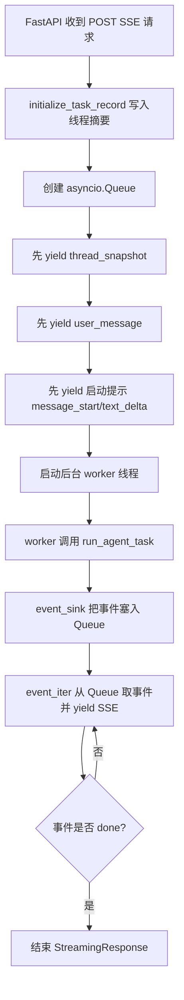

为什么这里需要后台线程？

- FastAPI 的 `StreamingResponse` 是异步生成器。
- Agent 运行是同步阻塞流程。
- 如果直接在 async generator 中执行 Agent，会阻塞事件循环。
- 所以用 `threading.Thread` 运行 Agent，再通过 `asyncio.Queue` 把事件安全送回 SSE。

### 3.5 `dashboard_routes.py` 的详细职责

`agent/api/dashboard_routes.py` 是 FastAPI 和 Vue Dashboard 之间的适配层。它不是 Agent 核心推理层，也不是 DeepAgents 工厂层，而是一个 **Web API 边界层**。

可以把它理解成四件事：

| 职责 | 具体说明 | 相关函数 |
| --- | --- | --- |
| 页面初始化 | 给前端提供当前用户、模型下拉框、默认模型等信息 | `dashboard_me()`、`dashboard_options()` |
| 历史会话读取 | 给左侧会话列表和历史详情提供稳定数据 | `dashboard_threads()`、`dashboard_thread_detail()` |
| 当前轮实时运行 | 接收用户输入，创建或复用 thread，返回 POST SSE 实时事件 | `dashboard_stream_new_message()`、`dashboard_stream_existing_message()`、`_post_streaming_response()` |
| 删除会话 | 删除 Store 业务数据和 checkpoint 历史 | `dashboard_delete_thread()` |

它和 `runtime.py` 的边界非常重要：

| 文件 | 更接近哪一层 | 主要问题 |
| --- | --- | --- |
| `dashboard_routes.py` | HTTP/SSE 产品接口层 | 前端怎么请求、后端怎么响应、SSE 怎么发 |
| `runtime.py` | Agent 运行调度层 | 当前用户输入应该走 planning、coding、review 还是 qa |
| `server.py` | Agent 工厂层 | 这个 Agent 应该有哪些模型、工具、子 Agent、权限、中间件 |
| `streaming_runtime.py` | DeepAgents 事件适配层 | 如何消费 `stream_events(version="v3")` 并转换为前端事件 |

一句话总结：

> `dashboard_routes.py` 只负责“接住前端请求并把后端事件推回前端”，不负责判断任务策略，也不负责组装 Agent。

### 3.6 FastAPI 路由结构

当前 Dashboard API 统一挂载在：

```python
dashboard_router = APIRouter(prefix="/dashboard/api")
```

也就是说，文件中的路由都会自动加上 `/dashboard/api` 前缀。

主要接口如下：

| HTTP 方法 | 路径 | 后端函数 | 前端用途 |
| --- | --- | --- | --- |
| `GET` | `/dashboard/api/me` | `dashboard_me()` | 页面初始化时获取用户信息 |
| `GET` | `/dashboard/api/options` | `dashboard_options()` | 获取模型列表和默认模型 |
| `GET` | `/dashboard/api/threads` | `dashboard_threads()` | 左侧会话列表 |
| `GET` | `/dashboard/api/threads/{thread_id}` | `dashboard_thread_detail()` | 打开历史会话 |
| `POST` | `/dashboard/api/threads/stream-message` | `dashboard_stream_new_message()` | 新建会话并实时运行 Agent |
| `POST` | `/dashboard/api/threads/{thread_id}/stream-message` | `dashboard_stream_existing_message()` | 在已有会话中继续对话 |
| `DELETE` | `/dashboard/api/threads/{thread_id}` | `dashboard_delete_thread()` | 删除会话 |

这套 API 的重点不是 REST 资源建模，而是为了让前端拥有清晰的三类操作：

1. **读配置**：`/me`、`/options`
2. **读历史**：`/threads`、`/threads/{thread_id}`
3. **跑任务**：`POST /stream-message`
4. **删会话**：`DELETE /threads/{thread_id}`

### 3.7 FastAPI 为什么使用 `StreamingResponse`

普通 HTTP 响应是“一次请求，一次完整返回”。这不适合 Agent 项目，因为 Agent 可能需要：

- 读取仓库文件；
- 生成任务计划；
- 调用模型多轮推理；
- 执行命令；
- 创建或复用 PR；
- 输出很长的技术方案或审查报告。

如果等全部完成后再返回，用户会长时间看不到任何反馈。

所以当前项目使用 FastAPI 的：

```python
StreamingResponse(event_iter(), media_type="text/event-stream")
```

它允许后端在一个 HTTP 响应中持续 `yield` 多段 SSE 文本。前端可以边接收边渲染。

简化伪代码：

```python
async def event_iter():
    yield sse("user_message", {"content": content})
    yield sse("message_start", {"message_id": message_id})

    while True:
        event, data = await queue.get()
        yield sse(event, data)
        if event == "done":
            break

return StreamingResponse(event_iter(), media_type="text/event-stream")
```

这里的关键点是：`event_iter()` 是异步生成器，每次 `yield` 都会向浏览器推送一段内容。

### 3.8 为什么用 POST SSE，而不是 EventSource GET

浏览器原生 `EventSource` 只能发 GET 请求，不适合当前场景。因为 Agent 每轮运行需要提交比较完整的请求体：

```json
{
  "content": "用户输入的任务",
  "repo": "owner-example/efg-test",
  "model_id": "deepseek-v4-pro",
  "effort": "default"
}
```

如果使用 GET，只能把这些内容拼到 URL 查询参数里，会有几个问题：

| 问题 | 说明 |
| --- | --- |
| URL 长度限制 | 技术方案修改、代码审查指令可能很长 |
| 中文编码麻烦 | 用户输入包含中文、换行、Markdown 时不适合放 URL |
| 隐私风险 | URL 更容易出现在浏览器历史、代理日志中 |
| 语义不合适 | “启动一次 Agent 运行”本质上是提交任务，不是读取资源 |

因此当前项目用 `fetch(..., { method: "POST" })` 发起请求，再手动读取 `response.body` 的流。这就是 POST SSE。

### 3.9 `_post_streaming_response()` 的执行顺序

`_post_streaming_response()` 是当前 Dashboard 后端最关键的函数。它把一次前端输入转换成一条实时 SSE 流。

核心顺序如下：

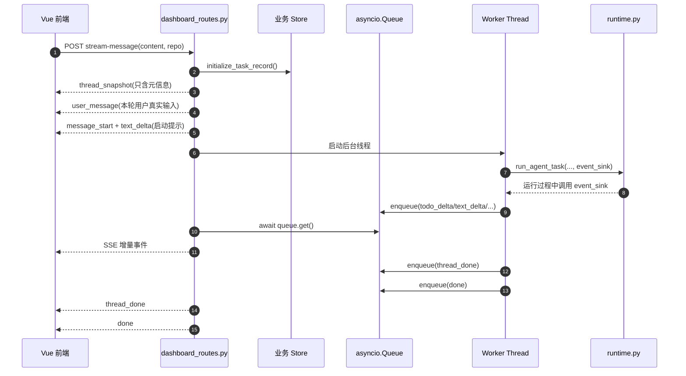

几个设计点：

1. `thread_snapshot` 不包含 `messages`  
   它只更新当前会话的仓库、状态、分支、PR 等元信息，不能覆盖前端已经追加的本轮用户输入。

2. `user_message` 必须尽早发送  
   用户输入进入后端后，后端立即通过 `user_message` 确认这轮输入，前端据此稳定本地临时消息。

3. Agent 在后台线程运行  
   避免阻塞 FastAPI 的异步响应生成器。

4. `event_sink` 是 runtime 到 SSE 的桥  
   `runtime.py` 和 `streaming_runtime.py` 不知道 FastAPI 的存在，只调用 `event_sink(event, data)`。

5. `done` 是 SSE 结束信号  
   前端收到 `done` 后关闭本轮 streaming 状态，输入框恢复可用。

### 3.10 `asyncio.Queue` 和后台线程为什么同时存在

这里容易让初学者困惑：为什么不用一个普通函数直接跑？

原因是 FastAPI 的 SSE 发送发生在异步世界，而 Agent 运行发生在同步世界。

| 部分 | 执行模型 |
| --- | --- |
| `StreamingResponse(event_iter())` | async/await，运行在事件循环中 |
| `run_agent_task()` | 同步阻塞函数 |
| DeepAgents 工具调用 | 可能执行文件、命令、网络请求，耗时不可控 |

如果在 `event_iter()` 里直接调用 `run_agent_task()`：

```python
async def event_iter():
    run_agent_task(...)  # 阻塞
    yield sse(...)
```

那么 `yield` 要等 Agent 全部结束后才执行，页面又会变成“一次性输出”。

当前做法是：

```python
thread = threading.Thread(target=worker, daemon=True)
thread.start()

while True:
    event, data = await queue.get()
    yield _sse_part(event, data)
```

这样：

- worker 线程负责慢任务；
- async generator 负责持续发 SSE；
- `asyncio.Queue` 负责跨线程传递事件；
- `loop.call_soon_threadsafe()` 确保从 worker 线程安全地把事件放回事件循环。

### 3.11 `dashboard_routes.py` 中几个辅助函数

| 函数 | 作用 | 讲课重点 |
| --- | --- | --- |
| `_normalize_dashboard_repo_url()` | 把 `owner/repo` 转成完整 Gitee URL | API 边界层做输入规范化 |
| `_sse_part()` | 生成标准 SSE 字符串 | 前后端统一事件协议 |
| `_timestamp_ms()` | 把后端时间转成前端毫秒时间戳 | 前端展示统一 |
| `_status_for_frontend()` | 把后端状态映射成页面状态 | 后端状态不等于 UI 状态 |
| `_repo_full_name()` | 组装 owner/repo | 侧边栏展示 |
| `_pr_payload()` | 把 PR URL 转成前端 PR 对象 | PR 展示和跳转 |
| `_message_payload()` | 从 checkpoint 生成历史 messages | 历史正文只读 checkpoint |
| `_thread_payload()` | 生成完整 thread DTO | 打开历史会话时使用 |
| `_thread_meta_payload()` | 生成不含 messages 的 thread 元信息 | 当前轮 SSE 中避免覆盖消息 |

其中最重要的是 `_thread_meta_payload()`：

```python
payload = _thread_payload(thread)
payload.pop("messages", None)
return payload
```

它的意义是：**当前轮实时流中，只允许更新元信息，不允许用后端快照覆盖前端当前消息列表。**

### 3.12 FastAPI 接口层的工程原则

这个文件可以总结出几个企业项目里的接口设计原则：

| 原则 | 当前项目做法 |
| --- | --- |
| 输入在边界层规范化 | `_normalize_dashboard_repo_url()` 统一仓库地址格式 |
| 长任务必须可观察 | 使用 `StreamingResponse` 持续返回 SSE |
| 实时数据和历史数据分开 | 当前轮走 SSE，历史正文走 checkpoint |
| 业务摘要和聊天正文分开 | Store 不拼接聊天正文 |
| 快照不能覆盖增量 | `thread_snapshot` / `thread_done` 不携带 messages |
| 错误也要通过协议返回 | worker 捕获异常后发送 `error`、`thread_done`、`done` |
| 删除要清理完整上下文 | DELETE 会同时清理 Store 和 checkpoint |

### 3.13 FastAPI 框架基础介绍

FastAPI 是一个基于 Python 类型注解构建 Web API 的框架。它底层依赖 Starlette 处理 ASGI Web 服务能力，依赖 Pydantic 做请求体和响应数据校验。

在课程版 MY-AICODING 中，FastAPI 的定位不是“业务系统框架”，而是 **Agent 产品服务外壳**。它负责接收前端请求、校验参数、启动 Agent 任务、返回实时流、暴露历史查询和删除接口。

FastAPI 在当前项目里的作用可以拆成五层：

| 层次 | FastAPI 提供的能力 | 当前项目中的体现 |
| --- | --- | --- |
| 路由层 | 用 `@router.get/post/delete` 定义 HTTP 接口 | `dashboard_me`、`dashboard_threads`、`dashboard_stream_existing_message` |
| 参数校验层 | 用 Pydantic `BaseModel` 校验 JSON 请求体 | `DashboardThreadMessageRequest` |
| 响应层 | 返回普通 JSON 或流式响应 | 普通接口返回 `dict/list`，流式接口返回 `StreamingResponse` |
| 异常层 | 抛出 `HTTPException` 生成标准 HTTP 错误 | 仓库地址不合法返回 400，会话不存在返回 404 |
| ASGI 服务层 | 由 Uvicorn 运行异步 Web 应用 | `start_all.py` 启动后端 Uvicorn 服务 |

简化后的 FastAPI 写法如下：

```python
from fastapi import APIRouter, HTTPException
from fastapi.responses import StreamingResponse
from pydantic import BaseModel

router = APIRouter(prefix="/dashboard/api")

class MessageRequest(BaseModel):
    content: str
    repo: str | None = None

@router.post("/threads/{thread_id}/stream-message")
async def stream_message(thread_id: str, body: MessageRequest):
    if not body.content.strip():
        raise HTTPException(status_code=400, detail="content 不能为空")
    return StreamingResponse(event_iter(), media_type="text/event-stream")
```

这里有几个初学者需要理解的点：

1. `APIRouter` 用于把一组接口集中管理  
   当前项目把 Dashboard 相关接口都放在 `dashboard_router` 下，最后由应用入口统一挂载。

2. `BaseModel` 让请求体变成结构化对象  
   前端传 JSON，FastAPI 自动解析成 `DashboardThreadMessageRequest`，代码里可以直接访问 `body.content` 和 `body.repo`。

3. `async def` 不等于所有代码都自动并发  
   FastAPI 可以运行异步接口，但如果接口内部直接执行同步阻塞的 Agent 任务，仍然会卡住事件循环。所以当前项目额外使用后台线程运行 Agent。

4. `StreamingResponse` 是 FastAPI 对流式 HTTP 响应的封装  
   它不会一次性返回完整 JSON，而是不断把 `event_iter()` 产生的内容推给浏览器。

5. FastAPI 不知道 DeepAgents 的内部逻辑  
   它只负责把 Web 请求转成 Python 函数调用。Agent 的任务分类、模型、工具、中间件、checkpoint 都在其它模块中完成。

### 3.14 SSE 流式方案是什么

SSE 全称是 Server-Sent Events，中文可以理解为“服务器推送事件”。它建立在普通 HTTP 连接之上，服务端可以不断向浏览器发送文本事件。

标准 SSE 格式是：

```text
event: text_delta
data: {"content": "正在生成方案..."}

event: done
data: {}
```

每个事件之间用空行分隔。浏览器或前端解析器按顺序读取这些事件，然后更新页面。

SSE 的核心特点：

| 特点 | 说明 |
| --- | --- |
| 单向通信 | 服务端持续向客户端推送，客户端不能在同一条连接上反向发送消息 |
| 基于 HTTP | 不需要升级协议，部署和代理兼容性较好 |
| 文本协议 | 默认传输 UTF-8 文本，很适合 token、日志、状态、JSON 事件 |
| 自动顺序 | 同一个连接里的事件天然按发送顺序到达 |
| 实现简单 | 后端 `yield` 文本，前端读取流即可 |

在 Agent 项目中，SSE 很适合这些场景：

- 模型 token 流式输出；
- 任务计划 `todo_delta`；
- 工具执行状态；
- 子 Agent 生命周期；
- 最终完成或错误事件。

当前项目使用的是 **POST SSE**，不是浏览器原生 `EventSource` 的 GET SSE。原因是本项目每次运行都需要提交用户输入、仓库地址、模型配置等请求体，用 POST 更合适。

当前项目中的 SSE 事件链路：

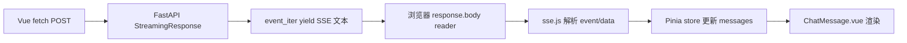

### 3.15 WebSocket 方案是什么

WebSocket 是一种浏览器和服务器之间的双向长连接协议。连接建立后，客户端和服务端都可以随时发送消息。

WebSocket 的典型连接过程是：

```text
浏览器 HTTP 请求
  -> 请求升级协议 Upgrade: websocket
  -> 服务端接受升级
  -> 双方进入 WebSocket 双向通信
```

WebSocket 的核心特点：

| 特点 | 说明 |
| --- | --- |
| 双向通信 | 客户端和服务端可以在同一条连接上互相发送消息 |
| 长连接 | 建立后持续存在，适合频繁实时交互 |
| 低延迟 | 比反复 HTTP 请求更适合高频消息 |
| 协议更复杂 | 需要处理连接生命周期、心跳、重连、断线、并发房间等问题 |
| 部署要求更高 | 反向代理、负载均衡、超时策略需要额外配置 |

WebSocket 更适合这些场景：

- 实时聊天系统；
- 多人协作编辑；
- 在线游戏；
- 实时语音/消息控制；
- 前端需要随时向后端发送取消、暂停、继续、调整参数等控制命令；
- 一个连接中有多路双向事件。

如果 MY-AICODING 使用 WebSocket，可能会变成下面这种结构：

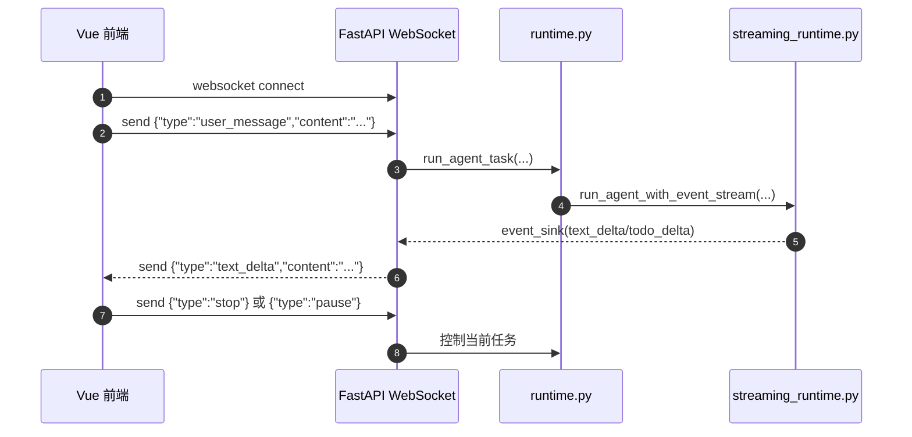

可以看到，WebSocket 能做更多控制，但也要求后端维护更多连接状态。

### 3.16 SSE 和 WebSocket 对比

两者都能实现“实时更新页面”，但适用场景不同。

| 对比项 | SSE | WebSocket |
| --- | --- | --- |
| 通信方向 | 服务端 -> 客户端单向推送 | 客户端 <-> 服务端双向通信 |
| 底层协议 | HTTP 文本流 | WebSocket 协议，需要 HTTP Upgrade |
| 浏览器支持 | 原生 `EventSource` 支持 GET；POST SSE 可用 `fetch` 流读取 | 原生 `WebSocket` 对象 |
| 请求体支持 | 原生 EventSource 不支持 POST；fetch POST SSE 支持请求体 | 建连后可随时发送任意消息 |
| 实现复杂度 | 相对简单 | 较复杂 |
| 代理兼容 | 通常更容易 | 需要代理支持 Upgrade 和长连接 |
| 断线重连 | EventSource 自带部分重连；fetch POST 需要自己处理 | 需要自己处理 |
| 消息格式 | 文本事件，适合 JSON | 文本或二进制都可以 |
| 适合 Agent token 输出 | 很适合 | 也适合，但有些偏重 |
| 适合实时协作/双向控制 | 一般 | 很适合 |
| 当前项目适配成本 | 低 | 中到高 |

从 Agent 产品角度看，可以这样判断：

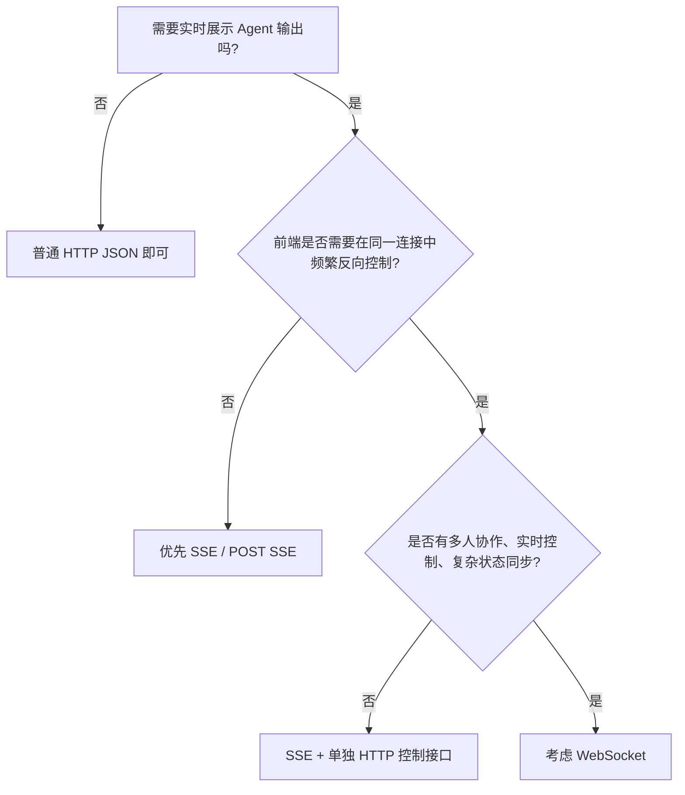

### 3.17 当前项目为什么选择 POST SSE

MY-AICODING 当前选择 POST SSE，主要原因是它的通信模型更简单：

1. 用户发起一轮任务；
2. 后端运行 Agent；
3. 后端持续把任务计划、AI 文本、完成状态推给前端；
4. 当前轮结束，连接关闭。

这正好是单向流式输出模型。

当前项目暂时不需要 WebSocket 的原因：

| 需求 | 当前是否需要 | 说明 |
| --- | --- | --- |
| 模型 token 实时输出 | 需要 | SSE 能很好满足 |
| `write_todos` 实时展示 | 需要 | SSE 能很好满足 |
| 用户在同一连接中继续发多条消息 | 不需要 | 每轮用户输入单独发起一次 POST SSE |
| 暂停/继续 Agent | 暂不需要 | 当前只有停止按钮，可通过 AbortController 中断 HTTP 流 |
| 多人协作 | 不需要 | 当前是单用户本地课程项目 |
| 高频双向控制 | 不需要 | Agent 控制逻辑在 runtime 层完成 |

因此当前项目的合理选择是：

> 当前轮 Agent 输出使用 POST SSE；历史恢复使用 checkpoint；业务状态使用 Store；如果未来需要多人协作、实时暂停/恢复、多个控制通道，再考虑 WebSocket。

如果将来升级到 WebSocket，建议不是直接替换全部 SSE，而是先评估是否真的需要双向控制。很多 Agent 产品可以采用混合方案：

| 功能 | 推荐协议 |
| --- | --- |
| 提交用户任务 | HTTP POST |
| 流式返回 Agent 输出 | SSE |
| 停止任务 | HTTP DELETE/POST cancel 或 AbortController |
| 实时控制、协作、多人状态 | WebSocket |

也就是说，WebSocket 不是 SSE 的高级替代品，而是解决另一类问题的协议。

---

## 4. runtime.py 的调度职责

`agent/core/runtime.py` 是整个 Agent 项目的运行调度中心。它不负责解析 token，也不直接实现工具，它主要负责决定“本轮任务应该怎么跑”。

### 4.1 runtime.py 的职责边界

| 职责 | 是否属于 runtime.py |
| --- | --- |
| 判断任务类型 | 是 |
| 判断是否需要先生成技术方案 | 是 |
| 判断用户是否确认上一轮方案 | 是 |
| 创建 thread/run 业务记录 | 是 |
| 构建 Agent 配置 | 间接，通过 `server.py` |
| 解析 DeepAgents V3 事件 | 否，交给 `streaming_runtime.py` |
| 维护 checkpoint | 否，交给 LangGraph checkpointer |
| 更新仓库记忆 | 是，coding 成功后基于最终回答更新 |
| 前端渲染 | 否 |

### 4.2 run_agent_task 总入口

核心函数：

```python
def run_agent_task(*, repo_url: str, prompt: str, thread_id: str | None = None, event_sink=None)
```

这个函数处理一轮用户输入。它的决策顺序可以理解成：

1. 是否是工作区查询任务。
2. 是否是 git pull 任务。
3. 调用 `classify_task_kind(prompt)` 做第一层意图分类。
4. 如果是 coding 需求但没有确认方案，先转 planning。
5. 如果用户输入“确认/开始实施”，从 checkpoint 找上一轮可确认方案。
6. 如果是方案修订，基于上一版方案重新生成完整新版方案。
7. 其它任务进入通用 Agent 执行分支。

### 4.3 runtime 调度流程图

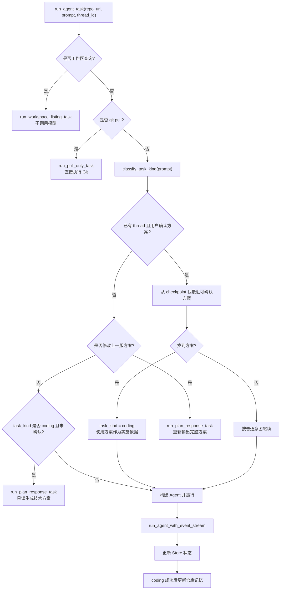

### 4.4 “先方案，再实施”的确定性控制

项目中不是单靠 Prompt 要求模型“先给方案”，而是在 runtime 层做确定性控制：

```python
if task_kind == "coding" and approved_plan_text is None:
    return run_plan_response_task(...)
```

这意味着：

- 用户第一次提出写代码需求，后端一定先进入 planning。
- planning 阶段只能读取、分析、输出方案，不能改文件、不能提交、不能创建 PR。
- 用户确认后，runtime 从 checkpoint 找上一轮方案，再切换为 coding。
- coding 任务会把上一轮方案作为实施依据传给 Agent。

这是企业 Agent 项目里常见的“人类确认门禁”：权限控制不只靠 Prompt，还要靠调度层。

### 4.5 `runtime.py`、`server.py`、`streaming_runtime.py` 三者关系

这一组三个文件最容易混淆。可以先记住一句话：

> `runtime.py` 决定本轮任务怎么跑，`server.py` 负责把 DeepAgent 组装出来，`streaming_runtime.py` 负责真正驱动 Agent 运行并解析流式事件。

也就是说，它们不是平级重复关系，而是一个调用链：

```text
FastAPI Dashboard API
  -> runtime.py
      -> server.py
          -> create_deep_agent(...)
      -> streaming_runtime.py
          -> agent.stream_events(version="v3")
          -> event_sink(...)
  -> FastAPI SSE
  -> Vue 前端
```

#### 4.5.1 三个文件的职责对比

| 文件 | 角色 | 主要负责 | 不负责 |
| --- | --- | --- | --- |
| `agent/core/runtime.py` | 运行调度层 | 判断任务类型、决定 planning/coding/review/qa 流程、创建 run 记录、更新任务状态、确认方案后切换 coding、任务成功后更新仓库记忆 | 不直接写 `create_deep_agent` 的完整参数，不解析 DeepAgents raw event，不直接渲染前端 |
| `agent/server.py` | Agent 工厂层 | 根据 `thread_id`、`task_kind`、`repo_url` 创建 DeepAgent，注入模型、工具、子 Agent、middleware、skills、backend、permissions、checkpoint、store | 不决定用户输入属于什么任务，不消费 SSE，不更新任务完成状态 |
| `agent/core/streaming_runtime.py` | Agent 执行与事件适配层 | 调用 `agent.stream_events(version="v3")`，解析 assistant token、`write_todos`、subagent 事件，把它们转换成 `message_start`、`text_delta`、`todo_delta` 等前端事件 | 不判断是否需要先出方案，不创建 Agent，不直接操作 FastAPI 响应 |

#### 4.5.2 为什么不是一个文件全部做完

如果把三件事都写在一个文件里，代码会变成：

- 一边判断用户意图；
- 一边组装 DeepAgent；
- 一边解析 V3 raw event；
- 一边更新 Store；
- 一边往前端推 SSE。

这会导致调度逻辑、Agent 能力配置、事件协议适配混在一起，后续改任何一层都容易影响其它层。当前项目把它们拆开，是为了让每层职责稳定：

| 变化场景 | 应该主要改哪里 |
| --- | --- |
| 新增任务类型，例如 `review`、`sync`、`inspect` | `runtime.py` |
| 新增工具、子 Agent、middleware、skill、权限规则 | `server.py` |
| DeepAgents V3 事件字段变化，或者前端需要新的流式事件 | `streaming_runtime.py` |
| 前端 SSE 事件格式变化 | `dashboard_routes.py` 和 `ui/src/stores/agent.js` |

#### 4.5.3 一轮普通 Agent 任务的真实调用顺序

下面这张图只画后端核心三个文件，不画前端和数据库，便于理解主干：

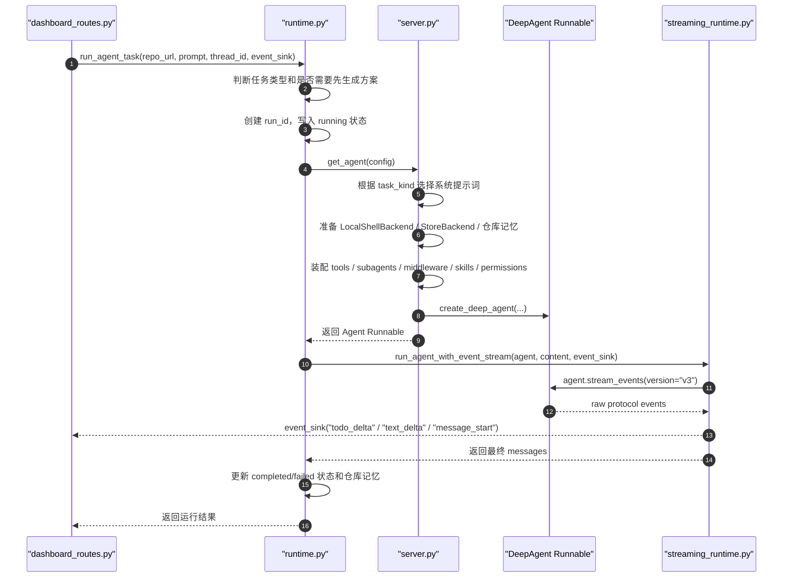

#### 4.5.4 以“生成技术方案”为例

当用户输入一个写代码需求时，例如“给用户增加注册功能”，后端不会马上进入 coding，而是这样走：

1. `dashboard_routes.py` 收到 POST SSE 请求。
2. `dashboard_routes.py` 先把用户输入通过 `user_message` 推给前端。
3. `dashboard_routes.py` 在线程中调用 `runtime.py` 的 `run_agent_task()`。
4. `runtime.py` 通过 `classify_task_kind()` 判断这是 coding 倾向任务。
5. `runtime.py` 发现还没有确认过方案，于是转入 `run_plan_response_task()`。
6. `runtime.py` 调用 `server.py` 的 `get_agent()`，要求创建一个 `task_kind="planning"` 的 Agent。
7. `server.py` 创建 DeepAgent，但系统提示词和权限都会偏只读方案生成。
8. `runtime.py` 把 Agent 交给 `streaming_runtime.py`。
9. `streaming_runtime.py` 调用 `agent.stream_events(version="v3")`。
10. `streaming_runtime.py` 把模型输出的方案正文转成 `text_delta`，把 `write_todos` 转成 `todo_delta`。
11. `dashboard_routes.py` 把这些事件原样通过 SSE 发给前端。
12. 前端持续追加任务计划和方案正文。
13. 方案完成后，`runtime.py` 标记任务 completed，等待用户确认。

这里的重点是：**planning 也是一个 Agent 运行，只是 runtime.py 决定它必须用 planning 模式，server.py 按 planning 模式组装 Agent，streaming_runtime.py 只负责把它的输出流式推给前端。**

#### 4.5.5 以“确认实施”为例

当用户继续输入“确认实施”时，流程会变成：

1. `dashboard_routes.py` 仍然收到 POST SSE 请求，并先推送用户本轮输入。
2. `runtime.py` 判断这是确认类输入。
3. `runtime.py` 从 checkpoint 里找到最近一条可确认的技术方案。
4. `runtime.py` 把 `task_kind` 切换成 `coding`。
5. `runtime.py` 调用 `server.py` 创建 coding 模式的 Agent。
6. `server.py` 注入 coding 系统提示词、可写项目目录权限、Gitee 工具、skills 和 middleware。
7. `runtime.py` 调用 `streaming_runtime.py` 正式运行 Agent。
8. `streaming_runtime.py` 继续解析 `write_todos`、assistant 文本和工具事件。
9. coding 成功后，`runtime.py` 更新 PR、分支、任务状态，并基于最终回答更新仓库记忆。

这里的重点是：**确认实施不是 server.py 判断的，也不是 streaming_runtime.py 判断的，而是 runtime.py 判断的。server.py 只按 runtime 给出的 task_kind 创建 Agent。**

#### 4.5.6 以“代码审查”为例

当用户输入“审查这个 PR”时：

1. `runtime.py` 把任务识别成 `review`。
2. `runtime.py` 调用 `server.py` 创建 review 语义下的 Agent。
3. `server.py` 给主 Agent 配置 `code_reviewer` 子 Agent、reviewer 工具和 code-review skill。
4. Agent 运行时可以委派 `code_reviewer` 子 Agent。
5. `streaming_runtime.py` 不关心这是主 Agent 还是子 Agent 输出，它只解析 DeepAgents V3 事件。
6. reviewer 发现的问题通过 reviewer tools 写入 `review_findings`，审查报告正文作为 assistant 输出进入 checkpoint。

这里的重点是：**reviewer 子 Agent 的能力配置在 server.py，是否进入 review 流程由 runtime.py 决定，审查过程如何实时显示由 streaming_runtime.py 负责。**

#### 4.5.7 三个文件之间传递的关键对象

| 对象 | 从哪里来 | 传到哪里 | 作用 |
| --- | --- | --- | --- |
| `thread_id` | FastAPI / 前端当前会话 | `runtime.py`、`server.py`、`streaming_runtime.py`、checkpoint、Store | 串起同一会话的状态、历史、事件 |
| `task_kind` | `runtime.py` 分类或流程改写 | `server.py`、`streaming_runtime.py` | 决定系统提示词、运行保护、任务模式 |
| `repo_url` | 前端输入或历史 thread fallback | `runtime.py`、`server.py` | 定位 Gitee 仓库、初始化仓库记忆、准备工作区 |
| `agent` | `server.py` 创建 | `runtime.py` 再传给 `streaming_runtime.py` | 可运行的 DeepAgent Runnable |
| `event_sink` | `dashboard_routes.py` 创建 | `runtime.py`、`streaming_runtime.py` | 把运行过程事件送回 FastAPI SSE 队列 |
| `run_id` | `runtime.py` 创建 | `streaming_runtime.py`、Store、前端 message_id | 隔离同一 thread 下的多轮任务 |

#### 4.5.8 最容易误解的点

1. `server.py` 不等于服务入口  
   虽然名字叫 `server.py`，但在当前项目里它主要是 **Agent 工厂**。FastAPI 路由入口在 `agent/api/dashboard_routes.py`。

2. `runtime.py` 不直接跑 token 流  
   `runtime.py` 会调用 Agent，但不解析 `content-block-delta`。真正解析 DeepAgents V3 raw event 的是 `streaming_runtime.py`。

3. `streaming_runtime.py` 不决定任务策略  
   它不会判断“是否先出方案”“是否确认实施”“是否 review”。这些策略都在 `runtime.py`。

4. `create_deep_agent()` 在 `server.py` 里执行，但运行在 `streaming_runtime.py` 里触发  
   `server.py` 返回的是一个 Agent runnable。只有 `streaming_runtime.py` 调用 `agent.stream_events(...)` 时，模型和工具才真正开始运行。

5. Agent 每轮可以重新创建，但上下文不会丢  
   因为上下文绑定在 `thread_id` 对应的 checkpoint 和仓库记忆中，不绑定在 Python 里的 Agent 对象上。

---

## 5. Agent 工厂：server.py 如何创建 DeepAgent

`agent/server.py` 是 Agent 工厂层，核心函数是：

```python
def get_agent(config: RunnableConfig)
```

它根据 `thread_id`、`task_kind`、`repo_url` 创建 DeepAgent。

### 5.1 get_agent 构建步骤

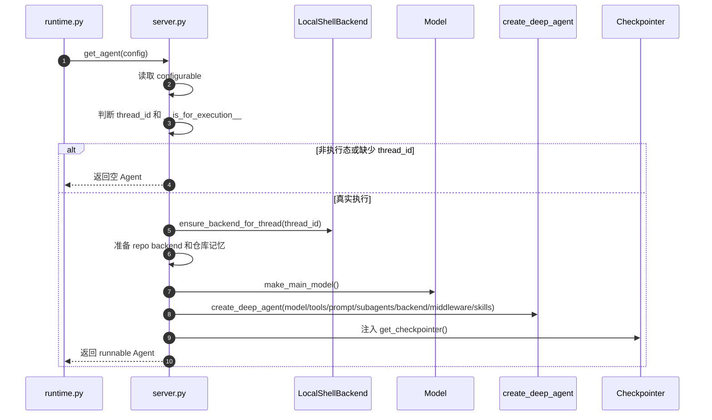

### 5.2 为什么每轮可以重新创建 Agent

MY-AICODING 和 LangGraph Server 部署方式不同：

- 当前项目由 FastAPI 自己管理请求。
- 每轮运行会通过 `get_agent(config)` 创建一个新的 Agent runnable。
- 但是状态不依赖这个 Python 对象本身，而是依赖：
  - `thread_id`
  - LangGraph checkpoint
  - StoreBackend 的仓库记忆
  - LocalShellBackend 的 thread 级缓存

因此“Agent 对象不是单例”不等于“每轮丢失上下文”。上下文由 checkpoint 和 StoreBackend 管，Agent runnable 只是本轮执行图。

### 5.3 create_deep_agent 的关键参数

| 参数 | 当前项目用法 | 讲课重点 |
| --- | --- | --- |
| `model` | `make_main_model()` 创建 deepseek-v4-pro | 主 Agent 推理模型 |
| `tools` | Gitee、web_search、reviewer_tools 等 | 主 Agent 可直接调用的动作 |
| `system_prompt` | `get_system_prompt(task_kind)` | 不同任务类型使用不同规则 |
| `subagents` | general-purpose、code_reviewer | 委派分析或审查 |
| `backend` | LocalShellBackend + StoreBackend 组合 | 文件、命令、记忆虚拟路径 |
| `permissions` | DeepAgents 文件权限 | 控制哪些目录可读写 |
| `middleware` | 上下文注入、消息清洗、工具异常、压缩、调用保护 | 企业项目稳定性关键 |
| `skills` | `["/skills/"]` | 让 Agent 加载工作区 skills |
| `memory` | 仓库记忆虚拟路径 | DeepAgents 原生记忆机制 |
| `checkpointer` | `get_checkpointer()` | 保存 thread state |
| `store` | `get_langgraph_store()` | StoreBackend 和 memory 使用 |

---

## 6. DeepAgents V3 流式输出解析

### 6.1 为什么需要 streaming_runtime.py

DeepAgents 的 `stream_events(version="v3")` 会返回比较底层的 raw protocol events。它包含：

- assistant 文本块开始和结束。
- assistant 文本 token delta。
- 工具调用 chunk。
- `write_todos` 参数增量。
- 子 Agent 生命周期。

这些事件不能直接给前端展示。`agent/core/streaming_runtime.py` 的作用就是把官方事件转换成项目自己的 SSE 事件。

### 6.2 调用入口

runtime.py 调用：

```python
result = run_agent_with_event_stream(
    agent=agent,
    thread_id=thread_id,
    run_id=run_id,
    content=content,
    task_kind=task_kind,
    event_sink=event_sink,
)
```

`run_agent_with_event_stream()` 内部执行：

```python
stream = agent.stream_events(
    {"messages": [{"role": "user", "content": content}]},
    version="v3",
    config={"configurable": {"thread_id": thread_id}},
)
```

### 6.3 V3 事件消费流程

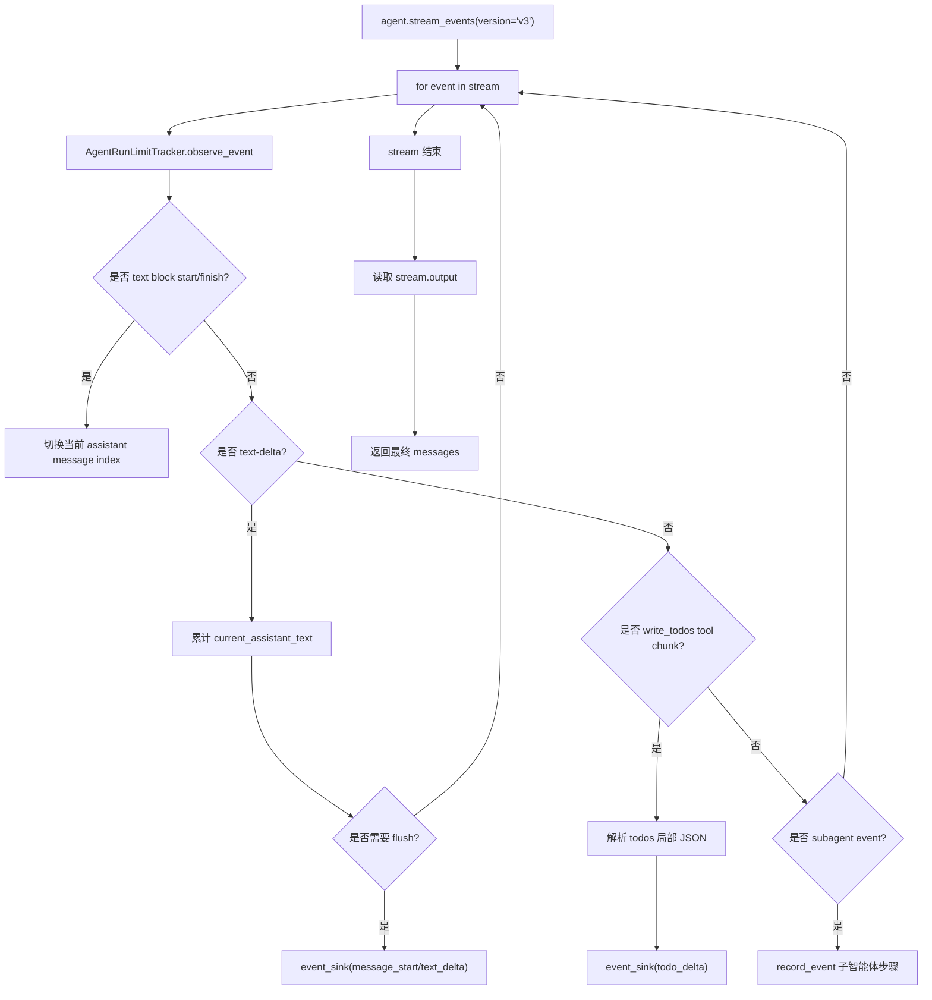

### 6.4 assistant 文本如何变成前端消息

关键函数：

```python
_record_assistant_stream_message(...)
```

它会产生两个前端事件：

1. `message_start`：保证前端有一个指定 `message_id` 的 AI 消息容器。
2. `text_delta`：把当前累计文本发给前端。

当前实现中，`text_delta` 的 `mode` 通常是 `replace`，原因是后端已经累计了一段完整文本。前端收到后直接替换当前文本块，避免 token 重复追加。

```python
event_sink(
    "text_delta",
    {
        "message_id": message_id,
        "content": text,
        "mode": "replace",
    },
)
```

### 6.5 为什么不是每个 token 都写一次

`_should_flush_stream_text()` 做了轻量合并：

- 第一段内容立即输出。
- 累计新增约 24 个字符再刷新。
- 遇到换行立即刷新。

这样可以兼顾实时性和 SQLite/浏览器压力。

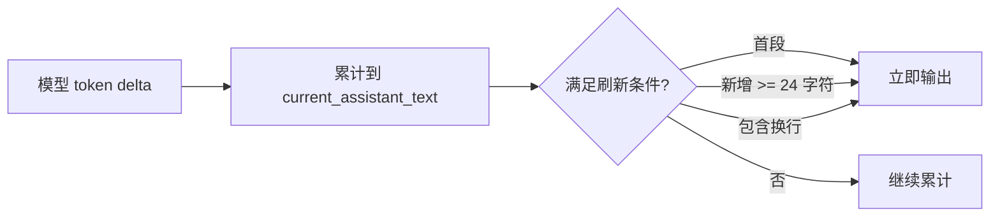

### 6.6 write_todos 如何流式展示

DeepAgents 的 `write_todos` 工具会把任务计划写成工具调用参数。V3 raw event 里，参数可能不是一次性完整 JSON，而是逐步增长的 JSON 字符串。

项目中使用两种方式兼容：

| 情况 | 处理函数 |
| --- | --- |
| 参数已经是 dict | `_extract_todos()` |
| 参数是逐步增长的字符串 | `_todos_from_args_text()` |

`_todos_from_args_text()` 会用保守正则提取已经闭合的 `content/status` 对象，让前端更早看到任务计划，而不是等完整 JSON 结束。

### 6.7 DeepAgents V3 event streaming 的框架视角

DeepAgents V3 event streaming 可以理解成：DeepAgents 在 LangGraph 运行图之上，提供了一套更适合 Agent 产品展示的流式事件接口。

传统流式输出通常只关注“模型正在吐 token”。但是 DeepAgents 的运行过程不只有模型文本，还包含：

- 主 Agent 的 assistant 文本。
- 工具调用的开始、参数增量、输出增量、结束状态。
- `write_todos` 这类特殊工具产生的任务计划。
- 子 Agent 的创建、运行、结束和输出。
- 图状态快照和最终输出。

因此，DeepAgents V3 event streaming 不是单纯的 token stream，而是一个“Agent 运行事件流”。当前项目正是基于这一点，把 DeepAgents 的底层事件转换成课程版前端可以理解的 SSE 事件。

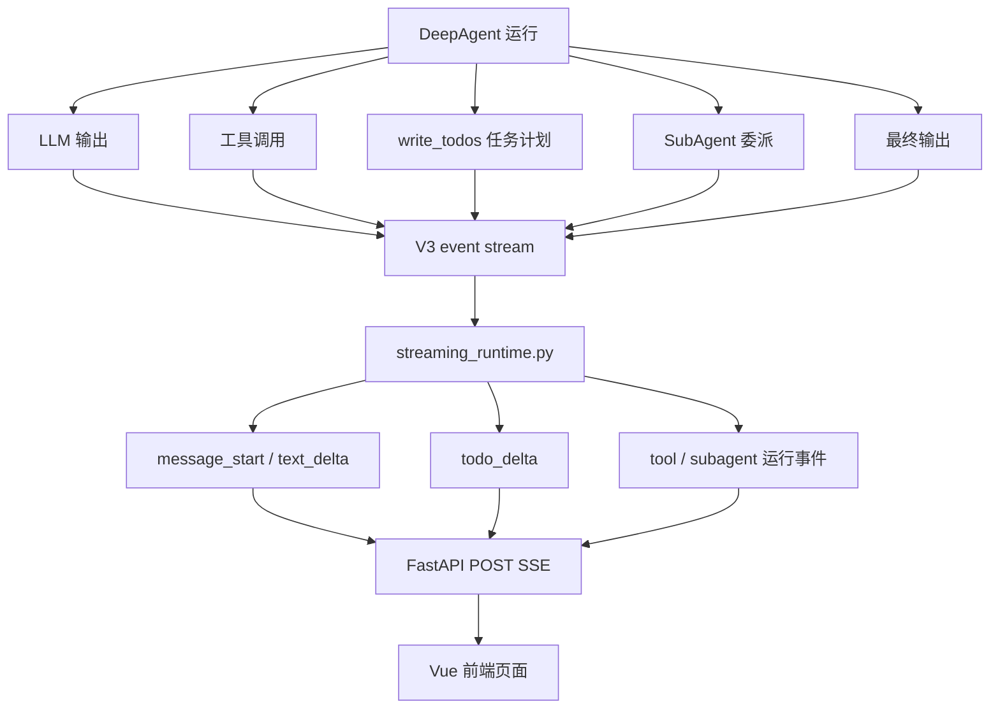

官方 V3 的核心调用形态是：

```python
stream = agent.stream_events(
    {"messages": [{"role": "user", "content": user_input}]},
    version="v3",
    config={"configurable": {"thread_id": thread_id}},
)
```

这里有三个关键点：

| 参数 | 作用 | 当前项目对应 |
| --- | --- | --- |
| `messages` | 本轮用户输入，作为 Agent 图的输入状态 | `content` 被包装成 `{"role": "user", "content": content}` |
| `version="v3"` | 启用新版事件协议，获得更完整的 Agent 运行事件 | `streaming_runtime.py` 固定使用 V3 |
| `thread_id` | 让 LangGraph checkpointer 识别同一会话 | 前端当前会话 ID / 后端 thread ID |

### 6.8 V3 typed projections：把同一条事件流拆成多个视角

DeepAgents V3 event streaming 暴露的不是单一列表，而是一组 typed projections。可以把它理解成：同一轮 Agent 运行，被框架整理成多个“观察视角”。

| Projection | 适合观察什么 | 典型用途 |
| --- | --- | --- |
| `stream.messages` | 顶层主 Agent 的 assistant 消息 | 展示主 Agent 的自然语言输出 |
| `stream.tool_calls` | 顶层主 Agent 调用的工具 | 展示工具卡片、工具参数、工具结果 |
| `stream.subagents` | DeepAgents 子 Agent 运行情况 | 展示 reviewer、general-purpose 等委派任务 |
| `subagent.messages` | 某个子 Agent 的 assistant 消息 | 展示子 Agent 的分析或审查文本 |
| `subagent.tool_calls` | 某个子 Agent 调用的工具 | 展示子 Agent 读取 diff、校验 findings 等动作 |
| `stream.values` | LangGraph 状态快照 | 调试图状态，不适合直接作为用户正文 |
| `stream.output` | 流结束后的最终结果 | 任务完成后读取最终 messages |

如果只做一个简单聊天页面，读取 `stream.messages` 可能就够了。但是 MY-AICODING 不是普通聊天，它需要同时展示：

- 任务计划列表。
- 技术方案或总结正文。
- 代码审查子 Agent 的运行过程。
- 工具是否正在执行。
- 最终结果和 PR 链接。

所以当前项目没有只依赖某一个 projection，而是进一步读取 raw protocol events，再统一转换成自己的前端事件。

#### 6.8.1 typed projections 和 raw protocol events 的关系

这两个概念不是互斥关系，也不是两套完全不同的流式系统。它们的关系可以这样理解：

> raw protocol events 是 DeepAgents / LangGraph 运行时吐出来的原始事件；typed projections 是框架在原始事件之上整理出来的“分类视图”。

换句话说：

- raw protocol events 更底层，信息更细，顺序更接近真实运行过程。
- typed projections 更上层，语义更清楚，用起来更简单。
- typed projections 通常可以看作对 raw events 的筛选、归类和包装。
- 如果项目只需要普通文本、工具结果、子 Agent 状态，用 typed projections 更省事。
- 如果项目要精确控制 token chunk、`write_todos` 参数增量、前端消息 ID、输出顺序，就更适合直接读 raw events。

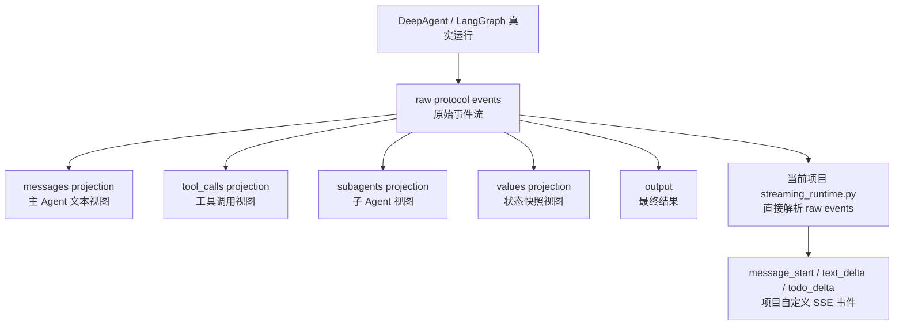

从这张图可以看出：typed projections 和 raw protocol events 的数据源是同一轮 Agent 运行。区别在于，typed projections 是官方帮你“整理好的视图”，raw protocol events 是你自己拿到底层事件后自行解释。

| 对比项 | typed projections | raw protocol events |
| --- | --- | --- |
| 抽象层级 | 高层 API | 底层协议事件 |
| 使用难度 | 低 | 高 |
| 字段语义 | 更稳定、更面向业务概念 | 更贴近运行协议，字段更细 |
| 事件粒度 | 通常较粗，按消息、工具、子 Agent 组织 | 更细，可以看到 content block、delta、tool args chunk |
| 输出顺序 | 不同 projection 需要 interleave 才能统一顺序 | 原始迭代天然接近事件到达顺序 |
| 适合场景 | 快速做 UI、调试工具/子 Agent 状态 | 精确控制前端流式展示和任务计划 |
| 当前项目定位 | 可作为参考视图 | 主链路采用 |

#### 6.8.2 用 typed projections 的伪代码

如果只想做一个简单的 Agent 运行页，可以直接消费 typed projections。代码会比较清晰：

```python
stream = agent.stream_events(
    {"messages": [{"role": "user", "content": user_input}]},
    version="v3",
)

# 读取主 Agent 的文本输出。
for message in stream.messages:
    ui.append_assistant_message(message.text)

# 读取主 Agent 工具调用。
for tool_call in stream.tool_calls:
    ui.show_tool_card(
        name=tool_call.tool_name,
        input=tool_call.input,
        completed=tool_call.completed,
        error=tool_call.error,
    )

# 读取子 Agent 的运行输出。
for subagent in stream.subagents:
    ui.show_subagent_status(
        name=subagent.name,
        status=subagent.status,
    )

    for sub_message in subagent.messages:
        ui.append_subagent_message(
            subagent_name=subagent.name,
            text=sub_message.text,
        )
```

这种写法的优点是直观。开发者不需要理解 `content-block-delta`、`namespace`、tool call chunk 这些细节。

但是它也有明显不足：如果 `write_todos` 的参数是逐步增长的 JSON 字符串，typed projections 可能更偏向“工具调用对象最终长什么样”，而不是“参数每次增长了什么”。任务计划可能不会足够早地出现在页面上。

#### 6.8.3 用 raw protocol events 的伪代码

当前项目采用的是更底层的写法：

```python
stream = agent.stream_events(
    {"messages": [{"role": "user", "content": user_input}]},
    version="v3",
)

for event in stream:
    # 1. assistant 文本块开始：前端先创建一个 AI 消息容器。
    if is_content_block_start(event):
        message_id = new_message_id()
        sse_send("message_start", {"message_id": message_id, "role": "assistant"})

    # 2. assistant 文本 token：前端立即更新正文。
    elif is_content_block_delta(event):
        text = extract_text_delta(event)
        sse_send("text_delta", {"message_id": message_id, "content": text})

    # 3. write_todos 工具参数 chunk：尽早解析任务计划。
    elif is_write_todos_args_chunk(event):
        todos = parse_partial_todos(event)
        sse_send("todo_delta", {"todos": todos})

    # 4. 子 Agent 事件：转成简短运行步骤。
    elif is_subagent_event(event):
        step = summarize_subagent_event(event)
        sse_send("run_event", step)

    # 5. 工具失败：转成可读错误。
    elif is_tool_error(event):
        error = extract_tool_error(event)
        sse_send("run_event", {"level": "error", "message": error})
```

这种写法更复杂，但它能解决当前项目最关键的几个问题：

| 项目需求 | typed projections 是否方便 | raw events 是否方便 |
| --- | --- | --- |
| assistant 内容按 chunk 实时输出 | 可以，但控制粒度有限 | 很方便 |
| `write_todos` 任务计划尽早出现 | 不稳定 | 很方便 |
| 多轮消息必须严格追加到当前 run 后面 | 需要额外封装 | 可用 `run_id/message_id` 明确绑定 |
| 子 Agent 过程要简洁展示 | 可以 | 可以，同时能按原始顺序展示 |
| 避免工具输出刷屏 | 需要过滤 projection | 可以在 raw event 阶段直接过滤 |

#### 6.8.4 一个具体例子：同一轮运行，两种消费方式看到什么

假设 Agent 做了下面几件事：

1. 输出：“我先分析项目结构。”
2. 调用 `write_todos`，生成 3 个任务。
3. 调用 `read_file` 读取 `main.py`。
4. 委派 `code_reviewer` 子 Agent。
5. 输出最终审查报告。

如果用 typed projections，开发者看到的是分类后的结果：

```python
stream.messages
# -> ["我先分析项目结构。", "最终审查报告..."]

stream.tool_calls
# -> [
#      ToolCall(name="write_todos", input={"todos": [...]}),
#      ToolCall(name="read_file", input={"path": "main.py"}),
#    ]

stream.subagents
# -> [
#      SubAgent(name="code_reviewer", status="completed", output="...")
#    ]
```

如果用 raw protocol events，开发者看到的是更细的到达过程：

```python
for event in stream:
    # messages: content-block-start
    # messages: content-block-delta -> "我"
    # messages: content-block-delta -> "先"
    # messages: content-block-delta -> "分析"
    # messages: tool_call_chunk -> write_todos args: '{"todos": [{"content": "读取'
    # messages: tool_call_chunk -> write_todos args: '项目结构", "status": "in_progress"}'
    # tool_calls: write_todos completed
    # tool_calls: read_file started
    # tool_calls: read_file completed
    # subagents: code_reviewer started
    # subagents: code_reviewer completed
    # messages: content-block-delta -> "最终审查报告..."
```

这个例子说明：

- typed projections 更像“整理好的结果列表”。
- raw events 更像“实时发生的流水账”。
- 前端要做教学演示、任务计划实时追踪、token 级输出，就应该优先考虑 raw events。
- 后端业务逻辑只想知道最终有哪些消息、工具、子 Agent，则 typed projections 更简单。

#### 6.8.5 当前项目为什么不用纯 typed projections

MY-AICODING 曾经出现过几类前端问题：

- 用户输入被覆盖。
- 新一轮输出插入到上一轮中间。
- 任务计划出现太晚或消失。
- assistant 文本不是按 chunk 流式输出。
- 子 Agent 审查过程结束后正文丢失。

这些问题不是 typed projections 本身有问题，而是当前项目对“实时展示顺序”和“前端消息绑定”要求更高。为了解决这些问题，当前项目需要在后端自己掌控：

| 后端需要掌控的内容 | 为什么重要 |
| --- | --- |
| `run_id` | 区分同一 thread 下不同轮任务 |
| `message_id` | 区分同一轮中的不同 assistant 消息 |
| `text_delta` flush 时机 | 控制前端实时输出和性能 |
| `write_todos` 局部解析 | 保证任务计划尽早出现 |
| 工具输出过滤 | 避免页面刷屏 |
| checkpoint 和实时事件边界 | 避免历史恢复覆盖当前轮 |

所以，当前项目不是否定 typed projections，而是选择了更适合课程版 AI Coding 前端的方案：

> 用 DeepAgents V3 raw protocol events 做实时主链路；typed projections 作为理解框架和调试子 Agent / 工具调用的辅助视角。

### 6.9 messages projection：为什么它不够覆盖当前项目

`stream.messages` 适合消费主 Agent 的 assistant 文本。它的优点是简单、语义清晰，前端只需要关心文本即可。

伪代码如下：

```python
stream = agent.stream_events(input_data, version="v3")

for message in stream.messages:
    render_assistant_message(message)
```

但是它有几个限制：

| 限制 | 对当前项目的影响 |
| --- | --- |
| 主要关注 assistant 消息 | 无法稳定拿到 `write_todos` 的参数增量 |
| 对工具参数 chunk 不够直接 | 任务计划可能要等工具调用完整结束后才能出现 |
| 主 Agent 和子 Agent 的消息需要分开处理 | reviewer 子 Agent 的输出容易和主 Agent 输出混在一起 |
| 不保证满足“按原始到达顺序展示所有事件”的需求 | 前端可能无法精确还原 Agent 执行过程 |

因此，当前项目仍然保留“展示非空 AIMessage”的能力，但底层主要以 raw event 作为实时事件来源。

### 6.10 tool_calls projection：工具调用不是普通文本

DeepAgents V3 会把工具调用也作为一类可观察对象。工具调用通常包含这些信息：

| 字段 | 含义 |
| --- | --- |
| `tool_name` | 工具名称，例如 `write_todos`、`read_file`、`get_gitee_pull_request_context` |
| `input` | 工具最终输入参数 |
| `completed` | 工具是否执行完成 |
| `error` | 工具是否失败以及失败原因 |
| `output_deltas` | 工具输出的增量片段 |
| `output` | 工具最终输出 |

对普通工具来说，前端没有必要把所有参数和输出全部展示出来。否则页面会很吵，用户会看到大量文件内容、命令输出、JSON 参数。

当前项目的处理策略是：

| 工具类型 | 展示策略 |
| --- | --- |
| `write_todos` | 特殊处理，转换成任务计划卡片 |
| Gitee 上下文工具 | 通常只展示简短步骤，详细结果留给 Agent 总结 |
| 文件读取工具 | 不直接展示完整文件内容 |
| 命令执行工具 | 只在最终总结里展示关键测试结果 |
| reviewer findings 工具 | 结构化保存，最终生成中文审查报告 |

这也是为什么 `streaming_runtime.py` 会重点解析 `write_todos`，而不是把所有 tool call 都无差别推给前端。

### 6.11 subagents projection：为什么它适合代码审查子 Agent

DeepAgents V3 在 LangGraph 的基础上额外提供了 `subagents` projection。它描述的是“产品语义上的子 Agent 委派”，不是底层图结构。

一个子 Agent 事件通常可以观察到：

| 字段 | 含义 |
| --- | --- |
| `name` | 子 Agent 名称，例如 `code_reviewer` |
| `path` | 子 Agent 在运行树中的路径 |
| `status` | 子 Agent 当前状态 |
| `messages` | 子 Agent 自己的 assistant 输出 |
| `tool_calls` | 子 Agent 自己调用的工具 |
| `subagents` | 子 Agent 继续委派的下级 Agent |
| `output` | 子 Agent 最终输出 |

这对当前项目的代码审查功能很重要。因为审查任务并不是主 Agent 简单读几个文件就结束，而是有清晰的委派边界：

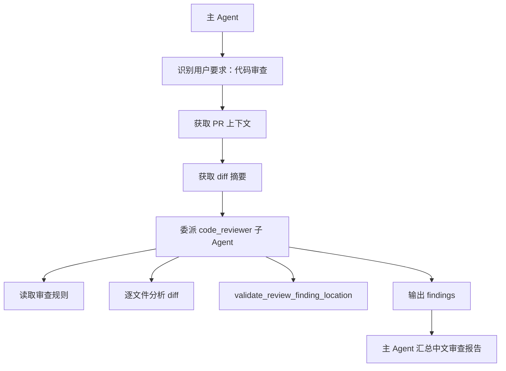

这里应该让前端看到“审查正在进行”，但不应该把底层 LangGraph 子图状态直接暴露给用户。所以：

- 面向用户展示时，优先理解 `subagents`。
- 调试框架执行时，才需要看 `subgraphs` 或 `values`。

简单说：`subagents` 是业务视角，`subgraphs` 是框架执行视角。课程讲解代码审查子 Agent 时，重点讲 `subagents` 更合适。

### 6.12 raw protocol events：为什么当前项目选择解析它

官方 typed projections 更容易使用，但当前项目最终选择解析 raw protocol events，原因是前端有更强的实时性要求。

raw event 可以理解成框架最原始的事件协议。它通常包含：

```python
{
    "method": "messages",
    "params": {
        "namespace": [],
        "data": {
            "event": "content-block-delta",
            "data": {
                "delta": {
                    "type": "text",
                    "text": "正在分析项目结构..."
                }
            }
        },
    },
}
```

当前项目主要关心几类 raw event：

| raw event | 当前项目处理 |
| --- | --- |
| `method=messages` + `content-block-start` | 创建或切换当前 assistant message |
| `method=messages` + `content-block-delta` | 提取文本 delta，流式输出到前端 |
| `method=messages` + `content-block-finish` | flush 当前 assistant 文本 |
| `method=messages` 里的 tool call chunk | 提取 `write_todos` 参数增量 |
| `method=tool_calls` | 兼容部分版本的工具调用事件 |
| `method=subagents` | 记录子 Agent 运行步骤 |

`streaming_runtime.py` 里对应的辅助函数包括：

| 函数 | 作用 |
| --- | --- |
| `_event_payloads()` | 从 raw event 中取 `params.data` |
| `_text_delta_from_event()` | 提取 assistant 文本 token |
| `_text_block_marker_from_event()` | 识别文本块开始和结束 |
| `_tool_chunk_from_message_event()` | 从 message event 中提取工具调用 chunk |
| `_tool_call_from_raw()` | 兼容 `method=tool_calls` |
| `_subagent_from_raw()` | 兼容 `method=subagents` |
| `_todos_from_args_text()` | 从不完整 JSON 参数中尽早提取任务计划 |

这样做的好处是：**任务计划和 assistant 文本都可以真正按 chunk 实时进入前端**，不必等到 Agent 最终完成后再一次性展示。

### 6.13 interleave：为什么多类事件需要按到达顺序消费

DeepAgents V3 支持把多个 projection 交错消费，例如同时消费 `messages` 和 `subagents`。这类能力解决的是一个真实问题：Agent 运行不是线性的。

比如一轮代码审查可能出现这样的顺序：

```text
主 Agent 输出：我先获取 PR 上下文
工具调用：get_gitee_pull_request_context
主 Agent 输出：现在委派 code_reviewer
子 Agent 输出：我开始检查 main.py
工具调用：validate_review_finding_location
子 Agent 输出：发现 3 个问题
主 Agent 输出：汇总审查报告
```

如果前端分别消费 `messages`、`tool_calls`、`subagents`，再自己拼接，顺序就可能错乱。官方提供的 `interleave(...)` 可以按到达顺序消费多个 projection。

当前项目为了同时处理：

- assistant token chunk；
- `write_todos` 参数 chunk；
- 子 Agent 事件；
- 工具生命周期事件；

最终选择直接消费 raw event。这个做法和 `interleave(...)` 的目标是一致的：都希望按照真实到达顺序处理事件。区别是 raw event 更底层，项目可以拿到更细的 chunk。

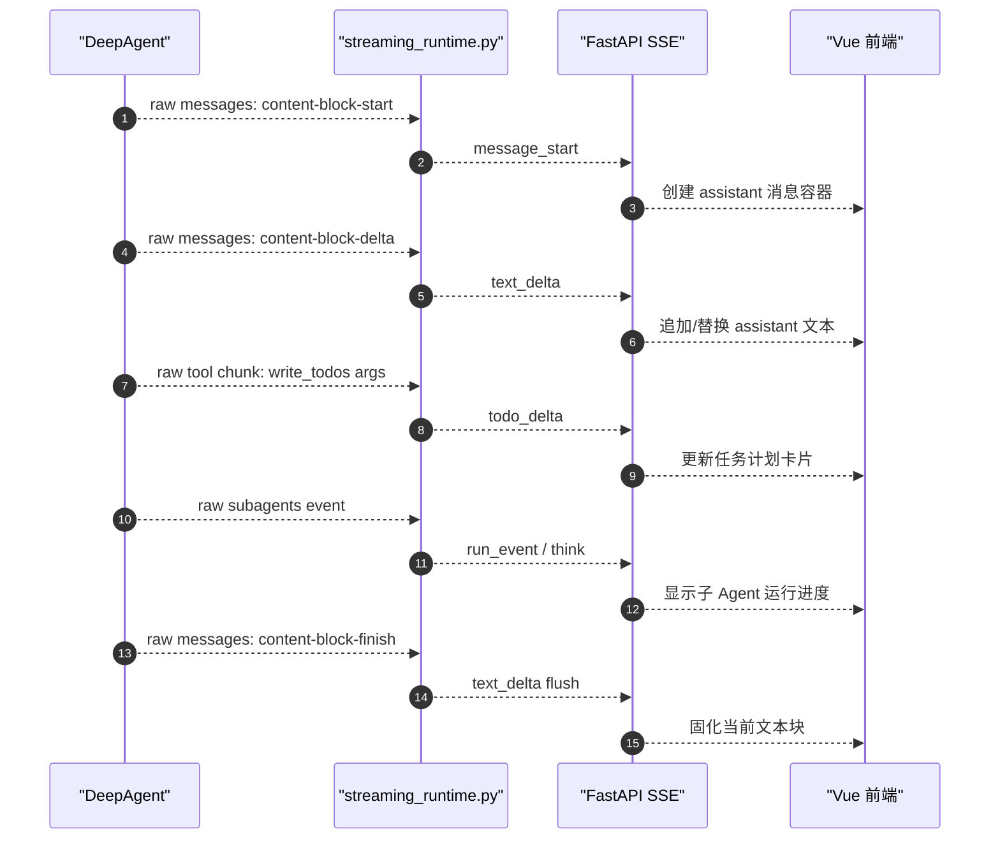

### 6.14 V3 与旧式流式方案的区别

在 LangChain / LangGraph / DeepAgents 生态里，常见流式方案包括：

| 方案 | 特点 | 当前项目是否采用 |
| --- | --- | --- |
| 只流式输出模型 token | 简单，但看不到工具和子 Agent | 不采用 |
| LangGraph `stream_mode="values"` | 适合看状态快照，但前端正文容易重复或过大 | 不作为前端主链路 |
| LangGraph `stream_mode="updates"` | 适合看节点更新，但不是产品级展示协议 | 不作为前端主链路 |
| DeepAgents typed projections | 语义清晰，适合快速开发 | 部分参考 |
| DeepAgents raw protocol events + V3 | 信息最完整，能处理 token、工具、子 Agent、任务计划 | 当前项目采用 |

当前项目采用 V3 raw event 的原因可以总结成一句话：

> MY-AICODING 需要的是“Agent 执行过程展示”，不是单纯“模型回答展示”。

### 6.15 当前项目对 DeepAgents V3 事件的业务映射

后端不会把官方事件原样发给前端，而是转换成更稳定的业务事件。这样做有两个好处：

1. 前端不需要知道 DeepAgents 版本细节。
2. 如果后续 DeepAgents raw event 字段变化，只需要改 `streaming_runtime.py`。

| DeepAgents V3 来源 | 后端转换 | 前端效果 |
| --- | --- | --- |
| assistant text block start | `message_start` | 创建 AI 消息 |
| assistant text delta | `text_delta` | 流式展示正文 |
| assistant text block finish | 最后一次 `text_delta` | 固化正文 |
| `write_todos` tool args chunk | `todo_delta` | 更新任务计划列表 |
| subagent lifecycle | `run_event` / 简短步骤 | 展示子 Agent 正在工作 |
| tool completed / error | 工具步骤事件或最终总结 | 展示关键执行状态 |
| stream output | 返回最终 messages | 供 runtime 后处理和 checkpoint 保存 |

这层映射是当前项目稳定性的关键。它把“框架事件协议”和“前端展示协议”隔离开了。

### 6.16 为什么最终历史仍然从 checkpoint 恢复

V3 event streaming 解决的是“当前轮实时输出”。它不是历史存储系统。

当前项目的数据边界是：

| 数据 | 来源 | 用途 |
| --- | --- | --- |
| 当前轮实时输出 | DeepAgents V3 event stream | SSE 推给前端 |
| 会话历史正文 | LangGraph checkpoint | 打开历史会话时恢复 |
| 仓库记忆、review findings 等业务数据 | Store / StoreBackend | Agent 后续推理和业务查询 |

所以，DeepAgents V3 event streaming 和 checkpoint 不是互相替代关系：

- V3 event streaming 负责“现在正在发生什么”。
- checkpoint 负责“这轮结束后历史里应该看到什么”。
- Store 负责“业务数据和长期记忆是什么”。

这个边界非常重要。之前前端混乱的问题，本质上就是实时事件、历史快照、Store 兜底数据边界不清。现在的正确原则是：

> 前端正文展示只认实时 SSE 和 checkpoint；Store 不参与网页正文恢复。

### 6.17 课堂讲解时可以这样解释 V3 event streaming

面向初级程序员讲课时，不建议一开始就讲 raw event 字段。可以按下面顺序讲：

1. 普通聊天只需要 token stream。
2. Agent 产品不只需要 token，还需要工具、任务计划、子 Agent。
3. DeepAgents V3 把这些都放进 event stream。
4. 官方提供 typed projections，方便按 `messages`、`tool_calls`、`subagents` 分别观察。
5. 当前项目为了更强的实时性，直接解析 raw protocol event。
6. 后端把 raw event 转成稳定的 SSE 业务事件。
7. 前端只消费自己的业务事件，不直接依赖 DeepAgents 内部结构。

可以用下面这段伪代码串起来：

```python
def run_agent_with_event_stream(agent, content, event_sink):
    # 1. 启动 DeepAgents V3 事件流
    stream = agent.stream_events(
        {"messages": [{"role": "user", "content": content}]},
        version="v3",
    )

    # 2. 按真实到达顺序消费 raw event
    for event in stream:
        if is_assistant_text_delta(event):
            event_sink("text_delta", extract_text(event))

        elif is_write_todos_chunk(event):
            event_sink("todo_delta", extract_todos(event))

        elif is_subagent_event(event):
            event_sink("run_event", summarize_subagent(event))

    # 3. 流结束后读取最终输出，交给 runtime 后处理
    return stream.output
```

这段伪代码表达的是当前项目的核心思想：**DeepAgents 负责产生事件，`streaming_runtime.py` 负责翻译事件，FastAPI 负责传输事件，Vue 前端负责展示事件。**

---

## 7. 前端如何消费 SSE

### 7.1 sse.js 的职责

`ui/src/api/sse.js` 使用浏览器 `fetch` 发起 POST 请求，然后读取 `response.body.getReader()`。

基本流程：

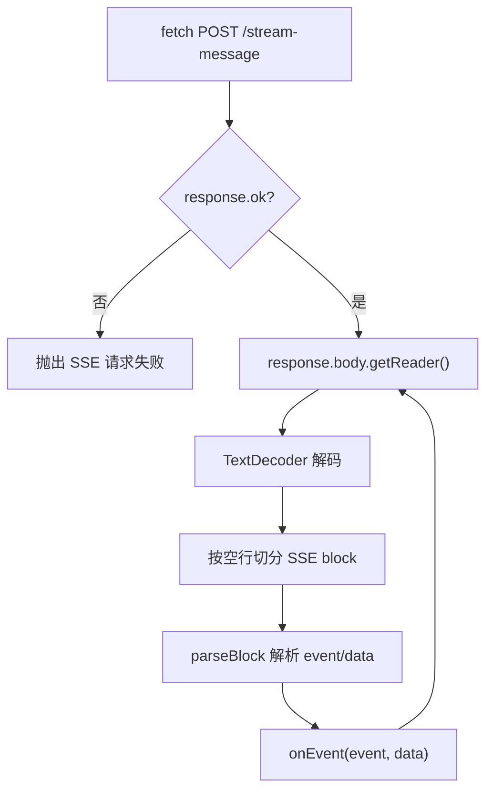

### 7.2 Pinia store 如何处理事件

主要文件：

- `ui/src/stores/agent.js`

核心函数：

- `submit(content)`
- `consumeMessageStream(threadId, prompt)`
- `ensureAgentMessage(messages, messageId)`
- `upsertTodoMessage(messages, messageId, todos)`
- `appendTextDelta(messages, messageId, content, mode)`

事件处理表：

| SSE 事件 | 前端动作 |
| --- | --- |
| `thread_snapshot` | 设置或合并当前 thread 元信息 |
| `user_message` | 把本地临时 user 消息稳定化 |
| `todo_delta` | 用 `message_id` 更新任务计划消息 |
| `message_start` | 确保存在 agent 消息 |
| `text_delta` | append/replace 文本 |
| `thread_done` | 合并分支、PR、状态 |
| `error` | 设置错误消息 |
| `done` | 标记本轮结束 |

### 7.3 为什么使用 message_id

流式输出最大的问题是“如何知道这个 chunk 属于哪条消息”。当前项目要求后端每个流式事件都带 `message_id`。

前端逻辑：

```js
function ensureAgentMessage(messages, messageId) {
  let message = messages.find((item) => item.id === messageId)
  if (!message) {
    message = { id: messageId, author: 'agent', chunks: [] }
    messages.push(message)
  }
  return message
}
```

这样：

- 同一个 `message_id` 的多次 `text_delta` 会更新同一条 AI 消息。
- 不同 `message_id` 会成为不同 AI 消息。
- `todo_delta` 有自己的 `message_id`，不会覆盖正文消息。
- 多轮对话有不同 `run_id`，不会互相覆盖。

---

## 8. checkpoint 历史恢复

### 8.1 打开历史会话时读取哪里

点击左侧会话时，前端调用：

```text
GET /dashboard/api/threads/{thread_id}
```

后端：

```python
dashboard_thread_detail(thread_id)
```

最终会调用：

```python
_thread_payload(task)
```

其中 messages 来自：

```python
visible_checkpoint_messages(thread_id)
```

也就是说：**历史正文只从 checkpoint 读取，不从 Store 读取**。

### 8.2 checkpoint_history.py 做了哪些清洗

`agent/core/checkpoint_history.py` 主要处理：

1. 使用 `get_delta_channel_history(config, channels=["messages"])` 读取 messages 历史。
2. 把 LangChain message content 转成纯文本。
3. 从 runtime 包装后的 HumanMessage 中提取用户原始输入。
4. 过滤没有展示价值的短 assistant 过程消息。
5. 按 author + content 去重。
6. 生成稳定的历史 message id。

### 8.3 为什么要从 HumanMessage 里提取“用户可见输入”

后端真正发给 Agent 的内容不是用户原始文本，而是包含内部执行上下文：

```text
用户可见输入：
确认实施

内部执行上下文：
Gitee 仓库地址：...
任务类型：coding
用户任务：...
```

如果历史恢复直接展示完整 HumanMessage，用户会看到大量内部提示词。  
如果只展示 `用户任务：` 后面的内容，“确认实施”这类 follow-up 又会丢失。

所以 runtime 写入 `用户可见输入：`，checkpoint_history 优先提取它。

---

## 9. Store 的职责边界

### 9.1 Store 保存什么

`agent/store/sqlite_store.py` 当前主要表：

| 表 | 作用 |
| --- | --- |
| `threads` | 会话摘要、仓库、分支、PR、最新状态 |
| `runs` | 每次运行记录、开始结束时间、错误 |
| `run_events` | 工具步骤和任务计划等业务事件 |
| `review_findings` | 代码审查结构化发现 |
| `settings` | 少量配置 |
| `thread_messages` | 旧表，当前前端正文不依赖 |
| `thread_plans` | 旧表，当前方案正文不依赖 |

### 9.2 Store 不做什么

Store 不再用于：

- 恢复聊天正文。
- 拼接 assistant 回答。
- 回填用户输入。
- 作为实时流的主要来源。

这些都交给：

- 当前轮：POST SSE。
- 历史轮：checkpoint。

### 9.3 什么时候 Store 和 checkpoint 同时参与

删除会话时两者都要删除：

```python
def delete_task(thread_id: str) -> bool:
    deleted = get_store().delete_thread(thread_id)
    if not deleted:
        return False
    get_checkpointer().delete_thread(thread_id)
    return True
```

原因是：

- Store 删除后，侧边栏和业务摘要消失。
- checkpoint 删除后，Agent 历史上下文消失。
- 两者都删，才是真正删除一个会话。

---

## 10. 任务计划的完整链路

任务计划来自 DeepAgents 原生 `write_todos`。

### 10.1 后端捕获

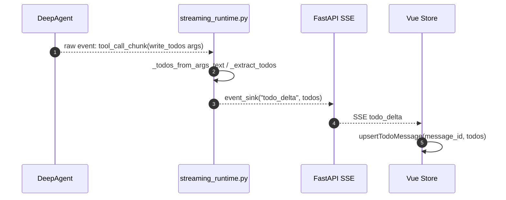

### 10.2 前端展示

前端会把任务计划作为一个普通 agent message 的 `todo` chunk：

```js
message.chunks = [
  { kind: 'text', text: '任务计划' },
  { kind: 'todo', todos },
]
```

`ChatMessage.vue` 负责把 `todo` chunk 渲染成任务计划卡片，`TodoPlan.vue` 展示每一项的状态。

---

## 11. AI 文本流式输出链路

### 11.1 运行过程中的 AIMessage 是否展示

当前项目允许展示所有非空 assistant 文本，不只展示最后一条 assistant。

原因：

- 技术方案需要边生成边展示。
- 代码审查报告需要边分析边展示。
- coding 过程中的中间总结可以帮助用户知道 Agent 进行到哪里。

但工具消息不直接展示大段内容，避免页面被命令输出和文件内容刷屏。

### 11.2 文本 chunk 的数据流

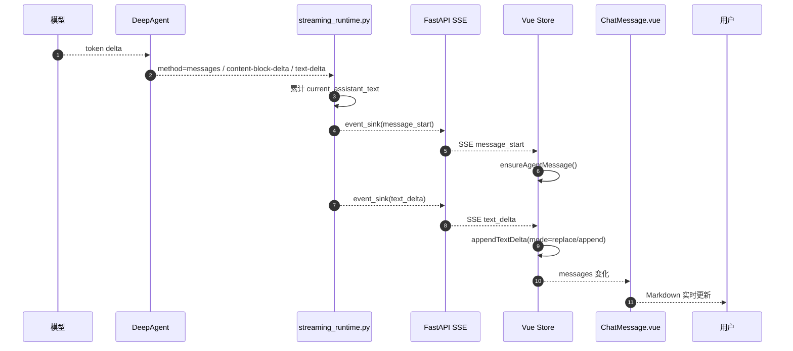

### 11.3 Markdown 渲染

前端 `ChatMessage.vue` 使用：

- `markdown-it` 渲染 Markdown。
- `dompurify` 做 HTML 清洗。

这样模型输出的表格、标题、列表、代码块可以正常显示，同时降低 XSS 风险。

---

## 12. 运行保护与异常处理

### 12.1 模型/工具调用保护

当前项目有两层保护：

| 保护 | 位置 | 作用 |
| --- | --- | --- |
| `ModelCallLimitMiddleware` | `agent/server.py` | 限制模型调用次数 |
| `AgentRunLimitTracker` | `agent/core/streaming_runtime.py` | 消费事件时跟踪运行保护阈值 |

如果触发保护，`streaming_runtime.py` 会抛出 `AgentRunLimitExceeded`，runtime 捕获后把任务标记为 failed，并通过 SSE 返回 error。

### 12.2 异常路径为什么要关闭 run_events

runtime 的异常路径会执行：

```python
store.finish_open_run_events(thread_id, status="error")
store.update_thread_status(thread_id, "failed")
record_event(thread_id, "failed", "任务失败", status="error", detail=...)
store.record_run(..., status="failed", finished=True)
```

这样可以避免前端一直显示“运行中”。

### 12.3 SSE 错误返回

`_post_streaming_response()` 的 worker 捕获异常后会发送：

```text
event: error
data: {"message": "...", "detail": "..."}

event: thread_done
data: {...}

event: done
data: {}
```

前端收到 `error` 后设置 `agent.error`，收到 `done` 后结束 streaming。

---

## 13. 仓库记忆和运行调度的关系

仓库记忆不是前端正文数据源，它只服务 Agent 上下文。

### 13.1 初始化

`server.py` 在创建 Agent 时，根据 `repo_url`：

1. 解析 Gitee owner/repo。
2. 计算记忆 namespace。
3. 如果 `/memories/<owner>/<repo>.md` 不存在，则初始化模板。
4. 通过 `StoreBackend` 把 `/memories/` 虚拟路径挂载到 LangGraph Store。

### 13.2 注入

Agent 创建时：

- `memory=memory_paths`
- `backend=CompositeBackend`
- `ContextInjectionMiddleware`

共同保证 Agent 可以读取当前仓库记忆。

### 13.3 更新

coding 任务成功后，runtime 会提取最终 assistant 总结：

```python
final_answer = _extract_final_assistant_text(messages)
```

然后调用：

```python
update_repo_memory_from_text(...)
```

只把稳定结论写回仓库记忆，不写每个 token、不写临时任务计划。

---

## 14. 当前运行链路的关键设计取舍

### 14.1 为什么 Store 不参与前端正文

因为 Store 和 checkpoint 同时参与正文时，会出现：

- 用户输入被旧快照覆盖。
- 第二轮任务计划插到第一轮回答前面。
- 旧 assistant 消息覆盖新 assistant 消息。
- 页面刷新前后顺序不一致。

当前项目的取舍是：

| 场景 | 数据源 |
| --- | --- |
| 当前轮实时展示 | POST SSE |
| 刷新后历史正文 | checkpoint |
| 侧边栏任务列表 | Store.threads |
| PR 地址/分支状态 | Store.threads |
| reviewer findings | Store.review_findings |
| 删除会话 | Store + checkpoint |

### 14.2 为什么不直接让前端连 DeepAgents

因为当前项目不是 `langgraph dev`，Agent 运行在 FastAPI 中：

- 前端只知道 FastAPI Dashboard API。
- FastAPI 负责 Gitee 仓库规范化、任务创建、权限控制、异常处理。
- DeepAgents 的 raw event 协议由后端适配成更稳定的业务事件。

这样前端不需要了解 DeepAgents 内部协议变化。

### 14.3 为什么需要 run_id

同一个 thread 可以有多轮运行：

- 第一轮 planning。
- 第二轮 coding。
- 第三轮 review。
- 第四轮继续修改。

如果事件 id 或 message_id 不带 run_id，多轮事件容易写到同一条消息里。  
当前项目中，任务计划和流式 assistant message 都会把 `run_id` 纳入 id：

```text
{thread_id}-live-plan-{run_id}
{thread_id}-live-assistant-{run_id}-{index}
```

这样多轮之间天然隔离。

---

## 15. 课堂讲解建议顺序

建议按以下顺序讲：

| 顺序 | 主题 | 文件 |
| --- | --- | --- |
| 1 | 前端提交和 POST SSE | `ui/src/stores/agent.js`、`ui/src/api/sse.js` |
| 2 | FastAPI Dashboard 接口 | `agent/api/dashboard_routes.py` |
| 3 | runtime 调度流程 | `agent/core/runtime.py` |
| 4 | Agent 工厂和 DeepAgent 组装 | `agent/server.py` |
| 5 | V3 event streaming 解析 | `agent/core/streaming_runtime.py` |
| 6 | checkpoint 历史恢复 | `agent/core/checkpoint_history.py` |
| 7 | Store 业务数据边界 | `agent/store/sqlite_store.py` |
| 8 | 多轮对话、方案确认和 coding 执行 | `runtime.py` + 前端消息处理 |

---

## 16. 最小伪代码串联

### 16.1 前端

```js
submit(prompt) {
  messages.push(user(prompt))
  fetch('/dashboard/api/threads/{id}/stream-message', { method: 'POST' })
    .readSSE((event, data) => {
      if (event === 'user_message') stabilizeUserMessage(data)
      if (event === 'todo_delta') upsertTodo(data)
      if (event === 'message_start') ensureAgentMessage(data.message_id)
      if (event === 'text_delta') appendText(data.message_id, data.content)
      if (event === 'thread_done') mergeThreadMeta(data)
      if (event === 'done') streaming = false
    })
}
```

### 16.2 FastAPI

```python
async def event_iter():
    yield user_message
    start_worker_thread(run_agent_task)
    while True:
        event = await queue.get()
        yield sse(event)
        if event.name == "done":
            break
```

### 16.3 runtime

```python
def run_agent_task(repo_url, prompt, thread_id, event_sink):
    task_kind = classify_task_kind(prompt)

    if task_kind == "coding" and not confirmed_plan:
        return run_plan_response_task(...)

    agent = get_agent(config)
    result = run_agent_with_event_stream(
        agent=agent,
        content=wrapped_user_content,
        event_sink=event_sink,
    )
    update_status_and_memory(result)
```

### 16.4 streaming_runtime

```python
for event in agent.stream_events(version="v3"):
    if is_text_delta(event):
        accumulate_text()
        if should_flush():
            event_sink("text_delta", ...)
    elif is_write_todos(event):
        event_sink("todo_delta", ...)
    elif is_subagent(event):
        record_event(...)
```

---

## 17. 常见问题

### 17.1 为什么用户输入有时要本地追加，又要等后端 user_message？

本地追加解决“点击发送后立即可见”。  
后端 `user_message` 解决“后端确认 thread_id/message_id 后稳定化”。

前端收到 `user_message` 后，会查找同内容的本地临时消息，把临时 id 替换成后端 id，而不是重复追加。

### 17.2 为什么打开历史会话时不显示 run_events？

run_events 是运行过程事件，不是稳定对话正文。  
历史正文应该来自 checkpoint。  
如果把 run_events 也拼到历史正文里，页面会出现大量工具步骤，甚至和 checkpoint 正文重复。

### 17.3 为什么技术方案需要先 planning？

这是安全设计。编码任务先输出方案，让用户确认后再修改代码。  
这个逻辑在 runtime 层实现，比只写 Prompt 更可靠。

### 17.4 为什么 coding 任务确认后还要读取 checkpoint？

用户输入“确认”本身不是完整开发需求。  
runtime 必须从 checkpoint 找到上一轮完整方案，把它作为 coding 的实施依据。

### 17.5 为什么 reviewer findings 放 Store，不放 checkpoint？

findings 是结构化业务数据，后续可能用于：

- 生成报告。
- 发布 PR 评论。
- 统计风险数量。
- 让主 Agent 按 finding 生成修复方案。

因此它适合放 Store。  
审查报告正文则作为 assistant message 进入 checkpoint，用于页面历史展示。

---

## 18. 当前方案的优点和限制

### 18.1 优点

- 当前轮消息严格按 SSE 顺序追加，减少覆盖和乱序。
- 页面刷新后从 checkpoint 恢复，不依赖 Store 拼正文。
- Store 只保存业务摘要，职责清晰。
- DeepAgents V3 token 可以实时展示。
- `write_todos` 可以流式展示任务计划。
- `run_id` 隔离多轮任务，避免 plan/coding/review 互相覆盖。
- FastAPI 统一封装 DeepAgents，不要求前端理解 LangGraph 内部协议。

### 18.2 限制

- V3 raw event 仍带 experimental 特征，不同 DeepAgents 小版本字段可能变化。
- 当前事件合并策略不是逐 token 展示，而是按字符数和换行做轻量刷新。
- checkpoint_history 对 assistant 短过程消息做了过滤，历史中不会保留所有中间过程。
- Store 中旧表 `thread_messages`、`thread_plans` 仍存在，但当前前端正文不依赖它们。

---

## 19. 一句话总结

MY-AICODING 当前运行链路可以概括为：

> 前端用 POST SSE 发送用户输入并实时追加页面消息；FastAPI 调用 runtime 做任务调度；runtime 通过 server.py 创建 DeepAgent；streaming_runtime.py 消费 DeepAgents V3 raw events，把 assistant 文本和 write_todos 转成前端可理解的 SSE；checkpoint 保存历史正文，Store 只保存业务摘要和结构化数据。
